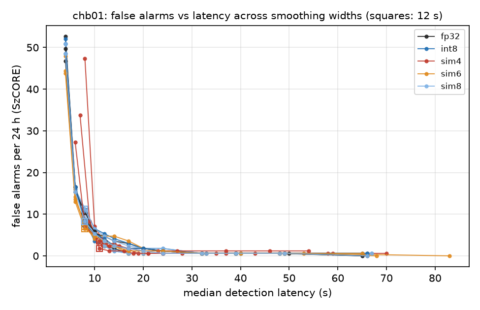

# Stage 0 summary

## chb01

Folds per seed: {0: 7, 1: 7, 2: 7}

- Early stopping fired in 21/21 jobs; ONNX FP32 export max |logit diff| 4.77e-06
- Seed 0: FP32 test specificity pooled over all held-out hours 0.9932 (within 0.995 +/- 0.005)
- Seed 1: FP32 test specificity pooled over all held-out hours 0.9933 (within 0.995 +/- 0.005)
- Seed 2: FP32 test specificity pooled over all held-out hours 0.9934 (within 0.995 +/- 0.005)
- Diagnostic: single folds outside the band 7/21 [(0, 0, 0.9891), (2, 0, 0.9815), (2, 1, 0.9831), (6, 1, 0.9857), (0, 2, 0.9887), (2, 2, 0.9864), (6, 2, 0.9892)]

### FP32 against EpiDeNet's reporting (4 s windows, pooled over folds)

| seed | FP/h raw | FP/h 3-window vote | window sens (vote) | spec (vote) | seizures detected |
|---|---|---|---|---|---|
| 0 | 5.89 | 2.22 | 0.822 | 0.9975 | 7/7 |
| 1 | 5.84 | 2.52 | 0.937 | 0.9972 | 7/7 |
| 2 | 5.47 | 2.22 | 0.780 | 0.9975 | 6/7 |

EpiDeNet (all CHB-MIT, LOOCV, 5 seeds): 4.29 raw, 2.24 with vote, 165/181 seizures.

### Two meanings of "FP/h" for the same FP32 model (pooled over folds)

| seed | window FP/h (3-window vote, 4 s grid) | SzCORE false alarms/h (12 s smoothing) | ratio |
|---|---|---|---|
| 0 | 2.22 | 0.37 | 6.0 |
| 1 | 2.52 | 0.44 | 5.7 |
| 2 | 2.22 | 0.35 | 6.4 |

Window FP/h is (1 - specificity) x windows per hour, so it depends on window length and hop, and one long artifact counts many times; SzCORE merges detections within 90 s into one alarm.

### Operating point (default smoothing, own threshold) and excess latency

| seed | model | FA/24h at 12 s | median latency at 12 s | detected | excess latency at FP32's FA (s) | smoothing there (s) | ΔFA/24h at FP32's latency |
|---|---|---|---|---|---|---|---|
| 0 | fp32 | 8.9 | 8.0 | 7/7 | 0.0 | 12.0 | 0.0 |
| 0 | int8 | 8.3 | 8.0 | 7/7 | -0.1 | 11.7 | -0.6 |
| 0 | sim8 | 8.9 | 8.0 | 7/7 | 0.0 | 12.0 | 0.0 |
| 0 | sim6 | 7.1 | 8.0 | 7/7 | -0.5 | 11.0 | -1.8 |
| 0 | sim4 | 3.0 | 12.0 | 6/7 | 1.9 | 7.8 | 38.5 |
| 1 | fp32 | 10.7 | 8.0 | 7/7 | 0.0 | 12.0 | 0.0 |
| 1 | int8 | 11.2 | 8.0 | 7/7 | 0.2 | 12.5 | 0.6 |
| 1 | sim8 | 11.2 | 8.0 | 7/7 | 0.2 | 12.5 | 0.6 |
| 1 | sim6 | 7.7 | 8.0 | 7/7 | -1.0 | 10.0 | -3.0 |
| 1 | sim4 | 1.8 | 11.0 | 7/7 | 0.8 | 7.6 | 10.4 |
| 2 | fp32 | 8.3 | 8.0 | 6/7 | 0.0 | 12.0 | 0.0 |
| 2 | int8 | 7.7 | 8.0 | 7/7 | -0.1 | 11.7 | -0.6 |
| 2 | sim8 | 8.3 | 8.0 | 7/7 | 0.0 | 12.0 | 0.0 |
| 2 | sim6 | 6.5 | 8.0 | 7/7 | -0.5 | 10.9 | -1.8 |
| 2 | sim4 | 3.6 | 11.0 | 7/7 | -0.1 | 7.8 | -1.2 |

FP32 seed-to-seed excess latency (the null), all ordered seed pairs: ['0.7', '-0.1', '-0.5', '-0.6', '0.4', '0.9']
95% band: (-0.5576923076923075, 0.8611111111111114)

## Pooled across patients (pre-registered: median over seeds per patient, then over patients)

- FP32 seed-pair null: n = 6 ordered pairs, 95% band (-0.56, 0.86)
- int8: pooled excess latency -0.13 s over 1 patient(s) [inside the null band, below the 2 s floor]; patient-seed values 3, censored 0, undefined 0
- sim8: pooled excess latency 0.00 s over 1 patient(s) [inside the null band, below the 2 s floor]; patient-seed values 3, censored 0, undefined 0
- sim6: pooled excess latency -0.55 s over 1 patient(s) [inside the null band, below the 2 s floor]; patient-seed values 3, censored 0, undefined 0
- sim4: pooled excess latency 0.81 s over 1 patient(s) [inside the null band, below the 2 s floor]; patient-seed values 3, censored 0, undefined 0

**Stage 0 kill rule** (stop if INT8, sim6 and sim4 are each inside the band or below 2 s): STOP (pilot: one patient decides nothing)
