# Stage 0 summary

## chb01

Folds per seed: {0: 7, 1: 7, 2: 7}

- Early stopping fired in 21/21 jobs; ONNX FP32 export max |logit diff| 4.77e-06
- Seed 0: FP32 test specificity pooled over all held-out hours 0.9932 (within 0.995 +/- 0.005)
- Seed 1: FP32 test specificity pooled over all held-out hours 0.9933 (within 0.995 +/- 0.005)
- Seed 2: FP32 test specificity pooled over all held-out hours 0.9934 (within 0.995 +/- 0.005)
- Diagnostic: single folds outside the band 7/21 [(0, 0, 0.9891), (2, 0, 0.9815), (2, 1, 0.9831), (6, 1, 0.9857), (0, 2, 0.9887), (2, 2, 0.9864), (6, 2, 0.9892)]

### FP32 against EpiDeNet's reporting (4 s windows, pooled over folds)

| seed | FP/h raw | FP/h 3-window vote | window sens (vote) | spec (vote) | seizures detected |
|---|---|---|---|---|---|
| 0 | 5.89 | 2.22 | 0.822 | 0.9975 | 7/7 |
| 1 | 5.84 | 2.52 | 0.937 | 0.9972 | 7/7 |
| 2 | 5.47 | 2.22 | 0.780 | 0.9975 | 6/7 |

EpiDeNet (all CHB-MIT, LOOCV, 5 seeds): 4.29 raw, 2.24 with vote, 165/181 seizures.

### Two meanings of "FP/h" for the same FP32 model (pooled over folds)

| seed | window FP/h (3-window vote, 4 s grid) | SzCORE false alarms/h (12 s smoothing) | ratio |
|---|---|---|---|
| 0 | 2.22 | 0.37 | 6.0 |
| 1 | 2.52 | 0.44 | 5.7 |
| 2 | 2.22 | 0.35 | 6.4 |

Window FP/h is (1 - specificity) x windows per hour, so it depends on window length and hop, and one long artifact counts many times; SzCORE merges detections within 90 s into one alarm.

### Operating point (default smoothing, own threshold) and excess latency

| seed | model | FA/24h at 12 s | median latency at 12 s | detected | excess latency at FP32's FA (s) | smoothing there (s) | ΔFA/24h at FP32's latency |
|---|---|---|---|---|---|---|---|
| 0 | fp32 | 8.9 | 8.0 | 7/7 | 0.0 | 12.0 | 0.0 |
| 0 | int8 | 8.3 | 8.0 | 7/7 | -0.2 | 11.7 | -0.6 |
| 0 | sim8 | 8.9 | 8.0 | 7/7 | 0.0 | 12.0 | 0.0 |
| 0 | sim6 | 7.1 | 8.0 | 7/7 | -0.5 | 11.0 | -1.8 |
| 0 | sim4 | 3.0 | 12.0 | 6/7 | 1.9 | 7.8 | 38.5 |
| 0 | qat8 | 8.3 | 8.0 | 6/7 | -0.2 | 11.7 | -0.6 |
| 1 | fp32 | 10.7 | 8.0 | 7/7 | 0.0 | 12.0 | 0.0 |
| 1 | int8 | 11.2 | 8.0 | 7/7 | 0.2 | 12.4 | 0.6 |
| 1 | sim8 | 11.2 | 8.0 | 7/7 | 0.2 | 12.5 | 0.6 |
| 1 | sim6 | 7.7 | 8.0 | 7/7 | -1.0 | 10.0 | -3.0 |
| 1 | sim4 | 1.2 | 11.0 | 7/7 | 0.8 | 7.6 | 10.4 |
| 1 | qat8 | 8.9 | 8.0 | 7/7 | -0.5 | 11.0 | -1.8 |
| 2 | fp32 | 8.3 | 8.0 | 6/7 | 0.0 | 12.0 | 0.0 |
| 2 | int8 | 7.7 | 8.0 | 7/7 | -0.1 | 11.7 | -0.6 |
| 2 | sim8 | 8.3 | 8.0 | 7/7 | 0.0 | 12.0 | 0.0 |
| 2 | sim6 | 6.5 | 8.0 | 7/7 | -0.5 | 10.9 | -1.8 |
| 2 | sim4 | 3.6 | 11.0 | 7/7 | -0.1 | 7.8 | -1.2 |
| 2 | qat8 | 6.5 | 8.0 | 6/7 | -0.4 | 11.2 | -1.8 |

FP32 seed-to-seed excess latency (the null), all ordered seed pairs: ['0.7', '-0.1', '-0.5', '-0.6', '0.4', '0.9']
95% band: (-0.5576923076923075, 0.8611111111111114)

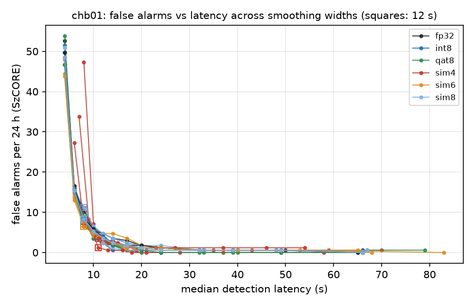

## chb02

Folds per seed: {0: 3, 1: 3, 2: 3}

- Early stopping fired in 6/9 jobs; ONNX FP32 export max |logit diff| 2.86e-06
- Seed 0: FP32 test specificity pooled over all held-out hours 0.9871 (OUTSIDE 0.995 +/- 0.005)
- Seed 1: FP32 test specificity pooled over all held-out hours 0.9936 (within 0.995 +/- 0.005)
- Seed 2: FP32 test specificity pooled over all held-out hours 0.9851 (OUTSIDE 0.995 +/- 0.005)
- Diagnostic: single folds outside the band 3/9 [(0, 0, 0.9673), (0, 1, 0.9838), (0, 2, 0.9589)]

### FP32 against EpiDeNet's reporting (4 s windows, pooled over folds)

| seed | FP/h raw | FP/h 3-window vote | window sens (vote) | spec (vote) | seizures detected |
|---|---|---|---|---|---|
| 0 | 11.29 | 7.43 | 0.935 | 0.9919 | 3/3 |
| 1 | 6.04 | 2.44 | 0.824 | 0.9973 | 3/3 |
| 2 | 13.38 | 9.30 | 0.936 | 0.9899 | 3/3 |

EpiDeNet (all CHB-MIT, LOOCV, 5 seeds): 4.29 raw, 2.24 with vote, 165/181 seizures.

### Two meanings of "FP/h" for the same FP32 model (pooled over folds)

| seed | window FP/h (3-window vote, 4 s grid) | SzCORE false alarms/h (12 s smoothing) | ratio |
|---|---|---|---|
| 0 | 7.43 | 0.77 | 9.7 |
| 1 | 2.44 | 0.31 | 7.8 |
| 2 | 9.30 | 0.74 | 12.6 |

Window FP/h is (1 - specificity) x windows per hour, so it depends on window length and hop, and one long artifact counts many times; SzCORE merges detections within 90 s into one alarm.

### Operating point (default smoothing, own threshold) and excess latency

| seed | model | FA/24h at 12 s | median latency at 12 s | detected | excess latency at FP32's FA (s) | smoothing there (s) | ΔFA/24h at FP32's latency |
|---|---|---|---|---|---|---|---|
| 0 | fp32 | 18.4 | 4.0 | 3/3 | 0.0 | 12.0 | 0.0 |
| 0 | int8 | 19.1 | 10.0 | 3/3 | 6.4 | 12.8 | 11.2 |
| 0 | sim8 | 18.4 | 10.0 | 3/3 | 6.0 | 12.0 | 11.1 |
| 0 | sim6 | 21.8 | 12.0 | 3/3 | 8.7 | 13.4 | 25.0 |
| 0 | sim4 | 2.7 | 10.0 | 3/3 | 3.8 | 7.7 | n/a |
| 0 | qat8 | 20.4 | 3.0 | 3/3 | 2.7 | 13.5 | 1.5 |
| 1 | fp32 | 7.5 | 12.0 | 3/3 | 0.0 | 12.0 | 0.0 |
| 1 | int8 | 6.1 | 11.0 | 3/3 | -1.4 | 11.2 | -2.4 |
| 1 | sim8 | 6.1 | 11.0 | 3/3 | -1.4 | 11.2 | -2.4 |
| 1 | sim6 | 6.8 | 13.0 | 3/3 | 0.9 | 11.8 | 4.8 |
| 1 | sim4 | 2.0 | 45.0 | 2/3 | -1.2 | 7.8 | -0.8 |
| 1 | qat8 | 2.7 | 12.0 | 3/3 | -2.3 | 7.4 | -4.8 |
| 2 | fp32 | 17.7 | 3.0 | 3/3 | 0.0 | 12.0 | 0.0 |
| 2 | int8 | 18.4 | 9.0 | 3/3 | 6.4 | 12.8 | 4.8 |
| 2 | sim8 | 18.4 | 9.0 | 3/3 | 6.7 | 13.3 | 4.4 |
| 2 | sim6 | 15.7 | 9.0 | 3/3 | 3.2 | 11.0 | 2.4 |
| 2 | sim4 | 4.8 | 15.0 | 2/3 | 9.4 | 6.8 | n/a |
| 2 | qat8 | 16.3 | 4.0 | 3/3 | -0.0 | 11.3 | -0.0 |

FP32 seed-to-seed excess latency (the null), all ordered seed pairs: ['5.7', '-1.4', '11.0', '21.0', '2.5', '6.8']
95% band: (-0.9270833333333341, 19.75)

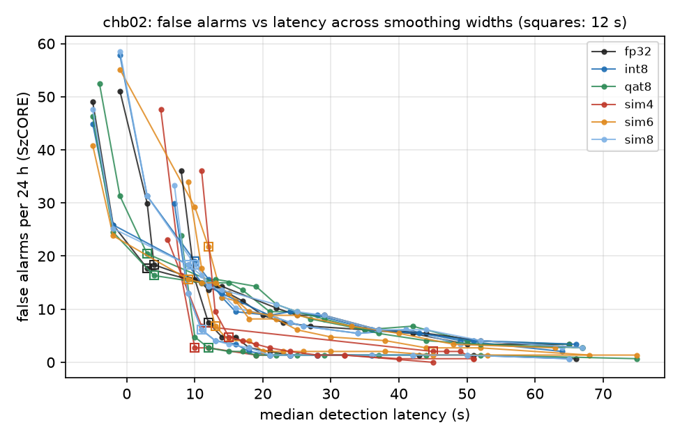

## chb03

Folds per seed: {0: 7, 1: 7, 2: 7}

- Early stopping fired in 21/21 jobs; ONNX FP32 export max |logit diff| 4.29e-06
- Seed 0: FP32 test specificity pooled over all held-out hours 0.9887 (OUTSIDE 0.995 +/- 0.005)
- Seed 1: FP32 test specificity pooled over all held-out hours 0.9885 (OUTSIDE 0.995 +/- 0.005)
- Seed 2: FP32 test specificity pooled over all held-out hours 0.9909 (within 0.995 +/- 0.005)
- Diagnostic: single folds outside the band 14/21 [(1, 0, 0.9876), (2, 0, 0.969), (3, 0, 1.0), (4, 0, 0.9861), (6, 0, 0.9865), (1, 1, 0.9882), (2, 1, 0.9692), (3, 1, 1.0), (4, 1, 0.9858), (6, 1, 0.9831), (2, 2, 0.9795), (3, 2, 1.0), (4, 2, 0.9874), (6, 2, 0.9833)]

### FP32 against EpiDeNet's reporting (4 s windows, pooled over folds)

| seed | FP/h raw | FP/h 3-window vote | window sens (vote) | spec (vote) | seizures detected |
|---|---|---|---|---|---|
| 0 | 10.58 | 6.84 | 0.839 | 0.9925 | 7/7 |
| 1 | 10.47 | 6.45 | 0.841 | 0.9929 | 7/7 |
| 2 | 8.18 | 4.29 | 0.931 | 0.9951 | 7/7 |

EpiDeNet (all CHB-MIT, LOOCV, 5 seeds): 4.29 raw, 2.24 with vote, 165/181 seizures.

### Two meanings of "FP/h" for the same FP32 model (pooled over folds)

| seed | window FP/h (3-window vote, 4 s grid) | SzCORE false alarms/h (12 s smoothing) | ratio |
|---|---|---|---|
| 0 | 6.84 | 0.61 | 11.3 |
| 1 | 6.45 | 0.55 | 11.7 |
| 2 | 4.29 | 0.47 | 9.1 |

Window FP/h is (1 - specificity) x windows per hour, so it depends on window length and hop, and one long artifact counts many times; SzCORE merges detections within 90 s into one alarm.

### Operating point (default smoothing, own threshold) and excess latency

| seed | model | FA/24h at 12 s | median latency at 12 s | detected | excess latency at FP32's FA (s) | smoothing there (s) | ΔFA/24h at FP32's latency |
|---|---|---|---|---|---|---|---|
| 0 | fp32 | 14.5 | 8.0 | 7/7 | 0.0 | 12.0 | 0.0 |
| 0 | int8 | 14.5 | 8.0 | 7/7 | 0.0 | 12.0 | 0.0 |
| 0 | sim8 | 14.5 | 8.0 | 7/7 | 0.0 | 12.0 | 0.0 |
| 0 | sim6 | 11.4 | 8.0 | 7/7 | -1.4 | 9.1 | -3.2 |
| 0 | sim4 | 6.3 | 16.0 | 7/7 | 5.7 | 7.4 | n/a |
| 0 | qat8 | 11.4 | 8.0 | 7/7 | -0.8 | 10.3 | -3.2 |
| 1 | fp32 | 13.3 | 8.0 | 7/7 | 0.0 | 12.0 | 0.0 |
| 1 | int8 | 15.2 | 8.0 | 7/7 | 1.0 | 14.0 | 1.9 |
| 1 | sim8 | 14.5 | 8.0 | 7/7 | 0.8 | 13.6 | 1.3 |
| 1 | sim6 | 9.5 | 12.0 | 7/7 | 0.7 | 9.3 | 0.8 |
| 1 | sim4 | 9.5 | 18.0 | 7/7 | 8.5 | 9.0 | n/a |
| 1 | qat8 | 12.6 | 12.0 | 7/7 | 3.3 | 11.6 | 3.2 |
| 2 | fp32 | 11.4 | 8.0 | 7/7 | 0.0 | 12.0 | 0.0 |
| 2 | int8 | 12.6 | 8.0 | 7/7 | 0.7 | 13.3 | 1.3 |
| 2 | sim8 | 13.9 | 8.0 | 7/7 | 1.3 | 14.7 | 2.5 |
| 2 | sim6 | 8.2 | 8.0 | 7/7 | -0.8 | 10.3 | -3.2 |
| 2 | sim4 | 13.9 | 13.0 | 7/7 | 6.0 | 14.0 | 26.7 |
| 2 | qat8 | 13.3 | 8.0 | 7/7 | 1.5 | 14.0 | 1.9 |

FP32 seed-to-seed excess latency (the null), all ordered seed pairs: ['-0.2', '-0.6', '1.0', '-0.4', '4.5', '1.5']
95% band: (-0.59375, 4.125)

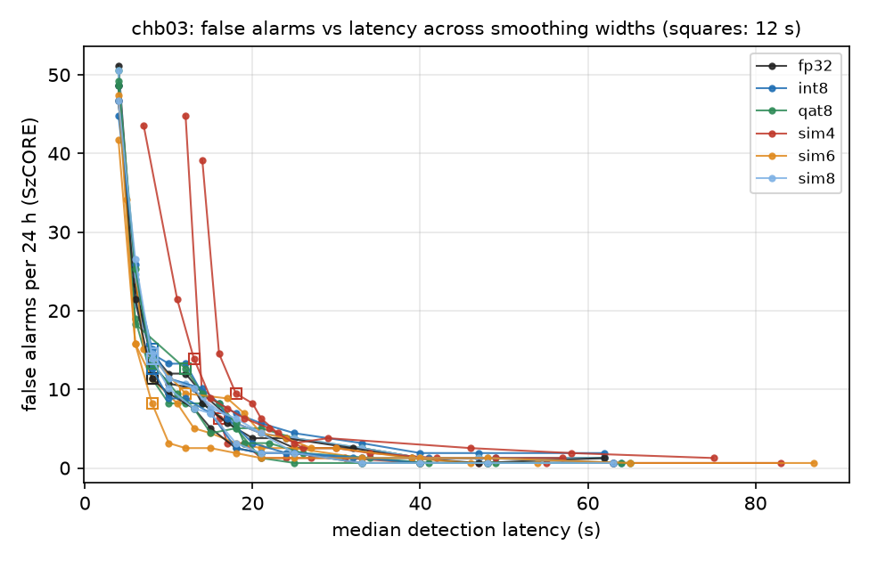

## chb04

Folds per seed: {0: 3, 1: 3, 2: 3}

- Early stopping fired in 9/9 jobs; ONNX FP32 export max |logit diff| 6.20e-06
- Seed 0: FP32 test specificity pooled over all held-out hours 0.9950 (within 0.995 +/- 0.005)
- Seed 1: FP32 test specificity pooled over all held-out hours 0.9882 (OUTSIDE 0.995 +/- 0.005)
- Seed 2: FP32 test specificity pooled over all held-out hours 0.9929 (within 0.995 +/- 0.005)
- Diagnostic: single folds outside the band 2/9 [(1, 1, 0.974), (1, 2, 0.9852)]

### FP32 against EpiDeNet's reporting (4 s windows, pooled over folds)

| seed | FP/h raw | FP/h 3-window vote | window sens (vote) | spec (vote) | seizures detected |
|---|---|---|---|---|---|
| 0 | 4.46 | 1.83 | 0.408 | 0.9980 | 4/4 |
| 1 | 10.66 | 8.31 | 0.507 | 0.9908 | 4/4 |
| 2 | 6.22 | 4.57 | 0.451 | 0.9950 | 4/4 |

EpiDeNet (all CHB-MIT, LOOCV, 5 seeds): 4.29 raw, 2.24 with vote, 165/181 seizures.

### Two meanings of "FP/h" for the same FP32 model (pooled over folds)

| seed | window FP/h (3-window vote, 4 s grid) | SzCORE false alarms/h (12 s smoothing) | ratio |
|---|---|---|---|
| 0 | 1.83 | 0.36 | 5.1 |
| 1 | 8.31 | 0.39 | 21.3 |
| 2 | 4.57 | 0.31 | 14.6 |

Window FP/h is (1 - specificity) x windows per hour, so it depends on window length and hop, and one long artifact counts many times; SzCORE merges detections within 90 s into one alarm.

### Operating point (default smoothing, own threshold) and excess latency

| seed | model | FA/24h at 12 s | median latency at 12 s | detected | excess latency at FP32's FA (s) | smoothing there (s) | ΔFA/24h at FP32's latency |
|---|---|---|---|---|---|---|---|
| 0 | fp32 | 8.6 | 14.0 | 4/4 | 0.0 | 12.0 | 0.0 |
| 0 | int8 | 8.5 | 17.0 | 4/4 | 2.8 | 11.9 | 2.8 |
| 0 | sim8 | 8.5 | 17.0 | 4/4 | 2.8 | 11.8 | 2.3 |
| 0 | sim6 | 6.0 | inf | 2/4 | inf | n/a | n/a |
| 0 | sim4 | 7.1 | inf | 1/4 | inf | n/a | n/a |
| 0 | qat8 | 9.5 | 14.0 | 4/4 | 2.5 | 14.0 | 0.9 |
| 1 | fp32 | 9.4 | 13.5 | 4/4 | 0.0 | 12.0 | 0.0 |
| 1 | int8 | 9.7 | 14.0 | 4/4 | 0.8 | 12.6 | 1.1 |
| 1 | sim8 | 9.2 | 14.5 | 4/4 | 0.9 | 11.8 | 1.5 |
| 1 | sim6 | 8.3 | 20.0 | 3/4 | 5.8 | 10.6 | n/a |
| 1 | sim4 | 7.8 | inf | 0/4 | inf | n/a | n/a |
| 1 | qat8 | 7.7 | 15.5 | 4/4 | 1.3 | 10.6 | 3.1 |
| 2 | fp32 | 7.5 | 17.5 | 4/4 | 0.0 | 12.0 | 0.0 |
| 2 | int8 | 7.4 | 19.0 | 4/4 | 1.3 | 11.8 | 0.8 |
| 2 | sim8 | 7.4 | 18.5 | 4/4 | 0.9 | 11.9 | 2.1 |
| 2 | sim6 | 5.4 | inf | 1/4 | inf | n/a | n/a |
| 2 | sim4 | 6.3 | inf | 0/4 | inf | n/a | n/a |
| 2 | qat8 | 8.9 | 21.0 | 4/4 | 5.3 | 15.6 | 8.7 |

FP32 seed-to-seed excess latency (the null), all ordered seed pairs: ['0.3', '3.0', '0.2', '3.2', '-1.4', '-2.0']
95% band: (-1.9301470588235294, 3.1791666666666663)

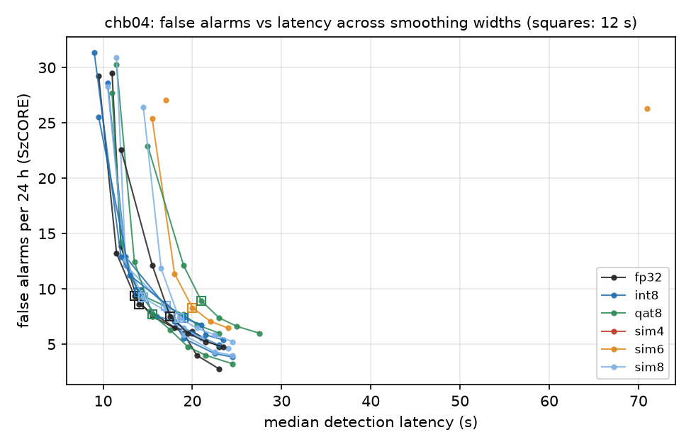

## chb05

Folds per seed: {0: 5, 1: 5, 2: 5}

- Early stopping fired in 15/15 jobs; ONNX FP32 export max |logit diff| 4.29e-06
- Seed 0: FP32 test specificity pooled over all held-out hours 0.9926 (within 0.995 +/- 0.005)
- Seed 1: FP32 test specificity pooled over all held-out hours 0.9940 (within 0.995 +/- 0.005)
- Seed 2: FP32 test specificity pooled over all held-out hours 0.9933 (within 0.995 +/- 0.005)
- Diagnostic: single folds outside the band 4/15 [(1, 0, 0.981), (4, 1, 0.9891), (1, 2, 0.9892), (4, 2, 0.9887)]

### FP32 against EpiDeNet's reporting (4 s windows, pooled over folds)

| seed | FP/h raw | FP/h 3-window vote | window sens (vote) | spec (vote) | seizures detected |
|---|---|---|---|---|---|
| 0 | 6.64 | 2.95 | 0.940 | 0.9968 | 5/5 |
| 1 | 5.15 | 1.21 | 0.955 | 0.9986 | 5/5 |
| 2 | 5.95 | 1.62 | 0.956 | 0.9982 | 5/5 |

EpiDeNet (all CHB-MIT, LOOCV, 5 seeds): 4.29 raw, 2.24 with vote, 165/181 seizures.

### Two meanings of "FP/h" for the same FP32 model (pooled over folds)

| seed | window FP/h (3-window vote, 4 s grid) | SzCORE false alarms/h (12 s smoothing) | ratio |
|---|---|---|---|
| 0 | 2.95 | 0.28 | 10.5 |
| 1 | 1.21 | 0.26 | 4.7 |
| 2 | 1.62 | 0.31 | 5.2 |

Window FP/h is (1 - specificity) x windows per hour, so it depends on window length and hop, and one long artifact counts many times; SzCORE merges detections within 90 s into one alarm.

### Operating point (default smoothing, own threshold) and excess latency

| seed | model | FA/24h at 12 s | median latency at 12 s | detected | excess latency at FP32's FA (s) | smoothing there (s) | ΔFA/24h at FP32's latency |
|---|---|---|---|---|---|---|---|
| 0 | fp32 | 6.8 | 9.0 | 5/5 | 0.0 | 12.0 | 0.0 |
| 0 | int8 | 6.2 | 9.0 | 5/5 | -0.1 | 11.8 | -0.6 |
| 0 | sim8 | 6.2 | 9.0 | 5/5 | -0.1 | 11.8 | -0.6 |
| 0 | sim6 | 6.2 | 9.0 | 5/5 | -0.1 | 11.8 | -0.6 |
| 0 | sim4 | 3.7 | 22.0 | 4/5 | 11.0 | 10.0 | n/a |
| 0 | qat8 | 8.0 | 10.0 | 5/5 | 2.0 | 14.0 | 5.2 |
| 1 | fp32 | 6.2 | 9.0 | 5/5 | 0.0 | 12.0 | 0.0 |
| 1 | int8 | 6.2 | 10.0 | 5/5 | 1.0 | 12.0 | 3.7 |
| 1 | sim8 | 7.4 | 10.0 | 5/5 | 1.5 | 13.0 | 4.9 |
| 1 | sim6 | 6.2 | 10.0 | 5/5 | 1.0 | 12.0 | 3.4 |
| 1 | sim4 | 6.8 | 28.0 | 4/5 | 19.2 | 12.7 | n/a |
| 1 | qat8 | 9.2 | 10.0 | 5/5 | 2.2 | 14.5 | 5.5 |
| 2 | fp32 | 7.4 | 9.0 | 5/5 | 0.0 | 12.0 | 0.0 |
| 2 | int8 | 8.6 | 8.0 | 5/5 | -0.2 | 13.0 | -0.4 |
| 2 | sim8 | 8.6 | 9.0 | 5/5 | 0.5 | 13.0 | 1.2 |
| 2 | sim6 | 8.6 | 10.0 | 5/5 | 1.4 | 12.9 | 3.7 |
| 2 | sim4 | 3.7 | 15.0 | 5/5 | 4.5 | 9.0 | n/a |
| 2 | qat8 | 9.2 | 9.0 | 5/5 | 0.8 | 13.5 | 1.8 |

FP32 seed-to-seed excess latency (the null), all ordered seed pairs: ['-0.2', '0.3', '2.0', '0.7', '-0.1', '-0.3']
95% band: (-0.31250000000000044, 1.8333333333333333)

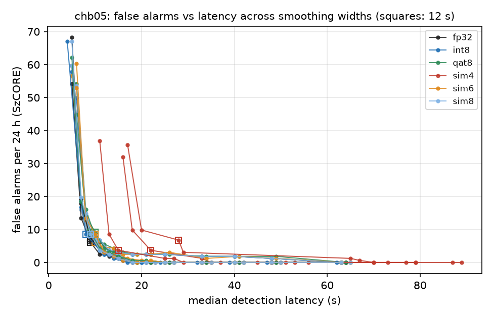

## chb06

Folds per seed: {0: 7, 1: 7, 2: 7}

- Early stopping fired in 21/21 jobs; ONNX FP32 export max |logit diff| 4.77e-06
- Seed 0: FP32 test specificity pooled over all held-out hours 0.9920 (within 0.995 +/- 0.005)
- Seed 1: FP32 test specificity pooled over all held-out hours 0.9856 (OUTSIDE 0.995 +/- 0.005)
- Seed 2: FP32 test specificity pooled over all held-out hours 0.9906 (within 0.995 +/- 0.005)
- Diagnostic: single folds outside the band 4/21 [(6, 0, 0.9585), (3, 1, 0.9592), (6, 1, 0.976), (6, 2, 0.9593)]

### FP32 against EpiDeNet's reporting (4 s windows, pooled over folds)

| seed | FP/h raw | FP/h 3-window vote | window sens (vote) | spec (vote) | seizures detected |
|---|---|---|---|---|---|
| 0 | 7.24 | 3.46 | 0.438 | 0.9956 | 7/10 |
| 1 | 12.63 | 8.86 | 0.476 | 0.9913 | 7/10 |
| 2 | 8.33 | 3.49 | 0.521 | 0.9957 | 9/10 |

EpiDeNet (all CHB-MIT, LOOCV, 5 seeds): 4.29 raw, 2.24 with vote, 165/181 seizures.

### Two meanings of "FP/h" for the same FP32 model (pooled over folds)

| seed | window FP/h (3-window vote, 4 s grid) | SzCORE false alarms/h (12 s smoothing) | ratio |
|---|---|---|---|
| 0 | 3.46 | 0.55 | 6.2 |
| 1 | 8.86 | 0.54 | 16.4 |
| 2 | 3.49 | 0.55 | 6.3 |

Window FP/h is (1 - specificity) x windows per hour, so it depends on window length and hop, and one long artifact counts many times; SzCORE merges detections within 90 s into one alarm.

### Operating point (default smoothing, own threshold) and excess latency

| seed | model | FA/24h at 12 s | median latency at 12 s | detected | excess latency at FP32's FA (s) | smoothing there (s) | ΔFA/24h at FP32's latency |
|---|---|---|---|---|---|---|---|
| 0 | fp32 | 13.3 | 11.0 | 7/10 | 0.0 | 12.0 | 0.0 |
| 0 | int8 | 11.1 | 10.5 | 7/10 | -1.3 | 10.4 | -3.2 |
| 0 | sim8 | 10.8 | 10.5 | 7/10 | -1.4 | 10.1 | -3.2 |
| 0 | sim6 | 3.6 | 14.5 | 7/10 | -1.4 | 7.5 | -6.4 |
| 0 | sim4 | 0.0 | inf | 0/10 | inf | n/a | n/a |
| 0 | qat8 | 14.4 | 11.0 | 8/10 | 0.5 | 12.9 | 1.1 |
| 1 | fp32 | 12.9 | 10.0 | 7/10 | 0.0 | 12.0 | 0.0 |
| 1 | int8 | 11.5 | 12.5 | 6/10 | 1.9 | 11.4 | 5.1 |
| 1 | sim8 | 12.9 | 12.5 | 6/10 | 2.5 | 12.0 | 6.3 |
| 1 | sim6 | 6.1 | inf | 3/10 | 17.3 | 7.5 | n/a |
| 1 | sim4 | 4.0 | inf | 0/10 | inf | n/a | n/a |
| 1 | qat8 | 14.4 | 9.5 | 7/10 | 0.2 | 13.3 | 0.4 |
| 2 | fp32 | 13.3 | 10.5 | 8/10 | 0.0 | 12.0 | 0.0 |
| 2 | int8 | 13.7 | 10.5 | 8/10 | 0.2 | 12.4 | 0.4 |
| 2 | sim8 | 11.5 | 10.5 | 8/10 | -0.4 | 11.2 | -1.8 |
| 2 | sim6 | 4.3 | inf | 5/10 | 1.7 | 7.3 | 27.3 |
| 2 | sim4 | 0.7 | inf | 0/10 | inf | n/a | n/a |
| 2 | qat8 | 15.1 | 10.0 | 9/10 | 0.3 | 13.7 | 0.7 |

FP32 seed-to-seed excess latency (the null), all ordered seed pairs: ['-1.1', '-0.5', '1.2', '0.7', '0.5', '-0.6']
95% band: (-0.9981060606060606, 1.117424242424244)

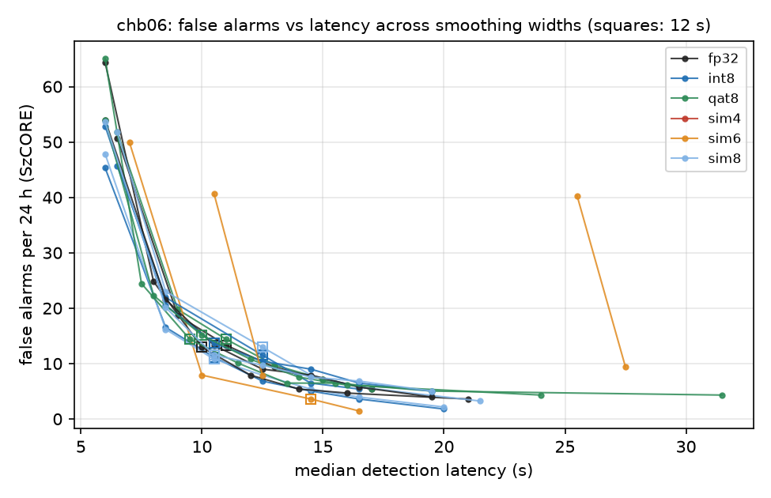

## chb07

Folds per seed: {0: 3, 1: 3, 2: 3}

- Early stopping fired in 9/9 jobs; ONNX FP32 export max |logit diff| 3.34e-06
- Seed 0: FP32 test specificity pooled over all held-out hours 0.9822 (OUTSIDE 0.995 +/- 0.005)
- Seed 1: FP32 test specificity pooled over all held-out hours 0.9863 (OUTSIDE 0.995 +/- 0.005)
- Seed 2: FP32 test specificity pooled over all held-out hours 0.9812 (OUTSIDE 0.995 +/- 0.005)
- Diagnostic: single folds outside the band 3/9 [(2, 0, 0.9485), (2, 1, 0.9602), (2, 2, 0.9459)]

### FP32 against EpiDeNet's reporting (4 s windows, pooled over folds)

| seed | FP/h raw | FP/h 3-window vote | window sens (vote) | spec (vote) | seizures detected |
|---|---|---|---|---|---|
| 0 | 15.97 | 15.15 | 0.929 | 0.9824 | 3/3 |
| 1 | 12.24 | 10.90 | 0.726 | 0.9873 | 3/3 |
| 2 | 16.87 | 15.44 | 0.841 | 0.9820 | 3/3 |

EpiDeNet (all CHB-MIT, LOOCV, 5 seeds): 4.29 raw, 2.24 with vote, 165/181 seizures.

### Two meanings of "FP/h" for the same FP32 model (pooled over folds)

| seed | window FP/h (3-window vote, 4 s grid) | SzCORE false alarms/h (12 s smoothing) | ratio |
|---|---|---|---|
| 0 | 15.15 | 0.48 | 31.8 |
| 1 | 10.90 | 0.45 | 24.4 |
| 2 | 15.44 | 0.51 | 30.4 |

Window FP/h is (1 - specificity) x windows per hour, so it depends on window length and hop, and one long artifact counts many times; SzCORE merges detections within 90 s into one alarm.

### Operating point (default smoothing, own threshold) and excess latency

| seed | model | FA/24h at 12 s | median latency at 12 s | detected | excess latency at FP32's FA (s) | smoothing there (s) | ΔFA/24h at FP32's latency |
|---|---|---|---|---|---|---|---|
| 0 | fp32 | 11.5 | 10.0 | 3/3 | 0.0 | 12.0 | 0.0 |
| 0 | int8 | 10.7 | 10.0 | 3/3 | -0.4 | 11.2 | -0.7 |
| 0 | sim8 | 11.1 | 10.0 | 3/3 | -0.2 | 11.6 | -0.4 |
| 0 | sim6 | 10.7 | 10.0 | 3/3 | -0.3 | 11.4 | -0.7 |
| 0 | sim4 | 8.6 | 27.0 | 3/3 | 14.5 | 7.6 | n/a |
| 0 | qat8 | 12.2 | 10.0 | 3/3 | 1.0 | 14.0 | 0.7 |
| 1 | fp32 | 10.7 | 9.0 | 3/3 | 0.0 | 12.0 | 0.0 |
| 1 | int8 | 9.7 | 10.0 | 3/3 | 0.5 | 11.0 | 1.1 |
| 1 | sim8 | 10.4 | 9.0 | 3/3 | -0.2 | 11.6 | -0.4 |
| 1 | sim6 | 7.9 | 16.0 | 3/3 | -0.2 | 7.6 | -0.7 |
| 1 | sim4 | 3.9 | 14.0 | 2/3 | 2.3 | 6.5 | n/a |
| 1 | qat8 | 12.9 | 9.0 | 3/3 | 1.1 | 14.2 | 2.1 |
| 2 | fp32 | 12.2 | 10.0 | 3/3 | 0.0 | 12.0 | 0.0 |
| 2 | int8 | 12.5 | 10.0 | 3/3 | 0.2 | 12.5 | 0.4 |
| 2 | sim8 | 12.2 | 10.0 | 3/3 | 0.0 | 12.0 | 0.0 |
| 2 | sim6 | 5.7 | 23.0 | 3/3 | -0.2 | 7.5 | -1.8 |
| 2 | sim4 | 13.6 | 23.0 | 3/3 | 15.0 | 16.0 | n/a |
| 2 | qat8 | 13.2 | 10.0 | 3/3 | 0.8 | 13.5 | 1.1 |

FP32 seed-to-seed excess latency (the null), all ordered seed pairs: ['-1.3', '0.5', '2.0', '2.0', '-0.6', '-1.5']
95% band: (-1.4999999999999998, 2.0)

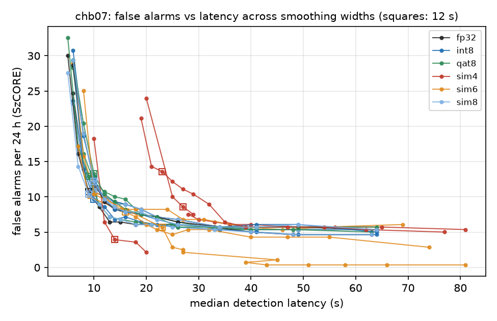

## chb08

Folds per seed: {0: 5, 1: 5, 2: 5}

- Early stopping fired in 15/15 jobs; ONNX FP32 export max |logit diff| 7.15e-06
- Seed 0: FP32 test specificity pooled over all held-out hours 0.9918 (within 0.995 +/- 0.005)
- Seed 1: FP32 test specificity pooled over all held-out hours 0.9911 (within 0.995 +/- 0.005)
- Seed 2: FP32 test specificity pooled over all held-out hours 0.9950 (within 0.995 +/- 0.005)
- Diagnostic: single folds outside the band 2/15 [(1, 0, 0.9734), (1, 1, 0.9711)]

### FP32 against EpiDeNet's reporting (4 s windows, pooled over folds)

| seed | FP/h raw | FP/h 3-window vote | window sens (vote) | spec (vote) | seizures detected |
|---|---|---|---|---|---|
| 0 | 7.20 | 5.70 | 0.863 | 0.9936 | 5/5 |
| 1 | 8.20 | 5.90 | 0.870 | 0.9934 | 5/5 |
| 2 | 4.30 | 2.50 | 0.888 | 0.9972 | 5/5 |

EpiDeNet (all CHB-MIT, LOOCV, 5 seeds): 4.29 raw, 2.24 with vote, 165/181 seizures.

### Two meanings of "FP/h" for the same FP32 model (pooled over folds)

| seed | window FP/h (3-window vote, 4 s grid) | SzCORE false alarms/h (12 s smoothing) | ratio |
|---|---|---|---|
| 0 | 5.70 | 0.25 | 22.8 |
| 1 | 5.90 | 0.30 | 19.7 |
| 2 | 2.50 | 0.35 | 7.1 |

Window FP/h is (1 - specificity) x windows per hour, so it depends on window length and hop, and one long artifact counts many times; SzCORE merges detections within 90 s into one alarm.

### Operating point (default smoothing, own threshold) and excess latency

| seed | model | FA/24h at 12 s | median latency at 12 s | detected | excess latency at FP32's FA (s) | smoothing there (s) | ΔFA/24h at FP32's latency |
|---|---|---|---|---|---|---|---|
| 0 | fp32 | 6.0 | 15.0 | 5/5 | 0.0 | 12.0 | 0.0 |
| 0 | int8 | 4.8 | 15.0 | 5/5 | -1.0 | 10.0 | -1.2 |
| 0 | sim8 | 6.0 | 15.0 | 5/5 | 0.0 | 12.0 | 0.0 |
| 0 | sim6 | 7.2 | 15.0 | 5/5 | 2.0 | 16.0 | 1.2 |
| 0 | sim4 | 7.2 | 20.0 | 5/5 | 5.7 | 13.3 | 32.4 |
| 0 | qat8 | 7.2 | 15.0 | 5/5 | 1.0 | 14.0 | 1.2 |
| 1 | fp32 | 7.2 | 12.0 | 5/5 | 0.0 | 12.0 | 0.0 |
| 1 | int8 | 9.6 | 12.0 | 5/5 | 1.3 | 14.7 | 2.4 |
| 1 | sim8 | 9.6 | 12.0 | 5/5 | 1.3 | 14.7 | 2.4 |
| 1 | sim6 | 10.8 | 12.0 | 5/5 | 1.5 | 15.0 | 3.6 |
| 1 | sim4 | 3.6 | 16.0 | 5/5 | 2.0 | 8.0 | 18.0 |
| 1 | qat8 | 8.4 | 12.0 | 5/5 | 1.0 | 14.0 | 1.2 |
| 2 | fp32 | 8.4 | 14.0 | 5/5 | 0.0 | 12.0 | 0.0 |
| 2 | int8 | 7.2 | 15.0 | 5/5 | 0.3 | 10.7 | 0.6 |
| 2 | sim8 | 7.2 | 15.0 | 5/5 | 0.3 | 10.7 | 0.6 |
| 2 | sim6 | 6.0 | 13.0 | 5/5 | -2.3 | 9.3 | -3.6 |
| 2 | sim4 | 9.6 | 17.0 | 5/5 | 3.4 | 12.8 | 22.8 |
| 2 | qat8 | 6.0 | 14.0 | 5/5 | -1.3 | 9.3 | -2.4 |

FP32 seed-to-seed excess latency (the null), all ordered seed pairs: ['0.0', '0.3', '1.0', '2.7', '-1.2', '-2.5']
95% band: (-2.331730769230769, 2.4583333333333344)

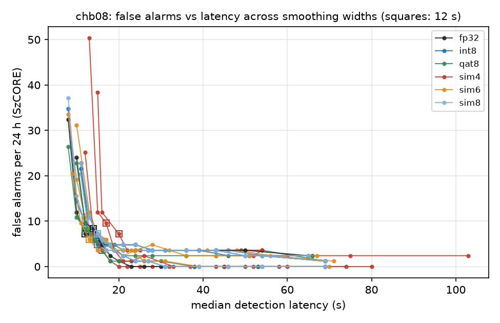

## chb09

Folds per seed: {0: 3, 1: 3, 2: 3}

- Early stopping fired in 8/9 jobs; ONNX FP32 export max |logit diff| 2.86e-06
- Seed 0: FP32 test specificity pooled over all held-out hours 0.9640 (OUTSIDE 0.995 +/- 0.005)
- Seed 1: FP32 test specificity pooled over all held-out hours 0.9876 (OUTSIDE 0.995 +/- 0.005)
- Seed 2: FP32 test specificity pooled over all held-out hours 0.9754 (OUTSIDE 0.995 +/- 0.005)
- Diagnostic: single folds outside the band 3/9 [(2, 0, 0.8813), (2, 1, 0.9707), (2, 2, 0.9231)]

### FP32 against EpiDeNet's reporting (4 s windows, pooled over folds)

| seed | FP/h raw | FP/h 3-window vote | window sens (vote) | spec (vote) | seizures detected |
|---|---|---|---|---|---|
| 0 | 32.38 | 33.02 | 0.939 | 0.9550 | 4/4 |
| 1 | 11.24 | 7.23 | 0.941 | 0.9914 | 4/4 |
| 2 | 22.20 | 21.42 | 0.941 | 0.9714 | 4/4 |

EpiDeNet (all CHB-MIT, LOOCV, 5 seeds): 4.29 raw, 2.24 with vote, 165/181 seizures.

### Two meanings of "FP/h" for the same FP32 model (pooled over folds)

| seed | window FP/h (3-window vote, 4 s grid) | SzCORE false alarms/h (12 s smoothing) | ratio |
|---|---|---|---|
| 0 | 33.02 | 0.69 | 47.7 |
| 1 | 7.23 | 0.65 | 11.2 |
| 2 | 21.42 | 0.78 | 27.4 |

Window FP/h is (1 - specificity) x windows per hour, so it depends on window length and hop, and one long artifact counts many times; SzCORE merges detections within 90 s into one alarm.

### Operating point (default smoothing, own threshold) and excess latency

| seed | model | FA/24h at 12 s | median latency at 12 s | detected | excess latency at FP32's FA (s) | smoothing there (s) | ΔFA/24h at FP32's latency |
|---|---|---|---|---|---|---|---|
| 0 | fp32 | 16.6 | 8.5 | 4/4 | 0.0 | 12.0 | 0.0 |
| 0 | int8 | 16.6 | 8.5 | 4/4 | 0.0 | 12.0 | 0.0 |
| 0 | sim8 | 16.6 | 8.5 | 4/4 | 0.0 | 12.0 | 0.0 |
| 0 | sim6 | 16.3 | 8.5 | 4/4 | -0.7 | 10.7 | -0.4 |
| 0 | sim4 | 13.8 | 24.0 | 4/4 | 14.0 | 9.1 | 14.4 |
| 0 | qat8 | 16.6 | 8.5 | 4/4 | 0.0 | 12.0 | 0.0 |
| 1 | fp32 | 15.6 | 8.0 | 4/4 | 0.0 | 12.0 | 0.0 |
| 1 | int8 | 16.6 | 8.0 | 4/4 | 0.7 | 13.3 | 1.1 |
| 1 | sim8 | 16.3 | 8.0 | 4/4 | 0.5 | 13.0 | 0.7 |
| 1 | sim6 | 16.3 | 8.0 | 4/4 | 0.6 | 13.1 | 0.7 |
| 1 | sim4 | 5.3 | inf | 2/4 | 56.9 | 6.6 | n/a |
| 1 | qat8 | 11.3 | 8.0 | 4/4 | -2.0 | 8.0 | -4.2 |
| 2 | fp32 | 18.7 | 8.5 | 4/4 | 0.0 | 12.0 | 0.0 |
| 2 | int8 | 18.7 | 8.5 | 4/4 | 0.0 | 12.0 | 0.0 |
| 2 | sim8 | 18.4 | 8.5 | 4/4 | -0.3 | 11.4 | -0.4 |
| 2 | sim6 | 13.4 | 8.5 | 4/4 | -2.2 | 7.6 | -5.3 |
| 2 | sim4 | 8.5 | 16.5 | 3/4 | 4.5 | 5.1 | n/a |
| 2 | qat8 | 19.8 | 8.5 | 4/4 | 1.0 | 14.0 | 1.1 |

FP32 seed-to-seed excess latency (the null), all ordered seed pairs: ['-1.3', '2.0', '5.2', '5.5', '-2.4', '-2.7']
95% band: (-2.6256868131868134, 5.458333333333336)

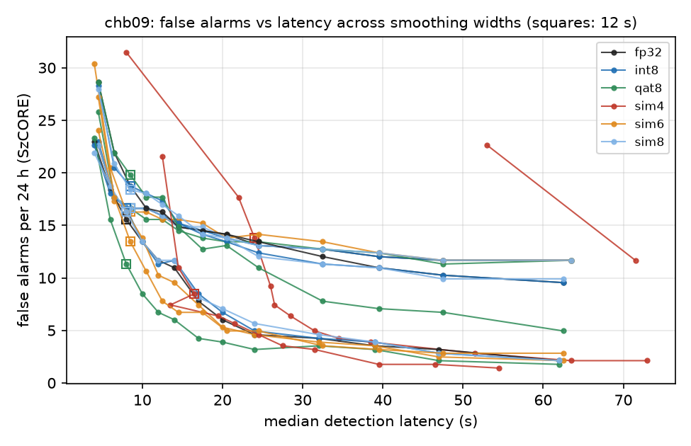

## chb10

Folds per seed: {0: 7, 1: 7, 2: 7}

- Early stopping fired in 21/21 jobs; ONNX FP32 export max |logit diff| 6.20e-06
- Seed 0: FP32 test specificity pooled over all held-out hours 0.9940 (within 0.995 +/- 0.005)
- Seed 1: FP32 test specificity pooled over all held-out hours 0.9919 (within 0.995 +/- 0.005)
- Seed 2: FP32 test specificity pooled over all held-out hours 0.9912 (within 0.995 +/- 0.005)
- Diagnostic: single folds outside the band 7/21 [(1, 0, 0.9864), (1, 1, 0.9825), (5, 1, 0.9834), (1, 2, 0.9823), (2, 2, 0.9858), (5, 2, 0.9871), (6, 2, 0.9899)]

### FP32 against EpiDeNet's reporting (4 s windows, pooled over folds)

| seed | FP/h raw | FP/h 3-window vote | window sens (vote) | spec (vote) | seizures detected |
|---|---|---|---|---|---|
| 0 | 5.36 | 1.64 | 0.962 | 0.9982 | 7/7 |
| 1 | 7.18 | 3.16 | 0.977 | 0.9963 | 7/7 |
| 2 | 7.84 | 2.66 | 0.962 | 0.9971 | 7/7 |

EpiDeNet (all CHB-MIT, LOOCV, 5 seeds): 4.29 raw, 2.24 with vote, 165/181 seizures.

### Two meanings of "FP/h" for the same FP32 model (pooled over folds)

| seed | window FP/h (3-window vote, 4 s grid) | SzCORE false alarms/h (12 s smoothing) | ratio |
|---|---|---|---|
| 0 | 1.64 | 0.18 | 9.1 |
| 1 | 3.16 | 0.38 | 8.3 |
| 2 | 2.66 | 0.36 | 7.4 |

Window FP/h is (1 - specificity) x windows per hour, so it depends on window length and hop, and one long artifact counts many times; SzCORE merges detections within 90 s into one alarm.

### Operating point (default smoothing, own threshold) and excess latency

| seed | model | FA/24h at 12 s | median latency at 12 s | detected | excess latency at FP32's FA (s) | smoothing there (s) | ΔFA/24h at FP32's latency |
|---|---|---|---|---|---|---|---|
| 0 | fp32 | 4.3 | 7.0 | 7/7 | 0.0 | 12.0 | 0.0 |
| 0 | int8 | 4.3 | 7.0 | 7/7 | 0.0 | 12.0 | 0.0 |
| 0 | sim8 | 4.3 | 7.0 | 7/7 | 0.0 | 12.0 | 0.0 |
| 0 | sim6 | 2.9 | 7.0 | 7/7 | -0.5 | 10.9 | -1.4 |
| 0 | sim4 | 3.4 | 10.0 | 4/7 | 0.8 | 7.7 | 4.6 |
| 0 | qat8 | 4.8 | 7.0 | 7/7 | 0.5 | 13.0 | 0.5 |
| 1 | fp32 | 9.1 | 6.0 | 7/7 | 0.0 | 12.0 | 0.0 |
| 1 | int8 | 8.2 | 6.0 | 7/7 | -0.3 | 11.4 | -1.0 |
| 1 | sim8 | 8.6 | 6.0 | 7/7 | -0.2 | 11.7 | -0.5 |
| 1 | sim6 | 5.8 | 6.0 | 7/7 | -1.3 | 9.5 | -3.4 |
| 1 | sim4 | 4.8 | 10.0 | 4/7 | 2.0 | 8.0 | 20.2 |
| 1 | qat8 | 8.2 | 6.0 | 7/7 | -0.2 | 11.6 | -1.0 |
| 2 | fp32 | 8.6 | 7.0 | 7/7 | 0.0 | 12.0 | 0.0 |
| 2 | int8 | 8.6 | 7.0 | 7/7 | 0.0 | 12.0 | 0.0 |
| 2 | sim8 | 8.6 | 7.0 | 7/7 | 0.0 | 12.0 | 0.0 |
| 2 | sim6 | 10.1 | 7.0 | 7/7 | 1.2 | 14.4 | 1.4 |
| 2 | sim4 | 2.4 | 13.0 | 6/7 | 3.4 | 8.5 | 28.3 |
| 2 | qat8 | 3.8 | 7.0 | 7/7 | -1.4 | 9.1 | -4.8 |

FP32 seed-to-seed excess latency (the null), all ordered seed pairs: ['2.7', '3.1', '-0.8', '0.9', '-1.6', '-0.6']
95% band: (-1.5340909090909092, 3.083333333333333)

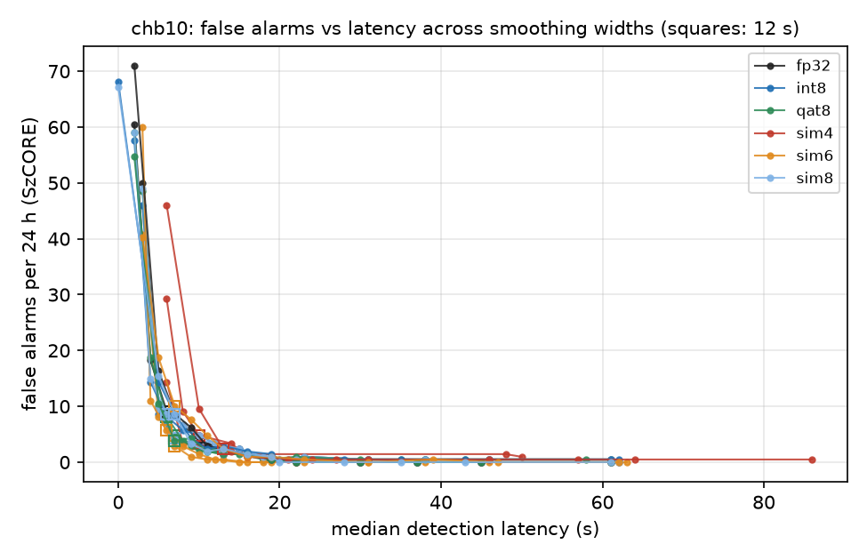

## chb11

Folds per seed: {0: 3, 1: 3, 2: 3}

- Early stopping fired in 6/9 jobs; ONNX FP32 export max |logit diff| 2.86e-06
- Seed 0: FP32 test specificity pooled over all held-out hours 0.9948 (within 0.995 +/- 0.005)
- Seed 1: FP32 test specificity pooled over all held-out hours 0.9948 (within 0.995 +/- 0.005)
- Seed 2: FP32 test specificity pooled over all held-out hours 0.9952 (within 0.995 +/- 0.005)
- Diagnostic: single folds outside the band 0/9

### FP32 against EpiDeNet's reporting (4 s windows, pooled over folds)

| seed | FP/h raw | FP/h 3-window vote | window sens (vote) | spec (vote) | seizures detected |
|---|---|---|---|---|---|
| 0 | 4.63 | 1.72 | 0.950 | 0.9981 | 3/3 |
| 1 | 4.48 | 1.75 | 0.950 | 0.9981 | 3/3 |
| 2 | 4.22 | 1.75 | 0.895 | 0.9981 | 3/3 |

EpiDeNet (all CHB-MIT, LOOCV, 5 seeds): 4.29 raw, 2.24 with vote, 165/181 seizures.

### Two meanings of "FP/h" for the same FP32 model (pooled over folds)

| seed | window FP/h (3-window vote, 4 s grid) | SzCORE false alarms/h (12 s smoothing) | ratio |
|---|---|---|---|
| 0 | 1.72 | 0.34 | 5.0 |
| 1 | 1.75 | 0.37 | 4.7 |
| 2 | 1.75 | 0.26 | 6.8 |

Window FP/h is (1 - specificity) x windows per hour, so it depends on window length and hop, and one long artifact counts many times; SzCORE merges detections within 90 s into one alarm.

### Operating point (default smoothing, own threshold) and excess latency

| seed | model | FA/24h at 12 s | median latency at 12 s | detected | excess latency at FP32's FA (s) | smoothing there (s) | ΔFA/24h at FP32's latency |
|---|---|---|---|---|---|---|---|
| 0 | fp32 | 8.3 | -15.0 | 5/5 | 0.0 | 12.0 | 0.0 |
| 0 | int8 | 9.0 | -15.0 | 5/5 | 0.8 | 12.7 | 0.7 |
| 0 | sim8 | 9.7 | -15.0 | 5/5 | 1.2 | 13.0 | 1.4 |
| 0 | sim6 | 7.6 | -1.0 | 5/5 | 13.0 | 11.0 | 25.7 |
| 0 | sim4 | 7.6 | 6.0 | 5/5 | 20.7 | 11.4 | 25.0 |
| 0 | qat8 | 9.0 | -9.0 | 5/5 | 8.0 | 12.7 | 8.9 |
| 1 | fp32 | 9.0 | -15.0 | 5/5 | 0.0 | 12.0 | 0.0 |
| 1 | int8 | 6.9 | -11.0 | 5/5 | 2.0 | 10.0 | 2.1 |
| 1 | sim8 | 6.9 | -14.0 | 5/5 | 0.6 | 10.3 | 2.8 |
| 1 | sim6 | 6.9 | -2.0 | 5/5 | 15.0 | 10.0 | n/a |
| 1 | sim4 | 9.0 | 7.0 | 5/5 | 22.0 | 12.0 | n/a |
| 1 | qat8 | 9.0 | 4.0 | 5/5 | 19.0 | 12.0 | n/a |
| 2 | fp32 | 6.2 | -9.0 | 5/5 | 0.0 | 12.0 | 0.0 |
| 2 | int8 | 6.9 | -9.0 | 5/5 | 0.5 | 13.0 | 0.7 |
| 2 | sim8 | 6.9 | -9.0 | 5/5 | 0.5 | 13.0 | 0.7 |
| 2 | sim6 | 6.9 | -9.0 | 5/5 | 1.0 | 14.0 | 0.7 |
| 2 | sim4 | 7.6 | 7.0 | 5/5 | 16.6 | 13.1 | 39.3 |
| 2 | qat8 | 6.9 | -3.0 | 5/5 | 7.0 | 14.0 | 8.7 |

FP32 seed-to-seed excess latency (the null), all ordered seed pairs: ['1.3', '6.0', '-0.3', '6.0', '-2.2', '2.3']
95% band: (-2.0104166666666665, 6.0)

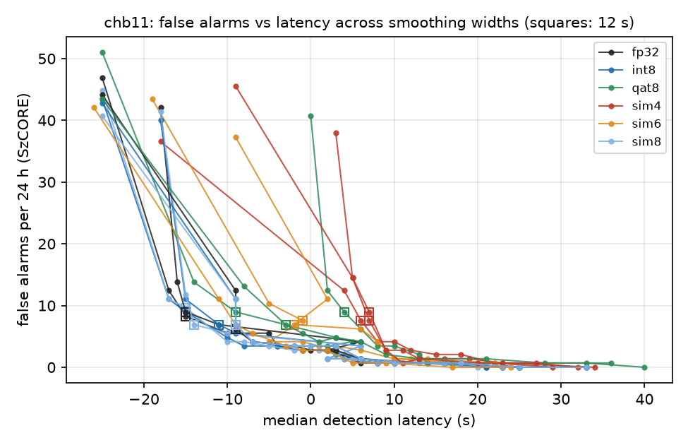

## chb12

Folds per seed: {0: 10, 1: 10, 2: 10}

- Early stopping fired in 30/30 jobs; ONNX FP32 export max |logit diff| 8.11e-06
- Seed 0: FP32 test specificity pooled over all held-out hours 0.9863 (OUTSIDE 0.995 +/- 0.005)
- Seed 1: FP32 test specificity pooled over all held-out hours 0.9896 (OUTSIDE 0.995 +/- 0.005)
- Seed 2: FP32 test specificity pooled over all held-out hours 0.9894 (OUTSIDE 0.995 +/- 0.005)
- Diagnostic: single folds outside the band 11/30 [(0, 0, 0.9888), (3, 0, 1.0), (4, 0, 0.9131), (9, 0, 0.9667), (0, 1, 0.9889), (2, 1, 0.9873), (4, 1, 0.9669), (7, 1, 1.0), (9, 1, 0.9645), (4, 2, 0.946), (9, 2, 0.9709)]

### FP32 against EpiDeNet's reporting (4 s windows, pooled over folds)

| seed | FP/h raw | FP/h 3-window vote | window sens (vote) | spec (vote) | seizures detected |
|---|---|---|---|---|---|
| 0 | 12.71 | 9.91 | 0.598 | 0.9872 | 24/27 |
| 1 | 9.28 | 4.50 | 0.570 | 0.9946 | 25/27 |
| 2 | 8.94 | 5.90 | 0.580 | 0.9925 | 24/27 |

EpiDeNet (all CHB-MIT, LOOCV, 5 seeds): 4.29 raw, 2.24 with vote, 165/181 seizures.

### Two meanings of "FP/h" for the same FP32 model (pooled over folds)

| seed | window FP/h (3-window vote, 4 s grid) | SzCORE false alarms/h (12 s smoothing) | ratio |
|---|---|---|---|
| 0 | 9.91 | 0.44 | 22.8 |
| 1 | 4.50 | 0.39 | 11.6 |
| 2 | 5.90 | 0.53 | 11.1 |

Window FP/h is (1 - specificity) x windows per hour, so it depends on window length and hop, and one long artifact counts many times; SzCORE merges detections within 90 s into one alarm.

### Operating point (default smoothing, own threshold) and excess latency

| seed | model | FA/24h at 12 s | median latency at 12 s | detected | excess latency at FP32's FA (s) | smoothing there (s) | ΔFA/24h at FP32's latency |
|---|---|---|---|---|---|---|---|
| 0 | fp32 | 10.4 | 11.0 | 22/27 | 0.0 | 12.0 | 0.0 |
| 0 | int8 | 11.6 | 11.0 | 22/27 | 3.0 | 18.0 | 1.2 |
| 0 | sim8 | 11.6 | 10.0 | 22/27 | 2.0 | 18.0 | 1.2 |
| 0 | sim6 | 11.6 | 21.0 | 16/27 | 11.2 | 13.0 | 18.6 |
| 0 | sim4 | 5.8 | inf | 7/27 | inf | n/a | n/a |
| 0 | qat8 | 9.3 | 13.0 | 23/27 | 0.7 | 10.7 | 0.6 |
| 1 | fp32 | 9.3 | 11.0 | 24/27 | 0.0 | 12.0 | 0.0 |
| 1 | int8 | 11.6 | 12.0 | 23/27 | 4.0 | 18.0 | 4.6 |
| 1 | sim8 | 11.6 | 12.0 | 22/27 | 3.0 | 16.0 | 3.5 |
| 1 | sim6 | 13.9 | inf | 10/27 | inf | n/a | n/a |
| 1 | sim4 | 0.0 | inf | 3/27 | inf | n/a | n/a |
| 1 | qat8 | 9.3 | 12.0 | 23/27 | 1.0 | 12.0 | 1.9 |
| 2 | fp32 | 12.8 | 12.0 | 24/27 | 0.0 | 12.0 | 0.0 |
| 2 | int8 | 12.8 | 12.0 | 24/27 | 0.0 | 12.0 | 0.0 |
| 2 | sim8 | 12.8 | 12.0 | 24/27 | 0.0 | 12.0 | 0.0 |
| 2 | sim6 | 10.4 | 14.0 | 20/27 | 0.7 | 9.3 | 1.2 |
| 2 | sim4 | 4.6 | 43.0 | 15/27 | 18.9 | 7.8 | n/a |
| 2 | qat8 | 12.8 | 13.0 | 24/27 | 1.0 | 12.0 | 1.2 |

FP32 seed-to-seed excess latency (the null), all ordered seed pairs: ['-0.3', '4.0', '4.0', '5.0', '-2.0', '-1.9']
95% band: (-1.9821428571428572, 4.875)

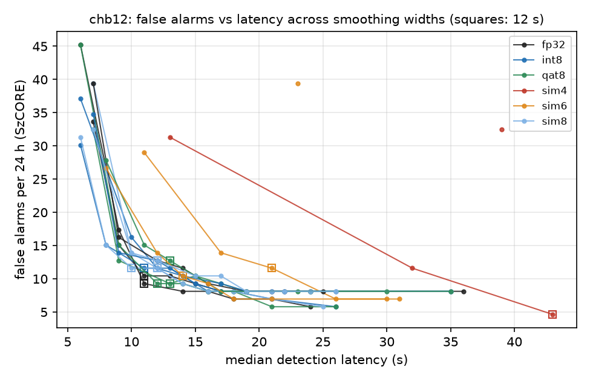

## chb13

Folds per seed: {0: 8, 1: 8, 2: 8}

- Early stopping fired in 24/24 jobs; ONNX FP32 export max |logit diff| 5.72e-06
- Seed 0: FP32 test specificity pooled over all held-out hours 0.9941 (within 0.995 +/- 0.005)
- Seed 1: FP32 test specificity pooled over all held-out hours 0.9941 (within 0.995 +/- 0.005)
- Seed 2: FP32 test specificity pooled over all held-out hours 0.9943 (within 0.995 +/- 0.005)
- Diagnostic: single folds outside the band 3/24 [(7, 0, 0.9878), (7, 1, 0.9882), (7, 2, 0.9858)]

### FP32 against EpiDeNet's reporting (4 s windows, pooled over folds)

| seed | FP/h raw | FP/h 3-window vote | window sens (vote) | spec (vote) | seizures detected |
|---|---|---|---|---|---|
| 0 | 5.85 | 3.30 | 0.489 | 0.9962 | 12/12 |
| 1 | 5.58 | 3.24 | 0.471 | 0.9963 | 12/12 |
| 2 | 5.33 | 3.58 | 0.484 | 0.9959 | 11/12 |

EpiDeNet (all CHB-MIT, LOOCV, 5 seeds): 4.29 raw, 2.24 with vote, 165/181 seizures.

### Two meanings of "FP/h" for the same FP32 model (pooled over folds)

| seed | window FP/h (3-window vote, 4 s grid) | SzCORE false alarms/h (12 s smoothing) | ratio |
|---|---|---|---|
| 0 | 3.30 | 0.48 | 6.8 |
| 1 | 3.24 | 0.39 | 8.2 |
| 2 | 3.58 | 0.45 | 7.9 |

Window FP/h is (1 - specificity) x windows per hour, so it depends on window length and hop, and one long artifact counts many times; SzCORE merges detections within 90 s into one alarm.

### Operating point (default smoothing, own threshold) and excess latency

| seed | model | FA/24h at 12 s | median latency at 12 s | detected | excess latency at FP32's FA (s) | smoothing there (s) | ΔFA/24h at FP32's latency |
|---|---|---|---|---|---|---|---|
| 0 | fp32 | 11.6 | 13.0 | 12/12 | 0.0 | 12.0 | 0.0 |
| 0 | int8 | 10.9 | 13.5 | 12/12 | -0.5 | 10.0 | -0.4 |
| 0 | sim8 | 10.9 | 13.5 | 12/12 | -2.0 | 8.0 | -0.6 |
| 0 | sim6 | 7.3 | 13.0 | 11/12 | -2.2 | 7.5 | -4.4 |
| 0 | sim4 | 2.9 | 18.0 | 9/12 | 3.4 | 7.0 | n/a |
| 0 | qat8 | 11.6 | 13.0 | 12/12 | -2.0 | 8.0 | 0.0 |
| 1 | fp32 | 9.5 | 14.5 | 12/12 | 0.0 | 12.0 | 0.0 |
| 1 | int8 | 9.5 | 13.5 | 12/12 | -1.0 | 12.0 | 0.0 |
| 1 | sim8 | 9.5 | 14.0 | 12/12 | -0.5 | 12.0 | 0.0 |
| 1 | sim6 | 8.7 | 16.0 | 11/12 | 0.3 | 10.0 | 0.1 |
| 1 | sim4 | 1.5 | inf | 0/12 | inf | n/a | n/a |
| 1 | qat8 | 9.5 | 13.5 | 12/12 | -1.0 | 12.0 | -0.4 |
| 2 | fp32 | 10.9 | 13.0 | 10/12 | 0.0 | 12.0 | 0.0 |
| 2 | int8 | 10.2 | 13.5 | 10/12 | 0.1 | 11.2 | 0.2 |
| 2 | sim8 | 10.2 | 13.5 | 10/12 | 0.1 | 11.2 | 0.2 |
| 2 | sim6 | 7.3 | 14.5 | 10/12 | -0.2 | 8.7 | -0.4 |
| 2 | sim4 | 0.7 | inf | 4/12 | inf | n/a | n/a |
| 2 | qat8 | 10.9 | 13.0 | 10/12 | 0.0 | 12.0 | 0.0 |

FP32 seed-to-seed excess latency (the null), all ordered seed pairs: ['-0.8', '-1.0', '0.0', '-0.2', '0.5', '0.0']
95% band: (-0.9687500000000016, 0.4375)

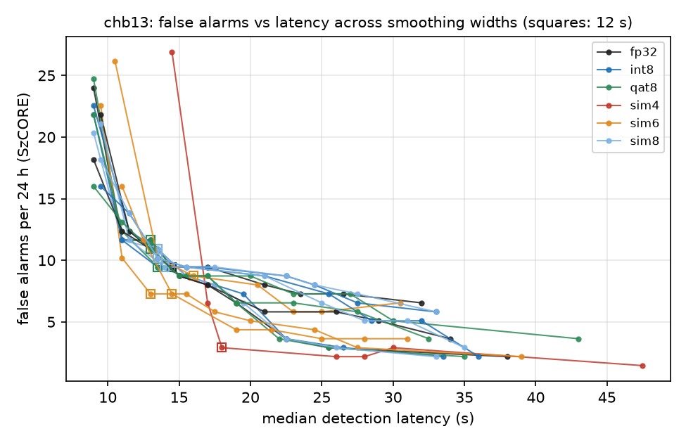

## chb14

Folds per seed: {0: 7, 1: 7, 2: 7}

- Early stopping fired in 21/21 jobs; ONNX FP32 export max |logit diff| 7.15e-06
- Seed 0: FP32 test specificity pooled over all held-out hours 0.9930 (within 0.995 +/- 0.005)
- Seed 1: FP32 test specificity pooled over all held-out hours 0.9919 (within 0.995 +/- 0.005)
- Seed 2: FP32 test specificity pooled over all held-out hours 0.9934 (within 0.995 +/- 0.005)
- Diagnostic: single folds outside the band 6/21 [(2, 0, 0.9892), (5, 0, 0.9837), (2, 1, 0.9823), (5, 1, 0.9756), (2, 2, 0.9884), (5, 2, 0.98)]

### FP32 against EpiDeNet's reporting (4 s windows, pooled over folds)

| seed | FP/h raw | FP/h 3-window vote | window sens (vote) | spec (vote) | seizures detected |
|---|---|---|---|---|---|
| 0 | 6.73 | 2.81 | 0.633 | 0.9967 | 8/8 |
| 1 | 7.19 | 3.31 | 0.520 | 0.9960 | 7/8 |
| 2 | 6.42 | 3.46 | 0.568 | 0.9957 | 8/8 |

EpiDeNet (all CHB-MIT, LOOCV, 5 seeds): 4.29 raw, 2.24 with vote, 165/181 seizures.

### Two meanings of "FP/h" for the same FP32 model (pooled over folds)

| seed | window FP/h (3-window vote, 4 s grid) | SzCORE false alarms/h (12 s smoothing) | ratio |
|---|---|---|---|
| 0 | 2.81 | 0.35 | 8.1 |
| 1 | 3.31 | 0.31 | 10.7 |
| 2 | 3.46 | 0.42 | 8.2 |

Window FP/h is (1 - specificity) x windows per hour, so it depends on window length and hop, and one long artifact counts many times; SzCORE merges detections within 90 s into one alarm.

### Operating point (default smoothing, own threshold) and excess latency

| seed | model | FA/24h at 12 s | median latency at 12 s | detected | excess latency at FP32's FA (s) | smoothing there (s) | ΔFA/24h at FP32's latency |
|---|---|---|---|---|---|---|---|
| 0 | fp32 | 8.3 | 10.0 | 8/8 | 0.0 | 12.0 | 0.0 |
| 0 | int8 | 9.2 | 10.5 | 8/8 | 1.0 | 13.0 | 2.5 |
| 0 | sim8 | 10.2 | 10.5 | 8/8 | 1.3 | 13.6 | 2.5 |
| 0 | sim6 | 6.5 | 10.5 | 5/8 | -0.5 | 10.4 | -0.9 |
| 0 | sim4 | 1.8 | inf | 0/8 | inf | n/a | n/a |
| 0 | qat8 | 11.1 | 11.0 | 8/8 | 2.5 | 15.0 | 6.5 |
| 1 | fp32 | 7.4 | 11.0 | 6/8 | 0.0 | 12.0 | 0.0 |
| 1 | int8 | 10.2 | 11.0 | 7/8 | 1.5 | 15.0 | 2.8 |
| 1 | sim8 | 10.2 | 11.0 | 7/8 | 2.3 | 16.7 | 2.8 |
| 1 | sim6 | 5.5 | 12.0 | 6/8 | 0.6 | 11.1 | 2.3 |
| 1 | sim4 | 10.2 | inf | 3/8 | inf | n/a | n/a |
| 1 | qat8 | 10.2 | 11.0 | 7/8 | 2.5 | 17.3 | 2.8 |
| 2 | fp32 | 10.2 | 11.0 | 8/8 | 0.0 | 12.0 | 0.0 |
| 2 | int8 | 10.2 | 11.0 | 8/8 | 0.0 | 12.0 | 0.0 |
| 2 | sim8 | 9.2 | 11.0 | 8/8 | -0.2 | 11.5 | -0.9 |
| 2 | sim6 | 6.5 | 12.0 | 6/8 | -1.0 | 8.0 | -1.8 |
| 2 | sim4 | 0.0 | inf | 0/8 | inf | n/a | n/a |
| 2 | qat8 | 10.2 | 11.0 | 7/8 | 0.0 | 12.0 | 0.0 |

FP32 seed-to-seed excess latency (the null), all ordered seed pairs: ['0.9', '1.8', '-0.5', '1.2', '-1.8', '-0.4']
95% band: (-1.6375000000000006, 1.7250000000000005)

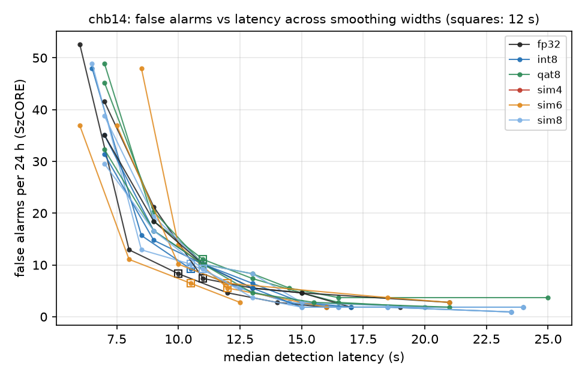

## chb15

Folds per seed: {0: 14, 1: 14, 2: 14}

- Early stopping fired in 42/42 jobs; ONNX FP32 export max |logit diff| 5.72e-06
- Seed 0: FP32 test specificity pooled over all held-out hours 0.9886 (OUTSIDE 0.995 +/- 0.005)
- Seed 1: FP32 test specificity pooled over all held-out hours 0.9902 (within 0.995 +/- 0.005)
- Seed 2: FP32 test specificity pooled over all held-out hours 0.9888 (OUTSIDE 0.995 +/- 0.005)
- Diagnostic: single folds outside the band 16/42 [(0, 0, 0.9653), (10, 0, 0.9495), (12, 0, 0.9851), (2, 0, 0.9818), (6, 0, 0.989), (9, 0, 1.0), (0, 1, 0.9781), (10, 1, 0.9518), (12, 1, 0.9819), (2, 1, 0.9823), (9, 1, 1.0), (0, 2, 0.9768), (10, 2, 0.9362), (12, 2, 0.9858), (2, 2, 0.9793), (9, 2, 1.0)]

### FP32 against EpiDeNet's reporting (4 s windows, pooled over folds)

| seed | FP/h raw | FP/h 3-window vote | window sens (vote) | spec (vote) | seizures detected |
|---|---|---|---|---|---|
| 0 | 10.32 | 6.92 | 0.844 | 0.9923 | 20/20 |
| 1 | 8.60 | 6.00 | 0.824 | 0.9932 | 20/20 |
| 2 | 9.80 | 6.22 | 0.851 | 0.9930 | 20/20 |

EpiDeNet (all CHB-MIT, LOOCV, 5 seeds): 4.29 raw, 2.24 with vote, 165/181 seizures.

### Two meanings of "FP/h" for the same FP32 model (pooled over folds)

| seed | window FP/h (3-window vote, 4 s grid) | SzCORE false alarms/h (12 s smoothing) | ratio |
|---|---|---|---|
| 0 | 6.92 | 0.50 | 13.8 |
| 1 | 6.00 | 0.35 | 17.1 |
| 2 | 6.22 | 0.52 | 11.9 |

Window FP/h is (1 - specificity) x windows per hour, so it depends on window length and hop, and one long artifact counts many times; SzCORE merges detections within 90 s into one alarm.

### Operating point (default smoothing, own threshold) and excess latency

| seed | model | FA/24h at 12 s | median latency at 12 s | detected | excess latency at FP32's FA (s) | smoothing there (s) | ΔFA/24h at FP32's latency |
|---|---|---|---|---|---|---|---|
| 0 | fp32 | 12.0 | 6.5 | 20/20 | 0.0 | 12.0 | 0.0 |
| 0 | int8 | 13.8 | 7.0 | 20/20 | 2.0 | 15.0 | 2.4 |
| 0 | sim8 | 13.2 | 7.0 | 20/20 | 1.8 | 14.7 | 1.7 |
| 0 | sim6 | 14.4 | 13.0 | 20/20 | 7.6 | 14.3 | n/a |
| 0 | sim4 | 5.4 | inf | 1/20 | inf | n/a | n/a |
| 0 | qat8 | 10.2 | 6.5 | 20/20 | -1.5 | 9.6 | -1.8 |
| 1 | fp32 | 8.4 | 5.0 | 20/20 | 0.0 | 12.0 | 0.0 |
| 1 | int8 | 6.0 | 8.0 | 20/20 | 1.9 | 9.7 | 9.7 |
| 1 | sim8 | 6.0 | 8.0 | 20/20 | 1.7 | 9.3 | 13.5 |
| 1 | sim6 | 15.0 | 16.0 | 19/20 | 17.0 | 22.0 | n/a |
| 1 | sim4 | 6.6 | inf | 2/20 | inf | n/a | n/a |
| 1 | qat8 | 7.8 | 5.5 | 20/20 | 0.2 | 11.3 | 0.3 |
| 2 | fp32 | 12.6 | 6.0 | 20/20 | 0.0 | 12.0 | 0.0 |
| 2 | int8 | 10.8 | 6.5 | 20/20 | -0.5 | 10.0 | -0.9 |
| 2 | sim8 | 11.4 | 6.5 | 20/20 | 0.1 | 11.1 | 0.1 |
| 2 | sim6 | 16.8 | 10.5 | 18/20 | 7.0 | 16.7 | n/a |
| 2 | sim4 | 0.6 | inf | 0/20 | inf | n/a | n/a |
| 2 | qat8 | 8.4 | 6.0 | 20/20 | -2.1 | 7.6 | -4.2 |

FP32 seed-to-seed excess latency (the null), all ordered seed pairs: ['-3.6', '-0.1', '5.5', '5.0', '-0.0', '-3.2']
95% band: (-3.5589285714285714, 5.4375)

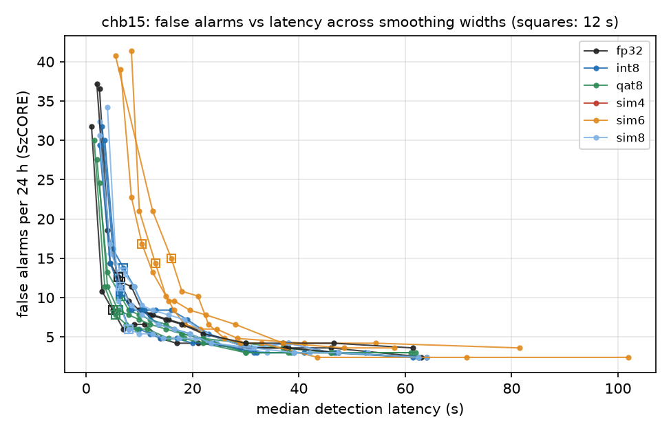

## chb16

Folds per seed: {0: 6, 1: 6, 2: 6}

- Early stopping fired in 18/18 jobs; ONNX FP32 export max |logit diff| 4.77e-06
- Seed 0: FP32 test specificity pooled over all held-out hours 0.9939 (within 0.995 +/- 0.005)
- Seed 1: FP32 test specificity pooled over all held-out hours 0.9870 (OUTSIDE 0.995 +/- 0.005)
- Seed 2: FP32 test specificity pooled over all held-out hours 0.9932 (within 0.995 +/- 0.005)
- Diagnostic: single folds outside the band 3/18 [(0, 1, 0.9601), (3, 1, 0.9849), (3, 2, 0.9856)]

### FP32 against EpiDeNet's reporting (4 s windows, pooled over folds)

| seed | FP/h raw | FP/h 3-window vote | window sens (vote) | spec (vote) | seizures detected |
|---|---|---|---|---|---|
| 0 | 5.84 | 1.00 | 0.125 | 0.9989 | 2/10 |
| 1 | 12.42 | 5.79 | 0.294 | 0.9947 | 4/10 |
| 2 | 6.05 | 1.16 | 0.100 | 0.9987 | 2/10 |

EpiDeNet (all CHB-MIT, LOOCV, 5 seeds): 4.29 raw, 2.24 with vote, 165/181 seizures.

### Two meanings of "FP/h" for the same FP32 model (pooled over folds)

| seed | window FP/h (3-window vote, 4 s grid) | SzCORE false alarms/h (12 s smoothing) | ratio |
|---|---|---|---|
| 0 | 1.00 | 0.11 | 9.5 |
| 1 | 5.79 | 0.58 | 10.0 |
| 2 | 1.16 | 0.16 | 7.3 |

Window FP/h is (1 - specificity) x windows per hour, so it depends on window length and hop, and one long artifact counts many times; SzCORE merges detections within 90 s into one alarm.

### Operating point (default smoothing, own threshold) and excess latency

| seed | model | FA/24h at 12 s | median latency at 12 s | detected | excess latency at FP32's FA (s) | smoothing there (s) | ΔFA/24h at FP32's latency |
|---|---|---|---|---|---|---|---|
| 0 | fp32 | 2.5 | inf | 0/10 | 0.0 | 12.0 | 0.0 |
| 0 | int8 | 2.5 | inf | 0/10 | n/a | n/a | n/a |
| 0 | sim8 | 2.5 | inf | 0/10 | n/a | n/a | n/a |
| 0 | sim6 | 2.5 | inf | 0/10 | n/a | n/a | n/a |
| 0 | sim4 | 1.3 | inf | 0/10 | n/a | n/a | n/a |
| 0 | qat8 | 5.1 | inf | 0/10 | n/a | n/a | n/a |
| 1 | fp32 | 13.9 | inf | 2/10 | 0.0 | 12.0 | 0.0 |
| 1 | int8 | 11.4 | inf | 4/10 | n/a | n/a | n/a |
| 1 | sim8 | 12.6 | inf | 4/10 | n/a | n/a | n/a |
| 1 | sim6 | 5.1 | inf | 1/10 | n/a | n/a | n/a |
| 1 | sim4 | 0.0 | inf | 0/10 | n/a | n/a | n/a |
| 1 | qat8 | 10.1 | inf | 4/10 | n/a | n/a | n/a |
| 2 | fp32 | 3.8 | inf | 0/10 | 0.0 | 12.0 | 0.0 |
| 2 | int8 | 3.8 | inf | 1/10 | n/a | n/a | n/a |
| 2 | sim8 | 3.8 | inf | 1/10 | n/a | n/a | n/a |
| 2 | sim6 | 5.1 | inf | 1/10 | n/a | n/a | n/a |
| 2 | sim4 | 6.3 | inf | 0/10 | n/a | n/a | n/a |
| 2 | qat8 | 5.1 | inf | 1/10 | n/a | n/a | n/a |

FP32 seed-to-seed excess latency (the null), all ordered seed pairs: ['n/a', 'n/a', 'n/a', 'n/a', 'n/a', 'n/a']
95% band: None

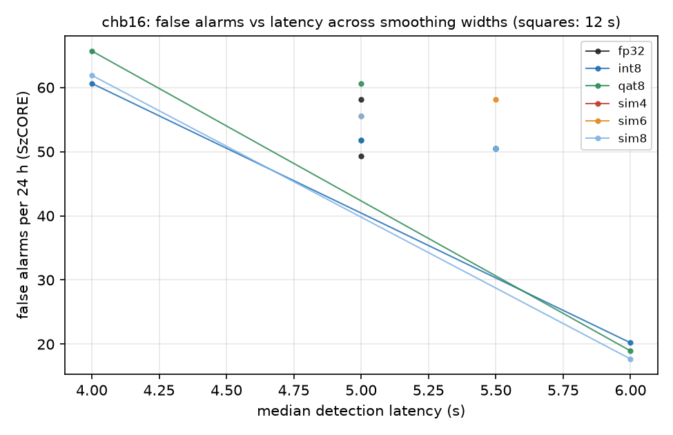

## chb17

Folds per seed: {0: 3, 1: 3, 2: 3}

- Early stopping fired in 9/9 jobs; ONNX FP32 export max |logit diff| 3.34e-06
- Seed 0: FP32 test specificity pooled over all held-out hours 0.9938 (within 0.995 +/- 0.005)
- Seed 1: FP32 test specificity pooled over all held-out hours 0.9937 (within 0.995 +/- 0.005)
- Seed 2: FP32 test specificity pooled over all held-out hours 0.9941 (within 0.995 +/- 0.005)
- Diagnostic: single folds outside the band 3/9 [(0, 0, 0.9881), (0, 1, 0.9868), (2, 2, 0.9897)]

### FP32 against EpiDeNet's reporting (4 s windows, pooled over folds)

| seed | FP/h raw | FP/h 3-window vote | window sens (vote) | spec (vote) | seizures detected |
|---|---|---|---|---|---|
| 0 | 5.76 | 1.71 | 0.436 | 0.9981 | 3/3 |
| 1 | 5.38 | 3.00 | 0.568 | 0.9967 | 3/3 |
| 2 | 5.38 | 2.52 | 0.437 | 0.9972 | 3/3 |

EpiDeNet (all CHB-MIT, LOOCV, 5 seeds): 4.29 raw, 2.24 with vote, 165/181 seizures.

### Two meanings of "FP/h" for the same FP32 model (pooled over folds)

| seed | window FP/h (3-window vote, 4 s grid) | SzCORE false alarms/h (12 s smoothing) | ratio |
|---|---|---|---|
| 0 | 1.71 | 0.33 | 5.1 |
| 1 | 3.00 | 0.38 | 7.9 |
| 2 | 2.52 | 0.43 | 5.9 |

Window FP/h is (1 - specificity) x windows per hour, so it depends on window length and hop, and one long artifact counts many times; SzCORE merges detections within 90 s into one alarm.

### Operating point (default smoothing, own threshold) and excess latency

| seed | model | FA/24h at 12 s | median latency at 12 s | detected | excess latency at FP32's FA (s) | smoothing there (s) | ΔFA/24h at FP32's latency |
|---|---|---|---|---|---|---|---|
| 0 | fp32 | 8.0 | 25.0 | 3/3 | 0.0 | 12.0 | 0.0 |
| 0 | int8 | 8.0 | 25.0 | 3/3 | 0.0 | 12.0 | 0.0 |
| 0 | sim8 | 8.0 | 25.0 | 3/3 | 0.0 | 12.0 | 0.0 |
| 0 | sim6 | 5.7 | 34.0 | 3/3 | 0.7 | 10.7 | 0.2 |
| 0 | sim4 | 8.0 | 52.0 | 2/3 | 27.0 | 12.0 | n/a |
| 0 | qat8 | 8.0 | 26.0 | 3/3 | 1.0 | 12.0 | 2.3 |
| 1 | fp32 | 9.1 | 32.0 | 3/3 | 0.0 | 12.0 | 0.0 |
| 1 | int8 | 8.0 | 14.0 | 3/3 | -18.6 | 11.4 | -8.0 |
| 1 | sim8 | 8.0 | 14.0 | 3/3 | -18.5 | 11.5 | -8.0 |
| 1 | sim6 | 5.7 | 33.0 | 3/3 | -0.2 | 9.6 | -0.6 |
| 1 | sim4 | 10.3 | 59.0 | 2/3 | 25.0 | 16.0 | n/a |
| 1 | qat8 | 8.0 | 32.0 | 3/3 | -2.3 | 11.6 | -1.1 |
| 2 | fp32 | 10.3 | 32.0 | 3/3 | 0.0 | 12.0 | 0.0 |
| 2 | int8 | 9.1 | 32.0 | 3/3 | -1.0 | 11.3 | -1.1 |
| 2 | sim8 | 9.1 | 29.0 | 3/3 | -3.5 | 11.3 | -3.4 |
| 2 | sim6 | 8.0 | 32.0 | 3/3 | -0.7 | 10.7 | -3.4 |
| 2 | sim4 | 13.7 | 40.0 | 2/3 | 12.0 | 16.0 | 16.1 |
| 2 | qat8 | 9.1 | 33.0 | 3/3 | -0.4 | 11.2 | -0.3 |

FP32 seed-to-seed excess latency (the null), all ordered seed pairs: ['9.0', '10.0', '-7.7', '1.5', '-8.3', '-2.9']
95% band: (-8.25, 9.875)

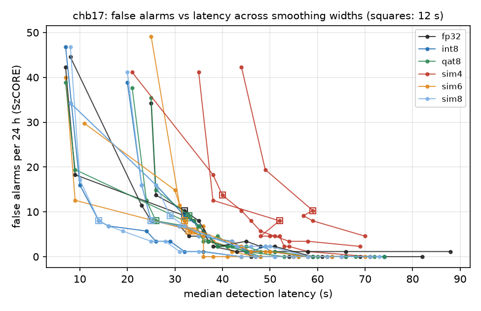

## chb18

Folds per seed: {0: 6, 1: 6, 2: 6}

- Early stopping fired in 18/18 jobs; ONNX FP32 export max |logit diff| 5.25e-06
- Seed 0: FP32 test specificity pooled over all held-out hours 0.9911 (within 0.995 +/- 0.005)
- Seed 1: FP32 test specificity pooled over all held-out hours 0.9942 (within 0.995 +/- 0.005)
- Seed 2: FP32 test specificity pooled over all held-out hours 0.9887 (OUTSIDE 0.995 +/- 0.005)
- Diagnostic: single folds outside the band 4/18 [(3, 0, 0.9744), (5, 1, 0.9853), (3, 2, 0.9651), (5, 2, 0.9797)]

### FP32 against EpiDeNet's reporting (4 s windows, pooled over folds)

| seed | FP/h raw | FP/h 3-window vote | window sens (vote) | spec (vote) | seizures detected |
|---|---|---|---|---|---|
| 0 | 8.28 | 6.26 | 0.782 | 0.9931 | 6/6 |
| 1 | 5.28 | 2.67 | 0.727 | 0.9971 | 6/6 |
| 2 | 10.47 | 8.14 | 0.772 | 0.9910 | 6/6 |

EpiDeNet (all CHB-MIT, LOOCV, 5 seeds): 4.29 raw, 2.24 with vote, 165/181 seizures.

### Two meanings of "FP/h" for the same FP32 model (pooled over folds)

| seed | window FP/h (3-window vote, 4 s grid) | SzCORE false alarms/h (12 s smoothing) | ratio |
|---|---|---|---|
| 0 | 6.26 | 0.20 | 31.9 |
| 1 | 2.67 | 0.36 | 7.3 |
| 2 | 8.14 | 0.36 | 22.3 |

Window FP/h is (1 - specificity) x windows per hour, so it depends on window length and hop, and one long artifact counts many times; SzCORE merges detections within 90 s into one alarm.

### Operating point (default smoothing, own threshold) and excess latency

| seed | model | FA/24h at 12 s | median latency at 12 s | detected | excess latency at FP32's FA (s) | smoothing there (s) | ΔFA/24h at FP32's latency |
|---|---|---|---|---|---|---|---|
| 0 | fp32 | 4.7 | 8.5 | 5/6 | 0.0 | 12.0 | 0.0 |
| 0 | int8 | 4.7 | 8.5 | 5/6 | 0.0 | 12.0 | 0.0 |
| 0 | sim8 | 4.7 | 8.5 | 6/6 | 0.0 | 12.0 | 0.0 |
| 0 | sim6 | 4.0 | 9.0 | 6/6 | -0.2 | 10.7 | -0.2 |
| 0 | sim4 | 4.7 | 30.0 | 5/6 | 21.5 | 12.0 | n/a |
| 0 | qat8 | 6.1 | 8.5 | 5/6 | 2.0 | 16.0 | 1.3 |
| 1 | fp32 | 8.8 | 9.0 | 6/6 | 0.0 | 12.0 | 0.0 |
| 1 | int8 | 7.4 | 9.0 | 6/6 | -1.0 | 10.0 | -1.3 |
| 1 | sim8 | 6.7 | 9.0 | 6/6 | -1.0 | 10.0 | -2.0 |
| 1 | sim6 | 4.0 | 12.5 | 4/6 | -0.5 | 7.5 | -2.0 |
| 1 | sim4 | 3.4 | inf | 2/6 | inf | n/a | n/a |
| 1 | qat8 | 9.4 | 8.5 | 6/6 | -0.1 | 12.8 | -0.2 |
| 2 | fp32 | 8.8 | 8.5 | 6/6 | 0.0 | 12.0 | 0.0 |
| 2 | int8 | 7.4 | 8.5 | 6/6 | -0.8 | 10.4 | -1.3 |
| 2 | sim8 | 8.1 | 8.5 | 6/6 | -1.0 | 10.0 | -0.7 |
| 2 | sim6 | 7.4 | 9.0 | 5/6 | -1.6 | 7.8 | -1.2 |
| 2 | sim4 | 2.0 | inf | 3/6 | inf | n/a | n/a |
| 2 | qat8 | 10.1 | 8.5 | 6/6 | 1.3 | 14.7 | 1.3 |

FP32 seed-to-seed excess latency (the null), all ordered seed pairs: ['2.5', '5.0', '-2.7', '-0.5', '-2.2', '0.5']
95% band: (-2.5913461538461533, 4.6875)

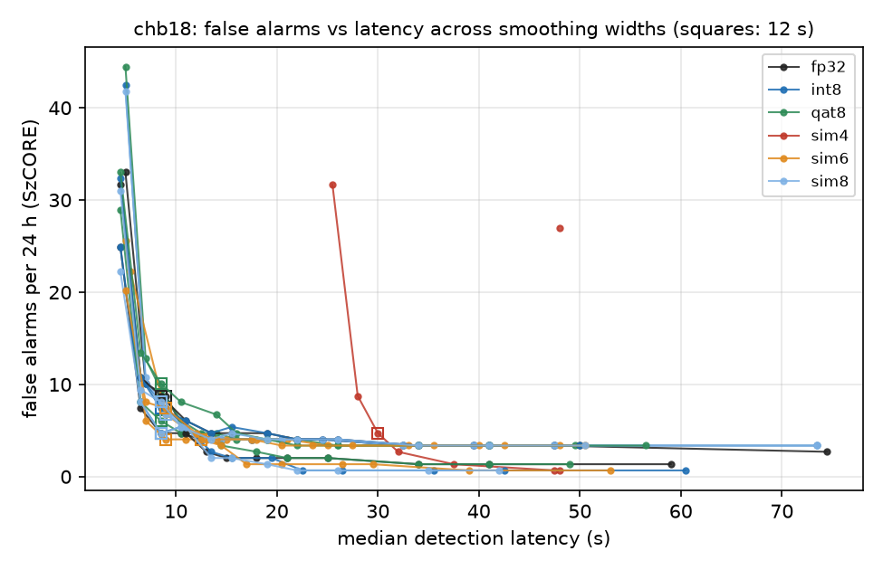

## chb19

Folds per seed: {0: 3, 1: 3, 2: 3}

- Early stopping fired in 9/9 jobs; ONNX FP32 export max |logit diff| 4.29e-06
- Seed 0: FP32 test specificity pooled over all held-out hours 0.9944 (within 0.995 +/- 0.005)
- Seed 1: FP32 test specificity pooled over all held-out hours 0.9955 (within 0.995 +/- 0.005)
- Seed 2: FP32 test specificity pooled over all held-out hours 0.9904 (within 0.995 +/- 0.005)
- Diagnostic: single folds outside the band 1/9 [(2, 2, 0.9851)]

### FP32 against EpiDeNet's reporting (4 s windows, pooled over folds)

| seed | FP/h raw | FP/h 3-window vote | window sens (vote) | spec (vote) | seizures detected |
|---|---|---|---|---|---|
| 0 | 4.88 | 2.77 | 0.947 | 0.9969 | 3/3 |
| 1 | 4.08 | 2.94 | 0.965 | 0.9967 | 3/3 |
| 2 | 8.32 | 6.65 | 0.947 | 0.9926 | 3/3 |

EpiDeNet (all CHB-MIT, LOOCV, 5 seeds): 4.29 raw, 2.24 with vote, 165/181 seizures.

### Two meanings of "FP/h" for the same FP32 model (pooled over folds)

| seed | window FP/h (3-window vote, 4 s grid) | SzCORE false alarms/h (12 s smoothing) | ratio |
|---|---|---|---|
| 0 | 2.77 | 0.43 | 6.4 |
| 1 | 2.94 | 0.17 | 17.6 |
| 2 | 6.65 | 0.50 | 13.3 |

Window FP/h is (1 - specificity) x windows per hour, so it depends on window length and hop, and one long artifact counts many times; SzCORE merges detections within 90 s into one alarm.

### Operating point (default smoothing, own threshold) and excess latency

| seed | model | FA/24h at 12 s | median latency at 12 s | detected | excess latency at FP32's FA (s) | smoothing there (s) | ΔFA/24h at FP32's latency |
|---|---|---|---|---|---|---|---|
| 0 | fp32 | 10.4 | 9.0 | 3/3 | 0.0 | 12.0 | 0.0 |
| 0 | int8 | 9.6 | 9.0 | 3/3 | -0.4 | 11.2 | -0.8 |
| 0 | sim8 | 9.6 | 9.0 | 3/3 | -0.5 | 11.0 | -0.8 |
| 0 | sim6 | 8.0 | 9.0 | 3/3 | -1.2 | 9.6 | -2.4 |
| 0 | sim4 | 2.4 | 18.0 | 3/3 | 6.4 | 6.8 | n/a |
| 0 | qat8 | 9.6 | 9.0 | 3/3 | -0.2 | 11.6 | -0.8 |
| 1 | fp32 | 4.0 | 10.0 | 3/3 | 0.0 | 12.0 | 0.0 |
| 1 | int8 | 8.0 | 10.0 | 3/3 | 6.0 | 24.0 | 4.0 |
| 1 | sim8 | 7.2 | 10.0 | 3/3 | 6.0 | 24.0 | 3.2 |
| 1 | sim6 | 7.2 | 10.0 | 3/3 | 2.0 | 16.0 | 3.2 |
| 1 | sim4 | 5.6 | 20.0 | 3/3 | 11.0 | 14.0 | n/a |
| 1 | qat8 | 6.4 | 10.0 | 3/3 | 1.2 | 14.4 | 2.4 |
| 2 | fp32 | 12.0 | 8.0 | 3/3 | 0.0 | 12.0 | 0.0 |
| 2 | int8 | 12.8 | 8.0 | 3/3 | 0.5 | 13.0 | 0.8 |
| 2 | sim8 | 12.8 | 8.0 | 3/3 | 0.5 | 13.0 | 0.8 |
| 2 | sim6 | 11.2 | 11.0 | 3/3 | 2.7 | 11.4 | 8.8 |
| 2 | sim4 | 6.4 | 16.0 | 3/3 | 5.4 | 6.8 | n/a |
| 2 | qat8 | 7.2 | 9.0 | 3/3 | -0.2 | 9.6 | -0.8 |

FP32 seed-to-seed excess latency (the null), all ordered seed pairs: ['-1.6', '0.0', '3.0', '22.0', '-1.1', '-1.1']
95% band: (-1.5763888888888884, 19.625)

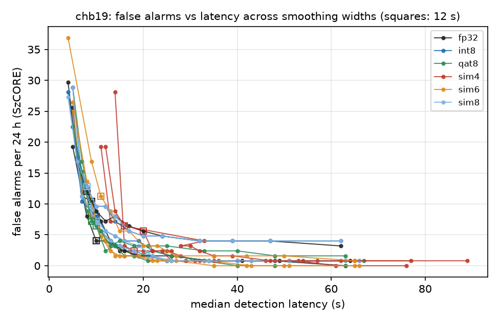

## chb20

Folds per seed: {0: 6, 1: 6, 2: 6}

- Early stopping fired in 18/18 jobs; ONNX FP32 export max |logit diff| 9.54e-06
- Seed 0: FP32 test specificity pooled over all held-out hours 0.9950 (within 0.995 +/- 0.005)
- Seed 1: FP32 test specificity pooled over all held-out hours 0.9951 (within 0.995 +/- 0.005)
- Seed 2: FP32 test specificity pooled over all held-out hours 0.9943 (within 0.995 +/- 0.005)
- Diagnostic: single folds outside the band 1/18 [(3, 1, 0.9897)]

### FP32 against EpiDeNet's reporting (4 s windows, pooled over folds)

| seed | FP/h raw | FP/h 3-window vote | window sens (vote) | spec (vote) | seizures detected |
|---|---|---|---|---|---|
| 0 | 4.71 | 2.64 | 0.807 | 0.9971 | 8/8 |
| 1 | 4.35 | 2.21 | 0.755 | 0.9976 | 8/8 |
| 2 | 4.93 | 2.54 | 0.795 | 0.9971 | 8/8 |

EpiDeNet (all CHB-MIT, LOOCV, 5 seeds): 4.29 raw, 2.24 with vote, 165/181 seizures.

### Two meanings of "FP/h" for the same FP32 model (pooled over folds)

| seed | window FP/h (3-window vote, 4 s grid) | SzCORE false alarms/h (12 s smoothing) | ratio |
|---|---|---|---|
| 0 | 2.64 | 0.25 | 10.4 |
| 1 | 2.21 | 0.25 | 8.7 |
| 2 | 2.54 | 0.36 | 7.0 |

Window FP/h is (1 - specificity) x windows per hour, so it depends on window length and hop, and one long artifact counts many times; SzCORE merges detections within 90 s into one alarm.

### Operating point (default smoothing, own threshold) and excess latency

| seed | model | FA/24h at 12 s | median latency at 12 s | detected | excess latency at FP32's FA (s) | smoothing there (s) | ΔFA/24h at FP32's latency |
|---|---|---|---|---|---|---|---|
| 0 | fp32 | 6.1 | 9.0 | 8/8 | 0.0 | 12.0 | 0.0 |
| 0 | int8 | 6.1 | 7.5 | 8/8 | -1.5 | 12.0 | -0.9 |
| 0 | sim8 | 6.1 | 7.5 | 8/8 | -1.5 | 12.0 | -0.9 |
| 0 | sim6 | 5.2 | 22.0 | 7/8 | 11.0 | 8.0 | n/a |
| 0 | sim4 | 4.3 | 28.5 | 5/8 | 18.9 | 11.5 | n/a |
| 0 | qat8 | 6.1 | 9.0 | 8/8 | 0.0 | 12.0 | 0.0 |
| 1 | fp32 | 6.1 | 6.5 | 8/8 | 0.0 | 12.0 | 0.0 |
| 1 | int8 | 4.3 | 8.5 | 8/8 | 1.0 | 10.0 | 1.7 |
| 1 | sim8 | 4.3 | 8.5 | 8/8 | 1.0 | 10.0 | 1.7 |
| 1 | sim6 | 1.7 | inf | 2/8 | inf | n/a | n/a |
| 1 | sim4 | 5.2 | inf | 0/8 | inf | n/a | n/a |
| 1 | qat8 | 4.3 | 6.5 | 8/8 | -0.1 | 10.9 | -1.7 |
| 2 | fp32 | 8.7 | 8.5 | 8/8 | 0.0 | 12.0 | 0.0 |
| 2 | int8 | 7.0 | 9.5 | 8/8 | 0.3 | 10.7 | 0.9 |
| 2 | sim8 | 8.7 | 12.0 | 8/8 | 3.5 | 12.0 | 2.7 |
| 2 | sim6 | 6.1 | 18.0 | 8/8 | 9.0 | 10.7 | n/a |
| 2 | sim4 | 1.7 | inf | 1/8 | inf | n/a | n/a |
| 2 | qat8 | 7.0 | 11.5 | 8/8 | 2.1 | 11.0 | 4.2 |

FP32 seed-to-seed excess latency (the null), all ordered seed pairs: ['-2.5', '5.1', '2.5', '7.6', '-0.5', '-2.9']
95% band: (-2.8124999999999996, 7.3125)

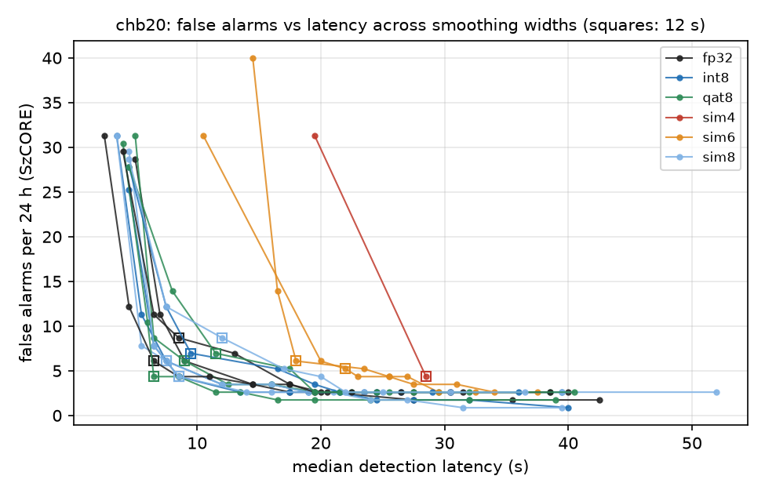

## chb21

Folds per seed: {0: 4, 1: 4, 2: 4}

- Early stopping fired in 12/12 jobs; ONNX FP32 export max |logit diff| 4.29e-06
- Seed 0: FP32 test specificity pooled over all held-out hours 0.9941 (within 0.995 +/- 0.005)
- Seed 1: FP32 test specificity pooled over all held-out hours 0.9942 (within 0.995 +/- 0.005)
- Seed 2: FP32 test specificity pooled over all held-out hours 0.9936 (within 0.995 +/- 0.005)
- Diagnostic: single folds outside the band 0/12

### FP32 against EpiDeNet's reporting (4 s windows, pooled over folds)

| seed | FP/h raw | FP/h 3-window vote | window sens (vote) | spec (vote) | seizures detected |
|---|---|---|---|---|---|
| 0 | 5.15 | 2.10 | 0.685 | 0.9976 | 4/4 |
| 1 | 4.96 | 2.44 | 0.924 | 0.9973 | 4/4 |
| 2 | 5.64 | 2.62 | 0.924 | 0.9971 | 4/4 |

EpiDeNet (all CHB-MIT, LOOCV, 5 seeds): 4.29 raw, 2.24 with vote, 165/181 seizures.

### Two meanings of "FP/h" for the same FP32 model (pooled over folds)

| seed | window FP/h (3-window vote, 4 s grid) | SzCORE false alarms/h (12 s smoothing) | ratio |
|---|---|---|---|
| 0 | 2.10 | 0.18 | 11.5 |
| 1 | 2.44 | 0.24 | 10.0 |
| 2 | 2.62 | 0.43 | 6.1 |

Window FP/h is (1 - specificity) x windows per hour, so it depends on window length and hop, and one long artifact counts many times; SzCORE merges detections within 90 s into one alarm.

### Operating point (default smoothing, own threshold) and excess latency

| seed | model | FA/24h at 12 s | median latency at 12 s | detected | excess latency at FP32's FA (s) | smoothing there (s) | ΔFA/24h at FP32's latency |
|---|---|---|---|---|---|---|---|
| 0 | fp32 | 4.4 | 9.0 | 4/4 | 0.0 | 12.0 | 0.0 |
| 0 | int8 | 4.4 | 9.0 | 4/4 | 0.0 | 12.0 | -0.0 |
| 0 | sim8 | 4.4 | 9.0 | 4/4 | 0.0 | 12.0 | 0.0 |
| 0 | sim6 | 5.8 | 8.5 | 4/4 | 0.8 | 14.7 | 0.9 |
| 0 | sim4 | 4.4 | inf | 1/4 | inf | n/a | n/a |
| 0 | qat8 | 5.8 | 8.0 | 4/4 | 1.0 | 16.0 | 0.7 |
| 1 | fp32 | 5.8 | 7.0 | 4/4 | 0.0 | 12.0 | 0.0 |
| 1 | int8 | 6.6 | 9.0 | 4/4 | 2.5 | 13.0 | 5.1 |
| 1 | sim8 | 7.3 | 9.0 | 4/4 | 2.8 | 13.6 | 6.6 |
| 1 | sim6 | 2.2 | 24.5 | 3/4 | 13.0 | 8.0 | n/a |
| 1 | sim4 | 3.7 | inf | 0/4 | inf | n/a | n/a |
| 1 | qat8 | 7.3 | 7.5 | 4/4 | 2.5 | 16.0 | 8.8 |
| 2 | fp32 | 10.2 | 6.5 | 4/4 | 0.0 | 12.0 | 0.0 |
| 2 | int8 | 10.2 | 6.0 | 4/4 | -0.5 | 12.0 | -0.9 |
| 2 | sim8 | 9.5 | 6.0 | 4/4 | -0.7 | 11.6 | -1.5 |
| 2 | sim6 | 7.3 | 8.0 | 4/4 | 0.6 | 9.7 | 2.2 |
| 2 | sim4 | 5.8 | inf | 2/4 | inf | n/a | n/a |
| 2 | qat8 | 10.2 | 7.5 | 4/4 | 1.0 | 12.0 | 5.1 |

FP32 seed-to-seed excess latency (the null), all ordered seed pairs: ['-0.7', '0.2', '1.6', '1.2', '0.9', '0.2']
95% band: (-0.5624999999999996, 1.5517857142857139)

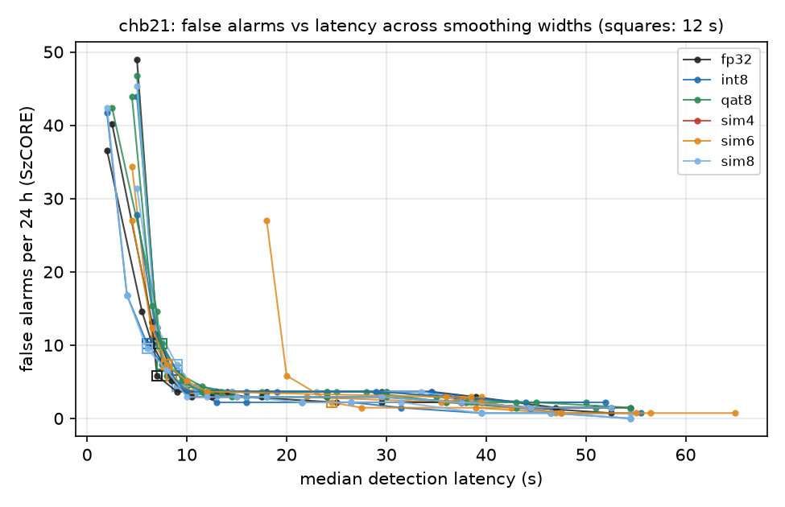

## chb22

Folds per seed: {0: 3, 1: 3, 2: 3}

- Early stopping fired in 9/9 jobs; ONNX FP32 export max |logit diff| 2.38e-06
- Seed 0: FP32 test specificity pooled over all held-out hours 0.9936 (within 0.995 +/- 0.005)
- Seed 1: FP32 test specificity pooled over all held-out hours 0.9934 (within 0.995 +/- 0.005)
- Seed 2: FP32 test specificity pooled over all held-out hours 0.9931 (within 0.995 +/- 0.005)
- Diagnostic: single folds outside the band 3/9 [(2, 0, 0.9891), (2, 1, 0.9874), (2, 2, 0.9865)]

### FP32 against EpiDeNet's reporting (4 s windows, pooled over folds)

| seed | FP/h raw | FP/h 3-window vote | window sens (vote) | spec (vote) | seizures detected |
|---|---|---|---|---|---|
| 0 | 5.58 | 2.00 | 0.921 | 0.9978 | 3/3 |
| 1 | 5.84 | 1.68 | 0.889 | 0.9981 | 3/3 |
| 2 | 6.48 | 2.61 | 0.921 | 0.9970 | 3/3 |

EpiDeNet (all CHB-MIT, LOOCV, 5 seeds): 4.29 raw, 2.24 with vote, 165/181 seizures.

### Two meanings of "FP/h" for the same FP32 model (pooled over folds)

| seed | window FP/h (3-window vote, 4 s grid) | SzCORE false alarms/h (12 s smoothing) | ratio |
|---|---|---|---|
| 0 | 2.00 | 0.45 | 4.4 |
| 1 | 1.68 | 0.32 | 5.2 |
| 2 | 2.61 | 0.42 | 6.2 |

Window FP/h is (1 - specificity) x windows per hour, so it depends on window length and hop, and one long artifact counts many times; SzCORE merges detections within 90 s into one alarm.

### Operating point (default smoothing, own threshold) and excess latency

| seed | model | FA/24h at 12 s | median latency at 12 s | detected | excess latency at FP32's FA (s) | smoothing there (s) | ΔFA/24h at FP32's latency |
|---|---|---|---|---|---|---|---|
| 0 | fp32 | 10.8 | 8.0 | 3/3 | 0.0 | 12.0 | 0.0 |
| 0 | int8 | 10.8 | 8.0 | 3/3 | 0.0 | 12.0 | 0.0 |
| 0 | sim8 | 10.8 | 8.0 | 3/3 | 0.0 | 12.0 | 0.0 |
| 0 | sim6 | 8.5 | 9.0 | 3/3 | -0.2 | 9.6 | -0.4 |
| 0 | sim4 | 3.1 | 15.0 | 3/3 | 4.7 | 7.4 | n/a |
| 0 | qat8 | 13.2 | 8.0 | 3/3 | 0.5 | 13.1 | 2.3 |
| 1 | fp32 | 7.7 | 16.0 | 3/3 | 0.0 | 12.0 | 0.0 |
| 1 | int8 | 7.7 | 16.0 | 3/3 | 0.0 | 12.0 | 0.0 |
| 1 | sim8 | 7.7 | 16.0 | 3/3 | 0.0 | 12.0 | 0.0 |
| 1 | sim6 | 1.5 | 8.0 | 3/3 | -8.9 | 10.1 | -7.7 |
| 1 | sim4 | 5.4 | 24.0 | 3/3 | 6.9 | 10.5 | 9.6 |
| 1 | qat8 | 4.6 | 9.0 | 3/3 | -7.6 | 10.8 | -7.7 |
| 2 | fp32 | 10.1 | 9.0 | 3/3 | 0.0 | 12.0 | 0.0 |
| 2 | int8 | 11.6 | 8.0 | 3/3 | -0.2 | 13.6 | -0.4 |
| 2 | sim8 | 11.6 | 8.0 | 3/3 | -0.2 | 13.6 | -0.4 |
| 2 | sim6 | 11.6 | 8.0 | 3/3 | 0.0 | 14.0 | 0.0 |
| 2 | sim4 | 8.5 | 11.0 | 3/3 | 1.5 | 11.0 | 4.6 |
| 2 | qat8 | 9.3 | 12.0 | 3/3 | 2.8 | 11.6 | 27.5 |

FP32 seed-to-seed excess latency (the null), all ordered seed pairs: ['7.0', '0.8', '-5.6', '-5.0', '-0.3', '6.2']
95% band: (-5.5249999999999995, 6.90625)

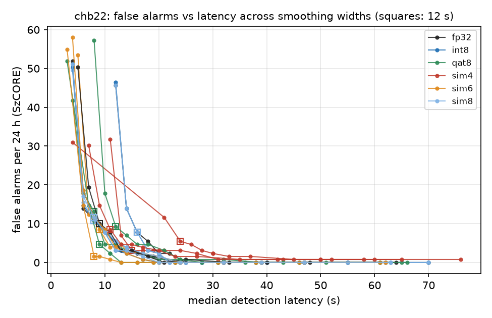

## chb23

Folds per seed: {0: 3, 1: 3, 2: 3}

- Early stopping fired in 9/9 jobs; ONNX FP32 export max |logit diff| 3.34e-06
- Seed 0: FP32 test specificity pooled over all held-out hours 0.9957 (within 0.995 +/- 0.005)
- Seed 1: FP32 test specificity pooled over all held-out hours 0.9959 (within 0.995 +/- 0.005)
- Seed 2: FP32 test specificity pooled over all held-out hours 0.9963 (within 0.995 +/- 0.005)
- Diagnostic: single folds outside the band 0/9

### FP32 against EpiDeNet's reporting (4 s windows, pooled over folds)

| seed | FP/h raw | FP/h 3-window vote | window sens (vote) | spec (vote) | seizures detected |
|---|---|---|---|---|---|
| 0 | 3.99 | 2.52 | 0.945 | 0.9974 | 7/7 |
| 1 | 3.58 | 2.22 | 0.954 | 0.9978 | 7/7 |
| 2 | 3.20 | 2.07 | 0.859 | 0.9979 | 7/7 |

EpiDeNet (all CHB-MIT, LOOCV, 5 seeds): 4.29 raw, 2.24 with vote, 165/181 seizures.

### Two meanings of "FP/h" for the same FP32 model (pooled over folds)

| seed | window FP/h (3-window vote, 4 s grid) | SzCORE false alarms/h (12 s smoothing) | ratio |
|---|---|---|---|
| 0 | 2.52 | 0.15 | 16.8 |
| 1 | 2.22 | 0.11 | 19.7 |
| 2 | 2.07 | 0.19 | 11.0 |

Window FP/h is (1 - specificity) x windows per hour, so it depends on window length and hop, and one long artifact counts many times; SzCORE merges detections within 90 s into one alarm.

### Operating point (default smoothing, own threshold) and excess latency

| seed | model | FA/24h at 12 s | median latency at 12 s | detected | excess latency at FP32's FA (s) | smoothing there (s) | ΔFA/24h at FP32's latency |
|---|---|---|---|---|---|---|---|
| 0 | fp32 | 3.6 | 5.0 | 7/7 | 0.0 | 12.0 | 0.0 |
| 0 | int8 | 3.6 | 5.0 | 7/7 | 0.0 | 12.0 | 0.0 |
| 0 | sim8 | 3.6 | 5.0 | 7/7 | 0.0 | 12.0 | 0.0 |
| 0 | sim6 | 2.7 | 5.0 | 7/7 | -0.5 | 11.0 | -0.9 |
| 0 | sim4 | 6.3 | 8.0 | 7/7 | 5.0 | 16.0 | 10.3 |
| 0 | qat8 | 1.8 | 5.0 | 7/7 | -1.0 | 10.0 | -1.8 |
| 1 | fp32 | 2.7 | 7.0 | 7/7 | 0.0 | 12.0 | 0.0 |
| 1 | int8 | 2.7 | 7.0 | 7/7 | 0.0 | 12.0 | 0.0 |
| 1 | sim8 | 2.7 | 7.0 | 7/7 | 0.0 | 12.0 | 0.0 |
| 1 | sim6 | 4.5 | 4.0 | 7/7 | 1.0 | 20.0 | 0.5 |
| 1 | sim4 | 6.3 | 17.0 | 7/7 | 12.0 | 16.0 | n/a |
| 1 | qat8 | 3.6 | 7.0 | 7/7 | 4.0 | 20.0 | 0.9 |
| 2 | fp32 | 4.5 | 11.0 | 7/7 | 0.0 | 12.0 | 0.0 |
| 2 | int8 | 4.5 | 11.0 | 7/7 | 0.0 | 12.0 | 0.0 |
| 2 | sim8 | 4.5 | 11.0 | 7/7 | 0.0 | 12.0 | 0.0 |
| 2 | sim6 | 3.6 | 10.0 | 7/7 | -1.7 | 10.7 | -0.9 |
| 2 | sim4 | 3.6 | 14.0 | 7/7 | 2.5 | 11.3 | 4.5 |
| 2 | qat8 | 4.5 | 11.0 | 7/7 | 0.0 | 12.0 | 0.0 |

FP32 seed-to-seed excess latency (the null), all ordered seed pairs: ['0.0', '8.0', '0.0', '7.0', '-6.7', '-6.1']
95% band: (-6.591954022988505, 7.875)

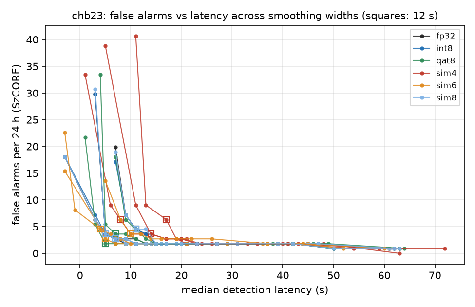

## chb24

Folds per seed: {0: 12, 1: 12, 2: 12}

- Early stopping fired in 36/36 jobs; ONNX FP32 export max |logit diff| 6.68e-06
- Seed 0: FP32 test specificity pooled over all held-out hours 0.9893 (OUTSIDE 0.995 +/- 0.005)
- Seed 1: FP32 test specificity pooled over all held-out hours 0.9920 (within 0.995 +/- 0.005)
- Seed 2: FP32 test specificity pooled over all held-out hours 0.9916 (within 0.995 +/- 0.005)
- Diagnostic: single folds outside the band 12/36 [(4, 0, 0.9815), (6, 0, 0.9847), (7, 0, 0.9854), (9, 0, 0.9375), (10, 1, 0.9796), (11, 1, 1.0), (2, 1, 0.9886), (6, 1, 0.9794), (9, 1, 0.9703), (4, 2, 0.9833), (6, 2, 0.9789), (9, 2, 0.9658)]

### FP32 against EpiDeNet's reporting (4 s windows, pooled over folds)

| seed | FP/h raw | FP/h 3-window vote | window sens (vote) | spec (vote) | seizures detected |
|---|---|---|---|---|---|
| 0 | 9.91 | 5.17 | 0.607 | 0.9933 | 16/16 |
| 1 | 6.81 | 3.15 | 0.631 | 0.9966 | 15/16 |
| 2 | 7.14 | 3.90 | 0.617 | 0.9953 | 16/16 |

EpiDeNet (all CHB-MIT, LOOCV, 5 seeds): 4.29 raw, 2.24 with vote, 165/181 seizures.

### Two meanings of "FP/h" for the same FP32 model (pooled over folds)

| seed | window FP/h (3-window vote, 4 s grid) | SzCORE false alarms/h (12 s smoothing) | ratio |
|---|---|---|---|
| 0 | 5.17 | 0.61 | 8.5 |
| 1 | 3.15 | 0.66 | 4.8 |
| 2 | 3.90 | 0.52 | 7.5 |

Window FP/h is (1 - specificity) x windows per hour, so it depends on window length and hop, and one long artifact counts many times; SzCORE merges detections within 90 s into one alarm.

### Operating point (default smoothing, own threshold) and excess latency

| seed | model | FA/24h at 12 s | median latency at 12 s | detected | excess latency at FP32's FA (s) | smoothing there (s) | ΔFA/24h at FP32's latency |
|---|---|---|---|---|---|---|---|
| 0 | fp32 | 14.7 | 11.5 | 16/16 | 0.0 | 12.0 | 0.0 |
| 0 | int8 | 12.4 | 11.5 | 16/16 | -0.3 | 11.4 | -2.3 |
| 0 | sim8 | 11.3 | 11.5 | 16/16 | -0.4 | 11.2 | -3.4 |
| 0 | sim6 | 18.0 | 12.0 | 14/16 | 6.8 | 18.7 | 6.5 |
| 0 | sim4 | 2.3 | inf | 6/16 | inf | n/a | n/a |
| 0 | qat8 | 16.9 | 11.5 | 16/16 | 1.0 | 14.0 | 2.3 |
| 1 | fp32 | 15.8 | 11.0 | 15/16 | 0.0 | 12.0 | 0.0 |
| 1 | int8 | 18.0 | 11.0 | 15/16 | 0.4 | 12.9 | 2.3 |
| 1 | sim8 | 19.2 | 11.0 | 15/16 | 0.6 | 13.2 | 3.4 |
| 1 | sim6 | 30.4 | 12.0 | 14/16 | 14.0 | 25.5 | 14.7 |
| 1 | sim4 | 6.8 | 42.5 | 9/16 | 22.0 | 7.3 | 24.8 |
| 1 | qat8 | 12.4 | 11.5 | 15/16 | -1.0 | 9.0 | -2.3 |
| 2 | fp32 | 12.4 | 12.0 | 15/16 | 0.0 | 12.0 | 0.0 |
| 2 | int8 | 12.4 | 12.0 | 15/16 | 0.0 | 12.0 | 0.0 |
| 2 | sim8 | 12.4 | 12.0 | 15/16 | 0.0 | 12.0 | 0.0 |
| 2 | sim6 | 7.9 | 12.0 | 14/16 | -2.0 | 8.0 | -4.5 |
| 2 | sim4 | 14.7 | 15.0 | 12/16 | 5.2 | 14.0 | 15.0 |
| 2 | qat8 | 11.3 | 12.0 | 15/16 | -0.7 | 10.7 | -1.1 |

FP32 seed-to-seed excess latency (the null), all ordered seed pairs: ['-0.2', '-0.5', '0.3', '-0.5', '0.5', '-0.1']
95% band: (-0.5, 0.47916666666666674)

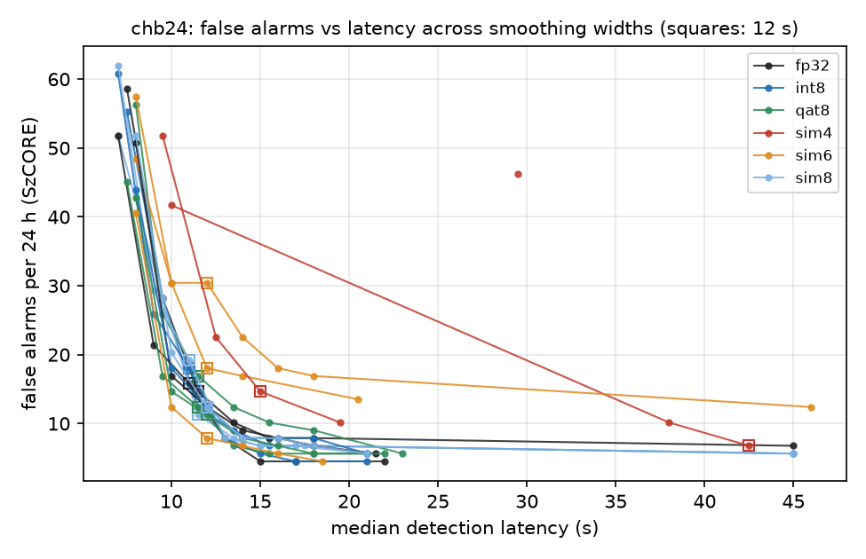

## Pooled across patients (pre-registered: median over seeds per patient, then over patients)

- FP32 seed-pair null: n = 144 ordered pairs, 95% band (-5.87, 9.57)
- int8: pooled excess latency 0.22 s over 24 patient(s) [inside the null band, below the 2 s floor]; patient-seed values 72, censored 0, undefined 3
- sim8: pooled excess latency 0.00 s over 24 patient(s) [inside the null band, below the 2 s floor]; patient-seed values 72, censored 0, undefined 3
- sim6: pooled excess latency 0.83 s over 24 patient(s) [inside the null band, below the 2 s floor]; patient-seed values 72, censored 4, undefined 3
- sim4: pooled excess latency 20.71 s over 24 patient(s) [outside the null band, at/above the 2 s floor]; patient-seed values 72, censored 24, undefined 3
- qat8: pooled excess latency 0.33 s over 24 patient(s) [inside the null band, below the 2 s floor]; patient-seed values 72, censored 0, undefined 3

**Stage 0 kill rule** (stop if INT8, sim6 and sim4 are each inside the band or below 2 s): CONTINUE
