# Stage 0 summary

## chb01

Folds per seed: {0: 7, 1: 7, 2: 7, 3: 7, 4: 7}

- Early stopping fired in 35/35 jobs; ONNX FP32 export max |logit diff| 7.63e-06
- Seed 0: FP32 test specificity pooled over all held-out hours 0.9959 (within 0.995 +/- 0.005)
- Seed 1: FP32 test specificity pooled over all held-out hours 0.9934 (within 0.995 +/- 0.005)
- Seed 2: FP32 test specificity pooled over all held-out hours 0.9942 (within 0.995 +/- 0.005)
- Seed 3: FP32 test specificity pooled over all held-out hours 0.9884 (OUTSIDE 0.995 +/- 0.005)
- Seed 4: FP32 test specificity pooled over all held-out hours 0.9951 (within 0.995 +/- 0.005)
- Diagnostic: single folds outside the band 4/35 [(0, 1, 0.9801), (0, 2, 0.9877), (0, 3, 0.964), (5, 3, 0.9767)]

### FP32 against EpiDeNet's reporting (4 s windows, pooled over folds)

| seed | FP/h raw | FP/h 3-window vote | window sens (vote) | spec (vote) | seizures detected |
|---|---|---|---|---|---|
| 0 | 1.75 | 0.69 | 0.880 | 0.9984 | 7/7 |
| 1 | 2.96 | 0.84 | 0.892 | 0.9981 | 7/7 |
| 2 | 2.39 | 0.84 | 0.856 | 0.9981 | 7/7 |
| 3 | 5.43 | 2.74 | 0.879 | 0.9937 | 7/7 |
| 4 | 2.19 | 0.81 | 0.856 | 0.9981 | 7/7 |

EpiDeNet (all CHB-MIT, LOOCV, 5 seeds): 4.29 raw, 2.24 with vote, 165/181 seizures.

### Two meanings of "FP/h" for the same FP32 model (pooled over folds)

| seed | window FP/h (3-window vote, 4 s grid) | SzCORE false alarms/h (12 s smoothing) | ratio |
|---|---|---|---|
| 0 | 0.69 | 0.54 | 1.3 |
| 1 | 0.84 | 0.76 | 1.1 |
| 2 | 0.84 | 0.64 | 1.3 |
| 3 | 2.74 | 1.13 | 2.4 |
| 4 | 0.81 | 0.49 | 1.7 |

Window FP/h is (1 - specificity) x windows per hour, so it depends on window length and hop, and one long artifact counts many times; SzCORE merges detections within 90 s into one alarm.

### Operating point (default smoothing, own threshold) and excess latency

| seed | model | FA/24h at 12 s | median latency at 12 s | detected | excess latency at FP32's FA (s) | smoothing there (s) | ΔFA/24h at FP32's latency |
|---|---|---|---|---|---|---|---|
| 0 | fp32 | 13.0 | 11.0 | 7/7 | 0.0 | 12.0 | 0.0 |
| 0 | int8 | 14.2 | 11.0 | 7/7 | 0.2 | 12.5 | 1.2 |
| 0 | sim8 | 14.2 | 11.0 | 7/7 | 0.2 | 12.5 | 1.2 |
| 0 | sim6 | 7.1 | 12.0 | 7/7 | -0.8 | 8.4 | -2.7 |
| 0 | sim4 | 15.4 | 11.0 | 7/7 | 0.4 | 12.8 | 2.4 |
| 0 | qat8 | 12.4 | 11.0 | 7/7 | -0.1 | 11.7 | -0.6 |
| 1 | fp32 | 18.3 | 9.0 | 7/7 | 0.0 | 12.0 | 0.0 |
| 1 | int8 | 17.2 | 9.0 | 7/7 | -0.2 | 11.6 | -1.2 |
| 1 | sim8 | 18.9 | 9.0 | 7/7 | 0.1 | 12.2 | 0.6 |
| 1 | sim6 | 17.2 | 9.0 | 7/7 | -0.3 | 11.5 | -1.2 |
| 1 | sim4 | 20.7 | 11.0 | 7/7 | 2.3 | 12.5 | 13.6 |
| 1 | qat8 | 17.8 | 9.0 | 7/7 | -0.1 | 11.8 | -0.6 |
| 2 | fp32 | 15.4 | 11.0 | 7/7 | 0.0 | 12.0 | 0.0 |
| 2 | int8 | 13.0 | 11.0 | 7/7 | -0.6 | 10.8 | -2.4 |
| 2 | sim8 | 14.8 | 11.0 | 7/7 | -0.1 | 11.8 | -0.6 |
| 2 | sim6 | 15.4 | 11.0 | 7/7 | 0.0 | 12.0 | 0.0 |
| 2 | sim4 | 17.8 | 12.0 | 7/7 | 1.4 | 12.8 | 7.4 |
| 2 | qat8 | 15.4 | 11.0 | 7/7 | 0.0 | 12.0 | 0.0 |
| 3 | fp32 | 27.2 | 11.0 | 7/7 | 0.0 | 12.0 | 0.0 |
| 3 | int8 | 26.6 | 11.0 | 7/7 | -0.1 | 11.8 | -0.6 |
| 3 | sim8 | 27.2 | 11.0 | 7/7 | 0.0 | 12.0 | 0.0 |
| 3 | sim6 | 21.3 | 11.0 | 7/7 | -1.0 | 10.0 | -5.9 |
| 3 | sim4 | 8.9 | 12.0 | 7/7 | -3.0 | 4.0 | -15.7 |
| 3 | qat8 | 21.9 | 11.0 | 7/7 | -1.1 | 9.8 | -5.3 |
| 4 | fp32 | 11.8 | 11.0 | 7/7 | 0.0 | 12.0 | 0.0 |
| 4 | int8 | 10.7 | 11.0 | 7/7 | -0.3 | 11.3 | -1.2 |
| 4 | sim8 | 12.4 | 11.0 | 7/7 | 0.2 | 12.4 | 0.6 |
| 4 | sim6 | 12.4 | 11.0 | 7/7 | 0.2 | 12.3 | 0.6 |
| 4 | sim4 | 18.9 | 11.0 | 7/7 | 11.4 | 14.4 | 7.1 |
| 4 | qat8 | 13.6 | 11.0 | 7/7 | 0.4 | 12.7 | 1.8 |

FP32 seed-to-seed excess latency (the null), all ordered seed pairs: ['-1.0', '0.6', '4.0', '-0.4', '0.6', '1.4', '3.9', '0.0', '-0.6', '-1.4', '3.0', '-1.1', '-3.7', '-3.2', '-2.2', '-3.4', '0.3', '-0.8', '0.9', '5.3']
95% band: (-3.5670329670329664, 4.6999999999999975)

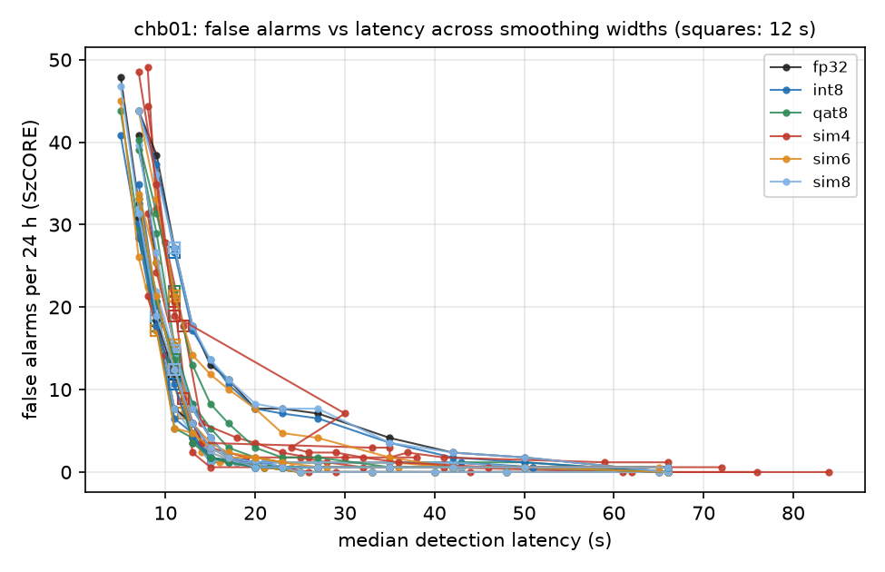

## chb02

Folds per seed: {0: 3, 1: 3, 2: 3, 3: 3, 4: 3}

- Early stopping fired in 15/15 jobs; ONNX FP32 export max |logit diff| 5.72e-06
- Seed 0: FP32 test specificity pooled over all held-out hours 0.9942 (within 0.995 +/- 0.005)
- Seed 1: FP32 test specificity pooled over all held-out hours 0.9968 (within 0.995 +/- 0.005)
- Seed 2: FP32 test specificity pooled over all held-out hours 0.9961 (within 0.995 +/- 0.005)
- Seed 3: FP32 test specificity pooled over all held-out hours 0.9956 (within 0.995 +/- 0.005)
- Seed 4: FP32 test specificity pooled over all held-out hours 0.9979 (within 0.995 +/- 0.005)
- Diagnostic: single folds outside the band 1/15 [(0, 0, 0.9885)]

### FP32 against EpiDeNet's reporting (4 s windows, pooled over folds)

| seed | FP/h raw | FP/h 3-window vote | window sens (vote) | spec (vote) | seizures detected |
|---|---|---|---|---|---|
| 0 | 2.64 | 1.28 | 0.485 | 0.9972 | 2/3 |
| 1 | 1.36 | 0.51 | 0.424 | 0.9989 | 2/3 |
| 2 | 1.64 | 0.62 | 0.242 | 0.9986 | 1/3 |
| 3 | 1.81 | 0.71 | 0.333 | 0.9984 | 2/3 |
| 4 | 0.99 | 0.43 | 0.273 | 0.9991 | 2/3 |

EpiDeNet (all CHB-MIT, LOOCV, 5 seeds): 4.29 raw, 2.24 with vote, 165/181 seizures.

### Two meanings of "FP/h" for the same FP32 model (pooled over folds)

| seed | window FP/h (3-window vote, 4 s grid) | SzCORE false alarms/h (12 s smoothing) | ratio |
|---|---|---|---|
| 0 | 1.28 | 0.71 | 1.8 |
| 1 | 0.51 | 0.37 | 1.4 |
| 2 | 0.62 | 0.45 | 1.4 |
| 3 | 0.71 | 0.45 | 1.6 |
| 4 | 0.43 | 0.23 | 1.9 |

Window FP/h is (1 - specificity) x windows per hour, so it depends on window length and hop, and one long artifact counts many times; SzCORE merges detections within 90 s into one alarm.

### Operating point (default smoothing, own threshold) and excess latency

| seed | model | FA/24h at 12 s | median latency at 12 s | detected | excess latency at FP32's FA (s) | smoothing there (s) | ΔFA/24h at FP32's latency |
|---|---|---|---|---|---|---|---|
| 0 | fp32 | 17.0 | 13.0 | 3/3 | 0.0 | 12.0 | 0.0 |
| 0 | int8 | 17.7 | 14.0 | 3/3 | 1.2 | 12.3 | 4.1 |
| 0 | sim8 | 17.0 | 14.0 | 3/3 | 1.0 | 12.0 | 5.4 |
| 0 | sim6 | 18.4 | 14.0 | 3/3 | 1.3 | 12.7 | 6.5 |
| 0 | sim4 | 12.9 | inf | 1/3 | inf | n/a | n/a |
| 0 | qat8 | 19.1 | 13.0 | 3/3 | 0.4 | 12.8 | 2.0 |
| 1 | fp32 | 8.8 | 12.0 | 3/3 | 0.0 | 12.0 | 0.0 |
| 1 | int8 | 7.5 | 12.0 | 3/3 | -0.4 | 11.1 | -1.4 |
| 1 | sim8 | 8.2 | 12.0 | 3/3 | -0.2 | 11.6 | -0.7 |
| 1 | sim6 | 12.9 | 13.0 | 3/3 | 2.2 | 14.4 | 8.8 |
| 1 | sim4 | 10.9 | inf | 0/3 | inf | n/a | n/a |
| 1 | qat8 | 8.2 | 12.0 | 3/3 | -0.2 | 11.6 | -0.7 |
| 2 | fp32 | 10.9 | 12.0 | 3/3 | 0.0 | 12.0 | 0.0 |
| 2 | int8 | 10.2 | 11.0 | 3/3 | -1.1 | 11.8 | -4.1 |
| 2 | sim8 | 12.9 | 12.0 | 3/3 | 11.3 | 12.9 | 2.0 |
| 2 | sim6 | 12.9 | 12.0 | 3/3 | 0.5 | 13.1 | 2.0 |
| 2 | sim4 | 12.2 | inf | 1/3 | inf | n/a | n/a |
| 2 | qat8 | 10.9 | 59.0 | 3/3 | 47.0 | 12.0 | 10.2 |
| 3 | fp32 | 10.9 | 13.0 | 3/3 | 0.0 | 12.0 | 0.0 |
| 3 | int8 | 8.8 | 14.0 | 3/3 | 0.5 | 11.0 | 2.0 |
| 3 | sim8 | 10.9 | 13.0 | 3/3 | 0.0 | 12.0 | 0.0 |
| 3 | sim6 | 12.9 | 14.0 | 3/3 | 2.0 | 14.0 | 6.5 |
| 3 | sim4 | 10.9 | inf | 1/3 | inf | n/a | n/a |
| 3 | qat8 | 16.3 | 13.0 | 3/3 | 1.5 | 14.9 | 5.4 |
| 4 | fp32 | 5.4 | 57.0 | 3/3 | 0.0 | 12.0 | 0.0 |
| 4 | int8 | 2.7 | 64.0 | 2/3 | 5.4 | 8.8 | n/a |
| 4 | sim8 | 5.4 | 57.0 | 3/3 | 0.0 | 12.0 | 0.0 |
| 4 | sim6 | 5.4 | 58.0 | 3/3 | 1.0 | 12.0 | 2.4 |
| 4 | sim4 | 6.8 | 67.0 | 2/3 | inf | n/a | n/a |
| 4 | qat8 | 6.1 | 56.0 | 3/3 | -0.6 | 12.8 | -1.0 |

FP32 seed-to-seed excess latency (the null), all ordered seed pairs: ['-3.5', '-2.1', '-1.1', '40.0', '2.8', '14.7', '3.0', '43.6', '2.4', '-0.6', '1.0', '42.7', '1.4', '-1.6', '-1.0', '41.7', '-34.0', '-43.3', '-5.8', '-40.3']
95% band: (-41.90833333333333, 43.141666666666666)

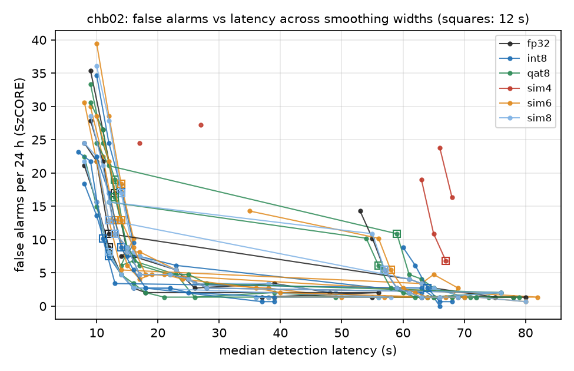

## chb03

Folds per seed: {0: 7, 1: 7, 2: 7, 3: 7, 4: 7}

- Early stopping fired in 35/35 jobs; ONNX FP32 export max |logit diff| 9.54e-06
- Seed 0: FP32 test specificity pooled over all held-out hours 0.9919 (within 0.995 +/- 0.005)
- Seed 1: FP32 test specificity pooled over all held-out hours 0.9940 (within 0.995 +/- 0.005)
- Seed 2: FP32 test specificity pooled over all held-out hours 0.9955 (within 0.995 +/- 0.005)
- Seed 3: FP32 test specificity pooled over all held-out hours 0.9953 (within 0.995 +/- 0.005)
- Seed 4: FP32 test specificity pooled over all held-out hours 0.9934 (within 0.995 +/- 0.005)
- Diagnostic: single folds outside the band 13/35 [(1, 0, 0.9884), (3, 0, 1.0), (4, 0, 0.9832), (5, 0, 0.9842), (3, 1, 1.0), (4, 1, 0.9828), (6, 1, 0.985), (4, 2, 0.9867), (3, 3, 1.0), (4, 3, 0.9796), (1, 4, 0.9867), (3, 4, 1.0), (4, 4, 0.9834)]

### FP32 against EpiDeNet's reporting (4 s windows, pooled over folds)

| seed | FP/h raw | FP/h 3-window vote | window sens (vote) | spec (vote) | seizures detected |
|---|---|---|---|---|---|
| 0 | 3.71 | 2.34 | 0.771 | 0.9947 | 6/7 |
| 1 | 2.61 | 1.82 | 0.660 | 0.9957 | 5/7 |
| 2 | 1.84 | 1.26 | 0.832 | 0.9970 | 7/7 |
| 3 | 2.13 | 1.55 | 0.771 | 0.9963 | 6/7 |
| 4 | 2.79 | 1.84 | 0.771 | 0.9958 | 6/7 |

EpiDeNet (all CHB-MIT, LOOCV, 5 seeds): 4.29 raw, 2.24 with vote, 165/181 seizures.

### Two meanings of "FP/h" for the same FP32 model (pooled over folds)

| seed | window FP/h (3-window vote, 4 s grid) | SzCORE false alarms/h (12 s smoothing) | ratio |
|---|---|---|---|
| 0 | 2.34 | 0.68 | 3.4 |
| 1 | 1.82 | 0.53 | 3.5 |
| 2 | 1.26 | 0.47 | 2.7 |
| 3 | 1.55 | 0.16 | 9.8 |
| 4 | 1.84 | 0.42 | 4.4 |

Window FP/h is (1 - specificity) x windows per hour, so it depends on window length and hop, and one long artifact counts many times; SzCORE merges detections within 90 s into one alarm.

### Operating point (default smoothing, own threshold) and excess latency

| seed | model | FA/24h at 12 s | median latency at 12 s | detected | excess latency at FP32's FA (s) | smoothing there (s) | ΔFA/24h at FP32's latency |
|---|---|---|---|---|---|---|---|
| 0 | fp32 | 16.4 | 8.0 | 6/7 | 0.0 | 12.0 | 0.0 |
| 0 | int8 | 13.9 | 9.0 | 6/7 | 0.3 | 10.5 | 0.9 |
| 0 | sim8 | 15.8 | 8.0 | 6/7 | -0.2 | 11.5 | -0.6 |
| 0 | sim6 | 6.9 | 8.0 | 6/7 | -4.0 | 4.0 | -9.5 |
| 0 | sim4 | 7.6 | 60.0 | 5/7 | 38.2 | 4.7 | n/a |
| 0 | qat8 | 13.3 | 8.0 | 6/7 | -2.4 | 7.3 | -3.2 |
| 1 | fp32 | 12.6 | 9.0 | 5/7 | 0.0 | 12.0 | 0.0 |
| 1 | int8 | 6.3 | 10.0 | 5/7 | -1.0 | 8.0 | -3.2 |
| 1 | sim8 | 13.9 | 9.0 | 5/7 | 0.4 | 12.7 | 1.3 |
| 1 | sim6 | 6.9 | 8.0 | 5/7 | -5.0 | 4.0 | -7.9 |
| 1 | sim4 | 16.4 | 63.0 | 4/7 | 55.1 | 14.2 | n/a |
| 1 | qat8 | 17.1 | 9.0 | 5/7 | 1.4 | 14.8 | 4.4 |
| 2 | fp32 | 11.4 | 8.0 | 7/7 | 0.0 | 12.0 | 0.0 |
| 2 | int8 | 11.4 | 9.0 | 7/7 | 1.0 | 12.0 | 2.8 |
| 2 | sim8 | 14.5 | 9.0 | 7/7 | 1.6 | 13.1 | 4.7 |
| 2 | sim6 | 2.5 | 8.0 | 7/7 | -4.0 | 4.0 | -8.8 |
| 2 | sim4 | 12.6 | 21.0 | 7/7 | 13.4 | 12.8 | n/a |
| 2 | qat8 | 13.3 | 8.0 | 7/7 | 0.4 | 12.8 | 1.9 |
| 3 | fp32 | 3.8 | 9.0 | 6/7 | 0.0 | 12.0 | 0.0 |
| 3 | int8 | 6.9 | 8.0 | 7/7 | 2.0 | 18.0 | 1.9 |
| 3 | sim8 | 4.4 | 9.0 | 6/7 | 1.0 | 14.0 | 0.6 |
| 3 | sim6 | 5.1 | 8.0 | 6/7 | 0.0 | 14.0 | 0.0 |
| 3 | sim4 | 5.7 | 38.0 | 6/7 | 32.8 | 13.5 | n/a |
| 3 | qat8 | 4.4 | 9.0 | 7/7 | 0.7 | 13.3 | 0.6 |
| 4 | fp32 | 10.1 | 8.0 | 6/7 | 0.0 | 12.0 | 0.0 |
| 4 | int8 | 9.5 | 9.0 | 6/7 | 0.8 | 11.6 | 2.2 |
| 4 | sim8 | 12.0 | 9.0 | 6/7 | 1.6 | 13.2 | 4.4 |
| 4 | sim6 | 9.5 | 7.0 | 6/7 | -1.3 | 11.3 | -3.8 |
| 4 | sim4 | 13.3 | 20.0 | 6/7 | 13.1 | 14.2 | n/a |
| 4 | qat8 | 11.4 | 8.0 | 6/7 | 0.5 | 13.0 | 1.3 |

FP32 seed-to-seed excess latency (the null), all ordered seed pairs: ['0.1', '-1.8', '-2.6', '-2.0', '0.0', '-1.4', '-2.5', '-1.8', '1.3', '1.4', '-1.2', '-0.4', '9.0', '7.5', '0.7', '3.0', '1.7', '1.8', '0.3', '-0.8']
95% band: (-2.5931818181818183, 8.287499999999998)

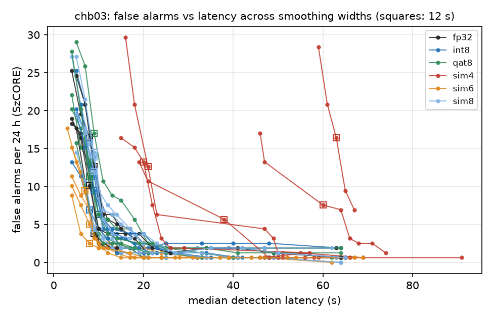

## chb04

Folds per seed: {0: 3, 1: 3, 2: 3, 3: 3, 4: 3}

- Early stopping fired in 15/15 jobs; ONNX FP32 export max |logit diff| 9.54e-06
- Seed 0: FP32 test specificity pooled over all held-out hours 0.9948 (within 0.995 +/- 0.005)
- Seed 1: FP32 test specificity pooled over all held-out hours 0.9962 (within 0.995 +/- 0.005)
- Seed 2: FP32 test specificity pooled over all held-out hours 0.9962 (within 0.995 +/- 0.005)
- Seed 3: FP32 test specificity pooled over all held-out hours 0.9985 (within 0.995 +/- 0.005)
- Seed 4: FP32 test specificity pooled over all held-out hours 0.9976 (within 0.995 +/- 0.005)
- Diagnostic: single folds outside the band 0/15

### FP32 against EpiDeNet's reporting (4 s windows, pooled over folds)

| seed | FP/h raw | FP/h 3-window vote | window sens (vote) | spec (vote) | seizures detected |
|---|---|---|---|---|---|
| 0 | 2.39 | 1.21 | 0.359 | 0.9972 | 3/4 |
| 1 | 1.81 | 0.98 | 0.322 | 0.9978 | 2/4 |
| 2 | 1.74 | 0.72 | 0.489 | 0.9984 | 4/4 |
| 3 | 0.74 | 0.43 | 0.500 | 0.9991 | 2/4 |
| 4 | 1.11 | 0.48 | 0.500 | 0.9989 | 2/4 |

EpiDeNet (all CHB-MIT, LOOCV, 5 seeds): 4.29 raw, 2.24 with vote, 165/181 seizures.

### Two meanings of "FP/h" for the same FP32 model (pooled over folds)

| seed | window FP/h (3-window vote, 4 s grid) | SzCORE false alarms/h (12 s smoothing) | ratio |
|---|---|---|---|
| 0 | 1.21 | 0.50 | 2.4 |
| 1 | 0.98 | 0.37 | 2.6 |
| 2 | 0.72 | 0.38 | 1.9 |
| 3 | 0.43 | 0.15 | 2.9 |
| 4 | 0.48 | 0.22 | 2.1 |

Window FP/h is (1 - specificity) x windows per hour, so it depends on window length and hop, and one long artifact counts many times; SzCORE merges detections within 90 s into one alarm.

### Operating point (default smoothing, own threshold) and excess latency

| seed | model | FA/24h at 12 s | median latency at 12 s | detected | excess latency at FP32's FA (s) | smoothing there (s) | ΔFA/24h at FP32's latency |
|---|---|---|---|---|---|---|---|
| 0 | fp32 | 12.0 | 17.0 | 4/4 | 0.0 | 12.0 | 0.0 |
| 0 | int8 | 11.5 | 17.5 | 4/4 | 0.4 | 11.7 | 1.1 |
| 0 | sim8 | 12.6 | 17.0 | 4/4 | 0.2 | 12.5 | 0.6 |
| 0 | sim6 | 7.2 | inf | 1/4 | inf | n/a | n/a |
| 0 | sim4 | 12.1 | inf | 0/4 | inf | n/a | n/a |
| 0 | qat8 | 12.1 | 17.0 | 4/4 | 0.1 | 12.1 | 0.2 |
| 1 | fp32 | 8.9 | 19.5 | 3/4 | 0.0 | 12.0 | 0.0 |
| 1 | int8 | 8.8 | 19.5 | 3/4 | -0.1 | 11.9 | -0.2 |
| 1 | sim8 | 9.2 | 19.5 | 3/4 | 0.2 | 12.3 | 0.3 |
| 1 | sim6 | 4.8 | inf | 1/4 | inf | n/a | n/a |
| 1 | sim4 | 7.8 | inf | 0/4 | inf | n/a | n/a |
| 1 | qat8 | 11.1 | 19.5 | 3/4 | 1.0 | 13.9 | 2.2 |
| 2 | fp32 | 9.2 | 22.0 | 4/4 | 0.0 | 12.0 | 0.0 |
| 2 | int8 | 8.8 | 21.5 | 4/4 | -0.7 | 11.6 | -0.5 |
| 2 | sim8 | 8.8 | 22.0 | 4/4 | -0.2 | 11.6 | -0.5 |
| 2 | sim6 | 10.1 | 99.5 | 3/4 | 78.8 | 13.2 | n/a |
| 2 | sim4 | 7.7 | inf | 1/4 | inf | n/a | n/a |
| 2 | qat8 | 9.4 | 22.0 | 4/4 | 2.2 | 12.2 | 0.2 |
| 3 | fp32 | 3.5 | inf | 2/4 | 0.0 | 12.0 | 0.0 |
| 3 | int8 | 3.8 | inf | 2/4 | n/a | n/a | n/a |
| 3 | sim8 | 3.8 | inf | 2/4 | n/a | n/a | n/a |
| 3 | sim6 | 3.5 | inf | 1/4 | n/a | n/a | n/a |
| 3 | sim4 | 1.5 | inf | 0/4 | n/a | n/a | n/a |
| 3 | qat8 | 3.7 | inf | 2/4 | n/a | n/a | n/a |
| 4 | fp32 | 5.4 | inf | 2/4 | 0.0 | 12.0 | 0.0 |
| 4 | int8 | 4.9 | inf | 2/4 | n/a | n/a | n/a |
| 4 | sim8 | 4.9 | inf | 2/4 | n/a | n/a | n/a |
| 4 | sim6 | 4.9 | inf | 2/4 | n/a | n/a | n/a |
| 4 | sim4 | 2.3 | inf | 1/4 | n/a | n/a | n/a |
| 4 | qat8 | 4.8 | inf | 2/4 | n/a | n/a | n/a |

FP32 seed-to-seed excess latency (the null), all ordered seed pairs: ['1.2', '4.0', 'inf', 'inf', '-1.1', '6.5', 'inf', 'inf', '-3.8', '-2.6', 'inf', 'inf', 'n/a', 'n/a', 'n/a', 'n/a', 'n/a', 'n/a', 'n/a', 'n/a']
95% band: (-3.617422135706342, 6.145885093167697)

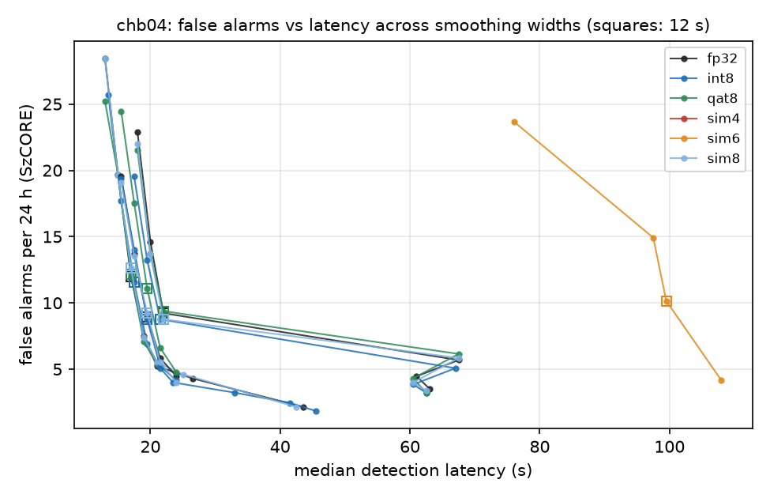

## chb05

Folds per seed: {0: 5, 1: 5, 2: 5, 3: 5, 4: 5}

- Early stopping fired in 25/25 jobs; ONNX FP32 export max |logit diff| 9.54e-06
- Seed 0: FP32 test specificity pooled over all held-out hours 0.9955 (within 0.995 +/- 0.005)
- Seed 1: FP32 test specificity pooled over all held-out hours 0.9950 (within 0.995 +/- 0.005)
- Seed 2: FP32 test specificity pooled over all held-out hours 0.9950 (within 0.995 +/- 0.005)
- Seed 3: FP32 test specificity pooled over all held-out hours 0.9945 (within 0.995 +/- 0.005)
- Seed 4: FP32 test specificity pooled over all held-out hours 0.9947 (within 0.995 +/- 0.005)
- Diagnostic: single folds outside the band 0/25

### FP32 against EpiDeNet's reporting (4 s windows, pooled over folds)

| seed | FP/h raw | FP/h 3-window vote | window sens (vote) | spec (vote) | seizures detected |
|---|---|---|---|---|---|
| 0 | 1.97 | 1.21 | 0.929 | 0.9973 | 5/5 |
| 1 | 2.18 | 1.26 | 0.942 | 0.9971 | 5/5 |
| 2 | 2.08 | 1.10 | 0.929 | 0.9975 | 5/5 |
| 3 | 2.38 | 1.18 | 0.929 | 0.9973 | 5/5 |
| 4 | 2.33 | 1.26 | 0.929 | 0.9971 | 5/5 |

EpiDeNet (all CHB-MIT, LOOCV, 5 seeds): 4.29 raw, 2.24 with vote, 165/181 seizures.

### Two meanings of "FP/h" for the same FP32 model (pooled over folds)

| seed | window FP/h (3-window vote, 4 s grid) | SzCORE false alarms/h (12 s smoothing) | ratio |
|---|---|---|---|
| 0 | 1.21 | 0.64 | 1.9 |
| 1 | 1.26 | 0.69 | 1.8 |
| 2 | 1.10 | 0.59 | 1.9 |
| 3 | 1.18 | 0.77 | 1.5 |
| 4 | 1.26 | 0.69 | 1.8 |

Window FP/h is (1 - specificity) x windows per hour, so it depends on window length and hop, and one long artifact counts many times; SzCORE merges detections within 90 s into one alarm.

### Operating point (default smoothing, own threshold) and excess latency

| seed | model | FA/24h at 12 s | median latency at 12 s | detected | excess latency at FP32's FA (s) | smoothing there (s) | ΔFA/24h at FP32's latency |
|---|---|---|---|---|---|---|---|
| 0 | fp32 | 15.4 | 10.0 | 5/5 | 0.0 | 12.0 | 0.0 |
| 0 | int8 | 16.0 | 10.0 | 5/5 | 0.2 | 12.5 | 0.6 |
| 0 | sim8 | 16.0 | 10.0 | 5/5 | 0.2 | 12.5 | 0.6 |
| 0 | sim6 | 16.0 | 10.0 | 5/5 | 0.2 | 12.4 | 0.6 |
| 0 | sim4 | 1.8 | 15.0 | 5/5 | 1.0 | 4.0 | n/a |
| 0 | qat8 | 16.6 | 10.0 | 5/5 | 0.6 | 13.1 | 1.2 |
| 1 | fp32 | 16.6 | 10.0 | 5/5 | 0.0 | 12.0 | 0.0 |
| 1 | int8 | 16.0 | 10.0 | 5/5 | -0.2 | 11.5 | -0.6 |
| 1 | sim8 | 16.6 | 10.0 | 5/5 | 0.0 | 12.0 | 0.0 |
| 1 | sim6 | 16.6 | 10.0 | 5/5 | 0.0 | 12.0 | 0.0 |
| 1 | sim4 | 15.4 | 15.0 | 5/5 | 4.7 | 11.3 | n/a |
| 1 | qat8 | 16.0 | 10.0 | 5/5 | -0.1 | 11.7 | -0.6 |
| 2 | fp32 | 14.2 | 11.0 | 5/5 | 0.0 | 12.0 | 0.0 |
| 2 | int8 | 14.2 | 11.0 | 5/5 | 0.0 | 12.0 | 0.0 |
| 2 | sim8 | 14.2 | 11.0 | 5/5 | 0.0 | 12.0 | 0.0 |
| 2 | sim6 | 16.0 | 12.0 | 5/5 | 2.0 | 14.0 | 4.6 |
| 2 | sim4 | 9.8 | 14.0 | 5/5 | 0.6 | 7.2 | 1.8 |
| 2 | qat8 | 15.4 | 10.0 | 5/5 | -0.4 | 13.1 | -0.9 |
| 3 | fp32 | 18.5 | 10.0 | 5/5 | 0.0 | 12.0 | 0.0 |
| 3 | int8 | 17.8 | 10.0 | 5/5 | -0.2 | 11.7 | -0.6 |
| 3 | sim8 | 17.8 | 10.0 | 5/5 | -0.2 | 11.7 | -0.6 |
| 3 | sim6 | 16.6 | 10.0 | 5/5 | -0.4 | 11.2 | -1.8 |
| 3 | sim4 | 13.5 | 12.0 | 5/5 | -0.1 | 7.8 | -0.6 |
| 3 | qat8 | 19.7 | 10.0 | 5/5 | 0.3 | 12.6 | 1.2 |
| 4 | fp32 | 16.6 | 11.0 | 5/5 | 0.0 | 12.0 | 0.0 |
| 4 | int8 | 16.6 | 11.0 | 5/5 | 0.0 | 12.0 | 0.0 |
| 4 | sim8 | 17.2 | 11.0 | 5/5 | 0.2 | 12.4 | 0.6 |
| 4 | sim6 | 17.2 | 11.0 | 5/5 | 0.2 | 12.4 | 0.6 |
| 4 | sim4 | 7.4 | 16.0 | 5/5 | 1.0 | 4.0 | n/a |
| 4 | qat8 | 16.6 | 10.0 | 5/5 | -1.0 | 12.0 | -2.5 |

FP32 seed-to-seed excess latency (the null), all ordered seed pairs: ['0.5', '0.6', '0.8', '1.4', '-0.7', '0.3', '0.5', '1.0', '-0.4', '0.0', '0.1', '0.8', '-1.7', '-0.6', '-0.3', '0.6', '-1.7', '-1.0', '-0.7', '-0.5']
95% band: (-1.666666666666667, 1.2099999999999995)

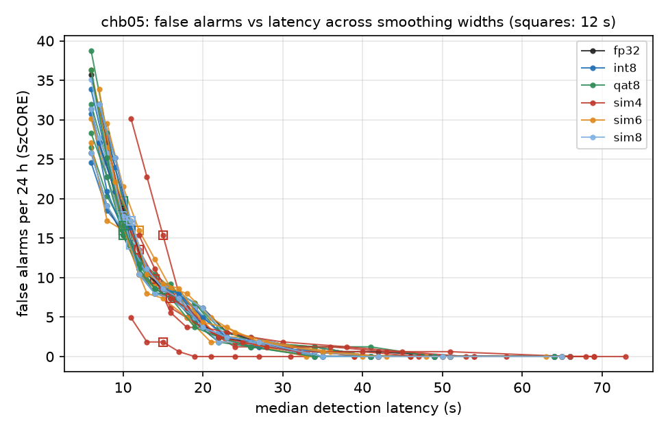

## chb06

Folds per seed: {0: 7, 1: 7, 2: 7, 3: 7, 4: 7}

- Early stopping fired in 35/35 jobs; ONNX FP32 export max |logit diff| 1.14e-05
- Seed 0: FP32 test specificity pooled over all held-out hours 0.9930 (within 0.995 +/- 0.005)
- Seed 1: FP32 test specificity pooled over all held-out hours 0.9941 (within 0.995 +/- 0.005)
- Seed 2: FP32 test specificity pooled over all held-out hours 0.9937 (within 0.995 +/- 0.005)
- Seed 3: FP32 test specificity pooled over all held-out hours 0.9936 (within 0.995 +/- 0.005)
- Seed 4: FP32 test specificity pooled over all held-out hours 0.9942 (within 0.995 +/- 0.005)
- Diagnostic: single folds outside the band 5/35 [(6, 0, 0.9765), (6, 1, 0.9845), (6, 2, 0.9854), (6, 3, 0.9831), (6, 4, 0.9848)]

### FP32 against EpiDeNet's reporting (4 s windows, pooled over folds)

| seed | FP/h raw | FP/h 3-window vote | window sens (vote) | spec (vote) | seizures detected |
|---|---|---|---|---|---|
| 0 | 3.19 | 1.80 | 0.048 | 0.9960 | 2/10 |
| 1 | 2.70 | 0.90 | 0.048 | 0.9979 | 1/10 |
| 2 | 2.83 | 1.38 | 0.119 | 0.9971 | 2/10 |
| 3 | 2.83 | 1.60 | 0.048 | 0.9966 | 1/10 |
| 4 | 2.40 | 0.85 | 0.214 | 0.9979 | 4/10 |

EpiDeNet (all CHB-MIT, LOOCV, 5 seeds): 4.29 raw, 2.24 with vote, 165/181 seizures.

### Two meanings of "FP/h" for the same FP32 model (pooled over folds)

| seed | window FP/h (3-window vote, 4 s grid) | SzCORE false alarms/h (12 s smoothing) | ratio |
|---|---|---|---|
| 0 | 1.80 | 0.58 | 3.1 |
| 1 | 0.90 | 0.52 | 1.7 |
| 2 | 1.38 | 0.51 | 2.7 |
| 3 | 1.60 | 0.54 | 3.0 |
| 4 | 0.85 | 0.69 | 1.2 |

Window FP/h is (1 - specificity) x windows per hour, so it depends on window length and hop, and one long artifact counts many times; SzCORE merges detections within 90 s into one alarm.

### Operating point (default smoothing, own threshold) and excess latency

| seed | model | FA/24h at 12 s | median latency at 12 s | detected | excess latency at FP32's FA (s) | smoothing there (s) | ΔFA/24h at FP32's latency |
|---|---|---|---|---|---|---|---|
| 0 | fp32 | 14.0 | 14.0 | 8/10 | 0.0 | 12.0 | 0.0 |
| 0 | int8 | 12.9 | 14.0 | 8/10 | -0.3 | 11.4 | -1.1 |
| 0 | sim8 | 13.3 | 14.0 | 8/10 | -0.1 | 11.7 | -0.7 |
| 0 | sim6 | 10.8 | 18.0 | 7/10 | 2.9 | 9.8 | 5.8 |
| 0 | sim4 | 9.7 | inf | 0/10 | inf | n/a | n/a |
| 0 | qat8 | 14.0 | 14.0 | 8/10 | 0.0 | 12.0 | 0.0 |
| 1 | fp32 | 12.6 | 25.0 | 8/10 | 0.0 | 12.0 | 0.0 |
| 1 | int8 | 10.8 | 24.5 | 8/10 | -1.2 | 10.9 | n/a |
| 1 | sim8 | 14.0 | 24.5 | 8/10 | inf | n/a | n/a |
| 1 | sim6 | 12.9 | 29.5 | 7/10 | inf | n/a | 3.2 |
| 1 | sim4 | 17.6 | inf | 2/10 | inf | n/a | n/a |
| 1 | qat8 | 11.5 | 28.5 | 7/10 | 1.0 | 11.2 | 0.4 |
| 2 | fp32 | 12.2 | inf | 5/10 | 0.0 | 12.0 | 0.0 |
| 2 | int8 | 11.5 | inf | 5/10 | n/a | n/a | n/a |
| 2 | sim8 | 11.9 | inf | 5/10 | n/a | n/a | n/a |
| 2 | sim6 | 10.8 | inf | 5/10 | n/a | n/a | n/a |
| 2 | sim4 | 7.9 | inf | 0/10 | n/a | n/a | n/a |
| 2 | qat8 | 13.3 | 27.5 | 6/10 | n/a | n/a | n/a |
| 3 | fp32 | 12.9 | inf | 5/10 | 0.0 | 12.0 | 0.0 |
| 3 | int8 | 11.5 | inf | 5/10 | n/a | n/a | n/a |
| 3 | sim8 | 12.9 | inf | 5/10 | n/a | n/a | n/a |
| 3 | sim6 | 12.9 | inf | 5/10 | n/a | n/a | n/a |
| 3 | sim4 | 12.9 | inf | 1/10 | n/a | n/a | n/a |
| 3 | qat8 | 14.0 | inf | 5/10 | n/a | n/a | n/a |
| 4 | fp32 | 16.5 | 16.0 | 7/10 | 0.0 | 12.0 | 0.0 |
| 4 | int8 | 17.6 | 16.5 | 7/10 | 0.8 | 12.6 | 1.8 |
| 4 | sim8 | 17.3 | 16.0 | 7/10 | 0.2 | 12.4 | 0.7 |
| 4 | sim6 | 16.2 | 17.0 | 6/10 | 0.8 | 11.9 | 2.0 |
| 4 | sim4 | 12.2 | inf | 1/10 | inf | n/a | n/a |
| 4 | qat8 | 17.3 | 15.5 | 7/10 | -0.2 | 12.4 | -0.6 |

FP32 seed-to-seed excess latency (the null), all ordered seed pairs: ['9.6', 'inf', 'inf', '2.8', '-6.1', 'inf', 'inf', '-7.8', 'n/a', 'n/a', 'n/a', 'n/a', 'n/a', 'n/a', 'n/a', 'n/a', '-2.6', '5.0', 'inf', 'inf']
95% band: (-7.565170940170941, 8.984913793103448)

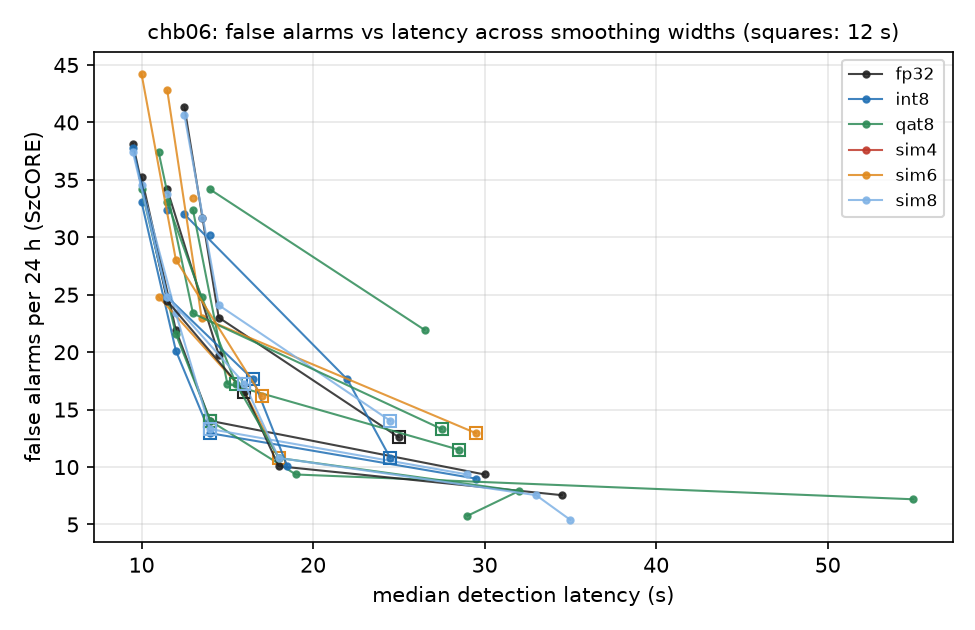

## chb07

Folds per seed: {0: 3, 1: 3, 2: 3, 3: 3, 4: 3}

- Early stopping fired in 15/15 jobs; ONNX FP32 export max |logit diff| 1.05e-05
- Seed 0: FP32 test specificity pooled over all held-out hours 0.9949 (within 0.995 +/- 0.005)
- Seed 1: FP32 test specificity pooled over all held-out hours 0.9945 (within 0.995 +/- 0.005)
- Seed 2: FP32 test specificity pooled over all held-out hours 0.9923 (within 0.995 +/- 0.005)
- Seed 3: FP32 test specificity pooled over all held-out hours 0.9932 (within 0.995 +/- 0.005)
- Seed 4: FP32 test specificity pooled over all held-out hours 0.9924 (within 0.995 +/- 0.005)
- Diagnostic: single folds outside the band 4/15 [(0, 1, 0.99), (0, 2, 0.9853), (0, 3, 0.9876), (0, 4, 0.9862)]

### FP32 against EpiDeNet's reporting (4 s windows, pooled over folds)

| seed | FP/h raw | FP/h 3-window vote | window sens (vote) | spec (vote) | seizures detected |
|---|---|---|---|---|---|
| 0 | 2.28 | 0.91 | 0.840 | 0.9980 | 3/3 |
| 1 | 2.48 | 1.06 | 0.849 | 0.9977 | 3/3 |
| 2 | 3.36 | 1.73 | 0.859 | 0.9963 | 3/3 |
| 3 | 2.98 | 1.24 | 0.840 | 0.9974 | 3/3 |
| 4 | 3.40 | 1.92 | 0.886 | 0.9959 | 3/3 |

EpiDeNet (all CHB-MIT, LOOCV, 5 seeds): 4.29 raw, 2.24 with vote, 165/181 seizures.

### Two meanings of "FP/h" for the same FP32 model (pooled over folds)

| seed | window FP/h (3-window vote, 4 s grid) | SzCORE false alarms/h (12 s smoothing) | ratio |
|---|---|---|---|
| 0 | 0.91 | 0.76 | 1.2 |
| 1 | 1.06 | 0.76 | 1.4 |
| 2 | 1.73 | 0.86 | 2.0 |
| 3 | 1.24 | 0.79 | 1.6 |
| 4 | 1.92 | 0.82 | 2.3 |

Window FP/h is (1 - specificity) x windows per hour, so it depends on window length and hop, and one long artifact counts many times; SzCORE merges detections within 90 s into one alarm.

### Operating point (default smoothing, own threshold) and excess latency

| seed | model | FA/24h at 12 s | median latency at 12 s | detected | excess latency at FP32's FA (s) | smoothing there (s) | ΔFA/24h at FP32's latency |
|---|---|---|---|---|---|---|---|
| 0 | fp32 | 18.3 | 13.0 | 3/3 | 0.0 | 12.0 | 0.0 |
| 0 | int8 | 16.5 | 13.0 | 3/3 | -0.7 | 10.7 | -1.8 |
| 0 | sim8 | 19.0 | 13.0 | 3/3 | 0.5 | 12.3 | 0.7 |
| 0 | sim6 | 9.7 | 18.0 | 3/3 | 1.9 | 6.9 | 4.5 |
| 0 | sim4 | 8.6 | 33.0 | 3/3 | 15.0 | 4.0 | n/a |
| 0 | qat8 | 17.5 | 13.0 | 3/3 | -0.2 | 11.6 | -0.7 |
| 1 | fp32 | 18.3 | 12.0 | 3/3 | 0.0 | 12.0 | 0.0 |
| 1 | int8 | 17.5 | 12.0 | 3/3 | -0.2 | 11.7 | -0.7 |
| 1 | sim8 | 18.3 | 12.0 | 3/3 | 0.0 | 12.0 | 0.0 |
| 1 | sim6 | 13.2 | 13.0 | 3/3 | -0.3 | 9.3 | -1.3 |
| 1 | sim4 | 20.8 | 33.0 | 3/3 | 21.5 | 13.0 | n/a |
| 1 | qat8 | 19.7 | 12.0 | 3/3 | 0.3 | 12.6 | 1.4 |
| 2 | fp32 | 20.8 | 12.0 | 3/3 | 0.0 | 12.0 | 0.0 |
| 2 | int8 | 20.0 | 12.0 | 3/3 | -0.3 | 11.3 | -0.7 |
| 2 | sim8 | 20.0 | 12.0 | 3/3 | -0.2 | 11.5 | -0.7 |
| 2 | sim6 | 16.1 | 12.0 | 3/3 | -1.0 | 10.0 | -4.7 |
| 2 | sim4 | 7.2 | 31.0 | 3/3 | 16.2 | 6.3 | n/a |
| 2 | qat8 | 20.8 | 12.0 | 3/3 | 0.0 | 12.0 | 0.0 |
| 3 | fp32 | 19.0 | 13.0 | 3/3 | 0.0 | 12.0 | 0.0 |
| 3 | int8 | 20.0 | 13.0 | 3/3 | 0.3 | 12.6 | 1.1 |
| 3 | sim8 | 19.7 | 13.0 | 3/3 | 0.2 | 12.5 | 0.7 |
| 3 | sim6 | 15.7 | 14.0 | 3/3 | 0.1 | 10.2 | 0.4 |
| 3 | sim4 | 11.5 | 31.0 | 3/3 | 17.2 | 8.8 | n/a |
| 3 | qat8 | 19.7 | 13.0 | 3/3 | 0.2 | 12.4 | 0.7 |
| 4 | fp32 | 19.7 | 13.0 | 3/3 | 0.0 | 12.0 | 0.0 |
| 4 | int8 | 17.5 | 13.0 | 3/3 | -0.8 | 10.4 | -2.1 |
| 4 | sim8 | 19.0 | 13.0 | 3/3 | -0.3 | 11.5 | -0.7 |
| 4 | sim6 | 16.5 | 14.0 | 3/3 | -0.1 | 9.9 | -0.2 |
| 4 | sim4 | 11.8 | 33.0 | 3/3 | 16.2 | 4.3 | n/a |
| 4 | qat8 | 19.7 | 13.0 | 3/3 | 0.0 | 12.0 | 0.0 |

FP32 seed-to-seed excess latency (the null), all ordered seed pairs: ['-1.0', '-0.3', '0.2', '0.5', '1.0', '0.7', '1.2', '1.5', '0.1', '-0.7', '0.5', '0.6', '-0.2', '-1.2', '-0.5', '0.2', '-0.5', '-1.4', '-0.7', '-0.2']
95% band: (-1.305, 1.358823529411764)

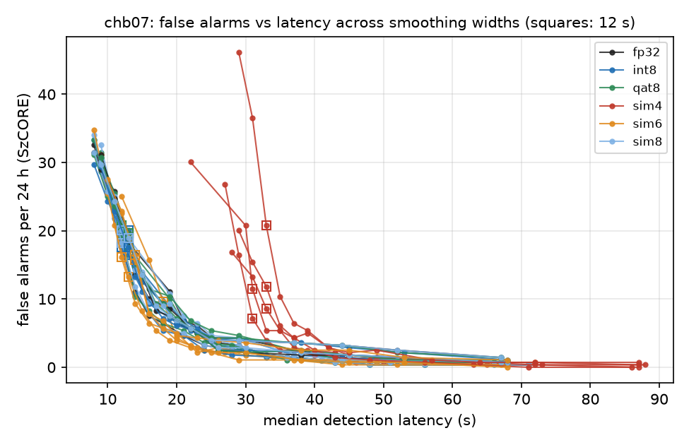

## chb08

Folds per seed: {0: 5, 1: 5, 2: 5, 3: 5, 4: 5}

- Early stopping fired in 25/25 jobs; ONNX FP32 export max |logit diff| 3.81e-06
- Seed 0: FP32 test specificity pooled over all held-out hours 0.9918 (within 0.995 +/- 0.005)
- Seed 1: FP32 test specificity pooled over all held-out hours 0.9917 (within 0.995 +/- 0.005)
- Seed 2: FP32 test specificity pooled over all held-out hours 0.9910 (within 0.995 +/- 0.005)
- Seed 3: FP32 test specificity pooled over all held-out hours 0.9926 (within 0.995 +/- 0.005)
- Seed 4: FP32 test specificity pooled over all held-out hours 0.9870 (OUTSIDE 0.995 +/- 0.005)
- Diagnostic: single folds outside the band 6/25 [(1, 0, 0.9755), (1, 1, 0.9712), (1, 2, 0.9719), (1, 3, 0.9729), (0, 4, 0.9727), (1, 4, 0.9761)]

### FP32 against EpiDeNet's reporting (4 s windows, pooled over folds)

| seed | FP/h raw | FP/h 3-window vote | window sens (vote) | spec (vote) | seizures detected |
|---|---|---|---|---|---|
| 0 | 3.90 | 2.80 | 0.762 | 0.9937 | 5/5 |
| 1 | 4.00 | 3.00 | 0.677 | 0.9932 | 5/5 |
| 2 | 4.30 | 3.10 | 0.749 | 0.9930 | 5/5 |
| 3 | 3.40 | 2.65 | 0.724 | 0.9940 | 5/5 |
| 4 | 5.95 | 4.05 | 0.793 | 0.9909 | 5/5 |

EpiDeNet (all CHB-MIT, LOOCV, 5 seeds): 4.29 raw, 2.24 with vote, 165/181 seizures.

### Two meanings of "FP/h" for the same FP32 model (pooled over folds)

| seed | window FP/h (3-window vote, 4 s grid) | SzCORE false alarms/h (12 s smoothing) | ratio |
|---|---|---|---|
| 0 | 2.80 | 0.70 | 4.0 |
| 1 | 3.00 | 0.35 | 8.6 |
| 2 | 3.10 | 0.55 | 5.6 |
| 3 | 2.65 | 0.30 | 8.8 |
| 4 | 4.05 | 0.75 | 5.4 |

Window FP/h is (1 - specificity) x windows per hour, so it depends on window length and hop, and one long artifact counts many times; SzCORE merges detections within 90 s into one alarm.

### Operating point (default smoothing, own threshold) and excess latency

| seed | model | FA/24h at 12 s | median latency at 12 s | detected | excess latency at FP32's FA (s) | smoothing there (s) | ΔFA/24h at FP32's latency |
|---|---|---|---|---|---|---|---|
| 0 | fp32 | 16.8 | 17.0 | 5/5 | 0.0 | 12.0 | 0.0 |
| 0 | int8 | 14.4 | 17.0 | 5/5 | -0.8 | 10.4 | -2.4 |
| 0 | sim8 | 16.8 | 17.0 | 5/5 | 0.0 | 12.0 | 0.0 |
| 0 | sim6 | 14.4 | 17.0 | 5/5 | -1.3 | 9.3 | -2.4 |
| 0 | sim4 | 12.0 | 20.0 | 5/5 | 2.3 | 10.5 | 12.6 |
| 0 | qat8 | 14.4 | 17.0 | 5/5 | -1.3 | 9.3 | -2.4 |
| 1 | fp32 | 8.4 | 18.0 | 5/5 | 0.0 | 12.0 | 0.0 |
| 1 | int8 | 9.6 | 18.0 | 5/5 | 1.0 | 14.0 | 1.2 |
| 1 | sim8 | 10.8 | 18.0 | 5/5 | 1.3 | 14.7 | 2.4 |
| 1 | sim6 | 10.8 | 18.0 | 5/5 | 1.0 | 14.0 | 2.4 |
| 1 | sim4 | 14.4 | 20.0 | 5/5 | 2.7 | 14.9 | 13.2 |
| 1 | qat8 | 9.6 | 18.0 | 5/5 | 0.7 | 13.3 | 1.2 |
| 2 | fp32 | 13.2 | 18.0 | 5/5 | 0.0 | 12.0 | 0.0 |
| 2 | int8 | 13.2 | 18.0 | 5/5 | 0.0 | 12.0 | 0.0 |
| 2 | sim8 | 13.2 | 18.0 | 5/5 | 0.0 | 12.0 | 0.0 |
| 2 | sim6 | 10.8 | 18.0 | 5/5 | -0.7 | 10.7 | -2.4 |
| 2 | sim4 | 10.8 | 17.0 | 5/5 | -1.5 | 11.0 | -3.6 |
| 2 | qat8 | 10.8 | 18.0 | 5/5 | -0.8 | 10.4 | -2.4 |
| 3 | fp32 | 7.2 | 19.0 | 5/5 | 0.0 | 12.0 | 0.0 |
| 3 | int8 | 7.2 | 19.0 | 5/5 | 0.0 | 12.0 | 0.0 |
| 3 | sim8 | 7.2 | 19.0 | 5/5 | 0.0 | 12.0 | 0.0 |
| 3 | sim6 | 7.2 | 19.0 | 5/5 | 0.0 | 12.0 | 0.0 |
| 3 | sim4 | 14.4 | 20.0 | 5/5 | 4.2 | 17.6 | 9.0 |
| 3 | qat8 | 7.2 | 19.0 | 5/5 | 0.0 | 12.0 | 0.0 |
| 4 | fp32 | 18.0 | 17.0 | 5/5 | 0.0 | 12.0 | 0.0 |
| 4 | int8 | 19.2 | 17.0 | 5/5 | 0.7 | 13.3 | 1.2 |
| 4 | sim8 | 18.0 | 17.0 | 5/5 | 0.0 | 12.0 | 0.0 |
| 4 | sim6 | 21.6 | 17.0 | 5/5 | 1.0 | 14.0 | 3.6 |
| 4 | sim4 | 24.0 | 19.0 | 5/5 | 3.0 | 14.0 | 18.0 |
| 4 | qat8 | 19.2 | 17.0 | 5/5 | 0.7 | 13.3 | 1.2 |

FP32 seed-to-seed excess latency (the null), all ordered seed pairs: ['-3.0', '0.0', '-2.0', '1.0', '1.0', '1.6', '0.7', '4.0', '-0.1', '-2.5', '-0.7', '1.8', '1.0', '1.0', '1.0', '4.0', '-0.7', '-3.0', '-0.3', '-2.0']
95% band: (-3.0, 4.0)

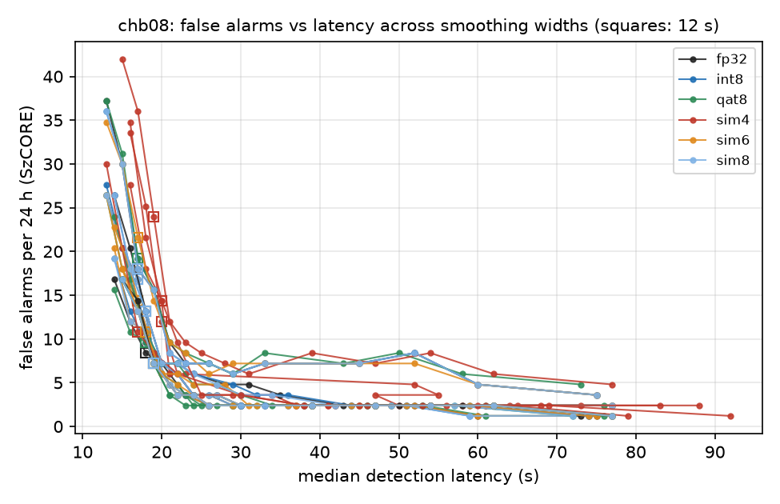

## chb09

Folds per seed: {0: 3, 1: 3, 2: 3, 3: 3, 4: 3}

- Early stopping fired in 15/15 jobs; ONNX FP32 export max |logit diff| 9.54e-06
- Seed 0: FP32 test specificity pooled over all held-out hours 0.9906 (within 0.995 +/- 0.005)
- Seed 1: FP32 test specificity pooled over all held-out hours 0.9947 (within 0.995 +/- 0.005)
- Seed 2: FP32 test specificity pooled over all held-out hours 0.9927 (within 0.995 +/- 0.005)
- Seed 3: FP32 test specificity pooled over all held-out hours 0.9922 (within 0.995 +/- 0.005)
- Seed 4: FP32 test specificity pooled over all held-out hours 0.9934 (within 0.995 +/- 0.005)
- Diagnostic: single folds outside the band 3/15 [(0, 0, 0.9887), (2, 2, 0.989), (2, 3, 0.9885)]

### FP32 against EpiDeNet's reporting (4 s windows, pooled over folds)

| seed | FP/h raw | FP/h 3-window vote | window sens (vote) | spec (vote) | seizures detected |
|---|---|---|---|---|---|
| 0 | 4.21 | 3.74 | 0.864 | 0.9920 | 4/4 |
| 1 | 2.37 | 1.87 | 0.783 | 0.9957 | 4/4 |
| 2 | 3.32 | 2.74 | 0.818 | 0.9939 | 4/4 |
| 3 | 3.46 | 2.84 | 0.906 | 0.9936 | 4/4 |
| 4 | 2.99 | 2.39 | 0.906 | 0.9947 | 4/4 |

EpiDeNet (all CHB-MIT, LOOCV, 5 seeds): 4.29 raw, 2.24 with vote, 165/181 seizures.

### Two meanings of "FP/h" for the same FP32 model (pooled over folds)

| seed | window FP/h (3-window vote, 4 s grid) | SzCORE false alarms/h (12 s smoothing) | ratio |
|---|---|---|---|
| 0 | 3.74 | 0.69 | 5.4 |
| 1 | 1.87 | 0.46 | 4.1 |
| 2 | 2.74 | 0.55 | 5.0 |
| 3 | 2.84 | 0.69 | 4.1 |
| 4 | 2.39 | 0.62 | 3.9 |

Window FP/h is (1 - specificity) x windows per hour, so it depends on window length and hop, and one long artifact counts many times; SzCORE merges detections within 90 s into one alarm.

### Operating point (default smoothing, own threshold) and excess latency

| seed | model | FA/24h at 12 s | median latency at 12 s | detected | excess latency at FP32's FA (s) | smoothing there (s) | ΔFA/24h at FP32's latency |
|---|---|---|---|---|---|---|---|
| 0 | fp32 | 16.6 | 12.0 | 4/4 | 0.0 | 12.0 | 0.0 |
| 0 | int8 | 16.3 | 12.0 | 4/4 | -0.2 | 11.6 | -0.4 |
| 0 | sim8 | 16.3 | 12.0 | 4/4 | -0.2 | 11.7 | -0.4 |
| 0 | sim6 | 14.1 | 12.5 | 4/4 | -1.2 | 8.5 | -1.8 |
| 0 | sim4 | 11.0 | 12.0 | 4/4 | -2.0 | 8.0 | -5.7 |
| 0 | qat8 | 15.9 | 12.0 | 4/4 | -0.3 | 11.3 | -0.7 |
| 1 | fp32 | 11.0 | 15.5 | 4/4 | 0.0 | 12.0 | 0.0 |
| 1 | int8 | 9.9 | 15.5 | 4/4 | -0.7 | 10.7 | -1.1 |
| 1 | sim8 | 11.0 | 15.5 | 4/4 | 0.0 | 12.0 | 0.0 |
| 1 | sim6 | 8.8 | 15.0 | 4/4 | -4.5 | 4.0 | -2.5 |
| 1 | sim4 | 7.4 | 19.5 | 4/4 | 1.7 | 7.4 | 4.2 |
| 1 | qat8 | 8.5 | 15.5 | 4/4 | -3.0 | 6.0 | -2.5 |
| 2 | fp32 | 13.1 | 14.5 | 4/4 | 0.0 | 12.0 | 0.0 |
| 2 | int8 | 12.4 | 15.0 | 4/4 | -0.3 | 10.4 | -0.3 |
| 2 | sim8 | 12.7 | 14.5 | 4/4 | -0.7 | 10.7 | -0.4 |
| 2 | sim6 | 11.3 | 14.5 | 4/4 | -1.4 | 9.1 | -1.8 |
| 2 | sim4 | 8.8 | 15.5 | 4/4 | -2.6 | 4.9 | -4.1 |
| 2 | qat8 | 12.7 | 14.5 | 4/4 | -0.7 | 10.7 | -0.4 |
| 3 | fp32 | 16.6 | 12.0 | 4/4 | 0.0 | 12.0 | 0.0 |
| 3 | int8 | 15.9 | 12.5 | 4/4 | -0.1 | 10.9 | -0.1 |
| 3 | sim8 | 16.6 | 12.5 | 4/4 | 0.5 | 12.0 | 0.5 |
| 3 | sim6 | 11.3 | 12.5 | 4/4 | -3.0 | 5.0 | -4.5 |
| 3 | sim4 | 8.8 | 11.0 | 4/4 | -7.0 | 4.0 | -9.2 |
| 3 | qat8 | 16.6 | 12.0 | 4/4 | 0.0 | 12.0 | 0.0 |
| 4 | fp32 | 14.9 | 12.5 | 4/4 | 0.0 | 12.0 | 0.0 |
| 4 | int8 | 14.1 | 12.5 | 4/4 | -0.3 | 11.4 | -0.7 |
| 4 | sim8 | 15.2 | 12.5 | 4/4 | 0.2 | 12.5 | 0.4 |
| 4 | sim6 | 12.7 | 12.5 | 4/4 | -2.2 | 7.5 | -2.1 |
| 4 | sim4 | 14.9 | 9.0 | 4/4 | -3.5 | 12.0 | -6.5 |
| 4 | qat8 | 14.1 | 12.5 | 4/4 | -0.4 | 11.2 | -0.7 |

FP32 seed-to-seed excess latency (the null), all ordered seed pairs: ['-0.5', '-1.5', '0.0', '-0.3', '3.1', '0.1', '0.9', '0.3', '-1.0', '-1.0', '-1.0', '-0.6', '0.0', '-0.5', '-1.5', '-0.3', '0.3', '-1.0', '-1.2', '0.3']
95% band: (-1.5, 2.054999999999999)

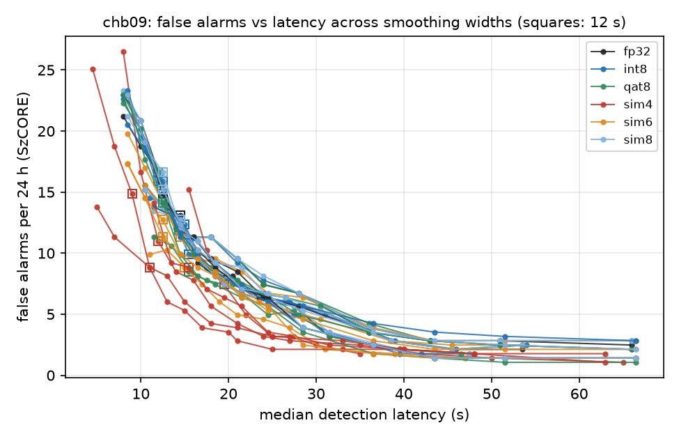

## chb10

Folds per seed: {0: 7, 1: 7, 2: 7, 3: 7, 4: 7}

- Early stopping fired in 35/35 jobs; ONNX FP32 export max |logit diff| 1.53e-05
- Seed 0: FP32 test specificity pooled over all held-out hours 0.9873 (OUTSIDE 0.995 +/- 0.005)
- Seed 1: FP32 test specificity pooled over all held-out hours 0.9892 (OUTSIDE 0.995 +/- 0.005)
- Seed 2: FP32 test specificity pooled over all held-out hours 0.9910 (within 0.995 +/- 0.005)
- Seed 3: FP32 test specificity pooled over all held-out hours 0.9920 (within 0.995 +/- 0.005)
- Seed 4: FP32 test specificity pooled over all held-out hours 0.9925 (within 0.995 +/- 0.005)
- Diagnostic: single folds outside the band 16/35 [(0, 0, 1.0), (1, 0, 0.9761), (4, 0, 0.9895), (6, 0, 0.9514), (0, 1, 1.0), (1, 1, 0.9808), (4, 1, 0.9837), (6, 1, 0.9653), (1, 2, 0.9778), (6, 2, 0.9791), (0, 3, 1.0), (1, 3, 0.9755), (6, 3, 0.9866), (0, 4, 1.0), (1, 4, 0.9801), (6, 4, 0.9869)]

### FP32 against EpiDeNet's reporting (4 s windows, pooled over folds)

| seed | FP/h raw | FP/h 3-window vote | window sens (vote) | spec (vote) | seizures detected |
|---|---|---|---|---|---|
| 0 | 5.72 | 3.34 | 0.814 | 0.9920 | 6/7 |
| 1 | 5.12 | 2.52 | 0.814 | 0.9941 | 6/7 |
| 2 | 4.00 | 1.90 | 0.928 | 0.9958 | 7/7 |
| 3 | 3.58 | 2.08 | 0.794 | 0.9956 | 6/7 |
| 4 | 3.22 | 1.46 | 0.879 | 0.9969 | 7/7 |

EpiDeNet (all CHB-MIT, LOOCV, 5 seeds): 4.29 raw, 2.24 with vote, 165/181 seizures.

### Two meanings of "FP/h" for the same FP32 model (pooled over folds)

| seed | window FP/h (3-window vote, 4 s grid) | SzCORE false alarms/h (12 s smoothing) | ratio |
|---|---|---|---|
| 0 | 3.34 | 1.08 | 3.1 |
| 1 | 2.52 | 1.08 | 2.3 |
| 2 | 1.90 | 0.90 | 2.1 |
| 3 | 2.08 | 0.74 | 2.8 |
| 4 | 1.46 | 0.70 | 2.1 |

Window FP/h is (1 - specificity) x windows per hour, so it depends on window length and hop, and one long artifact counts many times; SzCORE merges detections within 90 s into one alarm.

### Operating point (default smoothing, own threshold) and excess latency

| seed | model | FA/24h at 12 s | median latency at 12 s | detected | excess latency at FP32's FA (s) | smoothing there (s) | ΔFA/24h at FP32's latency |
|---|---|---|---|---|---|---|---|
| 0 | fp32 | 25.9 | 8.0 | 6/7 | 0.0 | 12.0 | 0.0 |
| 0 | int8 | 24.0 | 8.0 | 6/7 | -0.6 | 10.9 | -1.9 |
| 0 | sim8 | 28.8 | 8.0 | 6/7 | 0.4 | 12.8 | 2.9 |
| 0 | sim6 | 24.0 | 8.0 | 6/7 | -0.5 | 11.0 | -1.9 |
| 0 | sim4 | 14.4 | 12.0 | 6/7 | 0.0 | 4.0 | -4.3 |
| 0 | qat8 | 22.5 | 8.0 | 6/7 | -1.4 | 9.2 | -3.4 |
| 1 | fp32 | 25.9 | 8.0 | 7/7 | 0.0 | 12.0 | 0.0 |
| 1 | int8 | 24.9 | 8.0 | 7/7 | -0.3 | 11.4 | -1.0 |
| 1 | sim8 | 25.4 | 8.0 | 7/7 | -0.1 | 11.7 | -0.5 |
| 1 | sim6 | 26.4 | 8.0 | 7/7 | 0.1 | 12.2 | 0.5 |
| 1 | sim4 | 16.3 | 12.0 | 6/7 | 1.8 | 7.6 | 8.2 |
| 1 | qat8 | 25.9 | 8.0 | 7/7 | 0.0 | 12.0 | 0.0 |
| 2 | fp32 | 21.6 | 8.0 | 7/7 | 0.0 | 12.0 | 0.0 |
| 2 | int8 | 21.6 | 9.0 | 7/7 | 1.0 | 12.0 | 4.1 |
| 2 | sim8 | 22.1 | 8.0 | 7/7 | 0.1 | 12.2 | 0.5 |
| 2 | sim6 | 20.6 | 9.0 | 7/7 | 0.8 | 11.7 | 5.0 |
| 2 | sim4 | 21.1 | 11.0 | 7/7 | 2.9 | 11.8 | 12.0 |
| 2 | qat8 | 21.6 | 8.0 | 7/7 | 0.0 | 12.0 | 0.0 |
| 3 | fp32 | 17.8 | 8.0 | 6/7 | 0.0 | 12.0 | 0.0 |
| 3 | int8 | 16.8 | 8.0 | 6/7 | -0.2 | 11.5 | -1.0 |
| 3 | sim8 | 17.8 | 8.0 | 6/7 | 0.0 | 12.0 | 0.0 |
| 3 | sim6 | 16.3 | 8.0 | 6/7 | -0.3 | 11.3 | -1.4 |
| 3 | sim4 | 7.2 | 13.0 | 6/7 | 1.0 | 4.0 | n/a |
| 3 | qat8 | 15.8 | 8.0 | 6/7 | -1.0 | 10.0 | -1.9 |
| 4 | fp32 | 16.8 | 8.0 | 7/7 | 0.0 | 12.0 | 0.0 |
| 4 | int8 | 17.3 | 8.0 | 7/7 | 0.1 | 12.2 | 0.5 |
| 4 | sim8 | 16.3 | 8.0 | 7/7 | -0.1 | 11.9 | -0.5 |
| 4 | sim6 | 20.2 | 8.0 | 7/7 | 0.6 | 13.2 | 3.4 |
| 4 | sim4 | 14.9 | 12.0 | 7/7 | 3.5 | 11.0 | 14.9 |
| 4 | qat8 | 19.7 | 8.0 | 7/7 | 0.5 | 13.0 | 2.9 |

FP32 seed-to-seed excess latency (the null), all ordered seed pairs: ['0.0', '-0.9', '-1.9', '-1.3', '0.0', '-0.9', '-1.9', '-1.3', '0.8', '0.8', '-0.9', '-0.7', '1.4', '1.5', '0.7', '-0.1', '1.6', '1.7', '0.9', '0.3']
95% band: (-1.8888888888888893, 1.658901515151515)

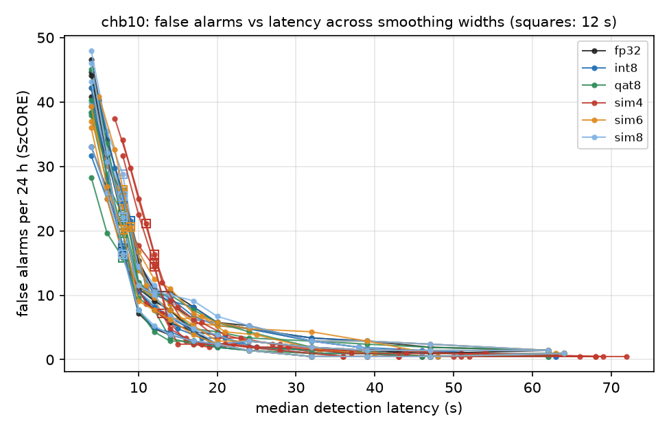

## chb11

Folds per seed: {0: 3, 1: 3, 2: 3, 3: 3, 4: 3}

- Early stopping fired in 15/15 jobs; ONNX FP32 export max |logit diff| 7.63e-06
- Seed 0: FP32 test specificity pooled over all held-out hours 0.9937 (within 0.995 +/- 0.005)
- Seed 1: FP32 test specificity pooled over all held-out hours 0.9880 (OUTSIDE 0.995 +/- 0.005)
- Seed 2: FP32 test specificity pooled over all held-out hours 0.9890 (OUTSIDE 0.995 +/- 0.005)
- Seed 3: FP32 test specificity pooled over all held-out hours 0.9909 (within 0.995 +/- 0.005)
- Seed 4: FP32 test specificity pooled over all held-out hours 0.9922 (within 0.995 +/- 0.005)
- Diagnostic: single folds outside the band 3/15 [(2, 1, 0.9758), (2, 2, 0.9783), (0, 3, 0.9861)]

### FP32 against EpiDeNet's reporting (4 s windows, pooled over folds)

| seed | FP/h raw | FP/h 3-window vote | window sens (vote) | spec (vote) | seizures detected |
|---|---|---|---|---|---|
| 0 | 2.67 | 0.80 | 0.806 | 0.9982 | 3/3 |
| 1 | 5.35 | 3.02 | 0.631 | 0.9928 | 2/3 |
| 2 | 5.17 | 2.93 | 0.770 | 0.9931 | 3/3 |
| 3 | 3.97 | 1.32 | 0.917 | 0.9970 | 3/3 |
| 4 | 3.45 | 1.44 | 0.806 | 0.9967 | 3/3 |

EpiDeNet (all CHB-MIT, LOOCV, 5 seeds): 4.29 raw, 2.24 with vote, 165/181 seizures.

### Two meanings of "FP/h" for the same FP32 model (pooled over folds)

| seed | window FP/h (3-window vote, 4 s grid) | SzCORE false alarms/h (12 s smoothing) | ratio |
|---|---|---|---|
| 0 | 0.80 | 0.75 | 1.1 |
| 1 | 3.02 | 1.15 | 2.6 |
| 2 | 2.93 | 0.89 | 3.3 |
| 3 | 1.32 | 1.26 | 1.0 |
| 4 | 1.44 | 1.29 | 1.1 |

Window FP/h is (1 - specificity) x windows per hour, so it depends on window length and hop, and one long artifact counts many times; SzCORE merges detections within 90 s into one alarm.

### Operating point (default smoothing, own threshold) and excess latency

| seed | model | FA/24h at 12 s | median latency at 12 s | detected | excess latency at FP32's FA (s) | smoothing there (s) | ΔFA/24h at FP32's latency |
|---|---|---|---|---|---|---|---|
| 0 | fp32 | 17.9 | -10.0 | 5/5 | 0.0 | 12.0 | 0.0 |
| 0 | int8 | 16.6 | -10.0 | 5/5 | -0.4 | 11.2 | -1.4 |
| 0 | sim8 | 17.2 | -10.0 | 5/5 | -0.2 | 11.6 | -0.7 |
| 0 | sim6 | 17.2 | 8.0 | 5/5 | 17.8 | 11.6 | n/a |
| 0 | sim4 | 7.6 | 10.0 | 4/5 | 16.0 | 4.0 | n/a |
| 0 | qat8 | 17.9 | -6.0 | 5/5 | 4.0 | 12.0 | 8.3 |
| 1 | fp32 | 27.6 | 32.0 | 4/5 | 0.0 | 12.0 | 0.0 |
| 1 | int8 | 20.0 | 32.0 | 4/5 | -2.7 | 6.7 | -7.6 |
| 1 | sim8 | 24.8 | 30.0 | 4/5 | -2.8 | 10.4 | -9.7 |
| 1 | sim6 | 20.7 | 35.0 | 4/5 | 0.7 | 7.4 | 5.2 |
| 1 | sim4 | 11.0 | inf | 3/5 | inf | n/a | n/a |
| 1 | qat8 | 28.3 | 32.0 | 4/5 | 0.2 | 12.4 | 0.7 |
| 2 | fp32 | 21.4 | 10.0 | 5/5 | 0.0 | 12.0 | 0.0 |
| 2 | int8 | 22.8 | 10.0 | 5/5 | 0.4 | 12.7 | 1.4 |
| 2 | sim8 | 22.8 | 10.0 | 5/5 | 0.3 | 12.7 | 1.4 |
| 2 | sim6 | 20.7 | 10.0 | 5/5 | -0.2 | 11.6 | -0.7 |
| 2 | sim4 | 13.1 | 18.0 | 5/5 | 3.2 | 4.3 | n/a |
| 2 | qat8 | 23.5 | 10.0 | 5/5 | 0.5 | 12.9 | 2.1 |
| 3 | fp32 | 30.4 | -9.0 | 5/5 | 0.0 | 12.0 | 0.0 |
| 3 | int8 | 29.7 | -10.0 | 5/5 | -1.1 | 11.8 | -2.8 |
| 3 | sim8 | 31.7 | -9.0 | 5/5 | 0.4 | 12.4 | 1.4 |
| 3 | sim6 | 20.7 | 8.0 | 5/5 | 15.4 | 8.7 | n/a |
| 3 | sim4 | 9.0 | 10.0 | 4/5 | 15.0 | 4.0 | n/a |
| 3 | qat8 | 22.1 | -11.0 | 5/5 | -3.4 | 9.2 | -9.5 |
| 4 | fp32 | 31.0 | -5.0 | 5/5 | 0.0 | 12.0 | 0.0 |
| 4 | int8 | 31.7 | -5.0 | 5/5 | 0.1 | 12.2 | 0.7 |
| 4 | sim8 | 33.1 | -6.0 | 5/5 | -0.8 | 12.5 | -6.9 |
| 4 | sim6 | 27.6 | 7.0 | 5/5 | 10.9 | 9.8 | n/a |
| 4 | sim4 | 15.2 | 10.0 | 4/5 | 11.0 | 4.0 | n/a |
| 4 | qat8 | 23.5 | -11.0 | 5/5 | -8.0 | 8.0 | -20.9 |

FP32 seed-to-seed excess latency (the null), all ordered seed pairs: ['44.3', '21.2', '14.5', '6.5', '-44.4', '-23.6', '-38.0', '-36.6', '-20.9', '23.4', '-9.3', '-13.9', '-3.9', '40.1', '16.7', '4.1', '-8.1', '35.9', '12.6', '-4.1']
95% band: (-41.36, 42.327777777777776)

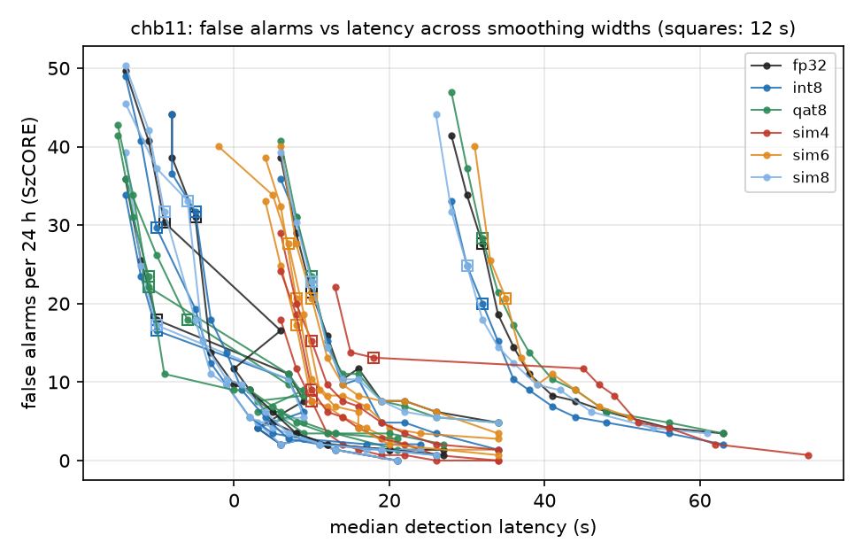

## chb12

Folds per seed: {0: 10, 1: 10, 2: 10, 3: 10, 4: 10}

- Early stopping fired in 50/50 jobs; ONNX FP32 export max |logit diff| 5.72e-06
- Seed 0: FP32 test specificity pooled over all held-out hours 0.9844 (OUTSIDE 0.995 +/- 0.005)
- Seed 1: FP32 test specificity pooled over all held-out hours 0.9864 (OUTSIDE 0.995 +/- 0.005)
- Seed 2: FP32 test specificity pooled over all held-out hours 0.9889 (OUTSIDE 0.995 +/- 0.005)
- Seed 3: FP32 test specificity pooled over all held-out hours 0.9882 (OUTSIDE 0.995 +/- 0.005)
- Seed 4: FP32 test specificity pooled over all held-out hours 0.9891 (OUTSIDE 0.995 +/- 0.005)
- Diagnostic: single folds outside the band 21/50 [(0, 0, 0.9898), (3, 0, 0.9189), (7, 0, 1.0), (8, 0, 1.0), (9, 0, 0.9532), (0, 1, 0.9848), (3, 1, 0.9368), (7, 1, 1.0), (9, 1, 0.9614), (3, 2, 0.9674), (4, 2, 0.9898), (8, 2, 1.0), (9, 2, 0.956), (0, 3, 0.9895), (3, 3, 0.9607), (7, 3, 1.0), (8, 3, 1.0), (9, 3, 0.9581), (3, 4, 0.9631), (7, 4, 1.0), (9, 4, 0.9584)]

### FP32 against EpiDeNet's reporting (4 s windows, pooled over folds)

| seed | FP/h raw | FP/h 3-window vote | window sens (vote) | spec (vote) | seizures detected |
|---|---|---|---|---|---|
| 0 | 7.20 | 5.27 | 0.541 | 0.9878 | 20/27 |
| 1 | 6.38 | 4.88 | 0.592 | 0.9891 | 21/27 |
| 2 | 4.88 | 3.48 | 0.590 | 0.9920 | 22/27 |
| 3 | 5.27 | 3.72 | 0.539 | 0.9914 | 21/27 |
| 4 | 4.93 | 3.43 | 0.550 | 0.9921 | 21/27 |

EpiDeNet (all CHB-MIT, LOOCV, 5 seeds): 4.29 raw, 2.24 with vote, 165/181 seizures.

### Two meanings of "FP/h" for the same FP32 model (pooled over folds)

| seed | window FP/h (3-window vote, 4 s grid) | SzCORE false alarms/h (12 s smoothing) | ratio |
|---|---|---|---|
| 0 | 5.27 | 0.87 | 6.1 |
| 1 | 4.88 | 1.26 | 3.9 |
| 2 | 3.48 | 0.82 | 4.2 |
| 3 | 3.72 | 0.87 | 4.3 |
| 4 | 3.43 | 0.82 | 4.2 |

Window FP/h is (1 - specificity) x windows per hour, so it depends on window length and hop, and one long artifact counts many times; SzCORE merges detections within 90 s into one alarm.

### Operating point (default smoothing, own threshold) and excess latency

| seed | model | FA/24h at 12 s | median latency at 12 s | detected | excess latency at FP32's FA (s) | smoothing there (s) | ΔFA/24h at FP32's latency |
|---|---|---|---|---|---|---|---|
| 0 | fp32 | 20.9 | 11.0 | 22/27 | 0.0 | 12.0 | 0.0 |
| 0 | int8 | 20.9 | 11.0 | 22/27 | 0.0 | 12.0 | 0.0 |
| 0 | sim8 | 22.0 | 11.0 | 22/27 | 0.7 | 13.3 | 1.2 |
| 0 | sim6 | 27.8 | 12.0 | 22/27 | 3.4 | 16.8 | 8.7 |
| 0 | sim4 | 19.7 | 44.0 | 14/27 | 31.9 | 11.6 | n/a |
| 0 | qat8 | 20.9 | 10.0 | 22/27 | -1.0 | 12.0 | -1.2 |
| 1 | fp32 | 30.2 | 10.0 | 22/27 | 0.0 | 12.0 | 0.0 |
| 1 | int8 | 29.0 | 11.0 | 22/27 | 0.7 | 11.3 | 2.3 |
| 1 | sim8 | 30.2 | 11.0 | 22/27 | 1.0 | 12.0 | 3.5 |
| 1 | sim6 | 34.8 | 10.0 | 23/27 | 0.6 | 13.2 | 4.6 |
| 1 | sim4 | 25.5 | 36.0 | 16/27 | 24.4 | 8.8 | n/a |
| 1 | qat8 | 27.8 | 11.0 | 22/27 | 0.4 | 10.9 | 1.7 |
| 2 | fp32 | 19.7 | 10.0 | 22/27 | 0.0 | 12.0 | 0.0 |
| 2 | int8 | 22.0 | 11.0 | 22/27 | 1.6 | 13.1 | 5.8 |
| 2 | sim8 | 22.0 | 10.0 | 22/27 | 0.6 | 13.1 | 2.3 |
| 2 | sim6 | 19.7 | 10.0 | 22/27 | 0.0 | 12.0 | 0.0 |
| 2 | sim4 | 19.7 | 37.0 | 15/27 | 27.0 | 12.0 | n/a |
| 2 | qat8 | 18.6 | 10.0 | 22/27 | -0.5 | 11.0 | -1.2 |
| 3 | fp32 | 20.9 | 11.0 | 22/27 | 0.0 | 12.0 | 0.0 |
| 3 | int8 | 22.0 | 11.0 | 22/27 | 0.4 | 12.8 | 1.2 |
| 3 | sim8 | 24.4 | 11.0 | 22/27 | 0.9 | 13.7 | 3.5 |
| 3 | sim6 | 23.2 | 11.0 | 22/27 | 0.4 | 12.9 | 2.3 |
| 3 | sim4 | 17.4 | 43.0 | 14/27 | 28.6 | 10.3 | n/a |
| 3 | qat8 | 19.7 | 11.0 | 22/27 | -0.3 | 11.3 | -1.2 |
| 4 | fp32 | 19.7 | 10.0 | 22/27 | 0.0 | 12.0 | 0.0 |
| 4 | int8 | 17.4 | 11.0 | 22/27 | 0.7 | 11.3 | 4.6 |
| 4 | sim8 | 18.6 | 10.0 | 22/27 | -0.1 | 11.7 | -1.2 |
| 4 | sim6 | 19.7 | 10.0 | 22/27 | 0.0 | 12.0 | 0.0 |
| 4 | sim4 | 20.9 | 35.0 | 18/27 | 26.6 | 12.6 | n/a |
| 4 | qat8 | 20.9 | 10.0 | 23/27 | 0.3 | 12.7 | 1.2 |

FP32 seed-to-seed excess latency (the null), all ordered seed pairs: ['1.7', '-1.2', '0.0', '-1.2', '-1.1', '-2.1', '-1.1', '-1.4', '1.5', '3.3', '1.4', '0.0', '0.0', '1.7', '-1.2', '-1.2', '1.5', '3.3', '0.0', '1.4']
95% band: (-1.7629554655870443, 3.333333333333332)

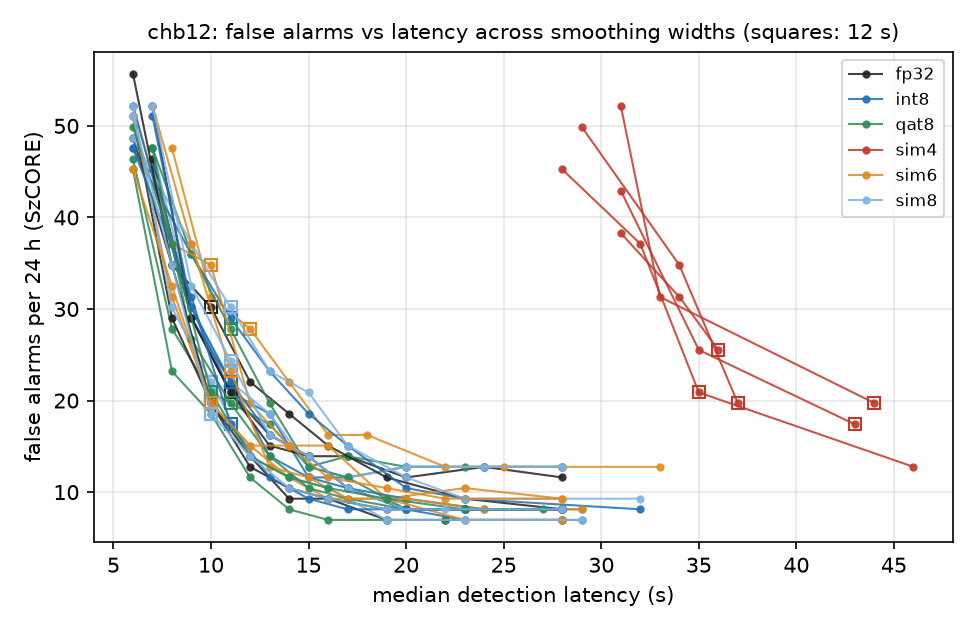

## chb13

Folds per seed: {0: 8, 1: 8, 2: 8, 3: 8, 4: 8}

- Early stopping fired in 40/40 jobs; ONNX FP32 export max |logit diff| 5.72e-06
- Seed 0: FP32 test specificity pooled over all held-out hours 0.9868 (OUTSIDE 0.995 +/- 0.005)
- Seed 1: FP32 test specificity pooled over all held-out hours 0.9911 (within 0.995 +/- 0.005)
- Seed 2: FP32 test specificity pooled over all held-out hours 0.9882 (OUTSIDE 0.995 +/- 0.005)
- Seed 3: FP32 test specificity pooled over all held-out hours 0.9876 (OUTSIDE 0.995 +/- 0.005)
- Seed 4: FP32 test specificity pooled over all held-out hours 0.9850 (OUTSIDE 0.995 +/- 0.005)
- Diagnostic: single folds outside the band 6/40 [(6, 0, 1.0), (7, 0, 0.9206), (7, 1, 0.95), (7, 2, 0.9284), (7, 3, 0.9281), (7, 4, 0.9013)]

### FP32 against EpiDeNet's reporting (4 s windows, pooled over folds)

| seed | FP/h raw | FP/h 3-window vote | window sens (vote) | spec (vote) | seizures detected |
|---|---|---|---|---|---|
| 0 | 6.27 | 4.88 | 0.437 | 0.9888 | 8/12 |
| 1 | 3.91 | 3.52 | 0.395 | 0.9920 | 8/12 |
| 2 | 5.33 | 4.64 | 0.380 | 0.9893 | 7/12 |
| 3 | 5.55 | 4.67 | 0.447 | 0.9893 | 9/12 |
| 4 | 6.64 | 5.48 | 0.426 | 0.9874 | 8/12 |

EpiDeNet (all CHB-MIT, LOOCV, 5 seeds): 4.29 raw, 2.24 with vote, 165/181 seizures.

### Two meanings of "FP/h" for the same FP32 model (pooled over folds)

| seed | window FP/h (3-window vote, 4 s grid) | SzCORE false alarms/h (12 s smoothing) | ratio |
|---|---|---|---|
| 0 | 4.88 | 0.85 | 5.8 |
| 1 | 3.52 | 0.55 | 6.4 |
| 2 | 4.64 | 0.58 | 8.1 |
| 3 | 4.67 | 0.88 | 5.3 |
| 4 | 5.48 | 0.94 | 5.8 |

Window FP/h is (1 - specificity) x windows per hour, so it depends on window length and hop, and one long artifact counts many times; SzCORE merges detections within 90 s into one alarm.

### Operating point (default smoothing, own threshold) and excess latency

| seed | model | FA/24h at 12 s | median latency at 12 s | detected | excess latency at FP32's FA (s) | smoothing there (s) | ΔFA/24h at FP32's latency |
|---|---|---|---|---|---|---|---|
| 0 | fp32 | 20.4 | 15.5 | 10/12 | 0.0 | 12.0 | 0.0 |
| 0 | int8 | 18.9 | 15.5 | 10/12 | -1.0 | 10.0 | -1.5 |
| 0 | sim8 | 19.6 | 15.5 | 10/12 | -0.7 | 10.7 | -0.7 |
| 0 | sim6 | 18.9 | 16.0 | 10/12 | -0.2 | 10.7 | -0.4 |
| 0 | sim4 | 14.5 | inf | 3/12 | inf | n/a | n/a |
| 0 | qat8 | 18.2 | 15.5 | 10/12 | -2.4 | 7.2 | -2.2 |
| 1 | fp32 | 13.1 | 16.5 | 10/12 | 0.0 | 12.0 | 0.0 |
| 1 | int8 | 12.4 | 16.5 | 10/12 | -0.5 | 11.0 | -0.7 |
| 1 | sim8 | 13.1 | 16.5 | 10/12 | 0.0 | 12.0 | 0.0 |
| 1 | sim6 | 13.8 | 16.5 | 10/12 | 0.5 | 13.0 | 0.7 |
| 1 | sim4 | 18.2 | inf | 5/12 | inf | n/a | n/a |
| 1 | qat8 | 14.5 | 16.5 | 10/12 | 2.0 | 16.0 | 1.5 |
| 2 | fp32 | 13.8 | 16.5 | 10/12 | 0.0 | 12.0 | 0.0 |
| 2 | int8 | 14.5 | 16.5 | 10/12 | 1.0 | 14.0 | 0.7 |
| 2 | sim8 | 13.8 | 16.5 | 10/12 | 0.0 | 12.0 | 0.0 |
| 2 | sim6 | 13.8 | 16.5 | 10/12 | 0.0 | 12.0 | 0.0 |
| 2 | sim4 | 14.5 | inf | 6/12 | inf | n/a | n/a |
| 2 | qat8 | 12.4 | 16.0 | 10/12 | -1.8 | 9.3 | -1.5 |
| 3 | fp32 | 21.1 | 15.0 | 10/12 | 0.0 | 12.0 | 0.0 |
| 3 | int8 | 19.6 | 15.0 | 10/12 | -3.2 | 5.6 | -1.5 |
| 3 | sim8 | 19.6 | 15.0 | 10/12 | -2.5 | 7.0 | -1.5 |
| 3 | sim6 | 18.9 | 15.0 | 10/12 | -2.5 | 7.0 | -2.2 |
| 3 | sim4 | 13.1 | inf | 6/12 | 1.7 | 5.3 | n/a |
| 3 | qat8 | 19.6 | 15.5 | 10/12 | -0.8 | 9.3 | -0.9 |
| 4 | fp32 | 22.5 | 16.0 | 10/12 | 0.0 | 12.0 | 0.0 |
| 4 | int8 | 23.3 | 16.5 | 10/12 | 0.7 | 12.4 | 1.3 |
| 4 | sim8 | 22.5 | 16.5 | 10/12 | 0.5 | 12.0 | 1.1 |
| 4 | sim6 | 22.5 | 16.0 | 10/12 | 0.0 | 12.0 | 0.0 |
| 4 | sim4 | 18.2 | inf | 5/12 | inf | n/a | n/a |
| 4 | qat8 | 14.5 | 16.0 | 10/12 | -4.0 | 4.0 | -8.0 |

FP32 seed-to-seed excess latency (the null), all ordered seed pairs: ['-3.0', '-2.6', '-0.2', '1.2', '10.6', '1.0', '4.5', '6.5', '8.7', '-0.7', '3.5', '3.5', '-1.5', '-2.5', '-2.3', '1.5', '-3.3', '-3.5', '-3.5', '-5.0']
95% band: (-4.2875, 9.734374999999998)

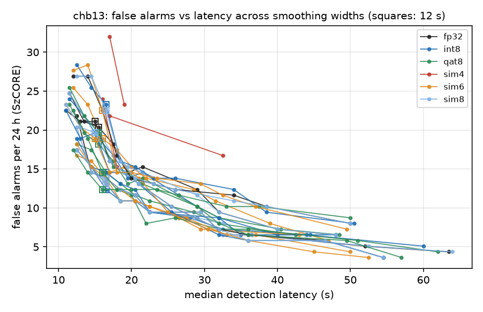

## chb14

Folds per seed: {0: 7, 1: 7, 2: 7, 3: 7, 4: 7}

- Early stopping fired in 35/35 jobs; ONNX FP32 export max |logit diff| 3.81e-06
- Seed 0: FP32 test specificity pooled over all held-out hours 0.9925 (within 0.995 +/- 0.005)
- Seed 1: FP32 test specificity pooled over all held-out hours 0.9930 (within 0.995 +/- 0.005)
- Seed 2: FP32 test specificity pooled over all held-out hours 0.9914 (within 0.995 +/- 0.005)
- Seed 3: FP32 test specificity pooled over all held-out hours 0.9924 (within 0.995 +/- 0.005)
- Seed 4: FP32 test specificity pooled over all held-out hours 0.9928 (within 0.995 +/- 0.005)
- Diagnostic: single folds outside the band 15/35 [(1, 0, 0.9878), (2, 0, 0.9865), (5, 0, 0.9872), (1, 1, 0.9874), (2, 1, 0.9891), (5, 1, 0.9819), (1, 2, 0.9864), (2, 2, 0.9844), (5, 2, 0.9777), (1, 3, 0.9888), (2, 3, 0.9898), (5, 3, 0.9792), (1, 4, 0.9868), (2, 4, 0.9861), (5, 4, 0.9845)]

### FP32 against EpiDeNet's reporting (4 s windows, pooled over folds)

| seed | FP/h raw | FP/h 3-window vote | window sens (vote) | spec (vote) | seizures detected |
|---|---|---|---|---|---|
| 0 | 3.31 | 1.58 | 0.252 | 0.9963 | 4/8 |
| 1 | 3.08 | 1.15 | 0.167 | 0.9975 | 3/8 |
| 2 | 3.58 | 1.46 | 0.281 | 0.9966 | 4/8 |
| 3 | 3.19 | 1.46 | 0.252 | 0.9966 | 4/8 |
| 4 | 3.08 | 1.54 | 0.352 | 0.9965 | 5/8 |

EpiDeNet (all CHB-MIT, LOOCV, 5 seeds): 4.29 raw, 2.24 with vote, 165/181 seizures.

### Two meanings of "FP/h" for the same FP32 model (pooled over folds)

| seed | window FP/h (3-window vote, 4 s grid) | SzCORE false alarms/h (12 s smoothing) | ratio |
|---|---|---|---|
| 0 | 1.58 | 1.19 | 1.3 |
| 1 | 1.15 | 1.19 | 1.0 |
| 2 | 1.46 | 1.19 | 1.2 |
| 3 | 1.46 | 1.15 | 1.3 |
| 4 | 1.54 | 0.92 | 1.7 |

Window FP/h is (1 - specificity) x windows per hour, so it depends on window length and hop, and one long artifact counts many times; SzCORE merges detections within 90 s into one alarm.

### Operating point (default smoothing, own threshold) and excess latency

| seed | model | FA/24h at 12 s | median latency at 12 s | detected | excess latency at FP32's FA (s) | smoothing there (s) | ΔFA/24h at FP32's latency |
|---|---|---|---|---|---|---|---|
| 0 | fp32 | 28.6 | 14.5 | 7/8 | 0.0 | 12.0 | 0.0 |
| 0 | int8 | 28.6 | 14.5 | 7/8 | 0.0 | 12.0 | 0.0 |
| 0 | sim8 | 28.6 | 14.5 | 7/8 | 0.0 | 12.0 | 0.0 |
| 0 | sim6 | 26.8 | 15.0 | 7/8 | 0.2 | 11.4 | 1.4 |
| 0 | sim4 | 21.2 | 17.0 | 6/8 | 1.4 | 9.9 | 11.1 |
| 0 | qat8 | 24.9 | 14.5 | 7/8 | -0.5 | 11.0 | -3.7 |
| 1 | fp32 | 28.6 | 15.0 | 7/8 | 0.0 | 12.0 | 0.0 |
| 1 | int8 | 26.8 | 15.0 | 7/8 | -0.4 | 11.4 | -1.8 |
| 1 | sim8 | 28.6 | 15.0 | 7/8 | 0.0 | 12.0 | 0.0 |
| 1 | sim6 | 29.5 | 15.0 | 7/8 | 0.2 | 12.3 | 0.9 |
| 1 | sim4 | 28.6 | 16.0 | 7/8 | 1.0 | 12.0 | 6.9 |
| 1 | qat8 | 25.8 | 15.0 | 6/8 | -0.7 | 11.1 | -2.8 |
| 2 | fp32 | 28.6 | 15.0 | 7/8 | 0.0 | 12.0 | 0.0 |
| 2 | int8 | 26.8 | 15.0 | 7/8 | -0.2 | 11.6 | -1.8 |
| 2 | sim8 | 28.6 | 15.0 | 7/8 | 0.0 | 12.0 | 0.0 |
| 2 | sim6 | 28.6 | 15.0 | 7/8 | 0.0 | 12.0 | 0.0 |
| 2 | sim4 | 30.5 | 17.5 | 5/8 | 2.8 | 12.6 | 5.2 |
| 2 | qat8 | 27.7 | 15.0 | 7/8 | -0.1 | 11.8 | -0.9 |
| 3 | fp32 | 27.7 | 14.5 | 7/8 | 0.0 | 12.0 | 0.0 |
| 3 | int8 | 27.7 | 14.5 | 7/8 | 0.0 | 12.0 | 0.0 |
| 3 | sim8 | 26.8 | 14.5 | 7/8 | -0.1 | 11.7 | -0.9 |
| 3 | sim6 | 26.8 | 14.5 | 6/8 | -0.2 | 11.7 | -0.9 |
| 3 | sim4 | 24.0 | inf | 4/8 | inf | n/a | n/a |
| 3 | qat8 | 26.8 | 14.5 | 7/8 | -0.1 | 11.7 | -0.9 |
| 4 | fp32 | 22.2 | 13.0 | 7/8 | 0.0 | 12.0 | 0.0 |
| 4 | int8 | 22.2 | 13.0 | 7/8 | 0.0 | 12.0 | 0.0 |
| 4 | sim8 | 24.0 | 14.5 | 7/8 | 2.1 | 13.1 | 10.2 |
| 4 | sim6 | 26.8 | 12.5 | 7/8 | 1.4 | 14.2 | 3.4 |
| 4 | sim4 | 21.2 | 18.0 | 7/8 | 4.8 | 11.7 | 20.9 |
| 4 | qat8 | 24.0 | 13.0 | 7/8 | 1.0 | 13.1 | 1.8 |

FP32 seed-to-seed excess latency (the null), all ordered seed pairs: ['0.5', '0.5', '-0.2', '-2.1', '-0.5', '0.0', '-0.7', '-2.6', '-0.5', '0.0', '-0.7', '-2.6', '0.2', '0.7', '0.8', '-2.0', '2.7', '3.1', '4.0', '2.8']
95% band: (-2.6363636363636367, 3.56153846153846)

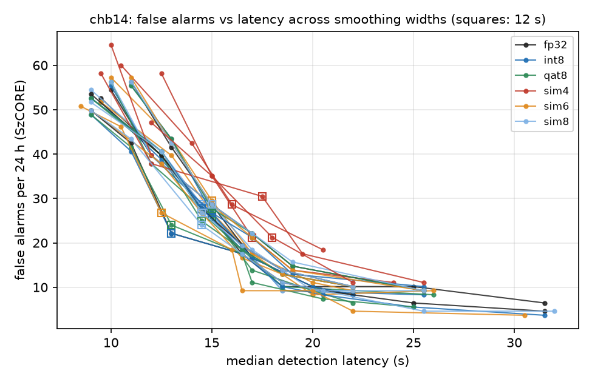

## chb15

Folds per seed: {0: 14, 1: 14, 2: 14, 3: 14, 4: 14}

- Early stopping fired in 70/70 jobs; ONNX FP32 export max |logit diff| 7.63e-06
- Seed 0: FP32 test specificity pooled over all held-out hours 0.9885 (OUTSIDE 0.995 +/- 0.005)
- Seed 1: FP32 test specificity pooled over all held-out hours 0.9895 (OUTSIDE 0.995 +/- 0.005)
- Seed 2: FP32 test specificity pooled over all held-out hours 0.9894 (OUTSIDE 0.995 +/- 0.005)
- Seed 3: FP32 test specificity pooled over all held-out hours 0.9898 (OUTSIDE 0.995 +/- 0.005)
- Seed 4: FP32 test specificity pooled over all held-out hours 0.9890 (OUTSIDE 0.995 +/- 0.005)
- Diagnostic: single folds outside the band 28/70 [(0, 0, 0.9718), (10, 0, 0.9545), (12, 0, 0.9898), (13, 0, 1.0), (2, 0, 0.9704), (5, 0, 0.9838), (6, 0, 0.9894), (9, 0, 1.0), (0, 1, 0.9769), (10, 1, 0.9554), (12, 1, 0.9876), (13, 1, 1.0), (2, 1, 0.9754), (5, 1, 0.987), (9, 1, 1.0), (0, 2, 0.9777), (10, 2, 0.9553), (2, 2, 0.9633), (9, 2, 1.0), (0, 3, 0.9782), (10, 3, 0.9563), (2, 3, 0.9654), (9, 3, 1.0), (0, 4, 0.9733), (10, 4, 0.957), (2, 4, 0.9719), (6, 4, 0.9892), (9, 4, 1.0)]

### FP32 against EpiDeNet's reporting (4 s windows, pooled over folds)

| seed | FP/h raw | FP/h 3-window vote | window sens (vote) | spec (vote) | seizures detected |
|---|---|---|---|---|---|
| 0 | 5.10 | 3.75 | 0.805 | 0.9919 | 19/20 |
| 1 | 4.65 | 3.42 | 0.777 | 0.9925 | 18/20 |
| 2 | 4.75 | 3.72 | 0.842 | 0.9919 | 19/20 |
| 3 | 4.45 | 3.30 | 0.839 | 0.9928 | 19/20 |
| 4 | 4.85 | 3.57 | 0.830 | 0.9923 | 19/20 |

EpiDeNet (all CHB-MIT, LOOCV, 5 seeds): 4.29 raw, 2.24 with vote, 165/181 seizures.

### Two meanings of "FP/h" for the same FP32 model (pooled over folds)

| seed | window FP/h (3-window vote, 4 s grid) | SzCORE false alarms/h (12 s smoothing) | ratio |
|---|---|---|---|
| 0 | 3.75 | 0.82 | 4.5 |
| 1 | 3.42 | 0.85 | 4.0 |
| 2 | 3.72 | 0.72 | 5.1 |
| 3 | 3.30 | 0.55 | 6.0 |
| 4 | 3.57 | 0.87 | 4.1 |

Window FP/h is (1 - specificity) x windows per hour, so it depends on window length and hop, and one long artifact counts many times; SzCORE merges detections within 90 s into one alarm.

### Operating point (default smoothing, own threshold) and excess latency

| seed | model | FA/24h at 12 s | median latency at 12 s | detected | excess latency at FP32's FA (s) | smoothing there (s) | ΔFA/24h at FP32's latency |
|---|---|---|---|---|---|---|---|
| 0 | fp32 | 19.8 | 8.0 | 19/20 | 0.0 | 12.0 | 0.0 |
| 0 | int8 | 16.2 | 8.5 | 16/20 | -1.0 | 9.0 | -2.4 |
| 0 | sim8 | 15.6 | 8.5 | 19/20 | -0.7 | 9.7 | -2.4 |
| 0 | sim6 | 12.0 | 15.0 | 18/20 | 5.3 | 9.3 | n/a |
| 0 | sim4 | 22.2 | inf | 5/20 | inf | n/a | n/a |
| 0 | qat8 | 14.4 | 8.0 | 19/20 | -2.0 | 8.0 | -5.4 |
| 1 | fp32 | 20.4 | 8.0 | 19/20 | 0.0 | 12.0 | 0.0 |
| 1 | int8 | 15.6 | 8.0 | 15/20 | -1.2 | 9.5 | -4.8 |
| 1 | sim8 | 16.8 | 8.0 | 19/20 | -0.9 | 10.2 | -3.6 |
| 1 | sim6 | 13.8 | 11.5 | 14/20 | 1.5 | 8.0 | 11.2 |
| 1 | sim4 | 25.8 | inf | 6/20 | inf | n/a | n/a |
| 1 | qat8 | 13.8 | 8.0 | 19/20 | -1.7 | 8.6 | -6.6 |
| 2 | fp32 | 17.4 | 8.5 | 19/20 | 0.0 | 12.0 | 0.0 |
| 2 | int8 | 12.6 | 8.5 | 19/20 | -0.8 | 10.3 | -4.8 |
| 2 | sim8 | 14.4 | 8.5 | 19/20 | -0.4 | 11.2 | -3.0 |
| 2 | sim6 | 12.6 | 11.0 | 16/20 | 0.5 | 8.0 | 1.6 |
| 2 | sim4 | 24.0 | inf | 3/20 | inf | n/a | n/a |
| 2 | qat8 | 15.0 | 8.0 | 19/20 | -1.1 | 10.8 | -3.6 |
| 3 | fp32 | 13.2 | 7.5 | 19/20 | 0.0 | 12.0 | 0.0 |
| 3 | int8 | 14.4 | 9.0 | 18/20 | 1.9 | 12.8 | 3.0 |
| 3 | sim8 | 13.2 | 8.0 | 19/20 | 0.5 | 12.0 | 1.5 |
| 3 | sim6 | 27.6 | 13.0 | 16/20 | 8.5 | 18.0 | n/a |
| 3 | sim4 | 6.0 | inf | 3/20 | inf | n/a | n/a |
| 3 | qat8 | 12.0 | 7.5 | 19/20 | -0.7 | 10.7 | -1.2 |
| 4 | fp32 | 21.0 | 8.0 | 19/20 | 0.0 | 12.0 | 0.0 |
| 4 | int8 | 19.8 | 9.0 | 17/20 | 0.6 | 11.3 | 2.1 |
| 4 | sim8 | 24.0 | 8.0 | 19/20 | 0.5 | 12.9 | 3.0 |
| 4 | sim6 | 16.8 | 13.0 | 17/20 | 4.2 | 10.4 | n/a |
| 4 | sim4 | 23.4 | inf | 4/20 | inf | n/a | n/a |
| 4 | qat8 | 20.4 | 8.0 | 19/20 | -0.2 | 11.7 | -0.6 |

FP32 seed-to-seed excess latency (the null), all ordered seed pairs: ['0.1', '-0.1', '-2.3', '0.2', '-0.2', '-0.3', '-2.5', '0.1', '0.4', '0.0', '-2.2', '0.1', '3.1', '1.8', '2.6', '1.9', '-0.3', '-0.2', '-0.4', '-2.6']
95% band: (-2.5583333333333336, 2.826388888888888)

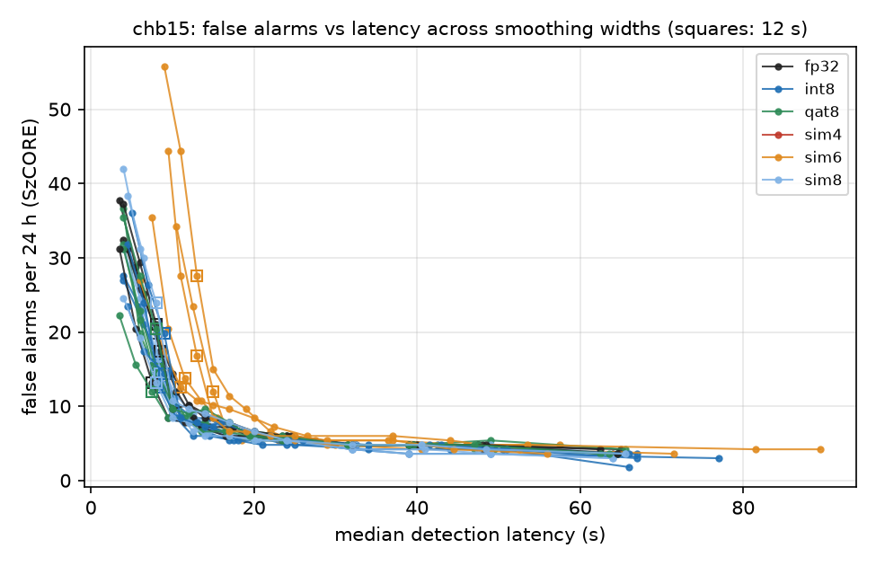

## chb16

Folds per seed: {0: 6, 1: 6, 2: 6, 3: 6, 4: 6}

- Early stopping fired in 30/30 jobs; ONNX FP32 export max |logit diff| 7.63e-06
- Seed 0: FP32 test specificity pooled over all held-out hours 0.9917 (within 0.995 +/- 0.005)
- Seed 1: FP32 test specificity pooled over all held-out hours 0.9843 (OUTSIDE 0.995 +/- 0.005)
- Seed 2: FP32 test specificity pooled over all held-out hours 0.9787 (OUTSIDE 0.995 +/- 0.005)
- Seed 3: FP32 test specificity pooled over all held-out hours 0.9929 (within 0.995 +/- 0.005)
- Seed 4: FP32 test specificity pooled over all held-out hours 0.9919 (within 0.995 +/- 0.005)
- Diagnostic: single folds outside the band 16/30 [(1, 0, 0.9727), (4, 0, 1.0), (5, 0, 1.0), (0, 1, 0.9485), (4, 1, 0.9868), (5, 1, 1.0), (0, 2, 0.9119), (3, 2, 0.99), (4, 2, 1.0), (0, 3, 0.9889), (1, 3, 0.9809), (4, 3, 1.0), (5, 3, 1.0), (0, 4, 0.9875), (1, 4, 0.9848), (4, 4, 1.0)]

### FP32 against EpiDeNet's reporting (4 s windows, pooled over folds)

| seed | FP/h raw | FP/h 3-window vote | window sens (vote) | spec (vote) | seizures detected |
|---|---|---|---|---|---|
| 0 | 3.47 | 1.84 | 0.000 | 0.9957 | 0/10 |
| 1 | 7.11 | 5.95 | 0.000 | 0.9888 | 0/10 |
| 2 | 9.16 | 7.58 | 0.000 | 0.9864 | 0/10 |
| 3 | 3.21 | 1.16 | 0.000 | 0.9975 | 0/10 |
| 4 | 3.89 | 1.53 | 0.000 | 0.9968 | 0/10 |

EpiDeNet (all CHB-MIT, LOOCV, 5 seeds): 4.29 raw, 2.24 with vote, 165/181 seizures.

### Two meanings of "FP/h" for the same FP32 model (pooled over folds)

| seed | window FP/h (3-window vote, 4 s grid) | SzCORE false alarms/h (12 s smoothing) | ratio |
|---|---|---|---|
| 0 | 1.84 | 0.68 | 2.7 |
| 1 | 5.95 | 1.00 | 5.9 |
| 2 | 7.58 | 1.00 | 7.6 |
| 3 | 1.16 | 0.53 | 2.2 |
| 4 | 1.53 | 0.79 | 1.9 |

Window FP/h is (1 - specificity) x windows per hour, so it depends on window length and hop, and one long artifact counts many times; SzCORE merges detections within 90 s into one alarm.

### Operating point (default smoothing, own threshold) and excess latency

| seed | model | FA/24h at 12 s | median latency at 12 s | detected | excess latency at FP32's FA (s) | smoothing there (s) | ΔFA/24h at FP32's latency |
|---|---|---|---|---|---|---|---|
| 0 | fp32 | 16.4 | inf | 3/10 | 0.0 | 12.0 | 0.0 |
| 0 | int8 | 15.2 | inf | 4/10 | n/a | n/a | n/a |
| 0 | sim8 | 16.4 | inf | 3/10 | n/a | n/a | n/a |
| 0 | sim6 | 20.2 | inf | 3/10 | n/a | n/a | n/a |
| 0 | sim4 | 13.9 | inf | 0/10 | n/a | n/a | n/a |
| 0 | qat8 | 17.7 | inf | 4/10 | n/a | n/a | n/a |
| 1 | fp32 | 24.0 | inf | 2/10 | 0.0 | 12.0 | 0.0 |
| 1 | int8 | 16.4 | inf | 2/10 | n/a | n/a | n/a |
| 1 | sim8 | 18.9 | inf | 2/10 | n/a | n/a | n/a |
| 1 | sim6 | 17.7 | inf | 2/10 | n/a | n/a | n/a |
| 1 | sim4 | 15.2 | inf | 0/10 | n/a | n/a | n/a |
| 1 | qat8 | 21.5 | inf | 2/10 | n/a | n/a | n/a |
| 2 | fp32 | 24.0 | inf | 2/10 | 0.0 | 12.0 | 0.0 |
| 2 | int8 | 22.7 | inf | 2/10 | n/a | n/a | n/a |
| 2 | sim8 | 24.0 | inf | 2/10 | n/a | n/a | n/a |
| 2 | sim6 | 22.7 | inf | 2/10 | n/a | n/a | n/a |
| 2 | sim4 | 20.2 | inf | 0/10 | n/a | n/a | n/a |
| 2 | qat8 | 29.1 | inf | 2/10 | n/a | n/a | n/a |
| 3 | fp32 | 12.6 | inf | 4/10 | 0.0 | 12.0 | 0.0 |
| 3 | int8 | 11.4 | inf | 4/10 | n/a | n/a | n/a |
| 3 | sim8 | 11.4 | inf | 4/10 | n/a | n/a | n/a |
| 3 | sim6 | 18.9 | inf | 4/10 | n/a | n/a | n/a |
| 3 | sim4 | 8.8 | inf | 0/10 | n/a | n/a | n/a |
| 3 | qat8 | 18.9 | inf | 4/10 | n/a | n/a | n/a |
| 4 | fp32 | 18.9 | inf | 3/10 | 0.0 | 12.0 | 0.0 |
| 4 | int8 | 17.7 | inf | 3/10 | n/a | n/a | n/a |
| 4 | sim8 | 18.9 | inf | 3/10 | n/a | n/a | n/a |
| 4 | sim6 | 17.7 | inf | 3/10 | n/a | n/a | n/a |
| 4 | sim4 | 12.6 | inf | 0/10 | n/a | n/a | n/a |
| 4 | qat8 | 18.9 | inf | 3/10 | n/a | n/a | n/a |

FP32 seed-to-seed excess latency (the null), all ordered seed pairs: ['n/a', 'n/a', 'n/a', 'n/a', 'n/a', 'n/a', 'n/a', 'n/a', 'n/a', 'n/a', 'n/a', 'n/a', 'n/a', 'n/a', 'n/a', 'n/a', 'n/a', 'n/a', 'n/a', 'n/a']
95% band: None

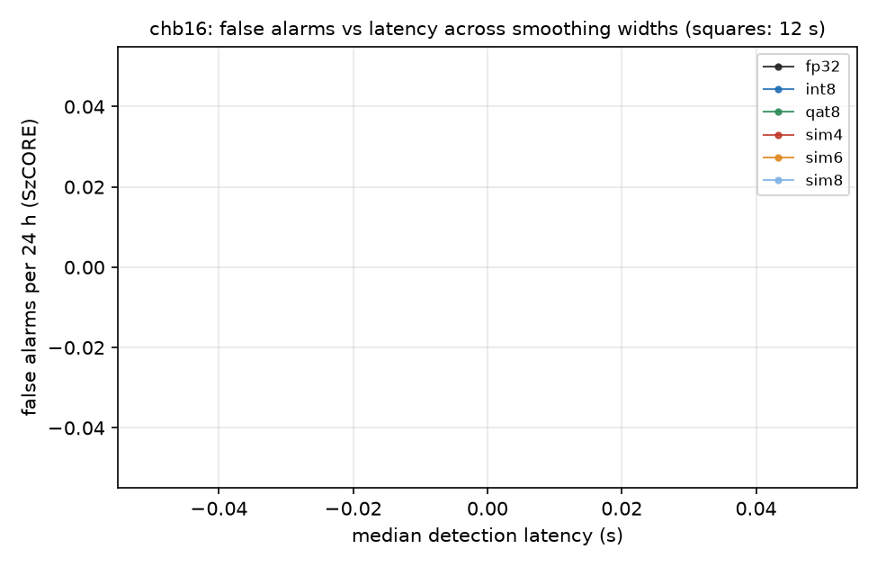

## chb17

Folds per seed: {0: 3, 1: 3, 2: 3, 3: 3, 4: 3}

- Early stopping fired in 15/15 jobs; ONNX FP32 export max |logit diff| 5.72e-06
- Seed 0: FP32 test specificity pooled over all held-out hours 0.9927 (within 0.995 +/- 0.005)
- Seed 1: FP32 test specificity pooled over all held-out hours 0.9946 (within 0.995 +/- 0.005)
- Seed 2: FP32 test specificity pooled over all held-out hours 0.9941 (within 0.995 +/- 0.005)
- Seed 3: FP32 test specificity pooled over all held-out hours 0.9916 (within 0.995 +/- 0.005)
- Seed 4: FP32 test specificity pooled over all held-out hours 0.9920 (within 0.995 +/- 0.005)
- Diagnostic: single folds outside the band 3/15 [(1, 2, 0.989), (2, 3, 0.9874), (1, 4, 0.9875)]

### FP32 against EpiDeNet's reporting (4 s windows, pooled over folds)

| seed | FP/h raw | FP/h 3-window vote | window sens (vote) | spec (vote) | seizures detected |
|---|---|---|---|---|---|
| 0 | 3.05 | 1.29 | 0.894 | 0.9971 | 3/3 |
| 1 | 2.33 | 0.86 | 0.894 | 0.9981 | 3/3 |
| 2 | 2.57 | 0.86 | 0.867 | 0.9981 | 3/3 |
| 3 | 3.57 | 1.24 | 0.894 | 0.9972 | 3/3 |
| 4 | 3.57 | 1.29 | 0.804 | 0.9971 | 3/3 |

EpiDeNet (all CHB-MIT, LOOCV, 5 seeds): 4.29 raw, 2.24 with vote, 165/181 seizures.

### Two meanings of "FP/h" for the same FP32 model (pooled over folds)

| seed | window FP/h (3-window vote, 4 s grid) | SzCORE false alarms/h (12 s smoothing) | ratio |
|---|---|---|---|
| 0 | 1.29 | 0.95 | 1.4 |
| 1 | 0.86 | 0.62 | 1.4 |
| 2 | 0.86 | 0.71 | 1.2 |
| 3 | 1.24 | 1.05 | 1.2 |
| 4 | 1.29 | 1.00 | 1.3 |

Window FP/h is (1 - specificity) x windows per hour, so it depends on window length and hop, and one long artifact counts many times; SzCORE merges detections within 90 s into one alarm.

### Operating point (default smoothing, own threshold) and excess latency

| seed | model | FA/24h at 12 s | median latency at 12 s | detected | excess latency at FP32's FA (s) | smoothing there (s) | ΔFA/24h at FP32's latency |
|---|---|---|---|---|---|---|---|
| 0 | fp32 | 22.8 | 11.0 | 3/3 | 0.0 | 12.0 | 0.0 |
| 0 | int8 | 24.0 | 11.0 | 3/3 | 0.2 | 12.4 | 1.1 |
| 0 | sim8 | 24.0 | 11.0 | 3/3 | 0.2 | 12.5 | 1.1 |
| 0 | sim6 | 14.9 | 13.0 | 3/3 | 0.0 | 7.2 | 0.0 |
| 0 | sim4 | 16.0 | 38.0 | 3/3 | 21.6 | 9.6 | n/a |
| 0 | qat8 | 22.8 | 11.0 | 3/3 | 0.0 | 12.0 | 0.0 |
| 1 | fp32 | 14.9 | 11.0 | 3/3 | 0.0 | 12.0 | 0.0 |
| 1 | int8 | 13.7 | 11.0 | 3/3 | -0.4 | 11.2 | -1.1 |
| 1 | sim8 | 16.0 | 11.0 | 3/3 | 0.3 | 12.6 | 1.1 |
| 1 | sim6 | 11.4 | 11.0 | 3/3 | -1.2 | 9.6 | -3.4 |
| 1 | sim4 | 21.7 | 44.0 | 3/3 | 34.1 | 14.2 | n/a |
| 1 | qat8 | 14.9 | 11.0 | 3/3 | 0.0 | 12.0 | 0.0 |
| 2 | fp32 | 17.1 | 11.0 | 3/3 | 0.0 | 12.0 | 0.0 |
| 2 | int8 | 8.0 | 11.0 | 3/3 | -1.6 | 8.8 | -9.1 |
| 2 | sim8 | 18.3 | 11.0 | 3/3 | 0.3 | 12.7 | 1.1 |
| 2 | sim6 | 12.6 | 11.0 | 3/3 | -1.1 | 9.7 | -4.6 |
| 2 | sim4 | 8.0 | 31.0 | 3/3 | 17.7 | 7.4 | n/a |
| 2 | qat8 | 20.6 | 11.0 | 3/3 | 0.9 | 13.7 | 3.4 |
| 3 | fp32 | 25.1 | 11.0 | 3/3 | 0.0 | 12.0 | 0.0 |
| 3 | int8 | 24.0 | 13.0 | 3/3 | 1.8 | 11.6 | 10.3 |
| 3 | sim8 | 24.0 | 11.0 | 3/3 | -0.1 | 11.7 | -1.1 |
| 3 | sim6 | 21.7 | 12.0 | 3/3 | 0.5 | 11.1 | 4.0 |
| 3 | sim4 | 17.1 | 31.0 | 3/3 | 18.7 | 9.5 | n/a |
| 3 | qat8 | 26.3 | 11.0 | 3/3 | 0.6 | 12.4 | 1.1 |
| 4 | fp32 | 24.0 | 11.0 | 3/3 | 0.0 | 12.0 | 0.0 |
| 4 | int8 | 22.8 | 12.0 | 3/3 | 0.9 | 11.7 | 7.4 |
| 4 | sim8 | 24.0 | 11.0 | 3/3 | 0.0 | 12.0 | 0.0 |
| 4 | sim6 | 22.8 | 11.0 | 3/3 | -0.2 | 11.7 | -1.1 |
| 4 | sim4 | 16.0 | 54.0 | 3/3 | 32.5 | 9.2 | n/a |
| 4 | qat8 | 22.8 | 11.0 | 3/3 | -0.1 | 11.8 | -1.1 |

FP32 seed-to-seed excess latency (the null), all ordered seed pairs: ['-2.2', '-0.9', '0.4', '0.2', '2.0', '0.8', '1.6', '1.5', '1.4', '-0.7', '1.3', '1.1', '-0.7', '-2.5', '-1.3', '-0.1', '-0.3', '-2.3', '-1.1', '0.2']
95% band: (-2.388461538461538, 1.827272727272727)

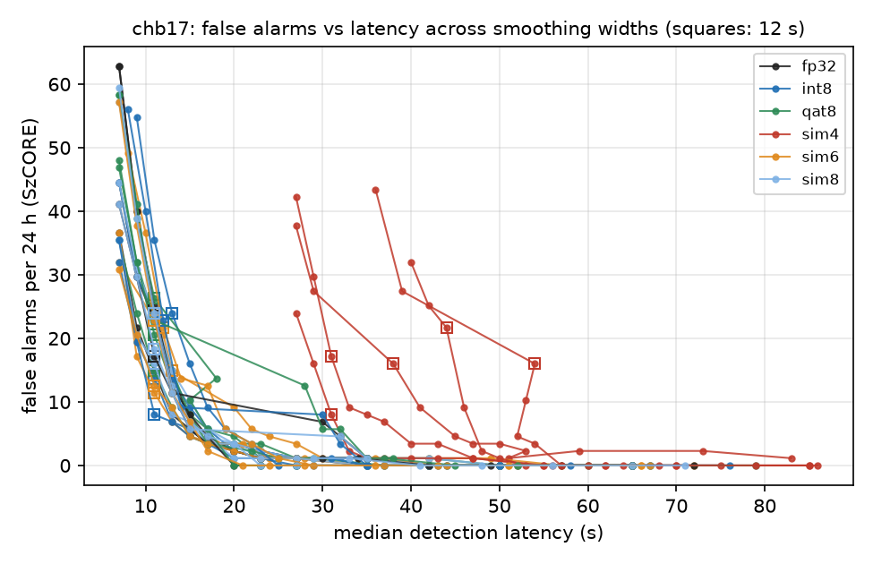

## chb18

Folds per seed: {0: 6, 1: 6, 2: 6, 3: 6, 4: 6}

- Early stopping fired in 30/30 jobs; ONNX FP32 export max |logit diff| 1.14e-05
- Seed 0: FP32 test specificity pooled over all held-out hours 0.9902 (within 0.995 +/- 0.005)
- Seed 1: FP32 test specificity pooled over all held-out hours 0.9902 (within 0.995 +/- 0.005)
- Seed 2: FP32 test specificity pooled over all held-out hours 0.9836 (OUTSIDE 0.995 +/- 0.005)
- Seed 3: FP32 test specificity pooled over all held-out hours 0.9908 (within 0.995 +/- 0.005)
- Seed 4: FP32 test specificity pooled over all held-out hours 0.9844 (OUTSIDE 0.995 +/- 0.005)
- Diagnostic: single folds outside the band 16/30 [(4, 0, 0.99), (5, 0, 0.975), (0, 1, 0.9833), (3, 1, 1.0), (4, 1, 0.986), (5, 1, 0.9816), (0, 2, 0.99), (3, 2, 0.9652), (4, 2, 0.9883), (5, 2, 0.9771), (4, 3, 0.9893), (5, 3, 0.9781), (0, 4, 0.9831), (3, 4, 0.9652), (4, 4, 0.9872), (5, 4, 0.9815)]

### FP32 against EpiDeNet's reporting (4 s windows, pooled over folds)

| seed | FP/h raw | FP/h 3-window vote | window sens (vote) | spec (vote) | seizures detected |
|---|---|---|---|---|---|
| 0 | 4.38 | 2.16 | 0.662 | 0.9952 | 5/6 |
| 1 | 4.41 | 2.92 | 0.662 | 0.9936 | 5/6 |
| 2 | 7.32 | 5.00 | 0.680 | 0.9890 | 5/6 |
| 3 | 4.43 | 2.30 | 0.680 | 0.9949 | 5/6 |
| 4 | 7.10 | 5.36 | 0.683 | 0.9882 | 5/6 |

EpiDeNet (all CHB-MIT, LOOCV, 5 seeds): 4.29 raw, 2.24 with vote, 165/181 seizures.

### Two meanings of "FP/h" for the same FP32 model (pooled over folds)

| seed | window FP/h (3-window vote, 4 s grid) | SzCORE false alarms/h (12 s smoothing) | ratio |
|---|---|---|---|
| 0 | 2.16 | 1.04 | 2.1 |
| 1 | 2.92 | 0.76 | 3.9 |
| 2 | 5.00 | 0.93 | 5.4 |
| 3 | 2.30 | 0.67 | 3.4 |
| 4 | 5.36 | 0.90 | 6.0 |

Window FP/h is (1 - specificity) x windows per hour, so it depends on window length and hop, and one long artifact counts many times; SzCORE merges detections within 90 s into one alarm.

### Operating point (default smoothing, own threshold) and excess latency

| seed | model | FA/24h at 12 s | median latency at 12 s | detected | excess latency at FP32's FA (s) | smoothing there (s) | ΔFA/24h at FP32's latency |
|---|---|---|---|---|---|---|---|
| 0 | fp32 | 24.9 | 10.0 | 6/6 | 0.0 | 12.0 | 0.0 |
| 0 | int8 | 23.6 | 10.0 | 6/6 | -0.4 | 11.3 | -1.3 |
| 0 | sim8 | 23.6 | 10.0 | 6/6 | -0.3 | 11.4 | -1.3 |
| 0 | sim6 | 13.5 | 12.0 | 6/6 | -3.0 | 4.9 | -8.8 |
| 0 | sim4 | 14.1 | 33.0 | 4/6 | 17.5 | 4.0 | n/a |
| 0 | qat8 | 24.2 | 10.0 | 6/6 | -0.1 | 11.7 | -0.7 |
| 1 | fp32 | 18.2 | 10.0 | 6/6 | 0.0 | 12.0 | 0.0 |
| 1 | int8 | 18.2 | 10.0 | 6/6 | 0.0 | 12.0 | 0.0 |
| 1 | sim8 | 19.5 | 10.0 | 6/6 | 0.7 | 12.6 | 1.3 |
| 1 | sim6 | 10.8 | 10.5 | 6/6 | -3.5 | 4.0 | -7.1 |
| 1 | sim4 | 12.8 | 32.5 | 5/6 | 19.6 | 6.2 | n/a |
| 1 | qat8 | 18.9 | 10.0 | 6/6 | 0.4 | 12.3 | 0.7 |
| 2 | fp32 | 22.2 | 10.5 | 6/6 | 0.0 | 12.0 | 0.0 |
| 2 | int8 | 21.6 | 10.5 | 6/6 | -0.1 | 11.7 | -0.7 |
| 2 | sim8 | 21.6 | 10.5 | 6/6 | -0.1 | 11.7 | -0.7 |
| 2 | sim6 | 16.2 | 11.5 | 6/6 | -0.6 | 8.7 | -2.4 |
| 2 | sim4 | 14.8 | 27.0 | 5/6 | 11.5 | 4.0 | n/a |
| 2 | qat8 | 24.9 | 11.0 | 6/6 | 1.7 | 13.1 | 5.4 |
| 3 | fp32 | 16.2 | 10.0 | 6/6 | 0.0 | 12.0 | 0.0 |
| 3 | int8 | 18.9 | 10.0 | 6/6 | 1.0 | 13.0 | 2.7 |
| 3 | sim8 | 17.5 | 9.5 | 6/6 | 0.0 | 12.5 | 0.0 |
| 3 | sim6 | 8.1 | 18.5 | 6/6 | -0.5 | 6.9 | -3.4 |
| 3 | sim4 | 10.1 | 40.5 | 4/6 | 25.0 | 4.0 | n/a |
| 3 | qat8 | 16.8 | 10.5 | 6/6 | 0.8 | 12.3 | 3.2 |
| 4 | fp32 | 21.6 | 11.0 | 6/6 | 0.0 | 12.0 | 0.0 |
| 4 | int8 | 18.2 | 10.5 | 6/6 | -1.3 | 10.3 | -4.2 |
| 4 | sim8 | 21.6 | 10.5 | 6/6 | -0.5 | 12.0 | -0.9 |
| 4 | sim6 | 9.4 | 12.5 | 6/6 | -2.5 | 4.0 | -8.1 |
| 4 | sim4 | 15.5 | 31.0 | 4/6 | 18.4 | 8.7 | n/a |
| 4 | qat8 | 19.5 | 11.0 | 6/6 | -0.4 | 11.2 | -2.0 |

FP32 seed-to-seed excess latency (the null), all ordered seed pairs: ['-1.5', '0.1', '-1.3', '0.2', '1.8', '3.0', '-0.3', '3.1', '0.2', '-1.4', '-1.4', '0.3', '2.4', '1.2', '4.2', '4.4', '-0.1', '-1.8', '-0.1', '-1.8']
95% band: (-1.7853846153846162, 4.2882867132867135)

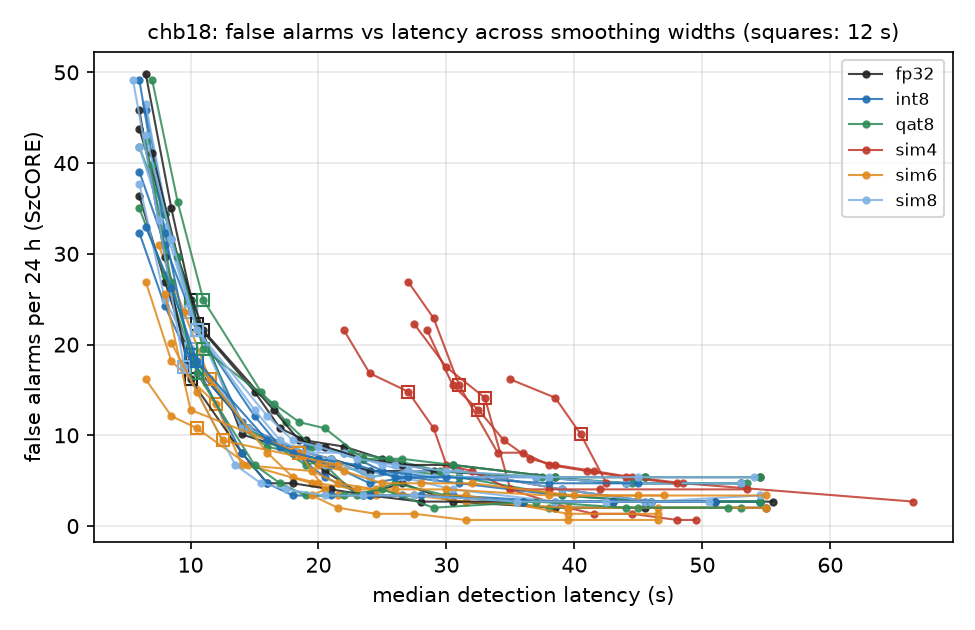

## chb19

Folds per seed: {0: 3, 1: 3, 2: 3, 3: 3, 4: 3}

- Early stopping fired in 15/15 jobs; ONNX FP32 export max |logit diff| 1.05e-05
- Seed 0: FP32 test specificity pooled over all held-out hours 0.9958 (within 0.995 +/- 0.005)
- Seed 1: FP32 test specificity pooled over all held-out hours 0.9939 (within 0.995 +/- 0.005)
- Seed 2: FP32 test specificity pooled over all held-out hours 0.9960 (within 0.995 +/- 0.005)
- Seed 3: FP32 test specificity pooled over all held-out hours 0.9954 (within 0.995 +/- 0.005)
- Seed 4: FP32 test specificity pooled over all held-out hours 0.9945 (within 0.995 +/- 0.005)
- Diagnostic: single folds outside the band 0/15

### FP32 against EpiDeNet's reporting (4 s windows, pooled over folds)

| seed | FP/h raw | FP/h 3-window vote | window sens (vote) | spec (vote) | seizures detected |
|---|---|---|---|---|---|
| 0 | 1.74 | 0.97 | 0.767 | 0.9978 | 3/3 |
| 1 | 2.74 | 1.97 | 0.700 | 0.9956 | 3/3 |
| 2 | 1.74 | 1.17 | 0.733 | 0.9974 | 3/3 |
| 3 | 2.04 | 1.64 | 0.733 | 0.9964 | 3/3 |
| 4 | 2.24 | 1.54 | 0.800 | 0.9966 | 3/3 |

EpiDeNet (all CHB-MIT, LOOCV, 5 seeds): 4.29 raw, 2.24 with vote, 165/181 seizures.

### Two meanings of "FP/h" for the same FP32 model (pooled over folds)

| seed | window FP/h (3-window vote, 4 s grid) | SzCORE false alarms/h (12 s smoothing) | ratio |
|---|---|---|---|
| 0 | 0.97 | 0.50 | 1.9 |
| 1 | 1.97 | 0.60 | 3.3 |
| 2 | 1.17 | 0.40 | 2.9 |
| 3 | 1.64 | 0.50 | 3.3 |
| 4 | 1.54 | 0.50 | 3.1 |

Window FP/h is (1 - specificity) x windows per hour, so it depends on window length and hop, and one long artifact counts many times; SzCORE merges detections within 90 s into one alarm.

### Operating point (default smoothing, own threshold) and excess latency

| seed | model | FA/24h at 12 s | median latency at 12 s | detected | excess latency at FP32's FA (s) | smoothing there (s) | ΔFA/24h at FP32's latency |
|---|---|---|---|---|---|---|---|
| 0 | fp32 | 12.0 | 16.0 | 3/3 | 0.0 | 12.0 | 0.0 |
| 0 | int8 | 13.6 | 16.0 | 3/3 | 1.6 | 12.7 | 1.6 |
| 0 | sim8 | 12.8 | 16.0 | 3/3 | 0.8 | 12.4 | 0.8 |
| 0 | sim6 | 7.2 | 16.0 | 3/3 | -3.3 | 5.3 | -4.8 |
| 0 | sim4 | 5.6 | 33.0 | 3/3 | -0.1 | 7.7 | -0.8 |
| 0 | qat8 | 12.0 | 16.0 | 3/3 | 0.0 | 12.0 | 0.0 |
| 1 | fp32 | 14.4 | 17.0 | 3/3 | 0.0 | 12.0 | 0.0 |
| 1 | int8 | 14.4 | 17.0 | 3/3 | 0.0 | 12.0 | 0.0 |
| 1 | sim8 | 14.4 | 17.0 | 3/3 | 0.0 | 12.0 | 0.0 |
| 1 | sim6 | 14.4 | 17.0 | 3/3 | 0.0 | 12.0 | 0.0 |
| 1 | sim4 | 11.2 | 34.0 | 3/3 | 9.0 | 10.2 | 3.6 |
| 1 | qat8 | 14.4 | 17.0 | 3/3 | 0.0 | 12.0 | 0.0 |
| 2 | fp32 | 9.6 | 17.0 | 3/3 | 0.0 | 12.0 | 0.0 |
| 2 | int8 | 9.6 | 17.0 | 3/3 | 0.0 | 12.0 | 0.0 |
| 2 | sim8 | 9.6 | 17.0 | 3/3 | 0.0 | 12.0 | 0.0 |
| 2 | sim6 | 8.0 | 17.0 | 3/3 | -0.7 | 10.7 | -1.6 |
| 2 | sim4 | 5.6 | 31.0 | 3/3 | 12.9 | 9.8 | 7.7 |
| 2 | qat8 | 8.8 | 16.0 | 3/3 | -1.5 | 11.0 | -2.8 |
| 3 | fp32 | 12.0 | 15.0 | 3/3 | 0.0 | 12.0 | 0.0 |
| 3 | int8 | 11.2 | 15.0 | 3/3 | -1.0 | 10.0 | -0.8 |
| 3 | sim8 | 12.0 | 15.0 | 3/3 | -2.0 | 8.0 | 0.0 |
| 3 | sim6 | 11.2 | 15.0 | 3/3 | -3.0 | 6.0 | -0.8 |
| 3 | sim4 | 4.0 | 16.0 | 3/3 | -2.0 | 6.0 | -5.6 |
| 3 | qat8 | 11.2 | 15.0 | 3/3 | -0.7 | 10.7 | -0.8 |
| 4 | fp32 | 12.0 | 13.0 | 3/3 | 0.0 | 12.0 | 0.0 |
| 4 | int8 | 10.4 | 13.0 | 3/3 | -0.8 | 10.4 | -1.6 |
| 4 | sim8 | 12.0 | 13.0 | 3/3 | 0.0 | 12.0 | 0.0 |
| 4 | sim6 | 10.4 | 14.0 | 3/3 | -0.3 | 9.3 | -0.4 |
| 4 | sim4 | 4.8 | 32.0 | 3/3 | 3.0 | 4.0 | n/a |
| 4 | qat8 | 12.0 | 13.0 | 3/3 | 0.0 | 12.0 | 0.0 |

FP32 seed-to-seed excess latency (the null), all ordered seed pairs: ['5.5', '-0.5', '-3.0', '-3.0', '-2.2', '-4.0', '-6.0', '-5.2', '2.0', '9.0', '-1.2', '-2.8', '1.0', '6.5', '0.5', '-2.0', '3.0', '8.5', '2.5', '0.0']
95% band: (-5.619999999999999, 8.762499999999998)

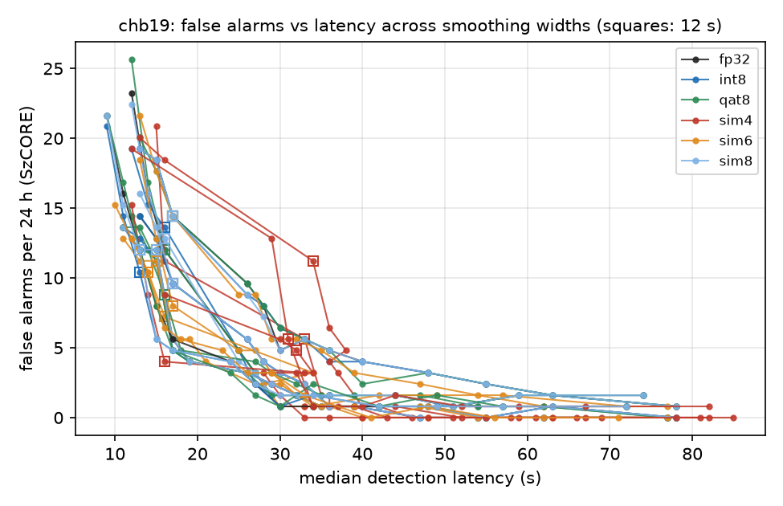

## chb20

Folds per seed: {0: 6, 1: 6, 2: 6, 3: 6, 4: 6}

- Early stopping fired in 30/30 jobs; ONNX FP32 export max |logit diff| 7.63e-06
- Seed 0: FP32 test specificity pooled over all held-out hours 0.9935 (within 0.995 +/- 0.005)
- Seed 1: FP32 test specificity pooled over all held-out hours 0.9952 (within 0.995 +/- 0.005)
- Seed 2: FP32 test specificity pooled over all held-out hours 0.9949 (within 0.995 +/- 0.005)
- Seed 3: FP32 test specificity pooled over all held-out hours 0.9943 (within 0.995 +/- 0.005)
- Seed 4: FP32 test specificity pooled over all held-out hours 0.9958 (within 0.995 +/- 0.005)
- Diagnostic: single folds outside the band 7/30 [(4, 0, 0.9897), (1, 1, 1.0), (1, 2, 1.0), (4, 2, 0.99), (4, 3, 0.9874), (1, 4, 1.0), (4, 4, 0.9881)]

### FP32 against EpiDeNet's reporting (4 s windows, pooled over folds)

| seed | FP/h raw | FP/h 3-window vote | window sens (vote) | spec (vote) | seizures detected |
|---|---|---|---|---|---|
| 0 | 3.04 | 2.17 | 0.524 | 0.9954 | 7/8 |
| 1 | 2.03 | 1.70 | 0.361 | 0.9963 | 5/8 |
| 2 | 2.32 | 1.67 | 0.348 | 0.9964 | 5/8 |
| 3 | 2.61 | 1.67 | 0.493 | 0.9964 | 7/8 |
| 4 | 1.99 | 1.70 | 0.398 | 0.9963 | 6/8 |

EpiDeNet (all CHB-MIT, LOOCV, 5 seeds): 4.29 raw, 2.24 with vote, 165/181 seizures.

### Two meanings of "FP/h" for the same FP32 model (pooled over folds)

| seed | window FP/h (3-window vote, 4 s grid) | SzCORE false alarms/h (12 s smoothing) | ratio |
|---|---|---|---|
| 0 | 2.17 | 0.51 | 4.3 |
| 1 | 1.70 | 0.29 | 5.9 |
| 2 | 1.67 | 0.40 | 4.2 |
| 3 | 1.67 | 0.51 | 3.3 |
| 4 | 1.70 | 0.36 | 4.7 |

Window FP/h is (1 - specificity) x windows per hour, so it depends on window length and hop, and one long artifact counts many times; SzCORE merges detections within 90 s into one alarm.

### Operating point (default smoothing, own threshold) and excess latency

| seed | model | FA/24h at 12 s | median latency at 12 s | detected | excess latency at FP32's FA (s) | smoothing there (s) | ΔFA/24h at FP32's latency |
|---|---|---|---|---|---|---|---|
| 0 | fp32 | 12.2 | 18.5 | 8/8 | 0.0 | 12.0 | 0.0 |
| 0 | int8 | 12.2 | 19.0 | 8/8 | 0.5 | 12.0 | 0.4 |
| 0 | sim8 | 12.2 | 17.0 | 8/8 | -1.5 | 12.0 | -3.3 |
| 0 | sim6 | 13.0 | 15.5 | 8/8 | -2.6 | 12.7 | -4.8 |
| 0 | sim4 | 13.0 | inf | 2/8 | inf | n/a | n/a |
| 0 | qat8 | 13.9 | 18.5 | 8/8 | 0.7 | 13.3 | 1.7 |
| 1 | fp32 | 7.0 | 21.0 | 6/8 | 0.0 | 12.0 | 0.0 |
| 1 | int8 | 6.1 | 21.0 | 7/8 | -0.5 | 11.0 | -0.9 |
| 1 | sim8 | 7.0 | 21.0 | 6/8 | 0.0 | 12.0 | 0.0 |
| 1 | sim6 | 7.0 | 28.5 | 6/8 | 7.5 | 12.0 | 1.4 |
| 1 | sim4 | 11.3 | inf | 2/8 | inf | n/a | n/a |
| 1 | qat8 | 7.0 | 21.0 | 7/8 | 0.0 | 12.0 | 0.0 |
| 2 | fp32 | 9.6 | 20.0 | 8/8 | 0.0 | 12.0 | 0.0 |
| 2 | int8 | 9.6 | 20.0 | 8/8 | 0.0 | 12.0 | 0.0 |
| 2 | sim8 | 9.6 | 20.0 | 8/8 | 0.0 | 12.0 | 0.0 |
| 2 | sim6 | 9.6 | 20.5 | 8/8 | 0.5 | 12.0 | 1.3 |
| 2 | sim4 | 13.0 | inf | 2/8 | inf | n/a | n/a |
| 2 | qat8 | 9.6 | 23.0 | 8/8 | 3.0 | 12.0 | 1.7 |
| 3 | fp32 | 12.2 | 21.0 | 8/8 | 0.0 | 12.0 | 0.0 |
| 3 | int8 | 13.0 | 21.0 | 8/8 | 0.4 | 12.8 | 0.9 |
| 3 | sim8 | 12.2 | 21.0 | 8/8 | 0.0 | 12.0 | 0.0 |
| 3 | sim6 | 13.0 | 15.5 | 8/8 | -4.1 | 12.8 | -2.5 |
| 3 | sim4 | 13.0 | inf | 3/8 | inf | n/a | n/a |
| 3 | qat8 | 11.3 | 20.5 | 8/8 | -0.7 | 11.7 | -1.3 |
| 4 | fp32 | 8.7 | 22.0 | 8/8 | 0.0 | 12.0 | 0.0 |
| 4 | int8 | 8.7 | 24.0 | 8/8 | 2.0 | 12.0 | 2.6 |
| 4 | sim8 | 8.7 | 22.0 | 8/8 | 0.0 | 12.0 | 0.0 |
| 4 | sim6 | 8.7 | 20.0 | 7/8 | -2.0 | 12.0 | -0.4 |
| 4 | sim4 | 10.4 | inf | 3/8 | inf | n/a | n/a |
| 4 | qat8 | 8.7 | 23.0 | 7/8 | 1.0 | 12.0 | 0.7 |

FP32 seed-to-seed excess latency (the null), all ordered seed pairs: ['-7.0', '0.0', '2.5', '-2.5', '-2.0', '4.0', '4.7', '5.7', '-1.2', '-1.0', '3.7', '0.7', '-2.5', '-9.5', '-2.5', '-5.0', '-3.2', '-2.3', '0.2', '2.3']
95% band: (-8.3125, 5.191666666666666)

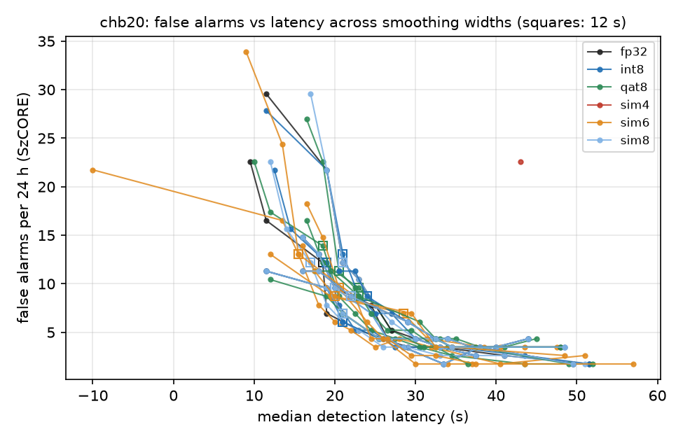

## chb21

Folds per seed: {0: 4, 1: 4, 2: 4, 3: 4, 4: 4}

- Early stopping fired in 20/20 jobs; ONNX FP32 export max |logit diff| 3.81e-06
- Seed 0: FP32 test specificity pooled over all held-out hours 0.9947 (within 0.995 +/- 0.005)
- Seed 1: FP32 test specificity pooled over all held-out hours 0.9941 (within 0.995 +/- 0.005)
- Seed 2: FP32 test specificity pooled over all held-out hours 0.9935 (within 0.995 +/- 0.005)
- Seed 3: FP32 test specificity pooled over all held-out hours 0.9949 (within 0.995 +/- 0.005)
- Seed 4: FP32 test specificity pooled over all held-out hours 0.9951 (within 0.995 +/- 0.005)
- Diagnostic: single folds outside the band 1/20 [(0, 2, 0.9888)]

### FP32 against EpiDeNet's reporting (4 s windows, pooled over folds)

| seed | FP/h raw | FP/h 3-window vote | window sens (vote) | spec (vote) | seizures detected |
|---|---|---|---|---|---|
| 0 | 2.38 | 1.19 | 0.745 | 0.9974 | 4/4 |
| 1 | 2.59 | 1.13 | 0.834 | 0.9976 | 4/4 |
| 2 | 2.80 | 1.22 | 0.870 | 0.9973 | 4/4 |
| 3 | 2.31 | 0.97 | 0.870 | 0.9979 | 4/4 |
| 4 | 2.04 | 1.10 | 0.584 | 0.9977 | 3/4 |

EpiDeNet (all CHB-MIT, LOOCV, 5 seeds): 4.29 raw, 2.24 with vote, 165/181 seizures.

### Two meanings of "FP/h" for the same FP32 model (pooled over folds)

| seed | window FP/h (3-window vote, 4 s grid) | SzCORE false alarms/h (12 s smoothing) | ratio |
|---|---|---|---|
| 0 | 1.19 | 0.58 | 2.1 |
| 1 | 1.13 | 0.70 | 1.6 |
| 2 | 1.22 | 0.82 | 1.5 |
| 3 | 0.97 | 0.61 | 1.6 |
| 4 | 1.10 | 0.73 | 1.5 |

Window FP/h is (1 - specificity) x windows per hour, so it depends on window length and hop, and one long artifact counts many times; SzCORE merges detections within 90 s into one alarm.

### Operating point (default smoothing, own threshold) and excess latency

| seed | model | FA/24h at 12 s | median latency at 12 s | detected | excess latency at FP32's FA (s) | smoothing there (s) | ΔFA/24h at FP32's latency |
|---|---|---|---|---|---|---|---|
| 0 | fp32 | 13.9 | 10.0 | 4/4 | 0.0 | 12.0 | 0.0 |
| 0 | int8 | 11.0 | 10.5 | 4/4 | 0.1 | 11.2 | 0.7 |
| 0 | sim8 | 13.2 | 10.5 | 4/4 | 0.4 | 11.8 | 2.6 |
| 0 | sim6 | 11.0 | 10.5 | 4/4 | 0.1 | 11.3 | 1.1 |
| 0 | sim4 | 19.0 | 36.5 | 3/4 | inf | n/a | n/a |
| 0 | qat8 | 13.2 | 10.0 | 4/4 | -0.1 | 11.8 | -0.7 |
| 1 | fp32 | 16.8 | 8.0 | 4/4 | 0.0 | 12.0 | 0.0 |
| 1 | int8 | 20.5 | 7.0 | 4/4 | -0.1 | 13.2 | -0.2 |
| 1 | sim8 | 16.8 | 8.5 | 4/4 | 0.5 | 12.0 | 2.7 |
| 1 | sim6 | 19.0 | 9.0 | 4/4 | 1.5 | 13.0 | 6.9 |
| 1 | sim4 | 16.1 | 49.0 | 3/4 | 40.9 | 11.7 | n/a |
| 1 | qat8 | 16.1 | 7.5 | 4/4 | -0.7 | 11.7 | -2.6 |
| 2 | fp32 | 19.7 | 8.5 | 4/4 | 0.0 | 12.0 | 0.0 |
| 2 | int8 | 19.7 | 8.5 | 4/4 | 0.0 | 12.0 | 0.0 |
| 2 | sim8 | 20.5 | 8.5 | 4/4 | 0.2 | 12.3 | 0.7 |
| 2 | sim6 | 23.4 | 9.0 | 4/4 | 1.1 | 13.2 | 5.8 |
| 2 | sim4 | 16.8 | inf | 2/4 | inf | n/a | n/a |
| 2 | qat8 | 18.3 | 9.0 | 4/4 | 0.2 | 11.5 | 1.5 |
| 3 | fp32 | 14.6 | 9.0 | 4/4 | 0.0 | 12.0 | 0.0 |
| 3 | int8 | 14.6 | 8.5 | 4/4 | -0.5 | 12.0 | -1.5 |
| 3 | sim8 | 14.6 | 9.0 | 4/4 | 0.0 | 12.0 | 0.0 |
| 3 | sim6 | 17.5 | 10.0 | 4/4 | 1.7 | 13.3 | 6.9 |
| 3 | sim4 | 21.2 | inf | 2/4 | inf | n/a | n/a |
| 3 | qat8 | 14.6 | 10.0 | 4/4 | 1.0 | 12.0 | 4.8 |
| 4 | fp32 | 17.5 | 11.0 | 4/4 | 0.0 | 12.0 | 0.0 |
| 4 | int8 | 16.1 | 11.0 | 4/4 | -0.4 | 11.3 | -1.5 |
| 4 | sim8 | 17.5 | 11.0 | 4/4 | 0.0 | 12.0 | 0.0 |
| 4 | sim6 | 18.3 | 11.0 | 4/4 | 0.2 | 12.3 | 0.7 |
| 4 | sim4 | 19.0 | inf | 2/4 | inf | n/a | n/a |
| 4 | qat8 | 14.6 | 10.0 | 4/4 | -1.6 | 10.9 | -4.6 |

FP32 seed-to-seed excess latency (the null), all ordered seed pairs: ['-1.2', '-0.2', '-0.8', '2.2', '1.6', '1.2', '0.5', '3.2', '0.6', '-1.0', '-0.6', '1.8', '0.9', '-0.4', '0.7', '3.0', '-1.6', '-3.1', '-2.0', '-2.6']
95% band: (-2.887307692307692, 3.1312499999999996)

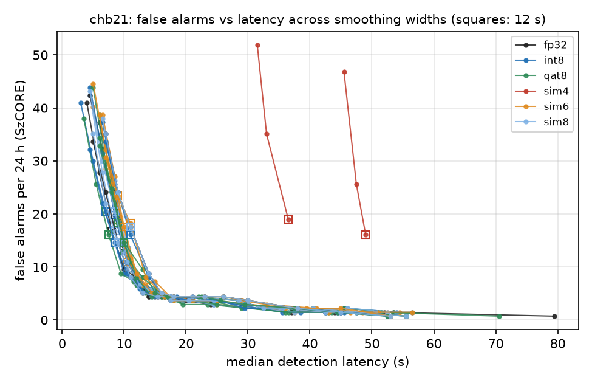

## chb22

Folds per seed: {0: 3, 1: 3, 2: 3, 3: 3, 4: 3}

- Early stopping fired in 15/15 jobs; ONNX FP32 export max |logit diff| 4.77e-06
- Seed 0: FP32 test specificity pooled over all held-out hours 0.9875 (OUTSIDE 0.995 +/- 0.005)
- Seed 1: FP32 test specificity pooled over all held-out hours 0.9897 (OUTSIDE 0.995 +/- 0.005)
- Seed 2: FP32 test specificity pooled over all held-out hours 0.9862 (OUTSIDE 0.995 +/- 0.005)
- Seed 3: FP32 test specificity pooled over all held-out hours 0.9956 (within 0.995 +/- 0.005)
- Seed 4: FP32 test specificity pooled over all held-out hours 0.9886 (OUTSIDE 0.995 +/- 0.005)
- Diagnostic: single folds outside the band 5/15 [(2, 0, 0.9659), (1, 1, 0.9888), (2, 1, 0.9823), (2, 2, 0.9641), (2, 4, 0.9725)]

### FP32 against EpiDeNet's reporting (4 s windows, pooled over folds)

| seed | FP/h raw | FP/h 3-window vote | window sens (vote) | spec (vote) | seizures detected |
|---|---|---|---|---|---|
| 0 | 6.03 | 2.68 | 0.801 | 0.9939 | 3/3 |
| 1 | 4.77 | 2.45 | 0.631 | 0.9944 | 3/3 |
| 2 | 6.19 | 2.68 | 0.679 | 0.9939 | 3/3 |
| 3 | 1.90 | 0.71 | 0.753 | 0.9984 | 3/3 |
| 4 | 5.19 | 1.90 | 0.801 | 0.9957 | 3/3 |

EpiDeNet (all CHB-MIT, LOOCV, 5 seeds): 4.29 raw, 2.24 with vote, 165/181 seizures.

### Two meanings of "FP/h" for the same FP32 model (pooled over folds)

| seed | window FP/h (3-window vote, 4 s grid) | SzCORE false alarms/h (12 s smoothing) | ratio |
|---|---|---|---|
| 0 | 2.68 | 1.35 | 2.0 |
| 1 | 2.45 | 1.06 | 2.3 |
| 2 | 2.68 | 1.52 | 1.8 |
| 3 | 0.71 | 0.58 | 1.2 |
| 4 | 1.90 | 1.39 | 1.4 |

Window FP/h is (1 - specificity) x windows per hour, so it depends on window length and hop, and one long artifact counts many times; SzCORE merges detections within 90 s into one alarm.

### Operating point (default smoothing, own threshold) and excess latency

| seed | model | FA/24h at 12 s | median latency at 12 s | detected | excess latency at FP32's FA (s) | smoothing there (s) | ΔFA/24h at FP32's latency |
|---|---|---|---|---|---|---|---|
| 0 | fp32 | 32.5 | 19.0 | 3/3 | 0.0 | 12.0 | 0.0 |
| 0 | int8 | 32.5 | 18.0 | 3/3 | -1.0 | 12.0 | -6.2 |
| 0 | sim8 | 31.7 | 19.0 | 3/3 | -0.3 | 11.3 | -0.8 |
| 0 | sim6 | 35.6 | 19.0 | 3/3 | 1.0 | 14.0 | 3.1 |
| 0 | sim4 | 4.6 | 27.0 | 3/3 | 4.0 | 4.0 | n/a |
| 0 | qat8 | 33.3 | 21.0 | 3/3 | 2.1 | 12.2 | 3.1 |
| 1 | fp32 | 25.5 | 23.0 | 3/3 | 0.0 | 12.0 | 0.0 |
| 1 | int8 | 22.4 | 23.0 | 3/3 | -0.7 | 10.5 | -3.1 |
| 1 | sim8 | 25.5 | 23.0 | 3/3 | 0.0 | 12.0 | 0.0 |
| 1 | sim6 | 25.5 | 23.0 | 3/3 | 0.0 | 12.0 | 0.0 |
| 1 | sim4 | 11.6 | 36.0 | 3/3 | 0.0 | 4.0 | -3.1 |
| 1 | qat8 | 26.3 | 23.0 | 3/3 | 0.2 | 12.3 | 0.8 |
| 2 | fp32 | 36.4 | 22.0 | 3/3 | 0.0 | 12.0 | 0.0 |
| 2 | int8 | 34.8 | 22.0 | 3/3 | -0.4 | 11.2 | -1.5 |
| 2 | sim8 | 36.4 | 21.0 | 3/3 | -1.0 | 12.0 | -4.6 |
| 2 | sim6 | 34.8 | 24.0 | 3/3 | 1.4 | 10.9 | 3.9 |
| 2 | sim4 | 8.5 | 25.0 | 3/3 | -1.0 | 4.0 | -25.2 |
| 2 | qat8 | 36.4 | 19.0 | 3/3 | -3.0 | 12.0 | -15.5 |
| 3 | fp32 | 13.9 | 14.0 | 3/3 | 0.0 | 12.0 | 0.0 |
| 3 | int8 | 14.7 | 13.0 | 3/3 | -0.8 | 12.4 | -3.1 |
| 3 | sim8 | 13.9 | 14.0 | 3/3 | 0.0 | 12.0 | 0.0 |
| 3 | sim6 | 13.2 | 14.0 | 3/3 | -0.2 | 11.5 | -0.8 |
| 3 | sim4 | 6.2 | 28.0 | 3/3 | 10.0 | 4.0 | n/a |
| 3 | qat8 | 14.7 | 13.0 | 3/3 | -0.8 | 12.4 | -2.7 |
| 4 | fp32 | 33.3 | 15.0 | 3/3 | 0.0 | 12.0 | 0.0 |
| 4 | int8 | 35.6 | 16.0 | 3/3 | 1.4 | 12.7 | 6.6 |
| 4 | sim8 | 32.5 | 15.0 | 3/3 | -0.1 | 11.8 | -0.8 |
| 4 | sim6 | 34.8 | 15.0 | 3/3 | 0.3 | 12.6 | 1.5 |
| 4 | sim4 | 7.7 | 24.0 | 3/3 | 6.0 | 4.0 | n/a |
| 4 | qat8 | 31.0 | 15.0 | 3/3 | -0.4 | 11.3 | -2.3 |

FP32 seed-to-seed excess latency (the null), all ordered seed pairs: ['2.4', '3.8', '-8.8', '-3.9', '-2.4', '1.3', '-11.3', '-6.7', '-5.0', '-1.2', '-12.0', '-7.5', '11.0', '12.4', '15.7', '6.7', '3.6', '6.2', '7.6', '-5.0']
95% band: (-11.683333333333334, 14.153571428571425)

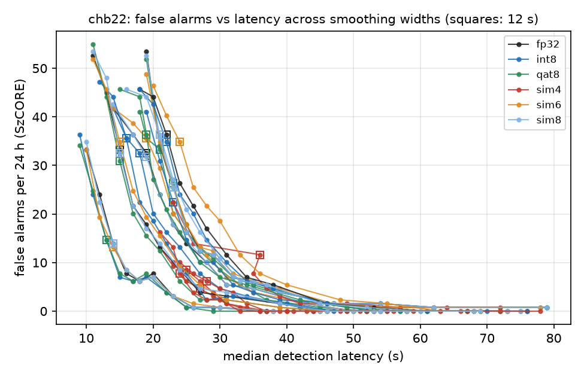

## chb23

Folds per seed: {0: 3, 1: 3, 2: 3, 3: 3, 4: 3}

- Early stopping fired in 15/15 jobs; ONNX FP32 export max |logit diff| 7.63e-06
- Seed 0: FP32 test specificity pooled over all held-out hours 0.9921 (within 0.995 +/- 0.005)
- Seed 1: FP32 test specificity pooled over all held-out hours 0.9958 (within 0.995 +/- 0.005)
- Seed 2: FP32 test specificity pooled over all held-out hours 0.9913 (within 0.995 +/- 0.005)
- Seed 3: FP32 test specificity pooled over all held-out hours 0.9939 (within 0.995 +/- 0.005)
- Seed 4: FP32 test specificity pooled over all held-out hours 0.9930 (within 0.995 +/- 0.005)
- Diagnostic: single folds outside the band 5/15 [(1, 0, 0.9872), (0, 2, 0.984), (1, 2, 0.9893), (1, 3, 0.9889), (1, 4, 0.9877)]

### FP32 against EpiDeNet's reporting (4 s windows, pooled over folds)

| seed | FP/h raw | FP/h 3-window vote | window sens (vote) | spec (vote) | seizures detected |
|---|---|---|---|---|---|
| 0 | 3.58 | 2.41 | 0.785 | 0.9948 | 7/7 |
| 1 | 1.81 | 1.02 | 0.894 | 0.9978 | 7/7 |
| 2 | 3.69 | 2.79 | 0.620 | 0.9931 | 6/7 |
| 3 | 2.79 | 1.69 | 0.915 | 0.9967 | 7/7 |
| 4 | 3.05 | 1.84 | 0.645 | 0.9963 | 5/7 |

EpiDeNet (all CHB-MIT, LOOCV, 5 seeds): 4.29 raw, 2.24 with vote, 165/181 seizures.

### Two meanings of "FP/h" for the same FP32 model (pooled over folds)

| seed | window FP/h (3-window vote, 4 s grid) | SzCORE false alarms/h (12 s smoothing) | ratio |
|---|---|---|---|
| 0 | 2.41 | 0.60 | 4.0 |
| 1 | 1.02 | 0.41 | 2.5 |
| 2 | 2.79 | 0.56 | 4.9 |
| 3 | 1.69 | 0.56 | 3.0 |
| 4 | 1.84 | 0.45 | 4.1 |

Window FP/h is (1 - specificity) x windows per hour, so it depends on window length and hop, and one long artifact counts many times; SzCORE merges detections within 90 s into one alarm.

### Operating point (default smoothing, own threshold) and excess latency

| seed | model | FA/24h at 12 s | median latency at 12 s | detected | excess latency at FP32's FA (s) | smoothing there (s) | ΔFA/24h at FP32's latency |
|---|---|---|---|---|---|---|---|
| 0 | fp32 | 14.5 | 16.0 | 7/7 | 0.0 | 12.0 | 0.0 |
| 0 | int8 | 12.7 | 16.0 | 7/7 | -1.0 | 10.0 | -1.8 |
| 0 | sim8 | 14.5 | 16.0 | 7/7 | 0.0 | 12.0 | 0.0 |
| 0 | sim6 | 13.6 | 16.0 | 7/7 | -0.5 | 11.0 | -0.9 |
| 0 | sim4 | 18.1 | 16.0 | 7/7 | 1.3 | 14.7 | 3.6 |
| 0 | qat8 | 12.7 | 16.0 | 7/7 | -0.6 | 10.9 | -1.8 |
| 1 | fp32 | 9.9 | 12.0 | 7/7 | 0.0 | 12.0 | 0.0 |
| 1 | int8 | 9.0 | 12.0 | 7/7 | -0.3 | 11.3 | -0.9 |
| 1 | sim8 | 9.9 | 12.0 | 7/7 | 0.0 | 12.0 | 0.0 |
| 1 | sim6 | 9.0 | 12.0 | 7/7 | -0.3 | 11.3 | -0.9 |
| 1 | sim4 | 12.7 | 15.0 | 7/7 | 4.2 | 13.2 | 18.1 |
| 1 | qat8 | 9.9 | 12.0 | 7/7 | 0.0 | 12.0 | 0.0 |
| 2 | fp32 | 13.6 | 14.0 | 6/7 | 0.0 | 12.0 | 0.0 |
| 2 | int8 | 14.5 | 14.0 | 6/7 | 1.0 | 14.0 | 0.9 |
| 2 | sim8 | 13.6 | 14.0 | 6/7 | 0.0 | 12.0 | 0.0 |
| 2 | sim6 | 13.6 | 14.0 | 6/7 | 0.0 | 12.0 | 0.0 |
| 2 | sim4 | 17.2 | 16.0 | 6/7 | 3.1 | 14.3 | 10.8 |
| 2 | qat8 | 16.3 | 13.0 | 7/7 | 0.0 | 14.0 | -0.0 |
| 3 | fp32 | 13.6 | 9.0 | 7/7 | 0.0 | 12.0 | 0.0 |
| 3 | int8 | 12.7 | 9.0 | 7/7 | -0.4 | 11.2 | -0.9 |
| 3 | sim8 | 12.7 | 9.0 | 7/7 | -0.4 | 11.2 | -0.9 |
| 3 | sim6 | 11.7 | 9.0 | 7/7 | -0.8 | 10.4 | -1.8 |
| 3 | sim4 | 15.4 | 12.0 | 7/7 | 3.3 | 12.7 | 19.0 |
| 3 | qat8 | 11.7 | 9.0 | 7/7 | -0.8 | 10.4 | -1.8 |
| 4 | fp32 | 10.8 | 9.0 | 6/7 | 0.0 | 12.0 | 0.0 |
| 4 | int8 | 11.7 | 12.0 | 5/7 | 3.0 | 14.0 | 8.6 |
| 4 | sim8 | 10.8 | 9.0 | 6/7 | 0.0 | 12.0 | 0.0 |
| 4 | sim6 | 9.9 | 9.0 | 5/7 | -0.2 | 11.6 | -0.9 |
| 4 | sim4 | 24.4 | 15.0 | 5/7 | 7.9 | 15.8 | n/a |
| 4 | qat8 | 12.7 | 9.0 | 5/7 | 1.3 | 14.7 | 1.8 |

FP32 seed-to-seed excess latency (the null), all ordered seed pairs: ['-5.7', '-2.5', '-7.7', '-8.1', '7.3', '8.0', '-1.7', '-0.0', '2.7', '-3.3', '-5.0', '-5.9', '7.7', '1.7', '5.0', '-0.9', '9.7', '2.7', '9.0', '1.0']
95% band: (-7.916666666666666, 9.35)

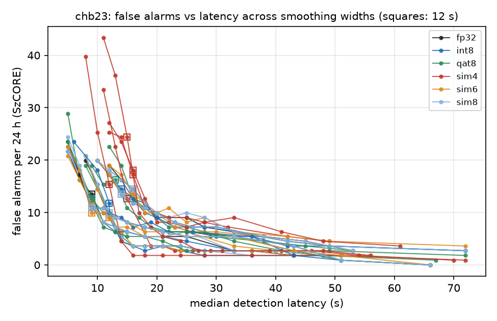

## chb24

Folds per seed: {0: 12, 1: 12, 2: 12, 3: 12, 4: 12}

- Early stopping fired in 59/60 jobs; ONNX FP32 export max |logit diff| 1.05e-05
- Seed 0: FP32 test specificity pooled over all held-out hours 0.9794 (OUTSIDE 0.995 +/- 0.005)
- Seed 1: FP32 test specificity pooled over all held-out hours 0.9770 (OUTSIDE 0.995 +/- 0.005)
- Seed 2: FP32 test specificity pooled over all held-out hours 0.9758 (OUTSIDE 0.995 +/- 0.005)
- Seed 3: FP32 test specificity pooled over all held-out hours 0.9739 (OUTSIDE 0.995 +/- 0.005)
- Seed 4: FP32 test specificity pooled over all held-out hours 0.9673 (OUTSIDE 0.995 +/- 0.005)
- Diagnostic: single folds outside the band 42/60 [(0, 0, 0.9892), (10, 0, 0.7893), (11, 0, 1.0), (2, 0, 0.9882), (4, 0, 0.9849), (5, 0, 1.0), (6, 0, 0.9824), (7, 0, 0.9854), (9, 0, 0.9489), (10, 1, 0.7402), (11, 1, 1.0), (2, 1, 0.9883), (4, 1, 0.9869), (5, 1, 1.0), (6, 1, 0.9743), (7, 1, 0.9788), (9, 1, 0.9642), (10, 2, 0.7836), (11, 2, 1.0), (1, 2, 1.0), (2, 2, 0.989), (4, 2, 0.9791), (5, 2, 1.0), (6, 2, 0.9671), (7, 2, 0.9763), (9, 2, 0.9245), (0, 3, 0.9891), (10, 3, 0.9056), (11, 3, 1.0), (1, 3, 0.8804), (2, 3, 0.9897), (5, 3, 1.0), (6, 3, 0.9845), (7, 3, 0.9626), (9, 3, 0.9605), (10, 4, 0.6429), (11, 4, 1.0), (1, 4, 0.9865), (2, 4, 0.989), (5, 4, 1.0), (6, 4, 0.9809), (9, 4, 0.8518)]

### FP32 against EpiDeNet's reporting (4 s windows, pooled over folds)

| seed | FP/h raw | FP/h 3-window vote | window sens (vote) | spec (vote) | seizures detected |
|---|---|---|---|---|---|
| 0 | 9.06 | 4.98 | 0.567 | 0.9834 | 15/16 |
| 1 | 10.71 | 5.92 | 0.518 | 0.9799 | 15/16 |
| 2 | 10.52 | 6.53 | 0.518 | 0.9792 | 15/16 |
| 3 | 11.41 | 8.31 | 0.578 | 0.9803 | 15/16 |
| 4 | 14.70 | 11.93 | 0.527 | 0.9590 | 15/16 |

EpiDeNet (all CHB-MIT, LOOCV, 5 seeds): 4.29 raw, 2.24 with vote, 165/181 seizures.

### Two meanings of "FP/h" for the same FP32 model (pooled over folds)

| seed | window FP/h (3-window vote, 4 s grid) | SzCORE false alarms/h (12 s smoothing) | ratio |
|---|---|---|---|
| 0 | 4.98 | 2.02 | 2.5 |
| 1 | 5.92 | 2.16 | 2.7 |
| 2 | 6.53 | 2.02 | 3.2 |
| 3 | 8.31 | 2.02 | 4.1 |
| 4 | 11.93 | 1.97 | 6.0 |

Window FP/h is (1 - specificity) x windows per hour, so it depends on window length and hop, and one long artifact counts many times; SzCORE merges detections within 90 s into one alarm.

### Operating point (default smoothing, own threshold) and excess latency

| seed | model | FA/24h at 12 s | median latency at 12 s | detected | excess latency at FP32's FA (s) | smoothing there (s) | ΔFA/24h at FP32's latency |
|---|---|---|---|---|---|---|---|
| 0 | fp32 | 48.5 | 12.0 | 16/16 | 0.0 | 12.0 | 0.0 |
| 0 | int8 | 54.1 | 12.0 | 16/16 | 0.5 | 13.1 | 5.6 |
| 0 | sim8 | 48.5 | 12.0 | 16/16 | 0.0 | 12.0 | 0.0 |
| 0 | sim6 | 40.6 | 12.0 | 16/16 | -2.7 | 6.7 | -7.9 |
| 0 | sim4 | 15.8 | 12.0 | 16/16 | -4.0 | 4.0 | -32.7 |
| 0 | qat8 | 49.6 | 12.0 | 16/16 | 0.1 | 12.2 | 1.1 |
| 1 | fp32 | 51.8 | 12.5 | 16/16 | 0.0 | 12.0 | 0.0 |
| 1 | int8 | 51.8 | 12.0 | 16/16 | -0.5 | 12.0 | -3.9 |
| 1 | sim8 | 51.8 | 12.0 | 16/16 | -0.5 | 12.0 | -4.5 |
| 1 | sim6 | 54.1 | 12.0 | 16/16 | -0.2 | 12.5 | -2.0 |
| 1 | sim4 | 33.8 | 13.5 | 16/16 | -1.8 | 6.4 | -13.5 |
| 1 | qat8 | 51.8 | 12.5 | 16/16 | 0.0 | 12.0 | 0.0 |
| 2 | fp32 | 48.5 | 12.5 | 16/16 | 0.0 | 12.0 | 0.0 |
| 2 | int8 | 53.0 | 13.0 | 16/16 | 1.0 | 13.1 | 7.0 |
| 2 | sim8 | 51.8 | 13.0 | 16/16 | 0.9 | 12.9 | 5.9 |
| 2 | sim6 | 40.6 | 13.0 | 15/16 | -1.3 | 8.5 | -5.6 |
| 2 | sim4 | 22.5 | 13.0 | 16/16 | -3.5 | 4.0 | -24.2 |
| 2 | qat8 | 51.8 | 12.5 | 16/16 | 0.7 | 13.3 | 3.4 |
| 3 | fp32 | 48.5 | 12.0 | 16/16 | 0.0 | 12.0 | 0.0 |
| 3 | int8 | 45.1 | 12.0 | 16/16 | -0.4 | 11.1 | -3.4 |
| 3 | sim8 | 45.1 | 12.0 | 16/16 | -0.5 | 10.9 | -3.4 |
| 3 | sim6 | 40.6 | 12.0 | 16/16 | -1.4 | 9.2 | -7.9 |
| 3 | sim4 | 25.9 | 12.5 | 16/16 | -3.5 | 4.0 | -19.7 |
| 3 | qat8 | 48.5 | 12.0 | 16/16 | 0.0 | 12.0 | 0.0 |
| 4 | fp32 | 47.3 | 12.0 | 16/16 | 0.0 | 12.0 | 0.0 |
| 4 | int8 | 45.1 | 12.0 | 16/16 | -0.4 | 11.1 | -2.3 |
| 4 | sim8 | 47.3 | 12.0 | 16/16 | 0.0 | 12.0 | 0.0 |
| 4 | sim6 | 40.6 | 12.0 | 16/16 | -1.5 | 9.0 | -6.8 |
| 4 | sim4 | 27.0 | 13.0 | 16/16 | -3.0 | 4.0 | -15.8 |
| 4 | qat8 | 41.7 | 12.0 | 16/16 | -2.1 | 7.7 | -5.6 |

FP32 seed-to-seed excess latency (the null), all ordered seed pairs: ['1.0', '0.5', '0.0', '-0.3', '-1.1', '-0.4', '-1.5', '-1.6', '-0.5', '0.5', '-0.5', '-0.8', '0.0', '1.0', '0.5', '-0.3', '0.1', '1.1', '0.7', '0.2']
95% band: (-1.5750000000000006, 1.042307692307692)

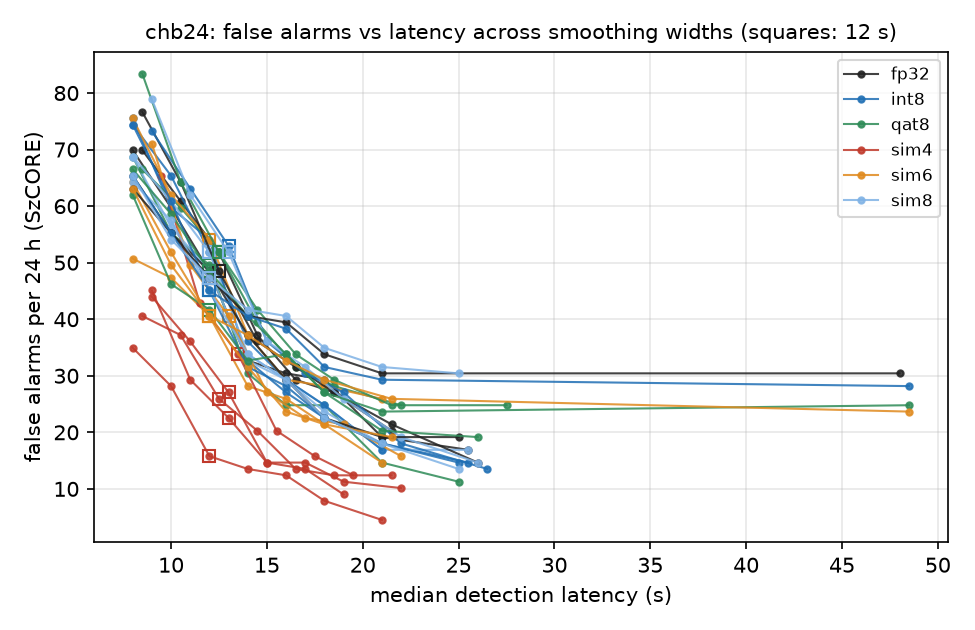

## Pooled across patients (pre-registered: median over seeds per patient, then over patients)

- FP32 seed-pair null: n = 480 ordered pairs, 95% band (-9.91, 14.93)
- int8: pooled excess latency -0.13 s over 24 patient(s) [inside the null band, below the 2 s floor]; patient-seed values 120, censored 0, undefined 9
- sim8: pooled excess latency 0.00 s over 24 patient(s) [inside the null band, below the 2 s floor]; patient-seed values 120, censored 1, undefined 9
- sim6: pooled excess latency 0.00 s over 24 patient(s) [inside the null band, below the 2 s floor]; patient-seed values 120, censored 3, undefined 9
- sim4: pooled excess latency 16.17 s over 24 patient(s) [outside the null band, at/above the 2 s floor]; patient-seed values 120, censored 31, undefined 9
- qat8: pooled excess latency 0.00 s over 24 patient(s) [inside the null band, below the 2 s floor]; patient-seed values 120, censored 0, undefined 9

**Stage 0 kill rule** (stop if INT8, sim6 and sim4 are each inside the band or below 2 s): CONTINUE
