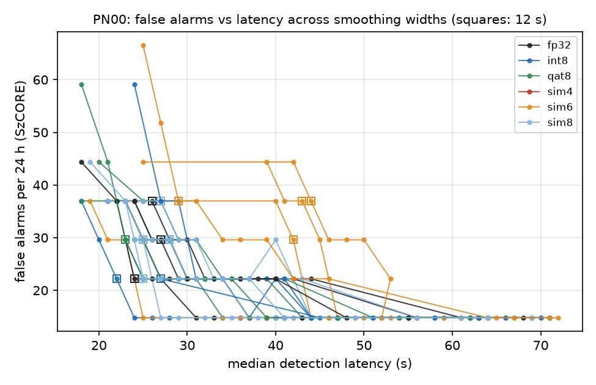
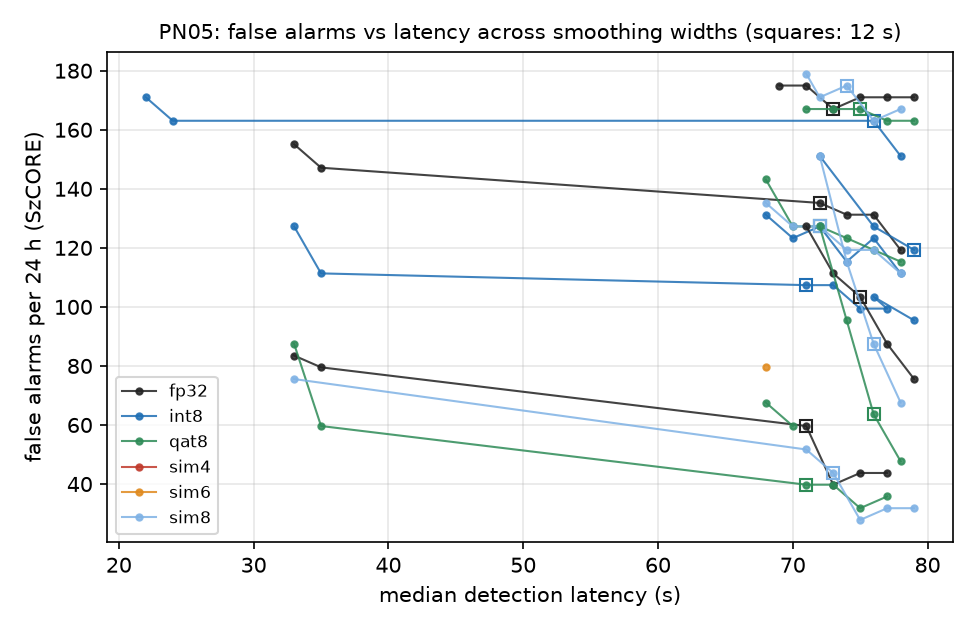
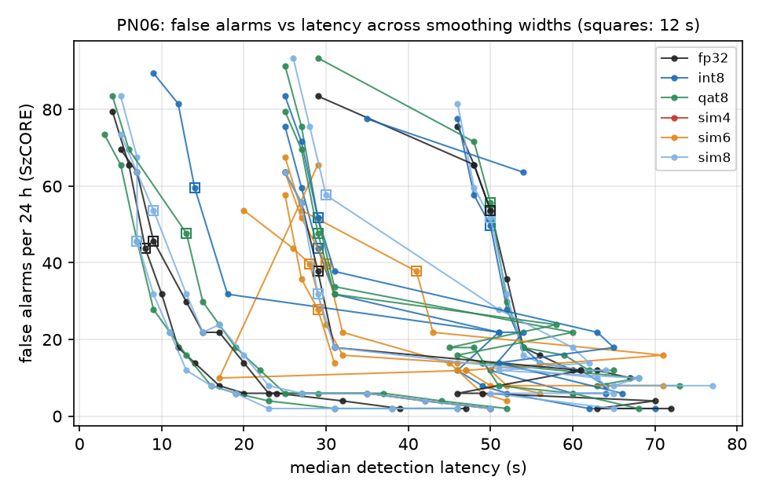
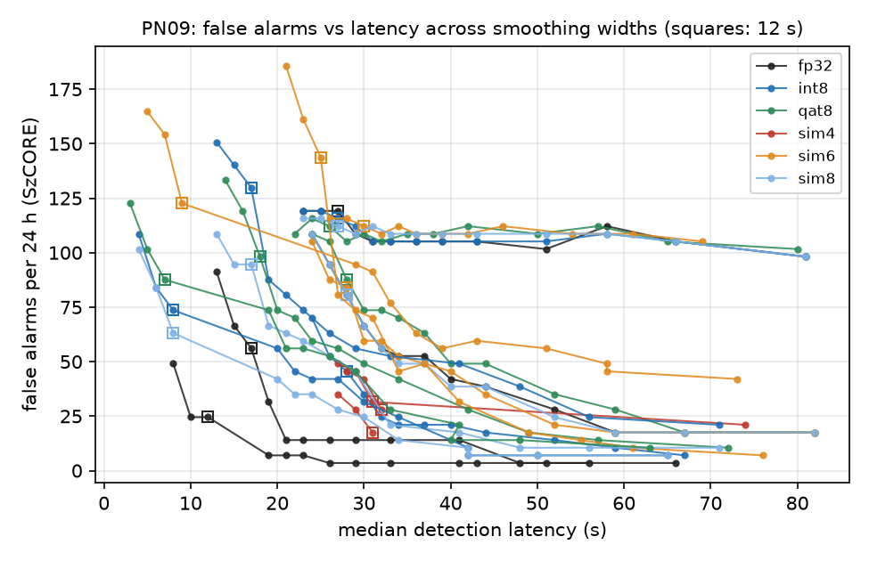
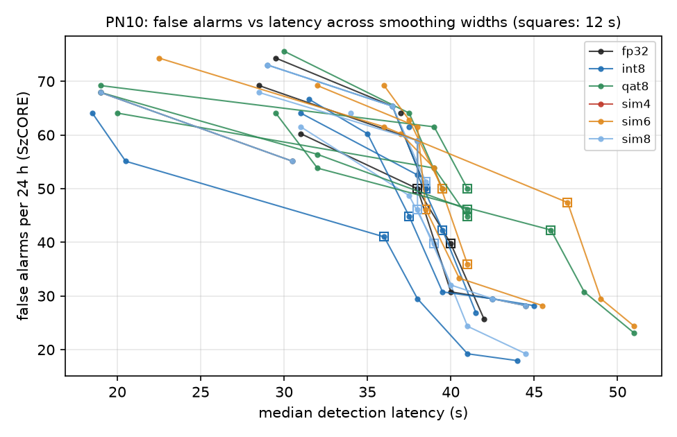
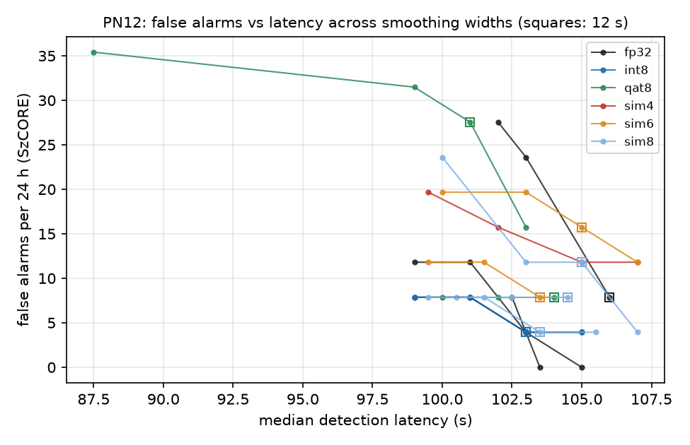
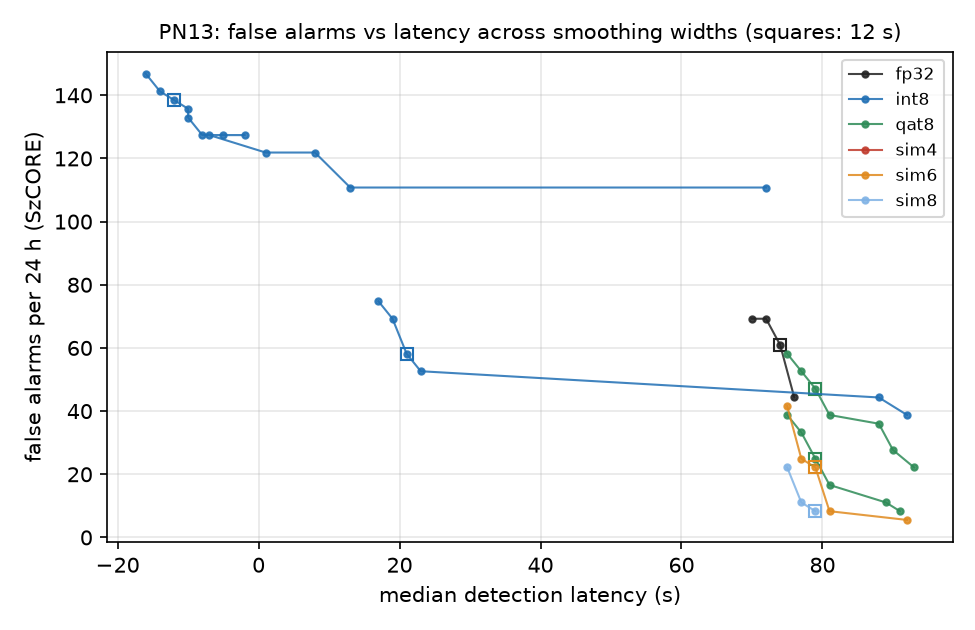
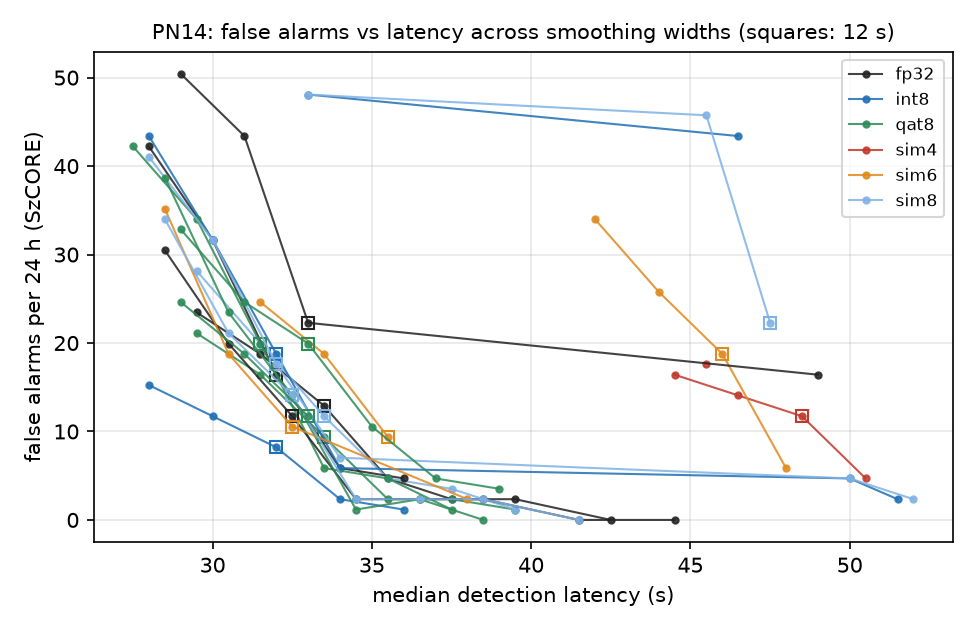

# Stage 0 summary

## PN00

Folds per seed: {0: 5, 1: 5, 2: 5, 3: 5, 4: 5}

- Early stopping fired in 25/25 jobs; ONNX FP32 export max |logit diff| 1.53e-05
- Seed 0: FP32 test specificity pooled over all held-out hours 0.9669 (OUTSIDE 0.995 +/- 0.005)
- Seed 1: FP32 test specificity pooled over all held-out hours 0.9644 (OUTSIDE 0.995 +/- 0.005)
- Seed 2: FP32 test specificity pooled over all held-out hours 0.9655 (OUTSIDE 0.995 +/- 0.005)
- Seed 3: FP32 test specificity pooled over all held-out hours 0.9634 (OUTSIDE 0.995 +/- 0.005)
- Seed 4: FP32 test specificity pooled over all held-out hours 0.9639 (OUTSIDE 0.995 +/- 0.005)
- Diagnostic: single folds outside the band 8/25 [(2, 0, 0.8632), (3, 0, 0.9851), (2, 1, 0.855), (3, 1, 0.9861), (2, 2, 0.8521), (2, 3, 0.841), (2, 4, 0.8505), (3, 4, 0.9847)]

### FP32 against EpiDeNet's reporting (4 s windows, pooled over folds)

| seed | FP/h raw | FP/h 3-window vote | window sens (vote) | spec (vote) | seizures detected |
|---|---|---|---|---|---|
| 0 | 14.18 | 14.79 | 0.493 | 0.9680 | 4/5 |
| 1 | 16.03 | 16.95 | 0.468 | 0.9632 | 4/5 |
| 2 | 14.79 | 14.79 | 0.423 | 0.9684 | 4/5 |
| 3 | 15.72 | 16.03 | 0.493 | 0.9656 | 4/5 |
| 4 | 16.95 | 16.64 | 0.490 | 0.9638 | 4/5 |

EpiDeNet (all CHB-MIT, LOOCV, 5 seeds): 4.29 raw, 2.24 with vote, 165/181 seizures.

### Two meanings of "FP/h" for the same FP32 model (pooled over folds)

| seed | window FP/h (3-window vote, 4 s grid) | SzCORE false alarms/h (12 s smoothing) | ratio |
|---|---|---|---|
| 0 | 14.79 | 1.23 | 12.0 |
| 1 | 16.95 | 1.54 | 11.0 |
| 2 | 14.79 | 1.23 | 12.0 |
| 3 | 16.03 | 1.23 | 13.0 |
| 4 | 16.64 | 0.92 | 18.0 |

Window FP/h is (1 - specificity) x windows per hour, so it depends on window length and hop, and one long artifact counts many times; SzCORE merges detections within 90 s into one alarm.

### Operating point (default smoothing, own threshold) and excess latency

| seed | model | FA/24h at 12 s | median latency at 12 s | detected | excess latency at FP32's FA (s) | smoothing there (s) | ΔFA/24h at FP32's latency |
|---|---|---|---|---|---|---|---|
| 0 | fp32 | 29.6 | 27.0 | 4/5 | 0.0 | 12.0 | 0.0 |
| 0 | int8 | 22.2 | 22.0 | 3/5 | -7.0 | 8.0 | -14.8 |
| 0 | sim8 | 29.6 | 28.0 | 4/5 | -3.0 | 4.0 | 0.0 |
| 0 | sim6 | 29.6 | 42.0 | 4/5 | 15.0 | 12.0 | 7.4 |
| 0 | sim4 | 29.6 | inf | 1/5 | inf | n/a | n/a |
| 0 | qat8 | 29.6 | 28.0 | 4/5 | -1.0 | 8.0 | 0.0 |
| 1 | fp32 | 37.0 | 26.0 | 4/5 | 0.0 | 12.0 | 0.0 |
| 1 | int8 | 14.8 | inf | 2/5 | inf | n/a | n/a |
| 1 | sim8 | 37.0 | 27.0 | 4/5 | -4.0 | 4.0 | 0.0 |
| 1 | sim6 | 37.0 | 43.0 | 4/5 | 15.0 | 8.0 | n/a |
| 1 | sim4 | 29.6 | inf | 0/5 | inf | n/a | n/a |
| 1 | qat8 | 37.0 | 27.0 | 4/5 | -1.0 | 8.0 | 0.0 |
| 2 | fp32 | 29.6 | 28.0 | 4/5 | 0.0 | 12.0 | 0.0 |
| 2 | int8 | 37.0 | 29.0 | 4/5 | 2.0 | 14.0 | 7.4 |
| 2 | sim8 | 29.6 | 28.0 | 4/5 | -4.0 | 4.0 | 0.0 |
| 2 | sim6 | 37.0 | 44.0 | 4/5 | 18.0 | 16.0 | 14.8 |
| 2 | sim4 | 22.2 | inf | 0/5 | inf | n/a | n/a |
| 2 | qat8 | 29.6 | 28.0 | 4/5 | -4.0 | 4.0 | 0.0 |
| 3 | fp32 | 29.6 | 25.0 | 4/5 | 0.0 | 12.0 | 0.0 |
| 3 | int8 | 22.2 | inf | 1/5 | inf | n/a | n/a |
| 3 | sim8 | 29.6 | 25.0 | 4/5 | 0.0 | 12.0 | 0.0 |
| 3 | sim6 | 29.6 | 23.0 | 4/5 | -4.0 | 8.0 | -14.8 |
| 3 | sim4 | 29.6 | inf | 2/5 | inf | n/a | n/a |
| 3 | qat8 | 29.6 | 25.0 | 4/5 | 0.0 | 12.0 | 0.0 |
| 4 | fp32 | 22.2 | 24.0 | 4/5 | 0.0 | 12.0 | 0.0 |
| 4 | int8 | 22.2 | 27.0 | 4/5 | 1.0 | 8.0 | 3.7 |
| 4 | sim8 | 22.2 | 25.0 | 4/5 | 1.0 | 12.0 | 7.4 |
| 4 | sim6 | 37.0 | 29.0 | 4/5 | 18.0 | 36.0 | n/a |
| 4 | sim4 | 44.4 | inf | 1/5 | inf | n/a | n/a |
| 4 | qat8 | 29.6 | 23.0 | 4/5 | 1.0 | 16.0 | 3.7 |

FP32 seed-to-seed excess latency (the null), all ordered seed pairs: ['1.0', '-1.0', '-2.0', '-4.0', '-3.0', '-2.0', '-5.0', '-4.0', '-3.0', '0.0', '-3.0', '-5.0', '0.0', '3.0', '1.0', '-2.0', '5.0', '8.0', '6.0', '3.0']
95% band: (-5.0, 7.049999999999997)

## PN05

Folds per seed: {0: 3, 1: 3, 2: 3, 3: 3, 4: 3}

- Early stopping fired in 15/15 jobs; ONNX FP32 export max |logit diff| 5.72e-06
- Seed 0: FP32 test specificity pooled over all held-out hours 0.9571 (OUTSIDE 0.995 +/- 0.005)
- Seed 1: FP32 test specificity pooled over all held-out hours 0.9626 (OUTSIDE 0.995 +/- 0.005)
- Seed 2: FP32 test specificity pooled over all held-out hours 0.8721 (OUTSIDE 0.995 +/- 0.005)
- Seed 3: FP32 test specificity pooled over all held-out hours 0.7953 (OUTSIDE 0.995 +/- 0.005)
- Seed 4: FP32 test specificity pooled over all held-out hours 0.9393 (OUTSIDE 0.995 +/- 0.005)
- Diagnostic: single folds outside the band 14/15 [(0, 0, 0.9201), (1, 0, 1.0), (2, 0, 0.9609), (0, 1, 0.9373), (1, 1, 1.0), (2, 1, 0.9529), (0, 2, 0.7315), (1, 2, 1.0), (2, 2, 0.9402), (0, 3, 0.7073), (2, 3, 0.647), (0, 4, 0.914), (1, 4, 1.0), (2, 4, 0.8935)]

### FP32 against EpiDeNet's reporting (4 s windows, pooled over folds)

| seed | FP/h raw | FP/h 3-window vote | window sens (vote) | spec (vote) | seizures detected |
|---|---|---|---|---|---|
| 0 | 18.56 | 14.25 | 0.267 | 0.9730 | 1/3 |
| 1 | 16.07 | 14.42 | 0.000 | 0.9671 | 0/3 |
| 2 | 57.16 | 49.21 | 0.067 | 0.9103 | 1/3 |
| 3 | 90.80 | 84.17 | 0.200 | 0.8034 | 1/3 |
| 4 | 27.67 | 22.87 | 0.200 | 0.9472 | 1/3 |

EpiDeNet (all CHB-MIT, LOOCV, 5 seeds): 4.29 raw, 2.24 with vote, 165/181 seizures.

### Two meanings of "FP/h" for the same FP32 model (pooled over folds)

| seed | window FP/h (3-window vote, 4 s grid) | SzCORE false alarms/h (12 s smoothing) | ratio |
|---|---|---|---|
| 0 | 14.25 | 2.49 | 5.7 |
| 1 | 14.42 | 1.82 | 7.9 |
| 2 | 49.21 | 5.63 | 8.7 |
| 3 | 84.17 | 6.96 | 12.1 |
| 4 | 22.87 | 4.31 | 5.3 |

Window FP/h is (1 - specificity) x windows per hour, so it depends on window length and hop, and one long artifact counts many times; SzCORE merges detections within 90 s into one alarm.

### Operating point (default smoothing, own threshold) and excess latency

| seed | model | FA/24h at 12 s | median latency at 12 s | detected | excess latency at FP32's FA (s) | smoothing there (s) | ΔFA/24h at FP32's latency |
|---|---|---|---|---|---|---|---|
| 0 | fp32 | 59.6 | 71.0 | 2/3 | 0.0 | 12.0 | 0.0 |
| 0 | int8 | 107.4 | 71.0 | 2/3 | inf | n/a | 47.7 |
| 0 | sim8 | 43.7 | 73.0 | 2/3 | -12.7 | 6.7 | -8.0 |
| 0 | sim6 | 11.9 | inf | 1/3 | inf | n/a | n/a |
| 0 | sim4 | 59.6 | inf | 1/3 | inf | n/a | n/a |
| 0 | qat8 | 39.8 | 71.0 | 2/3 | -36.0 | 8.0 | -19.9 |
| 1 | fp32 | 43.7 | inf | 1/3 | 0.0 | 12.0 | 0.0 |
| 1 | int8 | 91.5 | inf | 0/3 | n/a | n/a | n/a |
| 1 | sim8 | 47.7 | inf | 1/3 | n/a | n/a | n/a |
| 1 | sim6 | 0.0 | inf | 0/3 | n/a | n/a | n/a |
| 1 | sim4 | 4.0 | inf | 0/3 | n/a | n/a | n/a |
| 1 | qat8 | 43.7 | inf | 1/3 | n/a | n/a | n/a |
| 2 | fp32 | 135.2 | 72.0 | 2/3 | 0.0 | 12.0 | 0.0 |
| 2 | int8 | 127.3 | 72.0 | 2/3 | -4.0 | 4.0 | -8.0 |
| 2 | sim8 | 127.3 | 72.0 | 2/3 | -4.0 | 4.0 | -8.0 |
| 2 | sim6 | 27.8 | inf | 1/3 | inf | n/a | n/a |
| 2 | sim4 | 59.6 | inf | 1/3 | inf | n/a | n/a |
| 2 | qat8 | 127.3 | 72.0 | 2/3 | -3.0 | 6.0 | -8.0 |
| 3 | fp32 | 167.0 | 73.0 | 2/3 | 0.0 | 12.0 | 0.0 |
| 3 | int8 | 163.0 | 76.0 | 2/3 | -50.0 | 6.0 | -4.0 |
| 3 | sim8 | 175.0 | 74.0 | 2/3 | 2.3 | 14.7 | 6.0 |
| 3 | sim6 | 75.6 | inf | 1/3 | inf | n/a | n/a |
| 3 | sim4 | 55.7 | inf | 1/3 | inf | n/a | n/a |
| 3 | qat8 | 167.0 | 75.0 | 2/3 | -2.0 | 4.0 | 0.0 |
| 4 | fp32 | 103.4 | 75.0 | 2/3 | 0.0 | 12.0 | 0.0 |
| 4 | int8 | 119.3 | 79.0 | 2/3 | inf | n/a | 29.8 |
| 4 | sim8 | 87.5 | 76.0 | 2/3 | -0.1 | 9.7 | -2.0 |
| 4 | sim6 | 43.7 | inf | 1/3 | -7.0 | 4.0 | n/a |
| 4 | sim4 | 47.7 | inf | 1/3 | inf | n/a | n/a |
| 4 | qat8 | 63.6 | 76.0 | 2/3 | -1.5 | 7.0 | -23.9 |

FP32 seed-to-seed excess latency (the null), all ordered seed pairs: ['inf', 'inf', 'inf', 'inf', 'n/a', 'n/a', 'n/a', 'n/a', '-39.0', 'inf', 'inf', '-1.0', '-40.0', 'inf', '-40.0', '-2.0', '-42.0', 'inf', 'inf', 'inf']
95% band: (-41.75, -1.125)

## PN06

Folds per seed: {0: 5, 1: 5, 2: 5, 3: 5, 4: 5}

- Early stopping fired in 25/25 jobs; ONNX FP32 export max |logit diff| 5.72e-06
- Seed 0: FP32 test specificity pooled over all held-out hours 0.9803 (OUTSIDE 0.995 +/- 0.005)
- Seed 1: FP32 test specificity pooled over all held-out hours 0.9768 (OUTSIDE 0.995 +/- 0.005)
- Seed 2: FP32 test specificity pooled over all held-out hours 0.9805 (OUTSIDE 0.995 +/- 0.005)
- Seed 3: FP32 test specificity pooled over all held-out hours 0.9798 (OUTSIDE 0.995 +/- 0.005)
- Seed 4: FP32 test specificity pooled over all held-out hours 0.9852 (OUTSIDE 0.995 +/- 0.005)
- Diagnostic: single folds outside the band 16/25 [(0, 0, 0.9487), (1, 0, 0.9822), (4, 0, 0.9821), (0, 1, 0.9469), (1, 1, 0.9814), (2, 1, 1.0), (3, 1, 0.9645), (0, 2, 0.941), (4, 2, 0.9677), (0, 3, 0.9558), (1, 3, 0.9873), (2, 3, 1.0), (3, 3, 0.9666), (0, 4, 0.9545), (2, 4, 1.0), (4, 4, 0.9868)]

### FP32 against EpiDeNet's reporting (4 s windows, pooled over folds)

| seed | FP/h raw | FP/h 3-window vote | window sens (vote) | spec (vote) | seizures detected |
|---|---|---|---|---|---|
| 0 | 8.37 | 4.56 | 0.542 | 0.9902 | 4/5 |
| 1 | 10.93 | 6.54 | 0.375 | 0.9848 | 3/5 |
| 2 | 8.37 | 5.05 | 0.519 | 0.9882 | 4/5 |
| 3 | 10.02 | 5.88 | 0.325 | 0.9861 | 2/5 |
| 4 | 6.21 | 2.90 | 0.325 | 0.9937 | 2/5 |

EpiDeNet (all CHB-MIT, LOOCV, 5 seeds): 4.29 raw, 2.24 with vote, 165/181 seizures.

### Two meanings of "FP/h" for the same FP32 model (pooled over folds)

| seed | window FP/h (3-window vote, 4 s grid) | SzCORE false alarms/h (12 s smoothing) | ratio |
|---|---|---|---|
| 0 | 4.56 | 1.82 | 2.5 |
| 1 | 6.54 | 2.24 | 2.9 |
| 2 | 5.05 | 1.91 | 2.7 |
| 3 | 5.88 | 2.24 | 2.6 |
| 4 | 2.90 | 1.57 | 1.8 |

Window FP/h is (1 - specificity) x windows per hour, so it depends on window length and hop, and one long artifact counts many times; SzCORE merges detections within 90 s into one alarm.

### Operating point (default smoothing, own threshold) and excess latency

| seed | model | FA/24h at 12 s | median latency at 12 s | detected | excess latency at FP32's FA (s) | smoothing there (s) | ΔFA/24h at FP32's latency |
|---|---|---|---|---|---|---|---|
| 0 | fp32 | 43.7 | 8.0 | 5/5 | 0.0 | 12.0 | 0.0 |
| 0 | int8 | 43.7 | 29.0 | 4/5 | 21.0 | 12.0 | n/a |
| 0 | sim8 | 45.7 | 7.0 | 5/5 | -0.7 | 12.6 | -5.0 |
| 0 | sim6 | 39.8 | 30.0 | 5/5 | 21.0 | 10.7 | n/a |
| 0 | sim4 | 21.9 | inf | 1/5 | inf | n/a | n/a |
| 0 | qat8 | 45.7 | 7.0 | 5/5 | -0.8 | 12.4 | -7.0 |
| 1 | fp32 | 53.7 | 50.0 | 3/5 | 0.0 | 12.0 | 0.0 |
| 1 | int8 | 49.7 | 50.0 | 3/5 | -1.0 | 10.0 | -4.0 |
| 1 | sim8 | 51.7 | 50.0 | 3/5 | -0.5 | 11.0 | -2.0 |
| 1 | sim6 | 47.7 | inf | 2/5 | -23.6 | 7.4 | n/a |
| 1 | sim4 | 33.8 | inf | 0/5 | inf | n/a | n/a |
| 1 | qat8 | 55.7 | 50.0 | 3/5 | 0.2 | 12.3 | 2.0 |
| 2 | fp32 | 45.7 | 9.0 | 5/5 | 0.0 | 12.0 | 0.0 |
| 2 | int8 | 59.6 | 14.0 | 5/5 | 7.0 | 14.0 | 43.7 |
| 2 | sim8 | 53.7 | 9.0 | 5/5 | 1.5 | 13.5 | 8.0 |
| 2 | sim6 | 39.8 | 28.0 | 4/5 | 15.8 | 7.2 | n/a |
| 2 | sim4 | 45.7 | inf | 1/5 | inf | n/a | n/a |
| 2 | qat8 | 47.7 | 13.0 | 5/5 | 4.2 | 12.4 | 14.5 |
| 3 | fp32 | 53.7 | 50.0 | 3/5 | 0.0 | 12.0 | 0.0 |
| 3 | int8 | 43.7 | inf | 2/5 | inf | n/a | 12.9 |
| 3 | sim8 | 57.7 | 30.0 | 3/5 | -17.2 | 12.5 | -24.4 |
| 3 | sim6 | 37.8 | 41.0 | 3/5 | -23.0 | 8.0 | -45.7 |
| 3 | sim4 | 43.7 | inf | 0/5 | inf | n/a | n/a |
| 3 | qat8 | 51.7 | 29.0 | 4/5 | -21.2 | 11.7 | -40.0 |
| 4 | fp32 | 37.8 | 29.0 | 3/5 | 0.0 | 12.0 | 0.0 |
| 4 | int8 | 51.7 | 29.0 | 3/5 | 2.0 | 16.0 | 13.9 |
| 4 | sim8 | 31.8 | 29.0 | 3/5 | -0.5 | 11.0 | -6.0 |
| 4 | sim6 | 27.8 | 29.0 | 3/5 | -2.2 | 7.6 | -9.9 |
| 4 | sim4 | 25.8 | inf | 0/5 | inf | n/a | n/a |
| 4 | qat8 | 47.7 | 29.0 | 3/5 | 1.2 | 14.5 | 9.9 |

FP32 seed-to-seed excess latency (the null), all ordered seed pairs: ['43.1', '1.5', 'inf', '20.3', '-42.9', '-41.9', '0.0', '-22.8', '-1.2', '41.9', 'inf', '19.1', '-42.9', '0.0', '-41.9', '-22.8', '-20.0', '22.8', '-18.0', 'inf']
95% band: (-42.90909090909091, 42.62222222222222)

## PN09

Folds per seed: {0: 3, 1: 3, 2: 3, 3: 3, 4: 3}

- Early stopping fired in 15/15 jobs; ONNX FP32 export max |logit diff| 4.77e-06
- Seed 0: FP32 test specificity pooled over all held-out hours 0.9435 (OUTSIDE 0.995 +/- 0.005)
- Seed 1: FP32 test specificity pooled over all held-out hours 0.8446 (OUTSIDE 0.995 +/- 0.005)
- Seed 2: FP32 test specificity pooled over all held-out hours 0.7987 (OUTSIDE 0.995 +/- 0.005)
- Seed 3: FP32 test specificity pooled over all held-out hours 0.9816 (OUTSIDE 0.995 +/- 0.005)
- Seed 4: FP32 test specificity pooled over all held-out hours 0.9914 (within 0.995 +/- 0.005)
- Diagnostic: single folds outside the band 10/15 [(1, 0, 0.8407), (2, 0, 1.0), (1, 1, 0.5494), (1, 2, 0.4253), (2, 2, 0.987), (0, 3, 0.9847), (1, 3, 0.9707), (2, 3, 0.9899), (0, 4, 0.9871), (1, 4, 0.9876)]

### FP32 against EpiDeNet's reporting (4 s windows, pooled over folds)

| seed | FP/h raw | FP/h 3-window vote | window sens (vote) | spec (vote) | seizures detected |
|---|---|---|---|---|---|
| 0 | 26.14 | 22.34 | 0.519 | 0.9508 | 2/3 |
| 1 | 68.64 | 66.89 | 0.333 | 0.8528 | 1/3 |
| 2 | 89.52 | 92.00 | 0.567 | 0.7973 | 2/3 |
| 3 | 7.59 | 4.67 | 0.505 | 0.9896 | 2/3 |
| 4 | 3.80 | 2.63 | 0.552 | 0.9941 | 2/3 |

EpiDeNet (all CHB-MIT, LOOCV, 5 seeds): 4.29 raw, 2.24 with vote, 165/181 seizures.

### Two meanings of "FP/h" for the same FP32 model (pooled over folds)

| seed | window FP/h (3-window vote, 4 s grid) | SzCORE false alarms/h (12 s smoothing) | ratio |
|---|---|---|---|
| 0 | 22.34 | 3.36 | 6.7 |
| 1 | 66.89 | 4.53 | 14.8 |
| 2 | 92.00 | 4.97 | 18.5 |
| 3 | 4.67 | 2.34 | 2.0 |
| 4 | 2.63 | 1.02 | 2.6 |

Window FP/h is (1 - specificity) x windows per hour, so it depends on window length and hop, and one long artifact counts many times; SzCORE merges detections within 90 s into one alarm.

### Operating point (default smoothing, own threshold) and excess latency

| seed | model | FA/24h at 12 s | median latency at 12 s | detected | excess latency at FP32's FA (s) | smoothing there (s) | ΔFA/24h at FP32's latency |
|---|---|---|---|---|---|---|---|
| 0 | fp32 | 80.6 | 28.0 | 2/3 | 0.0 | 12.0 | 0.0 |
| 0 | int8 | 45.6 | 28.0 | 2/3 | -4.0 | 4.0 | -35.0 |
| 0 | sim8 | 80.6 | 28.0 | 2/3 | 0.0 | 12.0 | 0.0 |
| 0 | sim6 | 84.1 | 28.0 | 2/3 | 0.3 | 12.6 | 3.5 |
| 0 | sim4 | 31.5 | 31.0 | 2/3 | -1.0 | 4.0 | -33.3 |
| 0 | qat8 | 87.6 | 28.0 | 2/3 | 1.0 | 14.0 | 7.0 |
| 1 | fp32 | 108.7 | inf | 1/3 | 0.0 | 12.0 | 0.0 |
| 1 | int8 | 94.6 | inf | 1/3 | n/a | n/a | n/a |
| 1 | sim8 | 108.7 | inf | 1/3 | n/a | n/a | n/a |
| 1 | sim6 | 108.7 | inf | 1/3 | n/a | n/a | n/a |
| 1 | sim4 | 49.1 | inf | 1/3 | n/a | n/a | n/a |
| 1 | qat8 | 108.7 | inf | 1/3 | n/a | n/a | n/a |
| 2 | fp32 | 119.2 | 27.0 | 2/3 | 0.0 | 12.0 | 0.0 |
| 2 | int8 | 115.7 | 27.0 | 2/3 | -4.0 | 4.0 | -3.5 |
| 2 | sim8 | 112.2 | 27.0 | 2/3 | -4.0 | 4.0 | -7.0 |
| 2 | sim6 | 112.2 | 30.0 | 2/3 | -1.0 | 4.0 | -3.5 |
| 2 | sim4 | 122.7 | inf | 1/3 | inf | n/a | n/a |
| 2 | qat8 | 112.2 | 26.0 | 2/3 | -5.0 | 4.0 | -10.5 |
| 3 | fp32 | 56.1 | 17.0 | 2/3 | 0.0 | 12.0 | 0.0 |
| 3 | int8 | 129.7 | 17.0 | 2/3 | 12.0 | 36.0 | 73.6 |
| 3 | sim8 | 94.6 | 17.0 | 2/3 | 7.5 | 27.0 | 38.6 |
| 3 | sim6 | 143.7 | 25.0 | 2/3 | 15.7 | 27.4 | n/a |
| 3 | sim4 | 28.0 | 32.0 | 2/3 | 11.0 | 4.0 | n/a |
| 3 | qat8 | 98.1 | 18.0 | 2/3 | 10.0 | 30.0 | 52.6 |
| 4 | fp32 | 24.5 | 12.0 | 2/3 | 0.0 | 12.0 | 0.0 |
| 4 | int8 | 73.6 | 8.0 | 2/3 | 22.0 | 45.0 | 43.2 |
| 4 | sim8 | 63.1 | 8.0 | 2/3 | 18.0 | 36.0 | 31.5 |
| 4 | sim6 | 122.7 | 9.0 | 2/3 | inf | n/a | 93.9 |
| 4 | sim4 | 17.5 | 31.0 | 2/3 | 17.7 | 9.3 | n/a |
| 4 | qat8 | 87.6 | 7.0 | 2/3 | 25.0 | 52.5 | 57.2 |

FP32 seed-to-seed excess latency (the null), all ordered seed pairs: ['inf', 'inf', '-14.1', '-20.0', 'n/a', 'n/a', 'n/a', 'n/a', '-3.0', 'inf', '-14.0', '-19.0', '15.0', 'inf', 'inf', '-9.0', '42.3', 'inf', 'inf', '7.8']
95% band: (-19.8, 36.86666666666666)

## PN10

Folds per seed: {0: 6, 1: 6, 2: 6, 3: 6, 4: 6}

- Early stopping fired in 30/30 jobs; ONNX FP32 export max |logit diff| 1.53e-05
- Seed 0: FP32 test specificity pooled over all held-out hours 0.9592 (OUTSIDE 0.995 +/- 0.005)
- Seed 1: FP32 test specificity pooled over all held-out hours 0.9782 (OUTSIDE 0.995 +/- 0.005)
- Seed 2: FP32 test specificity pooled over all held-out hours 0.9665 (OUTSIDE 0.995 +/- 0.005)
- Seed 3: FP32 test specificity pooled over all held-out hours 0.9675 (OUTSIDE 0.995 +/- 0.005)
- Seed 4: FP32 test specificity pooled over all held-out hours 0.9647 (OUTSIDE 0.995 +/- 0.005)
- Diagnostic: single folds outside the band 14/30 [(0, 0, 0.7529), (1, 0, 0.9861), (5, 0, 1.0), (0, 1, 0.8762), (5, 1, 1.0), (0, 2, 0.7979), (3, 2, 0.9878), (5, 2, 1.0), (0, 3, 0.8035), (3, 3, 0.9865), (5, 3, 1.0), (0, 4, 0.7869), (3, 4, 0.9877), (5, 4, 1.0)]

### FP32 against EpiDeNet's reporting (4 s windows, pooled over folds)

| seed | FP/h raw | FP/h 3-window vote | window sens (vote) | spec (vote) | seizures detected |
|---|---|---|---|---|---|
| 0 | 18.00 | 15.06 | 0.333 | 0.9620 | 4/10 |
| 1 | 10.09 | 6.73 | 0.269 | 0.9830 | 5/10 |
| 2 | 14.84 | 11.91 | 0.380 | 0.9699 | 5/10 |
| 3 | 14.26 | 12.01 | 0.231 | 0.9698 | 4/10 |
| 4 | 15.49 | 13.14 | 0.306 | 0.9669 | 5/10 |

EpiDeNet (all CHB-MIT, LOOCV, 5 seeds): 4.29 raw, 2.24 with vote, 165/181 seizures.

### Two meanings of "FP/h" for the same FP32 model (pooled over folds)

| seed | window FP/h (3-window vote, 4 s grid) | SzCORE false alarms/h (12 s smoothing) | ratio |
|---|---|---|---|
| 0 | 15.06 | 2.08 | 7.2 |
| 1 | 6.73 | 1.66 | 4.1 |
| 2 | 11.91 | 2.08 | 5.7 |
| 3 | 12.01 | 1.87 | 6.4 |
| 4 | 13.14 | 1.82 | 7.2 |

Window FP/h is (1 - specificity) x windows per hour, so it depends on window length and hop, and one long artifact counts many times; SzCORE merges detections within 90 s into one alarm.

### Operating point (default smoothing, own threshold) and excess latency

| seed | model | FA/24h at 12 s | median latency at 12 s | detected | excess latency at FP32's FA (s) | smoothing there (s) | ΔFA/24h at FP32's latency |
|---|---|---|---|---|---|---|---|
| 0 | fp32 | 50.0 | 38.5 | 6/10 | 0.0 | 12.0 | 0.0 |
| 0 | int8 | 50.0 | 38.5 | 6/10 | 0.0 | 12.0 | 0.0 |
| 0 | sim8 | 51.3 | 38.5 | 6/10 | inf | n/a | 1.3 |
| 0 | sim6 | 50.0 | 39.5 | 6/10 | 1.0 | 12.0 | 6.4 |
| 0 | sim4 | 19.2 | inf | 0/10 | inf | n/a | n/a |
| 0 | qat8 | 50.0 | 39.5 | 6/10 | 1.0 | 12.0 | 7.0 |
| 1 | fp32 | 39.7 | 40.0 | 6/10 | 0.0 | 12.0 | 0.0 |
| 1 | int8 | 42.3 | 39.5 | 6/10 | -0.2 | 12.7 | -1.3 |
| 1 | sim8 | 39.7 | 39.0 | 6/10 | -1.0 | 12.0 | -7.7 |
| 1 | sim6 | 35.9 | 41.0 | 6/10 | 0.6 | 11.1 | 5.1 |
| 1 | sim4 | 11.5 | inf | 1/10 | inf | n/a | n/a |
| 1 | qat8 | 44.9 | 41.0 | 6/10 | inf | n/a | 9.6 |
| 2 | fp32 | 50.0 | 38.0 | 6/10 | 0.0 | 12.0 | 0.0 |
| 2 | int8 | 44.9 | 37.5 | 6/10 | -1.3 | 10.7 | -8.7 |
| 2 | sim8 | 46.1 | 38.0 | 6/10 | 0.0 | 10.8 | -3.8 |
| 2 | sim6 | 46.1 | 38.5 | 6/10 | 0.4 | 11.0 | 11.5 |
| 2 | sim4 | 11.5 | inf | 1/10 | inf | n/a | n/a |
| 2 | qat8 | 50.0 | 41.0 | 6/10 | 3.0 | 12.0 | 11.9 |
| 3 | fp32 | 44.9 | inf | 5/10 | 0.0 | 12.0 | 0.0 |
| 3 | int8 | 42.3 | inf | 5/10 | n/a | n/a | n/a |
| 3 | sim8 | 44.9 | inf | 5/10 | n/a | n/a | n/a |
| 3 | sim6 | 43.6 | inf | 4/10 | n/a | n/a | n/a |
| 3 | sim4 | 23.1 | inf | 0/10 | n/a | n/a | n/a |
| 3 | qat8 | 46.1 | 41.0 | 6/10 | n/a | n/a | n/a |
| 4 | fp32 | 43.6 | inf | 5/10 | 0.0 | 12.0 | 0.0 |
| 4 | int8 | 41.0 | 36.0 | 6/10 | n/a | n/a | n/a |
| 4 | sim8 | 44.9 | inf | 5/10 | n/a | n/a | n/a |
| 4 | sim6 | 47.4 | 47.0 | 6/10 | n/a | n/a | n/a |
| 4 | sim4 | 17.9 | inf | 0/10 | n/a | n/a | n/a |
| 4 | qat8 | 42.3 | 46.0 | 6/10 | n/a | n/a | n/a |

FP32 seed-to-seed excess latency (the null), all ordered seed pairs: ['-0.5', '-0.5', 'inf', 'inf', 'inf', '-0.9', 'inf', 'inf', '0.5', '0.0', 'inf', 'inf', 'n/a', 'n/a', 'n/a', 'n/a', 'n/a', 'n/a', 'n/a', 'n/a']
95% band: (-0.889999999999997, 0.44999999999999996)

## PN12

Folds per seed: {0: 3, 1: 3, 2: 3, 3: 3, 4: 3}

- Early stopping fired in 15/15 jobs; ONNX FP32 export max |logit diff| 7.63e-06
- Seed 0: FP32 test specificity pooled over all held-out hours 0.9982 (within 0.995 +/- 0.005)
- Seed 1: FP32 test specificity pooled over all held-out hours 0.9964 (within 0.995 +/- 0.005)
- Seed 2: FP32 test specificity pooled over all held-out hours 0.9970 (within 0.995 +/- 0.005)
- Seed 3: FP32 test specificity pooled over all held-out hours 0.9957 (within 0.995 +/- 0.005)
- Seed 4: FP32 test specificity pooled over all held-out hours 0.9963 (within 0.995 +/- 0.005)
- Diagnostic: single folds outside the band 3/15 [(1, 1, 0.9867), (1, 3, 0.9751), (1, 4, 0.9703)]

### FP32 against EpiDeNet's reporting (4 s windows, pooled over folds)

| seed | FP/h raw | FP/h 3-window vote | window sens (vote) | spec (vote) | seizures detected |
|---|---|---|---|---|---|
| 0 | 0.66 | 0.33 | 0.154 | 0.9995 | 1/4 |
| 1 | 1.64 | 0.82 | 0.154 | 0.9975 | 1/4 |
| 2 | 1.48 | 0.66 | 0.154 | 0.9989 | 1/4 |
| 3 | 1.80 | 0.66 | 0.179 | 0.9966 | 1/4 |
| 4 | 1.15 | 0.98 | 0.154 | 0.9938 | 1/4 |

EpiDeNet (all CHB-MIT, LOOCV, 5 seeds): 4.29 raw, 2.24 with vote, 165/181 seizures.

### Two meanings of "FP/h" for the same FP32 model (pooled over folds)

| seed | window FP/h (3-window vote, 4 s grid) | SzCORE false alarms/h (12 s smoothing) | ratio |
|---|---|---|---|
| 0 | 0.33 | 0.00 | n/a |
| 1 | 0.82 | 0.16 | 5.0 |
| 2 | 0.66 | 0.16 | 4.0 |
| 3 | 0.66 | 0.33 | 2.0 |
| 4 | 0.98 | 0.00 | n/a |

Window FP/h is (1 - specificity) x windows per hour, so it depends on window length and hop, and one long artifact counts many times; SzCORE merges detections within 90 s into one alarm.

### Operating point (default smoothing, own threshold) and excess latency

| seed | model | FA/24h at 12 s | median latency at 12 s | detected | excess latency at FP32's FA (s) | smoothing there (s) | ΔFA/24h at FP32's latency |
|---|---|---|---|---|---|---|---|
| 0 | fp32 | 0.0 | inf | 2/4 | 0.0 | 12.0 | 0.0 |
| 0 | int8 | 0.0 | inf | 1/4 | n/a | n/a | n/a |
| 0 | sim8 | 0.0 | inf | 2/4 | n/a | n/a | n/a |
| 0 | sim6 | 0.0 | inf | 2/4 | n/a | n/a | n/a |
| 0 | sim4 | 3.9 | inf | 1/4 | n/a | n/a | n/a |
| 0 | qat8 | 3.9 | inf | 1/4 | n/a | n/a | n/a |
| 1 | fp32 | 3.9 | 103.0 | 3/4 | 0.0 | 12.0 | 0.0 |
| 1 | int8 | 11.8 | inf | 2/4 | 0.0 | 8.0 | 0.0 |
| 1 | sim8 | 7.9 | 104.5 | 3/4 | inf | n/a | 3.9 |
| 1 | sim6 | 7.9 | inf | 1/4 | inf | n/a | n/a |
| 1 | sim4 | 15.7 | inf | 1/4 | inf | n/a | n/a |
| 1 | qat8 | 7.9 | 104.0 | 3/4 | inf | n/a | 3.9 |
| 2 | fp32 | 3.9 | 103.0 | 3/4 | 0.0 | 12.0 | 0.0 |
| 2 | int8 | 3.9 | 103.0 | 3/4 | 0.0 | 12.0 | 0.0 |
| 2 | sim8 | 3.9 | 103.5 | 3/4 | 0.5 | 12.0 | 1.0 |
| 2 | sim6 | 7.9 | 103.5 | 3/4 | inf | n/a | 4.9 |
| 2 | sim4 | 7.9 | inf | 1/4 | inf | n/a | n/a |
| 2 | qat8 | 0.0 | inf | 2/4 | inf | n/a | n/a |
| 3 | fp32 | 7.9 | 106.0 | 3/4 | 0.0 | 12.0 | 0.0 |
| 3 | int8 | 11.8 | inf | 2/4 | inf | n/a | n/a |
| 3 | sim8 | 11.8 | 105.0 | 3/4 | 0.0 | 14.0 | 0.0 |
| 3 | sim6 | 15.7 | 105.0 | 3/4 | inf | n/a | 5.9 |
| 3 | sim4 | 11.8 | 105.0 | 3/4 | inf | n/a | 3.9 |
| 3 | qat8 | 27.5 | 101.0 | 3/4 | inf | n/a | n/a |
| 4 | fp32 | 0.0 | inf | 2/4 | 0.0 | 12.0 | 0.0 |
| 4 | int8 | 0.0 | inf | 2/4 | n/a | n/a | n/a |
| 4 | sim8 | 0.0 | inf | 2/4 | n/a | n/a | n/a |
| 4 | sim6 | 7.9 | inf | 2/4 | n/a | n/a | n/a |
| 4 | sim4 | 7.9 | inf | 1/4 | n/a | n/a | n/a |
| 4 | qat8 | 3.9 | inf | 2/4 | n/a | n/a | n/a |

FP32 seed-to-seed excess latency (the null), all ordered seed pairs: ['n/a', 'n/a', 'n/a', 'n/a', '0.0', '0.0', 'inf', 'inf', '0.0', '0.0', 'inf', 'inf', '-3.5', '-4.0', '-7.0', 'inf', 'n/a', 'n/a', 'n/a', 'n/a']
95% band: (-6.55, 0.0)

## PN13

Folds per seed: {0: 3, 1: 3, 2: 3, 3: 3, 4: 3}

- Early stopping fired in 15/15 jobs; ONNX FP32 export max |logit diff| 2.86e-06
- Seed 0: FP32 test specificity pooled over all held-out hours 0.9581 (OUTSIDE 0.995 +/- 0.005)
- Seed 1: FP32 test specificity pooled over all held-out hours 0.9295 (OUTSIDE 0.995 +/- 0.005)
- Seed 2: FP32 test specificity pooled over all held-out hours 0.6927 (OUTSIDE 0.995 +/- 0.005)
- Seed 3: FP32 test specificity pooled over all held-out hours 0.9997 (within 0.995 +/- 0.005)
- Seed 4: FP32 test specificity pooled over all held-out hours 0.9599 (OUTSIDE 0.995 +/- 0.005)
- Diagnostic: single folds outside the band 14/15 [(0, 0, 1.0), (1, 0, 0.8998), (2, 0, 0.9702), (0, 1, 1.0), (1, 1, 0.8988), (2, 1, 0.8994), (0, 2, 1.0), (1, 2, 0.107), (2, 2, 0.8992), (0, 3, 1.0), (2, 3, 1.0), (0, 4, 1.0), (1, 4, 1.0), (2, 4, 0.8999)]

### FP32 against EpiDeNet's reporting (4 s windows, pooled over folds)

| seed | FP/h raw | FP/h 3-window vote | window sens (vote) | spec (vote) | seizures detected |
|---|---|---|---|---|---|
| 0 | 18.47 | 15.81 | 0.228 | 0.9633 | 1/3 |
| 1 | 31.51 | 28.97 | 0.000 | 0.9388 | 0/3 |
| 2 | 137.68 | 137.10 | 0.333 | 0.6687 | 1/3 |
| 3 | 0.12 | 0.00 | 0.070 | 1.0000 | 1/3 |
| 4 | 17.89 | 17.77 | 0.000 | 0.9668 | 0/3 |

EpiDeNet (all CHB-MIT, LOOCV, 5 seeds): 4.29 raw, 2.24 with vote, 165/181 seizures.

### Two meanings of "FP/h" for the same FP32 model (pooled over folds)

| seed | window FP/h (3-window vote, 4 s grid) | SzCORE false alarms/h (12 s smoothing) | ratio |
|---|---|---|---|
| 0 | 15.81 | 2.54 | 6.2 |
| 1 | 28.97 | 2.89 | 10.0 |
| 2 | 137.10 | 4.27 | 32.1 |
| 3 | 0.00 | 0.12 | 0.0 |
| 4 | 17.77 | 0.81 | 22.0 |

Window FP/h is (1 - specificity) x windows per hour, so it depends on window length and hop, and one long artifact counts many times; SzCORE merges detections within 90 s into one alarm.

### Operating point (default smoothing, own threshold) and excess latency

| seed | model | FA/24h at 12 s | median latency at 12 s | detected | excess latency at FP32's FA (s) | smoothing there (s) | ΔFA/24h at FP32's latency |
|---|---|---|---|---|---|---|---|
| 0 | fp32 | 60.9 | 74.0 | 2/3 | 0.0 | 12.0 | 0.0 |
| 0 | int8 | 138.5 | -12.0 | 3/3 | inf | n/a | n/a |
| 0 | sim8 | 24.9 | inf | 1/3 | inf | n/a | n/a |
| 0 | sim6 | 27.7 | inf | 1/3 | inf | n/a | n/a |
| 0 | sim4 | 22.2 | inf | 1/3 | inf | n/a | n/a |
| 0 | qat8 | 47.1 | 79.0 | 2/3 | 1.0 | 4.0 | n/a |
| 1 | fp32 | 69.2 | inf | 1/3 | 0.0 | 12.0 | 0.0 |
| 1 | int8 | 105.3 | inf | 1/3 | n/a | n/a | n/a |
| 1 | sim8 | 60.9 | inf | 1/3 | n/a | n/a | n/a |
| 1 | sim6 | 72.0 | inf | 1/3 | n/a | n/a | n/a |
| 1 | sim4 | 22.2 | inf | 0/3 | n/a | n/a | n/a |
| 1 | qat8 | 88.6 | inf | 1/3 | n/a | n/a | n/a |
| 2 | fp32 | 102.5 | inf | 1/3 | 0.0 | 12.0 | 0.0 |
| 2 | int8 | 91.4 | inf | 1/3 | n/a | n/a | n/a |
| 2 | sim8 | 99.7 | inf | 1/3 | n/a | n/a | n/a |
| 2 | sim6 | 99.7 | inf | 1/3 | n/a | n/a | n/a |
| 2 | sim4 | 105.3 | inf | 1/3 | n/a | n/a | n/a |
| 2 | qat8 | 22.2 | inf | 0/3 | n/a | n/a | n/a |
| 3 | fp32 | 2.8 | inf | 1/3 | 0.0 | 12.0 | 0.0 |
| 3 | int8 | 58.2 | 21.0 | 2/3 | n/a | n/a | n/a |
| 3 | sim8 | 8.3 | 79.0 | 2/3 | n/a | n/a | n/a |
| 3 | sim6 | 22.2 | 79.0 | 2/3 | n/a | n/a | n/a |
| 3 | sim4 | 5.5 | inf | 1/3 | n/a | n/a | n/a |
| 3 | qat8 | 24.9 | 79.0 | 2/3 | n/a | n/a | n/a |
| 4 | fp32 | 19.4 | inf | 0/3 | 0.0 | 12.0 | 0.0 |
| 4 | int8 | 33.2 | inf | 0/3 | n/a | n/a | n/a |
| 4 | sim8 | 24.9 | inf | 0/3 | n/a | n/a | n/a |
| 4 | sim6 | 27.7 | inf | 0/3 | n/a | n/a | n/a |
| 4 | sim4 | 24.9 | inf | 0/3 | n/a | n/a | n/a |
| 4 | qat8 | 58.2 | inf | 1/3 | n/a | n/a | n/a |

FP32 seed-to-seed excess latency (the null), all ordered seed pairs: ['inf', 'inf', 'inf', 'inf', 'n/a', 'n/a', 'n/a', 'n/a', 'n/a', 'n/a', 'n/a', 'n/a', 'n/a', 'n/a', 'n/a', 'n/a', 'n/a', 'n/a', 'n/a', 'n/a']
95% band: None

## PN14

Folds per seed: {0: 4, 1: 4, 2: 4, 3: 4, 4: 4}

- Early stopping fired in 20/20 jobs; ONNX FP32 export max |logit diff| 1.91e-05
- Seed 0: FP32 test specificity pooled over all held-out hours 0.9972 (within 0.995 +/- 0.005)
- Seed 1: FP32 test specificity pooled over all held-out hours 0.9955 (within 0.995 +/- 0.005)
- Seed 2: FP32 test specificity pooled over all held-out hours 0.9971 (within 0.995 +/- 0.005)
- Seed 3: FP32 test specificity pooled over all held-out hours 0.9962 (within 0.995 +/- 0.005)
- Seed 4: FP32 test specificity pooled over all held-out hours 0.9935 (within 0.995 +/- 0.005)
- Diagnostic: single folds outside the band 2/20 [(0, 4, 0.9824), (1, 4, 0.9834)]

### FP32 against EpiDeNet's reporting (4 s windows, pooled over folds)

| seed | FP/h raw | FP/h 3-window vote | window sens (vote) | spec (vote) | seizures detected |
|---|---|---|---|---|---|
| 0 | 1.37 | 0.49 | 0.233 | 0.9987 | 2/4 |
| 1 | 1.91 | 0.49 | 0.233 | 0.9995 | 2/4 |
| 2 | 1.37 | 0.34 | 0.233 | 0.9990 | 2/4 |
| 3 | 1.76 | 0.59 | 0.150 | 0.9975 | 1/4 |
| 4 | 2.88 | 1.03 | 0.233 | 0.9952 | 2/4 |

EpiDeNet (all CHB-MIT, LOOCV, 5 seeds): 4.29 raw, 2.24 with vote, 165/181 seizures.

### Two meanings of "FP/h" for the same FP32 model (pooled over folds)

| seed | window FP/h (3-window vote, 4 s grid) | SzCORE false alarms/h (12 s smoothing) | ratio |
|---|---|---|---|
| 0 | 0.49 | 0.54 | 0.9 |
| 1 | 0.49 | 0.68 | 0.7 |
| 2 | 0.34 | 0.49 | 0.7 |
| 3 | 0.59 | 0.49 | 1.2 |
| 4 | 1.03 | 0.93 | 1.1 |

Window FP/h is (1 - specificity) x windows per hour, so it depends on window length and hop, and one long artifact counts many times; SzCORE merges detections within 90 s into one alarm.

### Operating point (default smoothing, own threshold) and excess latency

| seed | model | FA/24h at 12 s | median latency at 12 s | detected | excess latency at FP32's FA (s) | smoothing there (s) | ΔFA/24h at FP32's latency |
|---|---|---|---|---|---|---|---|
| 0 | fp32 | 12.9 | 33.5 | 3/4 | 0.0 | 12.0 | 0.0 |
| 0 | int8 | 8.2 | inf | 2/4 | inf | n/a | n/a |
| 0 | sim8 | 11.7 | 33.5 | 3/4 | -0.3 | 11.4 | -1.2 |
| 0 | sim6 | 9.4 | 35.5 | 3/4 | 1.2 | 10.5 | 5.9 |
| 0 | sim4 | 12.9 | inf | 2/4 | inf | n/a | n/a |
| 0 | qat8 | 9.4 | 33.5 | 3/4 | -1.0 | 10.0 | -3.5 |
| 1 | fp32 | 16.4 | 32.0 | 3/4 | 0.0 | 12.0 | 0.0 |
| 1 | int8 | 18.8 | 32.0 | 3/4 | 0.4 | 12.7 | 2.3 |
| 1 | sim8 | 17.6 | 32.0 | 3/4 | 0.2 | 12.4 | 1.2 |
| 1 | sim6 | 18.8 | 46.0 | 3/4 | 14.4 | 12.7 | n/a |
| 1 | sim4 | 11.7 | 48.5 | 3/4 | 12.5 | 4.0 | n/a |
| 1 | qat8 | 19.9 | 31.5 | 3/4 | 0.0 | 13.0 | 0.0 |
| 2 | fp32 | 11.7 | 32.5 | 3/4 | 0.0 | 12.0 | 0.0 |
| 2 | int8 | 8.2 | 32.0 | 3/4 | -2.5 | 8.0 | -5.0 |
| 2 | sim8 | 14.1 | 32.5 | 3/4 | 0.4 | 12.8 | 2.3 |
| 2 | sim6 | 10.6 | 32.5 | 3/4 | -0.3 | 11.4 | -1.2 |
| 2 | sim4 | 10.6 | inf | 2/4 | inf | n/a | n/a |
| 2 | qat8 | 14.1 | 32.5 | 3/4 | 0.4 | 12.7 | 2.3 |
| 3 | fp32 | 11.7 | inf | 1/4 | 0.0 | 12.0 | 0.0 |
| 3 | int8 | 7.0 | inf | 1/4 | n/a | n/a | n/a |
| 3 | sim8 | 12.9 | inf | 1/4 | n/a | n/a | n/a |
| 3 | sim6 | 10.6 | inf | 1/4 | n/a | n/a | n/a |
| 3 | sim4 | 16.4 | inf | 1/4 | n/a | n/a | n/a |
| 3 | qat8 | 11.7 | 33.0 | 3/4 | n/a | n/a | n/a |
| 4 | fp32 | 22.3 | 33.0 | 4/4 | 0.0 | 12.0 | 0.0 |
| 4 | int8 | 21.1 | inf | 2/4 | inf | n/a | 25.8 |
| 4 | sim8 | 22.3 | 47.5 | 3/4 | 14.5 | 12.0 | 25.8 |
| 4 | sim6 | 15.2 | inf | 2/4 | inf | n/a | n/a |
| 4 | sim4 | 16.4 | inf | 2/4 | inf | n/a | n/a |
| 4 | qat8 | 19.9 | 33.0 | 3/4 | -1.0 | 10.0 | -2.3 |

FP32 seed-to-seed excess latency (the null), all ordered seed pairs: ['-0.8', '-1.3', 'inf', 'inf', '0.3', '-0.6', 'inf', '17.0', '1.3', '0.4', 'inf', 'inf', 'n/a', 'n/a', 'n/a', 'n/a', '-3.0', '-1.8', '-2.9', 'inf']
95% band: (-2.9875, 13.464285714285719)

## Pooled across patients (pre-registered: median over seeds per patient, then over patients)

- FP32 seed-pair null: n = 160 ordered pairs, 95% band (-42.16, 41.97)
- int8: pooled excess latency 5.50 s over 8 patient(s) [inside the null band, at/above the 2 s floor]; patient-seed values 40, censored 9, undefined 11
- sim8: pooled excess latency 0.16 s over 8 patient(s) [inside the null band, below the 2 s floor]; patient-seed values 40, censored 3, undefined 11
- sim6: pooled excess latency 11.50 s over 8 patient(s) [inside the null band, at/above the 2 s floor]; patient-seed values 40, censored 9, undefined 11
- sim4: pooled excess latency inf s over 8 patient(s) [outside the null band, at/above the 2 s floor]; patient-seed values 40, censored 25, undefined 11
- qat8: pooled excess latency 0.58 s over 8 patient(s) [inside the null band, below the 2 s floor]; patient-seed values 40, censored 4, undefined 11

**Stage 0 kill rule** (stop if INT8, sim6 and sim4 are each inside the band or below 2 s): CONTINUE
