# Stage 0 summary

## PN00

Folds per seed: {0: 1, 1: 1, 2: 1, 3: 1, 4: 1}

- Early stopping fired in 5/5 jobs; ONNX FP32 export max |logit diff| 3.81e-06
- Seed 0: FP32 test specificity pooled over all held-out hours 0.9996 (within 0.995 +/- 0.005)
- Seed 1: FP32 test specificity pooled over all held-out hours 0.9962 (within 0.995 +/- 0.005)
- Seed 2: FP32 test specificity pooled over all held-out hours 0.9957 (within 0.995 +/- 0.005)
- Seed 3: FP32 test specificity pooled over all held-out hours 0.9796 (OUTSIDE 0.995 +/- 0.005)
- Seed 4: FP32 test specificity pooled over all held-out hours 0.9992 (within 0.995 +/- 0.005)
- Diagnostic: single folds outside the band 1/5 [(0, 3, 0.9796)]

### FP32 against EpiDeNet's reporting (4 s windows, pooled over folds)

| seed | FP/h raw | FP/h 3-window vote | window sens (vote) | spec (vote) | seizures detected |
|---|---|---|---|---|---|
| 0 | 0.00 | 0.92 | 0.225 | 0.9979 | 4/5 |
| 1 | 1.85 | 1.54 | 0.375 | 0.9965 | 5/5 |
| 2 | 1.54 | 1.85 | 0.275 | 0.9958 | 5/5 |
| 3 | 8.63 | 10.48 | 0.400 | 0.9760 | 5/5 |
| 4 | 0.00 | 1.23 | 0.375 | 0.9972 | 5/5 |

EpiDeNet (all CHB-MIT, LOOCV, 5 seeds): 4.29 raw, 2.24 with vote, 165/181 seizures.

### Two meanings of "FP/h" for the same FP32 model (pooled over folds)

| seed | window FP/h (3-window vote, 4 s grid) | SzCORE false alarms/h (12 s smoothing) | ratio |
|---|---|---|---|
| 0 | 0.92 | 0.00 | n/a |
| 1 | 1.54 | 0.62 | 2.5 |
| 2 | 1.85 | 0.92 | 2.0 |
| 3 | 10.48 | 0.62 | 17.0 |
| 4 | 1.23 | 0.00 | n/a |

Window FP/h is (1 - specificity) x windows per hour, so it depends on window length and hop, and one long artifact counts many times; SzCORE merges detections within 90 s into one alarm.

### Operating point (default smoothing, own threshold) and excess latency

| seed | model | FA/24h at 12 s | median latency at 12 s | detected | excess latency at FP32's FA (s) | smoothing there (s) | ΔFA/24h at FP32's latency |
|---|---|---|---|---|---|---|---|
| 0 | fp32 | 0.0 | 45.0 | 5/5 | 0.0 | 12.0 | 0.0 |
| 0 | int8 | 7.4 | inf | 0/5 | inf | n/a | n/a |
| 0 | sim8 | 7.4 | inf | 0/5 | inf | n/a | n/a |
| 0 | sim6 | 74.0 | inf | 2/5 | inf | n/a | n/a |
| 0 | sim4 | 0.0 | inf | 0/5 | inf | n/a | n/a |
| 0 | qat8 | 7.4 | 45.0 | 5/5 | 4.0 | 20.0 | 7.4 |
| 1 | fp32 | 14.8 | 39.0 | 5/5 | 0.0 | 12.0 | 0.0 |
| 1 | int8 | 7.4 | inf | 0/5 | inf | n/a | n/a |
| 1 | sim8 | 0.0 | inf | 2/5 | inf | n/a | n/a |
| 1 | sim6 | 29.6 | inf | 0/5 | inf | n/a | n/a |
| 1 | sim4 | 0.0 | inf | 0/5 | inf | n/a | n/a |
| 1 | qat8 | 22.2 | 38.0 | 5/5 | 3.0 | 16.0 | 5.5 |
| 2 | fp32 | 22.2 | 46.0 | 5/5 | 0.0 | 12.0 | 0.0 |
| 2 | int8 | 29.6 | 64.0 | 5/5 | 18.7 | 13.3 | n/a |
| 2 | sim8 | 7.4 | inf | 2/5 | 17.0 | 6.0 | n/a |
| 2 | sim6 | 59.2 | inf | 1/5 | inf | n/a | n/a |
| 2 | sim4 | 7.4 | inf | 0/5 | inf | n/a | n/a |
| 2 | qat8 | 14.8 | 45.0 | 5/5 | -5.0 | 4.0 | -7.4 |
| 3 | fp32 | 14.8 | 43.0 | 5/5 | 0.0 | 12.0 | 0.0 |
| 3 | int8 | 0.0 | 48.0 | 4/5 | 1.7 | 5.3 | n/a |
| 3 | sim8 | 37.0 | inf | 2/5 | inf | n/a | n/a |
| 3 | sim6 | 66.6 | inf | 1/5 | inf | n/a | n/a |
| 3 | sim4 | 7.4 | inf | 0/5 | inf | n/a | n/a |
| 3 | qat8 | 29.6 | 43.0 | 5/5 | 2.0 | 16.0 | 14.8 |
| 4 | fp32 | 0.0 | 42.0 | 5/5 | 0.0 | 12.0 | 0.0 |
| 4 | int8 | 14.8 | 42.0 | 5/5 | 8.0 | 30.0 | 14.8 |
| 4 | sim8 | 7.4 | 44.0 | 4/5 | inf | n/a | 7.4 |
| 4 | sim6 | 140.5 | inf | 2/5 | inf | n/a | n/a |
| 4 | sim4 | 7.4 | inf | 0/5 | inf | n/a | n/a |
| 4 | qat8 | 14.8 | 44.0 | 5/5 | inf | n/a | 7.4 |

FP32 seed-to-seed excess latency (the null), all ordered seed pairs: ['3.0', '13.0', 'inf', '-7.0', '2.0', '3.0', '4.0', '-1.0', '-5.0', '-6.0', '-8.0', '-8.0', '-2.0', '-4.0', '-1.0', '-5.0', '-1.0', '6.0', '16.0', 'inf']
95% band: (-8.0, 14.724999999999998)

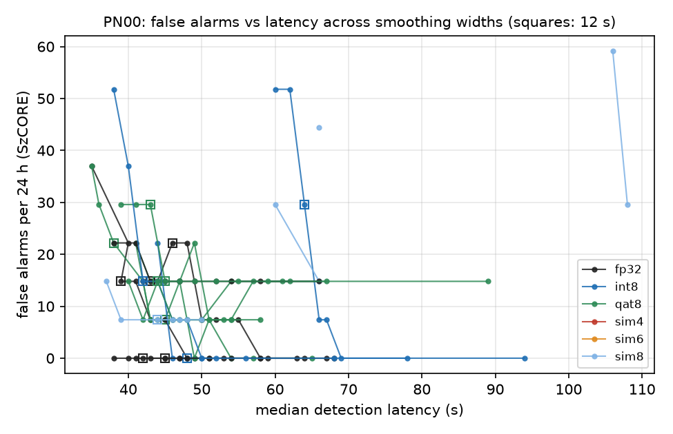

## PN01

Folds per seed: {0: 1, 1: 1, 2: 1, 3: 1, 4: 1}

- Early stopping fired in 5/5 jobs; ONNX FP32 export max |logit diff| 1.67e-06
- Seed 0: FP32 test specificity pooled over all held-out hours 1.0000 (OUTSIDE 0.995 +/- 0.005)
- Seed 1: FP32 test specificity pooled over all held-out hours 1.0000 (OUTSIDE 0.995 +/- 0.005)
- Seed 2: FP32 test specificity pooled over all held-out hours 1.0000 (within 0.995 +/- 0.005)
- Seed 3: FP32 test specificity pooled over all held-out hours 0.9979 (within 0.995 +/- 0.005)
- Seed 4: FP32 test specificity pooled over all held-out hours 1.0000 (within 0.995 +/- 0.005)
- Diagnostic: single folds outside the band 2/5 [(1, 0, 1.0), (1, 1, 1.0)]

### FP32 against EpiDeNet's reporting (4 s windows, pooled over folds)

| seed | FP/h raw | FP/h 3-window vote | window sens (vote) | spec (vote) | seizures detected |
|---|---|---|---|---|---|
| 0 | 0.00 | 0.00 | 0.000 | 1.0000 | 0/2 |
| 1 | 0.00 | 0.00 | 0.438 | 1.0000 | 2/2 |
| 2 | 0.00 | 0.00 | 0.250 | 1.0000 | 2/2 |
| 3 | 1.04 | 0.89 | 0.688 | 0.9980 | 2/2 |
| 4 | 0.00 | 0.00 | 0.500 | 1.0000 | 2/2 |

EpiDeNet (all CHB-MIT, LOOCV, 5 seeds): 4.29 raw, 2.24 with vote, 165/181 seizures.

### Two meanings of "FP/h" for the same FP32 model (pooled over folds)

| seed | window FP/h (3-window vote, 4 s grid) | SzCORE false alarms/h (12 s smoothing) | ratio |
|---|---|---|---|
| 0 | 0.00 | 0.00 | n/a |
| 1 | 0.00 | 0.00 | n/a |
| 2 | 0.00 | 0.00 | n/a |
| 3 | 0.89 | 0.15 | 6.0 |
| 4 | 0.00 | 0.00 | n/a |

Window FP/h is (1 - specificity) x windows per hour, so it depends on window length and hop, and one long artifact counts many times; SzCORE merges detections within 90 s into one alarm.

### Operating point (default smoothing, own threshold) and excess latency

| seed | model | FA/24h at 12 s | median latency at 12 s | detected | excess latency at FP32's FA (s) | smoothing there (s) | ΔFA/24h at FP32's latency |
|---|---|---|---|---|---|---|---|
| 0 | fp32 | 0.0 | inf | 0/2 | 0.0 | 12.0 | 0.0 |
| 0 | int8 | 0.0 | inf | 0/2 | n/a | n/a | n/a |
| 0 | sim8 | 0.0 | inf | 0/2 | n/a | n/a | n/a |
| 0 | sim6 | 0.0 | inf | 0/2 | n/a | n/a | n/a |
| 0 | sim4 | 0.0 | inf | 0/2 | n/a | n/a | n/a |
| 0 | qat8 | 0.0 | inf | 0/2 | n/a | n/a | n/a |
| 1 | fp32 | 0.0 | 15.5 | 2/2 | 0.0 | 12.0 | 0.0 |
| 1 | int8 | 0.0 | 17.5 | 2/2 | -2.0 | 4.0 | 0.0 |
| 1 | sim8 | 0.0 | 17.5 | 2/2 | -2.0 | 4.0 | 0.0 |
| 1 | sim6 | 0.0 | inf | 0/2 | inf | n/a | n/a |
| 1 | sim4 | 0.0 | inf | 0/2 | inf | n/a | n/a |
| 1 | qat8 | 0.0 | inf | 0/2 | inf | n/a | n/a |
| 2 | fp32 | 0.0 | 14.5 | 2/2 | 0.0 | 12.0 | 0.0 |
| 2 | int8 | 0.0 | inf | 0/2 | inf | n/a | n/a |
| 2 | sim8 | 0.0 | inf | 0/2 | 2.0 | 4.0 | n/a |
| 2 | sim6 | 0.0 | inf | 0/2 | inf | n/a | n/a |
| 2 | sim4 | 0.0 | inf | 0/2 | inf | n/a | n/a |
| 2 | qat8 | 0.0 | 19.0 | 2/2 | 0.5 | 4.0 | n/a |
| 3 | fp32 | 3.6 | 14.5 | 2/2 | 0.0 | 12.0 | 0.0 |
| 3 | int8 | 0.0 | inf | 0/2 | inf | n/a | n/a |
| 3 | sim8 | 0.0 | inf | 0/2 | inf | n/a | n/a |
| 3 | sim6 | 0.0 | inf | 0/2 | inf | n/a | n/a |
| 3 | sim4 | 0.0 | inf | 0/2 | inf | n/a | n/a |
| 3 | qat8 | 0.0 | inf | 0/2 | inf | n/a | n/a |
| 4 | fp32 | 0.0 | 13.0 | 2/2 | 0.0 | 12.0 | 0.0 |
| 4 | int8 | 0.0 | inf | 1/2 | 3.5 | 4.0 | n/a |
| 4 | sim8 | 0.0 | inf | 1/2 | 4.0 | 4.0 | n/a |
| 4 | sim6 | 0.0 | inf | 0/2 | inf | n/a | n/a |
| 4 | sim4 | 0.0 | inf | 0/2 | inf | n/a | n/a |
| 4 | qat8 | 12.5 | 10.0 | 2/2 | inf | n/a | 7.1 |

FP32 seed-to-seed excess latency (the null), all ordered seed pairs: ['n/a', 'n/a', 'n/a', 'n/a', '-0.5', '-5.0', 'inf', '-6.5', '0.5', '-3.0', 'inf', '-5.5', '0.5', '-3.0', '-4.0', '-5.5', '2.0', '-1.5', '-2.5', 'inf']
95% band: (-6.2, 1.549999999999999)

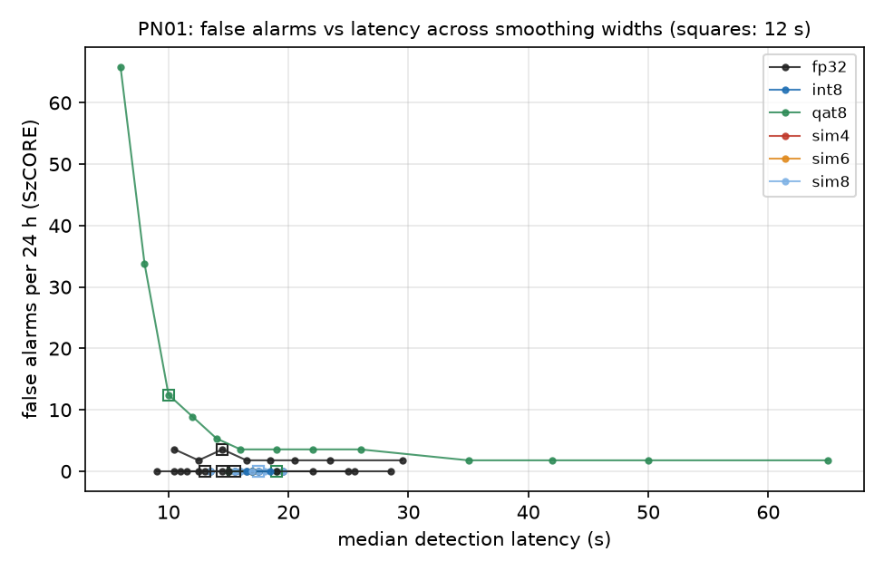

## PN03

Folds per seed: {0: 1, 1: 1, 2: 1, 3: 1, 4: 1}

- Early stopping fired in 5/5 jobs; ONNX FP32 export max |logit diff| 7.63e-06
- Seed 0: FP32 test specificity pooled over all held-out hours 0.9729 (OUTSIDE 0.995 +/- 0.005)
- Seed 1: FP32 test specificity pooled over all held-out hours 0.9875 (OUTSIDE 0.995 +/- 0.005)
- Seed 2: FP32 test specificity pooled over all held-out hours 0.9214 (OUTSIDE 0.995 +/- 0.005)
- Seed 3: FP32 test specificity pooled over all held-out hours 0.9625 (OUTSIDE 0.995 +/- 0.005)
- Seed 4: FP32 test specificity pooled over all held-out hours 0.9876 (OUTSIDE 0.995 +/- 0.005)
- Diagnostic: single folds outside the band 5/5 [(2, 0, 0.9729), (2, 1, 0.9875), (2, 2, 0.9214), (2, 3, 0.9625), (2, 4, 0.9876)]

### FP32 against EpiDeNet's reporting (4 s windows, pooled over folds)

| seed | FP/h raw | FP/h 3-window vote | window sens (vote) | spec (vote) | seizures detected |
|---|---|---|---|---|---|
| 0 | 12.26 | 9.99 | 0.226 | 0.9777 | 2/2 |
| 1 | 5.37 | 3.43 | 0.000 | 0.9924 | 0/2 |
| 2 | 35.17 | 33.64 | 0.387 | 0.9250 | 2/2 |
| 3 | 17.01 | 14.03 | 0.419 | 0.9687 | 2/2 |
| 4 | 5.41 | 3.92 | 0.226 | 0.9913 | 1/2 |

EpiDeNet (all CHB-MIT, LOOCV, 5 seeds): 4.29 raw, 2.24 with vote, 165/181 seizures.

### Two meanings of "FP/h" for the same FP32 model (pooled over folds)

| seed | window FP/h (3-window vote, 4 s grid) | SzCORE false alarms/h (12 s smoothing) | ratio |
|---|---|---|---|
| 0 | 9.99 | 1.53 | 6.5 |
| 1 | 3.43 | 1.40 | 2.4 |
| 2 | 33.64 | 2.31 | 14.6 |
| 3 | 14.03 | 2.15 | 6.5 |
| 4 | 3.92 | 1.03 | 3.8 |

Window FP/h is (1 - specificity) x windows per hour, so it depends on window length and hop, and one long artifact counts many times; SzCORE merges detections within 90 s into one alarm.

### Operating point (default smoothing, own threshold) and excess latency

| seed | model | FA/24h at 12 s | median latency at 12 s | detected | excess latency at FP32's FA (s) | smoothing there (s) | ΔFA/24h at FP32's latency |
|---|---|---|---|---|---|---|---|
| 0 | fp32 | 36.7 | 42.5 | 2/2 | 0.0 | 12.0 | 0.0 |
| 0 | int8 | 38.6 | 43.5 | 2/2 | 1.5 | 13.0 | 2.9 |
| 0 | sim8 | 36.7 | 43.5 | 2/2 | 1.0 | 12.0 | 1.3 |
| 0 | sim6 | 34.7 | 25.5 | 2/2 | -17.2 | 11.1 | n/a |
| 0 | sim4 | 54.5 | 59.0 | 2/2 | 27.5 | 30.0 | n/a |
| 0 | qat8 | 34.7 | 43.5 | 2/2 | -1.1 | 11.1 | -1.0 |
| 1 | fp32 | 33.7 | inf | 1/2 | 0.0 | 12.0 | 0.0 |
| 1 | int8 | 33.7 | inf | 1/2 | n/a | n/a | n/a |
| 1 | sim8 | 34.7 | inf | 1/2 | n/a | n/a | n/a |
| 1 | sim6 | 38.6 | inf | 1/2 | n/a | n/a | n/a |
| 1 | sim4 | 77.3 | inf | 1/2 | n/a | n/a | n/a |
| 1 | qat8 | 36.7 | 71.0 | 2/2 | n/a | n/a | n/a |
| 2 | fp32 | 55.5 | 10.5 | 2/2 | 0.0 | 12.0 | 0.0 |
| 2 | int8 | 0.0 | inf | 0/2 | inf | n/a | n/a |
| 2 | sim8 | 69.3 | inf | 1/2 | inf | n/a | n/a |
| 2 | sim6 | 51.5 | 39.0 | 2/2 | 27.5 | 10.4 | n/a |
| 2 | sim4 | 68.4 | 55.0 | 2/2 | 46.2 | 14.3 | n/a |
| 2 | qat8 | 71.3 | 9.0 | 2/2 | 1.0 | 28.0 | 2.0 |
| 3 | fp32 | 51.5 | 58.0 | 2/2 | 0.0 | 12.0 | 0.0 |
| 3 | int8 | 21.8 | inf | 1/2 | inf | n/a | n/a |
| 3 | sim8 | 43.6 | 77.5 | 2/2 | 7.0 | 4.0 | n/a |
| 3 | sim6 | 56.5 | 76.5 | 2/2 | 20.4 | 13.7 | 13.3 |
| 3 | sim4 | 69.3 | 60.0 | 2/2 | 5.1 | 18.2 | 25.8 |
| 3 | qat8 | 66.4 | 50.0 | 2/2 | 0.1 | 19.2 | -1.7 |
| 4 | fp32 | 24.8 | 51.0 | 2/2 | 0.0 | 12.0 | 0.0 |
| 4 | int8 | 11.9 | inf | 1/2 | inf | n/a | n/a |
| 4 | sim8 | 6.9 | 74.0 | 2/2 | 19.0 | 4.0 | n/a |
| 4 | sim6 | 19.8 | 42.0 | 2/2 | -11.5 | 7.0 | -9.9 |
| 4 | sim4 | 14.9 | 61.0 | 2/2 | 7.1 | 6.3 | n/a |
| 4 | qat8 | 6.9 | inf | 1/2 | inf | n/a | n/a |

FP32 seed-to-seed excess latency (the null), all ordered seed pairs: ['inf', '-26.0', 'inf', '-2.0', 'n/a', 'n/a', 'n/a', 'n/a', '21.4', 'inf', '44.5', '21.5', '-25.5', 'inf', '-47.0', '-26.0', '20.2', 'inf', 'inf', 'inf']
95% band: (-42.8, 39.9)

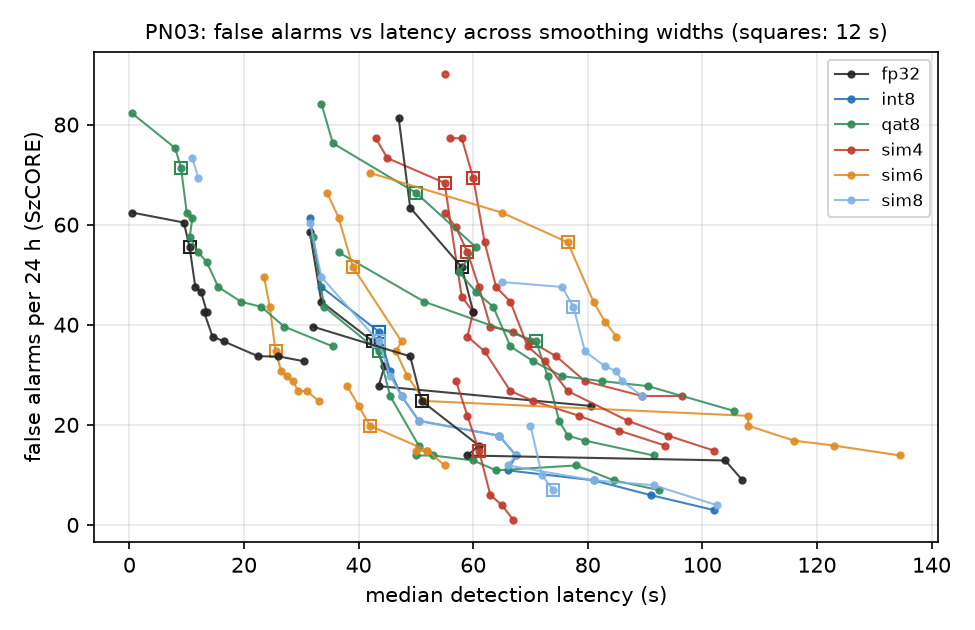

## PN05

Folds per seed: {0: 1, 1: 1, 2: 1, 3: 1, 4: 1}

- Early stopping fired in 5/5 jobs; ONNX FP32 export max |logit diff| 1.91e-06
- Seed 0: FP32 test specificity pooled over all held-out hours 0.9913 (within 0.995 +/- 0.005)
- Seed 1: FP32 test specificity pooled over all held-out hours 0.9981 (within 0.995 +/- 0.005)
- Seed 2: FP32 test specificity pooled over all held-out hours 0.9970 (within 0.995 +/- 0.005)
- Seed 3: FP32 test specificity pooled over all held-out hours 0.9925 (within 0.995 +/- 0.005)
- Seed 4: FP32 test specificity pooled over all held-out hours 0.9964 (within 0.995 +/- 0.005)
- Diagnostic: single folds outside the band 0/5

### FP32 against EpiDeNet's reporting (4 s windows, pooled over folds)

| seed | FP/h raw | FP/h 3-window vote | window sens (vote) | spec (vote) | seizures detected |
|---|---|---|---|---|---|
| 0 | 4.14 | 3.81 | 0.214 | 0.9915 | 2/3 |
| 1 | 0.99 | 0.66 | 0.000 | 0.9985 | 0/3 |
| 2 | 1.49 | 1.16 | 0.071 | 0.9974 | 1/3 |
| 3 | 3.48 | 2.98 | 0.214 | 0.9933 | 2/3 |
| 4 | 1.16 | 0.83 | 0.071 | 0.9981 | 1/3 |

EpiDeNet (all CHB-MIT, LOOCV, 5 seeds): 4.29 raw, 2.24 with vote, 165/181 seizures.

### Two meanings of "FP/h" for the same FP32 model (pooled over folds)

| seed | window FP/h (3-window vote, 4 s grid) | SzCORE false alarms/h (12 s smoothing) | ratio |
|---|---|---|---|
| 0 | 3.81 | 1.33 | 2.9 |
| 1 | 0.66 | 0.33 | 2.0 |
| 2 | 1.16 | 0.33 | 3.5 |
| 3 | 2.98 | 0.99 | 3.0 |
| 4 | 0.83 | 0.33 | 2.5 |

Window FP/h is (1 - specificity) x windows per hour, so it depends on window length and hop, and one long artifact counts many times; SzCORE merges detections within 90 s into one alarm.

### Operating point (default smoothing, own threshold) and excess latency

| seed | model | FA/24h at 12 s | median latency at 12 s | detected | excess latency at FP32's FA (s) | smoothing there (s) | ΔFA/24h at FP32's latency |
|---|---|---|---|---|---|---|---|
| 0 | fp32 | 31.8 | 25.0 | 3/3 | 0.0 | 12.0 | 0.0 |
| 0 | int8 | 39.8 | inf | 0/3 | inf | n/a | n/a |
| 0 | sim8 | 11.9 | inf | 0/3 | inf | n/a | n/a |
| 0 | sim6 | 51.7 | inf | 1/3 | inf | n/a | n/a |
| 0 | sim4 | 59.6 | inf | 1/3 | inf | n/a | n/a |
| 0 | qat8 | 8.0 | inf | 0/3 | 11.0 | 4.0 | n/a |
| 1 | fp32 | 8.0 | inf | 1/3 | 0.0 | 12.0 | 0.0 |
| 1 | int8 | 19.9 | inf | 0/3 | n/a | n/a | n/a |
| 1 | sim8 | 8.0 | inf | 0/3 | n/a | n/a | n/a |
| 1 | sim6 | 87.5 | inf | 1/3 | n/a | n/a | n/a |
| 1 | sim4 | 51.7 | inf | 0/3 | n/a | n/a | n/a |
| 1 | qat8 | 4.0 | inf | 0/3 | n/a | n/a | n/a |
| 2 | fp32 | 8.0 | inf | 1/3 | 0.0 | 12.0 | 0.0 |
| 2 | int8 | 51.7 | inf | 0/3 | n/a | n/a | n/a |
| 2 | sim8 | 51.7 | inf | 0/3 | n/a | n/a | n/a |
| 2 | sim6 | 31.8 | inf | 0/3 | n/a | n/a | n/a |
| 2 | sim4 | 39.8 | inf | 0/3 | n/a | n/a | n/a |
| 2 | qat8 | 0.0 | inf | 0/3 | n/a | n/a | n/a |
| 3 | fp32 | 23.9 | 26.0 | 3/3 | 0.0 | 12.0 | 0.0 |
| 3 | int8 | 63.6 | inf | 0/3 | inf | n/a | n/a |
| 3 | sim8 | 59.6 | inf | 0/3 | inf | n/a | n/a |
| 3 | sim6 | 55.7 | inf | 0/3 | inf | n/a | n/a |
| 3 | sim4 | 63.6 | inf | 1/3 | inf | n/a | n/a |
| 3 | qat8 | 15.9 | inf | 0/3 | inf | n/a | n/a |
| 4 | fp32 | 8.0 | inf | 1/3 | 0.0 | 12.0 | 0.0 |
| 4 | int8 | 35.8 | inf | 0/3 | n/a | n/a | n/a |
| 4 | sim8 | 39.8 | inf | 0/3 | n/a | n/a | n/a |
| 4 | sim6 | 95.4 | inf | 0/3 | n/a | n/a | n/a |
| 4 | sim4 | 95.4 | inf | 1/3 | n/a | n/a | n/a |
| 4 | qat8 | 4.0 | inf | 0/3 | n/a | n/a | n/a |

FP32 seed-to-seed excess latency (the null), all ordered seed pairs: ['12.0', '11.0', '-0.3', '11.5', 'n/a', 'n/a', 'n/a', 'n/a', 'n/a', 'n/a', 'n/a', 'n/a', '11.0', '11.0', '10.0', '11.5', 'n/a', 'n/a', 'n/a', 'n/a']
95% band: (1.4750000000000012, 11.9125)

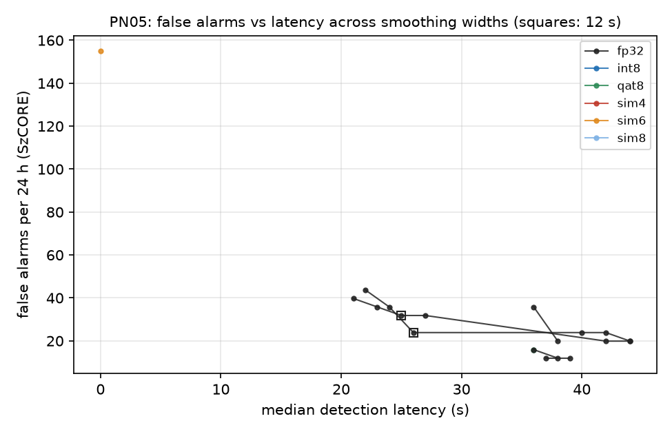

## PN06

Folds per seed: {0: 1, 1: 1, 2: 1, 3: 1, 4: 1}

- Early stopping fired in 5/5 jobs; ONNX FP32 export max |logit diff| 1.91e-06
- Seed 0: FP32 test specificity pooled over all held-out hours 1.0000 (OUTSIDE 0.995 +/- 0.005)
- Seed 1: FP32 test specificity pooled over all held-out hours 1.0000 (OUTSIDE 0.995 +/- 0.005)
- Seed 2: FP32 test specificity pooled over all held-out hours 1.0000 (OUTSIDE 0.995 +/- 0.005)
- Seed 3: FP32 test specificity pooled over all held-out hours 1.0000 (OUTSIDE 0.995 +/- 0.005)
- Seed 4: FP32 test specificity pooled over all held-out hours 1.0000 (OUTSIDE 0.995 +/- 0.005)
- Diagnostic: single folds outside the band 5/5 [(4, 0, 1.0), (4, 1, 1.0), (4, 2, 1.0), (4, 3, 1.0), (4, 4, 1.0)]

### FP32 against EpiDeNet's reporting (4 s windows, pooled over folds)

| seed | FP/h raw | FP/h 3-window vote | window sens (vote) | spec (vote) | seizures detected |
|---|---|---|---|---|---|
| 0 | 0.00 | 0.00 | 0.000 | 1.0000 | 0/5 |
| 1 | 0.00 | 0.00 | 0.000 | 1.0000 | 0/5 |
| 2 | 0.00 | 0.00 | 0.000 | 1.0000 | 0/5 |
| 3 | 0.00 | 0.00 | 0.000 | 1.0000 | 0/5 |
| 4 | 0.00 | 0.00 | 0.000 | 1.0000 | 0/5 |

EpiDeNet (all CHB-MIT, LOOCV, 5 seeds): 4.29 raw, 2.24 with vote, 165/181 seizures.

### Two meanings of "FP/h" for the same FP32 model (pooled over folds)

| seed | window FP/h (3-window vote, 4 s grid) | SzCORE false alarms/h (12 s smoothing) | ratio |
|---|---|---|---|
| 0 | 0.00 | 0.00 | n/a |
| 1 | 0.00 | 0.00 | n/a |
| 2 | 0.00 | 0.00 | n/a |
| 3 | 0.00 | 0.00 | n/a |
| 4 | 0.00 | 0.00 | n/a |

Window FP/h is (1 - specificity) x windows per hour, so it depends on window length and hop, and one long artifact counts many times; SzCORE merges detections within 90 s into one alarm.

### Operating point (default smoothing, own threshold) and excess latency

| seed | model | FA/24h at 12 s | median latency at 12 s | detected | excess latency at FP32's FA (s) | smoothing there (s) | ΔFA/24h at FP32's latency |
|---|---|---|---|---|---|---|---|
| 0 | fp32 | 0.0 | inf | 0/5 | 0.0 | 12.0 | 0.0 |
| 0 | int8 | 0.0 | inf | 0/5 | n/a | n/a | n/a |
| 0 | sim8 | 0.0 | inf | 0/5 | n/a | n/a | n/a |
| 0 | sim6 | 0.0 | inf | 0/5 | n/a | n/a | n/a |
| 0 | sim4 | 0.0 | inf | 0/5 | n/a | n/a | n/a |
| 0 | qat8 | 0.0 | inf | 0/5 | n/a | n/a | n/a |
| 1 | fp32 | 0.0 | inf | 0/5 | 0.0 | 12.0 | 0.0 |
| 1 | int8 | 0.0 | inf | 0/5 | n/a | n/a | n/a |
| 1 | sim8 | 0.0 | inf | 0/5 | n/a | n/a | n/a |
| 1 | sim6 | 0.0 | inf | 0/5 | n/a | n/a | n/a |
| 1 | sim4 | 0.0 | inf | 0/5 | n/a | n/a | n/a |
| 1 | qat8 | 0.0 | inf | 0/5 | n/a | n/a | n/a |
| 2 | fp32 | 0.0 | inf | 0/5 | 0.0 | 12.0 | 0.0 |
| 2 | int8 | 0.0 | inf | 0/5 | n/a | n/a | n/a |
| 2 | sim8 | 0.0 | inf | 0/5 | n/a | n/a | n/a |
| 2 | sim6 | 0.0 | inf | 0/5 | n/a | n/a | n/a |
| 2 | sim4 | 0.0 | inf | 0/5 | n/a | n/a | n/a |
| 2 | qat8 | 0.0 | inf | 0/5 | n/a | n/a | n/a |
| 3 | fp32 | 0.0 | inf | 0/5 | 0.0 | 12.0 | 0.0 |
| 3 | int8 | 0.0 | inf | 0/5 | n/a | n/a | n/a |
| 3 | sim8 | 0.0 | inf | 0/5 | n/a | n/a | n/a |
| 3 | sim6 | 0.0 | inf | 0/5 | n/a | n/a | n/a |
| 3 | sim4 | 0.0 | inf | 0/5 | n/a | n/a | n/a |
| 3 | qat8 | 0.0 | inf | 0/5 | n/a | n/a | n/a |
| 4 | fp32 | 0.0 | inf | 0/5 | 0.0 | 12.0 | 0.0 |
| 4 | int8 | 0.0 | inf | 0/5 | n/a | n/a | n/a |
| 4 | sim8 | 0.0 | inf | 0/5 | n/a | n/a | n/a |
| 4 | sim6 | 0.0 | inf | 0/5 | n/a | n/a | n/a |
| 4 | sim4 | 0.0 | inf | 0/5 | n/a | n/a | n/a |
| 4 | qat8 | 0.0 | inf | 0/5 | n/a | n/a | n/a |

FP32 seed-to-seed excess latency (the null), all ordered seed pairs: ['n/a', 'n/a', 'n/a', 'n/a', 'n/a', 'n/a', 'n/a', 'n/a', 'n/a', 'n/a', 'n/a', 'n/a', 'n/a', 'n/a', 'n/a', 'n/a', 'n/a', 'n/a', 'n/a', 'n/a']
95% band: None

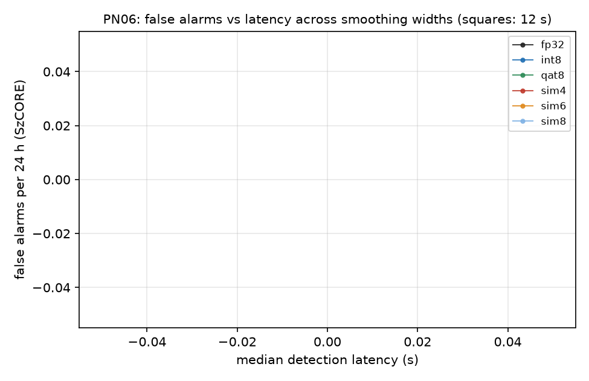

## PN07

Folds per seed: {0: 1, 1: 1, 2: 1, 3: 1, 4: 1}

- Early stopping fired in 5/5 jobs; ONNX FP32 export max |logit diff| 5.72e-06
- Seed 0: FP32 test specificity pooled over all held-out hours 0.4055 (OUTSIDE 0.995 +/- 0.005)
- Seed 1: FP32 test specificity pooled over all held-out hours 0.4266 (OUTSIDE 0.995 +/- 0.005)
- Seed 2: FP32 test specificity pooled over all held-out hours 0.0225 (OUTSIDE 0.995 +/- 0.005)
- Seed 3: FP32 test specificity pooled over all held-out hours 0.0841 (OUTSIDE 0.995 +/- 0.005)
- Seed 4: FP32 test specificity pooled over all held-out hours 0.9326 (OUTSIDE 0.995 +/- 0.005)
- Diagnostic: single folds outside the band 5/5 [(5, 0, 0.4055), (5, 1, 0.4266), (5, 2, 0.0225), (5, 3, 0.0841), (5, 4, 0.9326)]

### FP32 against EpiDeNet's reporting (4 s windows, pooled over folds)

| seed | FP/h raw | FP/h 3-window vote | window sens (vote) | spec (vote) | seizures detected |
|---|---|---|---|---|---|
| 0 | 266.73 | 272.79 | 0.875 | 0.3926 | 1/1 |
| 1 | 257.57 | 255.97 | 1.000 | 0.4300 | 1/1 |
| 2 | 439.12 | 441.76 | 1.000 | 0.0163 | 1/1 |
| 3 | 410.16 | 414.51 | 1.000 | 0.0770 | 1/1 |
| 4 | 30.79 | 23.01 | 0.250 | 0.9488 | 1/1 |

EpiDeNet (all CHB-MIT, LOOCV, 5 seeds): 4.29 raw, 2.24 with vote, 165/181 seizures.

### Two meanings of "FP/h" for the same FP32 model (pooled over folds)

| seed | window FP/h (3-window vote, 4 s grid) | SzCORE false alarms/h (12 s smoothing) | ratio |
|---|---|---|---|
| 0 | 272.79 | 11.56 | 23.6 |
| 1 | 255.97 | 11.45 | 22.4 |
| 2 | 441.76 | 11.91 | 37.1 |
| 3 | 414.51 | 12.02 | 34.5 |
| 4 | 23.01 | 7.21 | 3.2 |

Window FP/h is (1 - specificity) x windows per hour, so it depends on window length and hop, and one long artifact counts many times; SzCORE merges detections within 90 s into one alarm.

### Operating point (default smoothing, own threshold) and excess latency

| seed | model | FA/24h at 12 s | median latency at 12 s | detected | excess latency at FP32's FA (s) | smoothing there (s) | ΔFA/24h at FP32's latency |
|---|---|---|---|---|---|---|---|
| 0 | fp32 | 277.5 | -30.0 | 1/1 | 0.0 | 12.0 | 0.0 |
| 0 | int8 | 96.2 | 24.0 | 1/1 | 50.0 | 4.0 | n/a |
| 0 | sim8 | 277.5 | -30.0 | 1/1 | 0.0 | 12.0 | -30.2 |
| 0 | sim6 | 280.2 | -30.0 | 1/1 | 0.0 | 8.0 | -46.7 |
| 0 | sim4 | 307.7 | -30.0 | 1/1 | 0.0 | 15.4 | -118.1 |
| 0 | qat8 | 283.0 | -30.0 | 1/1 | 0.0 | 13.3 | -76.9 |
| 1 | fp32 | 274.7 | -30.0 | 1/1 | 0.0 | 12.0 | 0.0 |
| 1 | int8 | 280.2 | -30.0 | 1/1 | 0.0 | 12.6 | -107.1 |
| 1 | sim8 | 274.7 | -30.0 | 1/1 | 0.0 | 12.0 | -107.1 |
| 1 | sim6 | 291.2 | -30.0 | 1/1 | inf | n/a | 11.0 |
| 1 | sim4 | 302.2 | -17.0 | 1/1 | 16.0 | 18.0 | n/a |
| 1 | qat8 | 225.3 | 8.0 | 1/1 | 34.0 | 4.0 | n/a |
| 2 | fp32 | 285.7 | -30.0 | 1/1 | 0.0 | 12.0 | 0.0 |
| 2 | int8 | 0.0 | inf | 0/1 | inf | n/a | n/a |
| 2 | sim8 | 285.7 | -30.0 | 1/1 | 0.0 | 4.0 | 0.0 |
| 2 | sim6 | 285.7 | -30.0 | 1/1 | 0.0 | 4.0 | -13.7 |
| 2 | sim4 | 318.7 | -15.0 | 1/1 | 17.4 | 16.9 | n/a |
| 2 | qat8 | 285.7 | -30.0 | 1/1 | 0.0 | 4.0 | -2.7 |
| 3 | fp32 | 288.5 | -30.0 | 1/1 | 0.0 | 12.0 | 0.0 |
| 3 | int8 | 288.5 | -30.0 | 1/1 | 0.0 | 12.0 | -5.5 |
| 3 | sim8 | 285.7 | -30.0 | 1/1 | 0.0 | 16.0 | -5.5 |
| 3 | sim6 | 296.7 | -30.0 | 1/1 | 0.0 | 14.4 | -52.2 |
| 3 | sim4 | 302.2 | -15.0 | 1/1 | 16.4 | 14.9 | n/a |
| 3 | qat8 | 288.5 | -30.0 | 1/1 | 0.0 | 12.0 | -8.2 |
| 4 | fp32 | 173.1 | 20.0 | 1/1 | 0.0 | 12.0 | 0.0 |
| 4 | int8 | 153.9 | 24.0 | 1/1 | 1.2 | 6.4 | 8.2 |
| 4 | sim8 | 153.9 | 24.0 | 1/1 | 2.2 | 8.5 | 8.2 |
| 4 | sim6 | 241.8 | 16.0 | 1/1 | 15.0 | 36.0 | 38.5 |
| 4 | sim4 | 296.7 | -7.0 | 1/1 | -14.2 | 40.0 | -49.8 |
| 4 | qat8 | 109.9 | 24.0 | 1/1 | 0.0 | 4.0 | -52.2 |

FP32 seed-to-seed excess latency (the null), all ordered seed pairs: ['0.0', 'inf', 'inf', '44.0', '0.0', 'inf', 'inf', '44.0', '0.0', '0.0', '0.0', '44.0', '0.0', '0.0', '0.0', '44.0', 'inf', '-50.0', 'inf', 'inf']
95% band: (-35.0, 44.0)

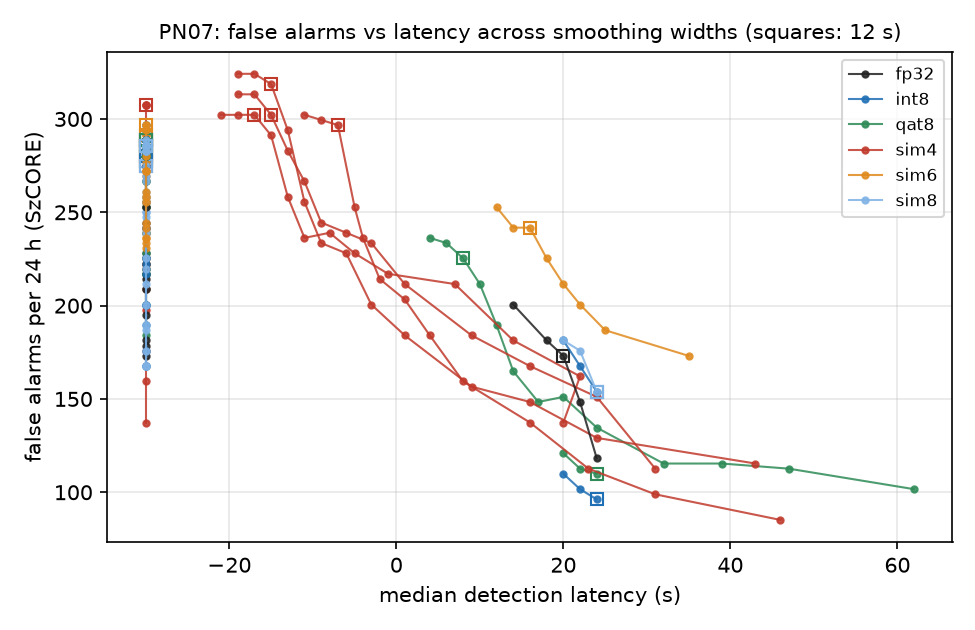

## PN09

Folds per seed: {0: 1, 1: 1, 2: 1, 3: 1, 4: 1}

- Early stopping fired in 5/5 jobs; ONNX FP32 export max |logit diff| 1.19e-06
- Seed 0: FP32 test specificity pooled over all held-out hours 1.0000 (OUTSIDE 0.995 +/- 0.005)
- Seed 1: FP32 test specificity pooled over all held-out hours 1.0000 (OUTSIDE 0.995 +/- 0.005)
- Seed 2: FP32 test specificity pooled over all held-out hours 1.0000 (OUTSIDE 0.995 +/- 0.005)
- Seed 3: FP32 test specificity pooled over all held-out hours 1.0000 (OUTSIDE 0.995 +/- 0.005)
- Seed 4: FP32 test specificity pooled over all held-out hours 0.9998 (within 0.995 +/- 0.005)
- Diagnostic: single folds outside the band 4/5 [(6, 0, 1.0), (6, 1, 1.0), (6, 2, 1.0), (6, 3, 1.0)]

### FP32 against EpiDeNet's reporting (4 s windows, pooled over folds)

| seed | FP/h raw | FP/h 3-window vote | window sens (vote) | spec (vote) | seizures detected |
|---|---|---|---|---|---|
| 0 | 0.00 | 0.00 | 0.000 | 1.0000 | 0/3 |
| 1 | 0.00 | 0.00 | 0.000 | 1.0000 | 0/3 |
| 2 | 0.00 | 0.00 | 0.000 | 1.0000 | 0/3 |
| 3 | 0.00 | 0.00 | 0.000 | 1.0000 | 0/3 |
| 4 | 0.00 | 0.00 | 0.000 | 1.0000 | 0/3 |

EpiDeNet (all CHB-MIT, LOOCV, 5 seeds): 4.29 raw, 2.24 with vote, 165/181 seizures.

### Two meanings of "FP/h" for the same FP32 model (pooled over folds)

| seed | window FP/h (3-window vote, 4 s grid) | SzCORE false alarms/h (12 s smoothing) | ratio |
|---|---|---|---|
| 0 | 0.00 | 0.00 | n/a |
| 1 | 0.00 | 0.00 | n/a |
| 2 | 0.00 | 0.00 | n/a |
| 3 | 0.00 | 0.00 | n/a |
| 4 | 0.00 | 0.00 | n/a |

Window FP/h is (1 - specificity) x windows per hour, so it depends on window length and hop, and one long artifact counts many times; SzCORE merges detections within 90 s into one alarm.

### Operating point (default smoothing, own threshold) and excess latency

| seed | model | FA/24h at 12 s | median latency at 12 s | detected | excess latency at FP32's FA (s) | smoothing there (s) | ΔFA/24h at FP32's latency |
|---|---|---|---|---|---|---|---|
| 0 | fp32 | 0.0 | inf | 0/3 | 0.0 | 12.0 | 0.0 |
| 0 | int8 | 0.0 | inf | 0/3 | n/a | n/a | n/a |
| 0 | sim8 | 0.0 | inf | 0/3 | n/a | n/a | n/a |
| 0 | sim6 | 112.2 | 53.0 | 2/3 | n/a | n/a | n/a |
| 0 | sim4 | 0.0 | inf | 0/3 | n/a | n/a | n/a |
| 0 | qat8 | 0.0 | inf | 0/3 | n/a | n/a | n/a |
| 1 | fp32 | 0.0 | inf | 0/3 | 0.0 | 12.0 | 0.0 |
| 1 | int8 | 0.0 | inf | 0/3 | n/a | n/a | n/a |
| 1 | sim8 | 10.5 | inf | 0/3 | n/a | n/a | n/a |
| 1 | sim6 | 73.6 | 53.0 | 2/3 | n/a | n/a | n/a |
| 1 | sim4 | 3.5 | inf | 0/3 | n/a | n/a | n/a |
| 1 | qat8 | 0.0 | inf | 0/3 | n/a | n/a | n/a |
| 2 | fp32 | 0.0 | inf | 0/3 | 0.0 | 12.0 | 0.0 |
| 2 | int8 | 24.5 | inf | 0/3 | n/a | n/a | n/a |
| 2 | sim8 | 7.0 | inf | 0/3 | n/a | n/a | n/a |
| 2 | sim6 | 133.2 | 53.0 | 2/3 | n/a | n/a | n/a |
| 2 | sim4 | 7.0 | inf | 0/3 | n/a | n/a | n/a |
| 2 | qat8 | 0.0 | inf | 0/3 | n/a | n/a | n/a |
| 3 | fp32 | 0.0 | inf | 0/3 | 0.0 | 12.0 | 0.0 |
| 3 | int8 | 0.0 | inf | 0/3 | n/a | n/a | n/a |
| 3 | sim8 | 0.0 | inf | 0/3 | n/a | n/a | n/a |
| 3 | sim6 | 80.6 | inf | 0/3 | n/a | n/a | n/a |
| 3 | sim4 | 0.0 | inf | 0/3 | n/a | n/a | n/a |
| 3 | qat8 | 0.0 | inf | 0/3 | n/a | n/a | n/a |
| 4 | fp32 | 0.0 | inf | 0/3 | 0.0 | 12.0 | 0.0 |
| 4 | int8 | 7.0 | inf | 0/3 | n/a | n/a | n/a |
| 4 | sim8 | 7.0 | inf | 0/3 | n/a | n/a | n/a |
| 4 | sim6 | 38.6 | inf | 1/3 | n/a | n/a | n/a |
| 4 | sim4 | 17.5 | inf | 0/3 | n/a | n/a | n/a |
| 4 | qat8 | 0.0 | inf | 0/3 | n/a | n/a | n/a |

FP32 seed-to-seed excess latency (the null), all ordered seed pairs: ['n/a', 'n/a', 'n/a', 'n/a', 'n/a', 'n/a', 'n/a', 'n/a', 'n/a', 'n/a', 'n/a', 'n/a', 'n/a', 'n/a', 'n/a', 'n/a', 'n/a', 'n/a', 'n/a', 'n/a']
95% band: None

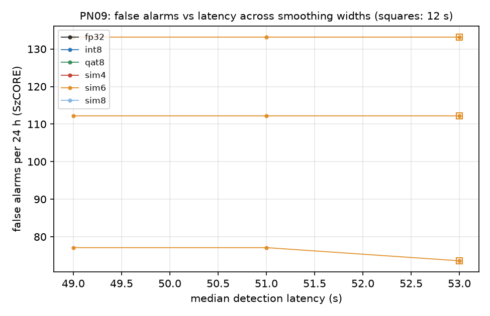

## PN10

Folds per seed: {0: 1, 1: 1, 2: 1, 3: 1, 4: 1}

- Early stopping fired in 5/5 jobs; ONNX FP32 export max |logit diff| 2.86e-06
- Seed 0: FP32 test specificity pooled over all held-out hours 1.0000 (OUTSIDE 0.995 +/- 0.005)
- Seed 1: FP32 test specificity pooled over all held-out hours 0.9973 (within 0.995 +/- 0.005)
- Seed 2: FP32 test specificity pooled over all held-out hours 0.9988 (within 0.995 +/- 0.005)
- Seed 3: FP32 test specificity pooled over all held-out hours 0.9992 (within 0.995 +/- 0.005)
- Seed 4: FP32 test specificity pooled over all held-out hours 0.9881 (OUTSIDE 0.995 +/- 0.005)
- Diagnostic: single folds outside the band 2/5 [(7, 0, 1.0), (7, 4, 0.9881)]

### FP32 against EpiDeNet's reporting (4 s windows, pooled over folds)

| seed | FP/h raw | FP/h 3-window vote | window sens (vote) | spec (vote) | seizures detected |
|---|---|---|---|---|---|
| 0 | 0.00 | 0.00 | 0.043 | 1.0000 | 1/10 |
| 1 | 1.01 | 0.43 | 0.149 | 0.9990 | 1/10 |
| 2 | 0.59 | 0.00 | 0.085 | 1.0000 | 1/10 |
| 3 | 0.48 | 0.11 | 0.149 | 0.9998 | 1/10 |
| 4 | 5.34 | 2.78 | 0.149 | 0.9938 | 1/10 |

EpiDeNet (all CHB-MIT, LOOCV, 5 seeds): 4.29 raw, 2.24 with vote, 165/181 seizures.

### Two meanings of "FP/h" for the same FP32 model (pooled over folds)

| seed | window FP/h (3-window vote, 4 s grid) | SzCORE false alarms/h (12 s smoothing) | ratio |
|---|---|---|---|
| 0 | 0.00 | 0.00 | n/a |
| 1 | 0.43 | 0.21 | 2.0 |
| 2 | 0.00 | 0.27 | 0.0 |
| 3 | 0.11 | 0.16 | 0.7 |
| 4 | 2.78 | 1.01 | 2.7 |

Window FP/h is (1 - specificity) x windows per hour, so it depends on window length and hop, and one long artifact counts many times; SzCORE merges detections within 90 s into one alarm.

### Operating point (default smoothing, own threshold) and excess latency

| seed | model | FA/24h at 12 s | median latency at 12 s | detected | excess latency at FP32's FA (s) | smoothing there (s) | ΔFA/24h at FP32's latency |
|---|---|---|---|---|---|---|---|
| 0 | fp32 | 0.0 | inf | 1/10 | 0.0 | 12.0 | 0.0 |
| 0 | int8 | 0.0 | inf | 0/10 | n/a | n/a | n/a |
| 0 | sim8 | 0.0 | inf | 0/10 | n/a | n/a | n/a |
| 0 | sim6 | 0.0 | inf | 0/10 | n/a | n/a | n/a |
| 0 | sim4 | 0.0 | inf | 0/10 | n/a | n/a | n/a |
| 0 | qat8 | 2.6 | inf | 1/10 | n/a | n/a | n/a |
| 1 | fp32 | 5.1 | inf | 1/10 | 0.0 | 12.0 | 0.0 |
| 1 | int8 | 0.0 | inf | 0/10 | n/a | n/a | n/a |
| 1 | sim8 | 2.6 | inf | 1/10 | n/a | n/a | n/a |
| 1 | sim6 | 0.0 | inf | 1/10 | n/a | n/a | n/a |
| 1 | sim4 | 0.0 | inf | 1/10 | n/a | n/a | n/a |
| 1 | qat8 | 32.0 | 38.5 | 6/10 | n/a | n/a | n/a |
| 2 | fp32 | 6.4 | inf | 1/10 | 0.0 | 12.0 | 0.0 |
| 2 | int8 | 0.0 | inf | 1/10 | n/a | n/a | n/a |
| 2 | sim8 | 0.0 | inf | 1/10 | n/a | n/a | n/a |
| 2 | sim6 | 0.0 | inf | 1/10 | n/a | n/a | n/a |
| 2 | sim4 | 0.0 | inf | 1/10 | n/a | n/a | n/a |
| 2 | qat8 | 19.2 | inf | 1/10 | n/a | n/a | n/a |
| 3 | fp32 | 3.8 | inf | 1/10 | 0.0 | 12.0 | 0.0 |
| 3 | int8 | 7.7 | inf | 1/10 | n/a | n/a | n/a |
| 3 | sim8 | 0.0 | inf | 1/10 | n/a | n/a | n/a |
| 3 | sim6 | 1.3 | inf | 1/10 | n/a | n/a | n/a |
| 3 | sim4 | 0.0 | inf | 1/10 | n/a | n/a | n/a |
| 3 | qat8 | 20.5 | inf | 2/10 | n/a | n/a | n/a |
| 4 | fp32 | 24.3 | inf | 1/10 | 0.0 | 12.0 | 0.0 |
| 4 | int8 | 1.3 | inf | 2/10 | n/a | n/a | n/a |
| 4 | sim8 | 1.3 | inf | 2/10 | n/a | n/a | n/a |
| 4 | sim6 | 0.0 | inf | 1/10 | n/a | n/a | n/a |
| 4 | sim4 | 0.0 | inf | 1/10 | n/a | n/a | n/a |
| 4 | qat8 | 9.0 | inf | 1/10 | n/a | n/a | n/a |

FP32 seed-to-seed excess latency (the null), all ordered seed pairs: ['n/a', 'n/a', 'n/a', 'n/a', 'n/a', 'n/a', 'n/a', 'n/a', 'n/a', 'n/a', 'n/a', 'n/a', 'n/a', 'n/a', 'n/a', 'n/a', 'n/a', 'n/a', 'n/a', 'n/a']
95% band: None

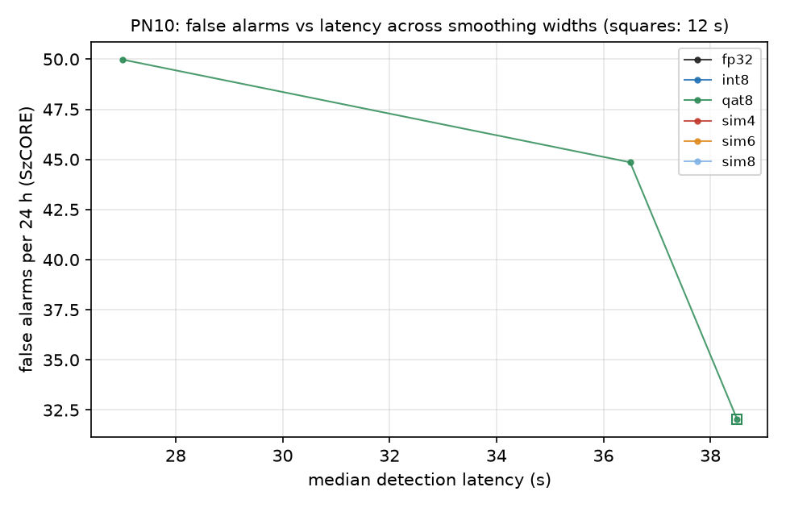

## PN11

Folds per seed: {0: 1, 1: 1, 2: 1, 3: 1, 4: 1}

- Early stopping fired in 5/5 jobs; ONNX FP32 export max |logit diff| 2.86e-06
- Seed 0: FP32 test specificity pooled over all held-out hours 0.9992 (within 0.995 +/- 0.005)
- Seed 1: FP32 test specificity pooled over all held-out hours 0.9149 (OUTSIDE 0.995 +/- 0.005)
- Seed 2: FP32 test specificity pooled over all held-out hours 0.9999 (within 0.995 +/- 0.005)
- Seed 3: FP32 test specificity pooled over all held-out hours 0.9797 (OUTSIDE 0.995 +/- 0.005)
- Seed 4: FP32 test specificity pooled over all held-out hours 1.0000 (OUTSIDE 0.995 +/- 0.005)
- Diagnostic: single folds outside the band 3/5 [(8, 1, 0.9149), (8, 3, 0.9797), (8, 4, 1.0)]

### FP32 against EpiDeNet's reporting (4 s windows, pooled over folds)

| seed | FP/h raw | FP/h 3-window vote | window sens (vote) | spec (vote) | seizures detected |
|---|---|---|---|---|---|
| 0 | 0.41 | 0.00 | 0.000 | 1.0000 | 0/1 |
| 1 | 39.00 | 34.02 | 1.000 | 0.9239 | 1/1 |
| 2 | 0.41 | 0.00 | 0.000 | 1.0000 | 0/1 |
| 3 | 9.13 | 6.64 | 0.000 | 0.9851 | 0/1 |
| 4 | 0.00 | 0.00 | 0.000 | 1.0000 | 0/1 |

EpiDeNet (all CHB-MIT, LOOCV, 5 seeds): 4.29 raw, 2.24 with vote, 165/181 seizures.

### Two meanings of "FP/h" for the same FP32 model (pooled over folds)

| seed | window FP/h (3-window vote, 4 s grid) | SzCORE false alarms/h (12 s smoothing) | ratio |
|---|---|---|---|
| 0 | 0.00 | 0.00 | n/a |
| 1 | 34.02 | 5.39 | 6.3 |
| 2 | 0.00 | 0.00 | n/a |
| 3 | 6.64 | 1.66 | 4.0 |
| 4 | 0.00 | 0.00 | n/a |

Window FP/h is (1 - specificity) x windows per hour, so it depends on window length and hop, and one long artifact counts many times; SzCORE merges detections within 90 s into one alarm.

### Operating point (default smoothing, own threshold) and excess latency

| seed | model | FA/24h at 12 s | median latency at 12 s | detected | excess latency at FP32's FA (s) | smoothing there (s) | ΔFA/24h at FP32's latency |
|---|---|---|---|---|---|---|---|
| 0 | fp32 | 0.0 | inf | 0/1 | 0.0 | 12.0 | 0.0 |
| 0 | int8 | 10.0 | 75.0 | 1/1 | n/a | n/a | n/a |
| 0 | sim8 | 19.9 | inf | 0/1 | n/a | n/a | n/a |
| 0 | sim6 | 169.3 | 54.0 | 1/1 | n/a | n/a | n/a |
| 0 | sim4 | 129.4 | 71.0 | 1/1 | n/a | n/a | n/a |
| 0 | qat8 | 29.9 | 73.0 | 1/1 | n/a | n/a | n/a |
| 1 | fp32 | 129.4 | 3.0 | 1/1 | 0.0 | 12.0 | 0.0 |
| 1 | int8 | 129.4 | -14.0 | 1/1 | -17.0 | 12.0 | -80.9 |
| 1 | sim8 | 129.4 | -14.0 | 1/1 | -19.0 | 8.0 | -80.9 |
| 1 | sim6 | 129.4 | -30.0 | 1/1 | -33.0 | 4.0 | n/a |
| 1 | sim4 | 139.4 | -30.0 | 1/1 | -31.0 | 16.0 | n/a |
| 1 | qat8 | 119.5 | -27.0 | 1/1 | -33.0 | 4.0 | -99.6 |
| 2 | fp32 | 0.0 | inf | 0/1 | 0.0 | 12.0 | 0.0 |
| 2 | int8 | 0.0 | inf | 0/1 | n/a | n/a | n/a |
| 2 | sim8 | 0.0 | inf | 0/1 | n/a | n/a | n/a |
| 2 | sim6 | 39.8 | inf | 0/1 | n/a | n/a | n/a |
| 2 | sim4 | 89.6 | 3.0 | 1/1 | n/a | n/a | n/a |
| 2 | qat8 | 0.0 | inf | 0/1 | n/a | n/a | n/a |
| 3 | fp32 | 39.8 | inf | 0/1 | 0.0 | 12.0 | 0.0 |
| 3 | int8 | 0.0 | inf | 0/1 | n/a | n/a | n/a |
| 3 | sim8 | 0.0 | inf | 0/1 | n/a | n/a | n/a |
| 3 | sim6 | 29.9 | inf | 0/1 | n/a | n/a | n/a |
| 3 | sim4 | 0.0 | inf | 0/1 | n/a | n/a | n/a |
| 3 | qat8 | 49.8 | inf | 0/1 | n/a | n/a | n/a |
| 4 | fp32 | 0.0 | inf | 0/1 | 0.0 | 12.0 | 0.0 |
| 4 | int8 | 0.0 | inf | 0/1 | n/a | n/a | n/a |
| 4 | sim8 | 0.0 | inf | 0/1 | n/a | n/a | n/a |
| 4 | sim6 | 59.7 | inf | 0/1 | n/a | n/a | n/a |
| 4 | sim4 | 79.7 | 20.0 | 1/1 | n/a | n/a | n/a |
| 4 | qat8 | 0.0 | inf | 0/1 | n/a | n/a | n/a |

FP32 seed-to-seed excess latency (the null), all ordered seed pairs: ['n/a', 'n/a', 'n/a', 'n/a', '69.0', 'inf', 'inf', 'inf', 'n/a', 'n/a', 'n/a', 'n/a', 'n/a', 'n/a', 'n/a', 'n/a', 'n/a', 'n/a', 'n/a', 'n/a']
95% band: None

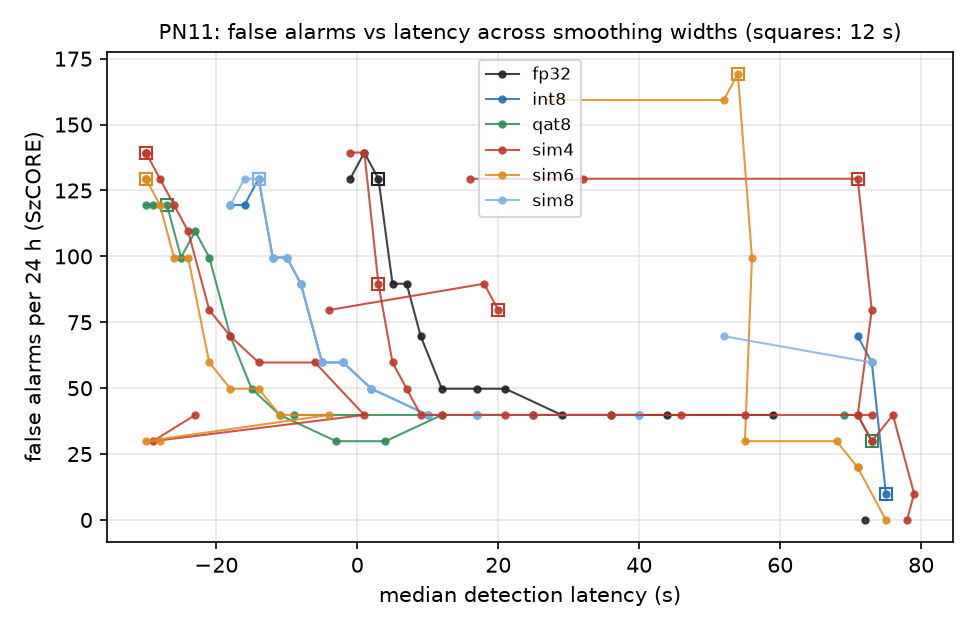

## PN12

Folds per seed: {0: 1, 1: 1, 2: 1, 3: 1, 4: 1}

- Early stopping fired in 5/5 jobs; ONNX FP32 export max |logit diff| 1.91e-06
- Seed 0: FP32 test specificity pooled over all held-out hours 0.8086 (OUTSIDE 0.995 +/- 0.005)
- Seed 1: FP32 test specificity pooled over all held-out hours 0.7881 (OUTSIDE 0.995 +/- 0.005)
- Seed 2: FP32 test specificity pooled over all held-out hours 0.8519 (OUTSIDE 0.995 +/- 0.005)
- Seed 3: FP32 test specificity pooled over all held-out hours 0.9411 (OUTSIDE 0.995 +/- 0.005)
- Seed 4: FP32 test specificity pooled over all held-out hours 0.9493 (OUTSIDE 0.995 +/- 0.005)
- Diagnostic: single folds outside the band 5/5 [(9, 0, 0.8086), (9, 1, 0.7881), (9, 2, 0.8519), (9, 3, 0.9411), (9, 4, 0.9493)]

### FP32 against EpiDeNet's reporting (4 s windows, pooled over folds)

| seed | FP/h raw | FP/h 3-window vote | window sens (vote) | spec (vote) | seizures detected |
|---|---|---|---|---|---|
| 0 | 84.44 | 81.32 | 0.789 | 0.8166 | 4/4 |
| 1 | 93.62 | 90.18 | 0.737 | 0.7967 | 4/4 |
| 2 | 65.42 | 58.37 | 0.684 | 0.8684 | 4/4 |
| 3 | 25.41 | 21.31 | 0.632 | 0.9519 | 4/4 |
| 4 | 22.79 | 18.36 | 0.632 | 0.9586 | 4/4 |

EpiDeNet (all CHB-MIT, LOOCV, 5 seeds): 4.29 raw, 2.24 with vote, 165/181 seizures.

### Two meanings of "FP/h" for the same FP32 model (pooled over folds)

| seed | window FP/h (3-window vote, 4 s grid) | SzCORE false alarms/h (12 s smoothing) | ratio |
|---|---|---|---|
| 0 | 81.32 | 7.05 | 11.5 |
| 1 | 90.18 | 8.03 | 11.2 |
| 2 | 58.37 | 8.36 | 7.0 |
| 3 | 21.31 | 4.26 | 5.0 |
| 4 | 18.36 | 3.61 | 5.1 |

Window FP/h is (1 - specificity) x windows per hour, so it depends on window length and hop, and one long artifact counts many times; SzCORE merges detections within 90 s into one alarm.

### Operating point (default smoothing, own threshold) and excess latency

| seed | model | FA/24h at 12 s | median latency at 12 s | detected | excess latency at FP32's FA (s) | smoothing there (s) | ΔFA/24h at FP32's latency |
|---|---|---|---|---|---|---|---|
| 0 | fp32 | 169.2 | -2.5 | 4/4 | 0.0 | 12.0 | 0.0 |
| 0 | int8 | 192.8 | inf | 2/4 | inf | n/a | n/a |
| 0 | sim8 | 43.3 | inf | 2/4 | 80.5 | 4.0 | n/a |
| 0 | sim6 | 0.0 | inf | 0/4 | inf | n/a | n/a |
| 0 | sim4 | 3.9 | inf | 2/4 | inf | n/a | n/a |
| 0 | qat8 | 236.1 | -8.5 | 4/4 | 1.3 | 93.3 | 4.9 |
| 1 | fp32 | 192.8 | 6.0 | 4/4 | 0.0 | 12.0 | 0.0 |
| 1 | int8 | 0.0 | inf | 0/4 | inf | n/a | n/a |
| 1 | sim8 | 98.4 | 53.0 | 3/4 | 27.0 | 4.0 | n/a |
| 1 | sim6 | 0.0 | inf | 0/4 | inf | n/a | n/a |
| 1 | sim4 | 0.0 | inf | 0/4 | inf | n/a | n/a |
| 1 | qat8 | 212.5 | 6.5 | 4/4 | 17.1 | 23.2 | -69.1 |
| 2 | fp32 | 200.7 | -5.5 | 4/4 | 0.0 | 12.0 | 0.0 |
| 2 | int8 | 0.0 | inf | 0/4 | inf | n/a | n/a |
| 2 | sim8 | 165.3 | 25.5 | 3/4 | -3.5 | 4.0 | -27.9 |
| 2 | sim6 | 0.0 | inf | 0/4 | inf | n/a | n/a |
| 2 | sim4 | 0.0 | inf | 0/4 | inf | n/a | n/a |
| 2 | qat8 | 240.0 | 6.0 | 4/4 | 29.5 | 36.0 | n/a |
| 3 | fp32 | 102.3 | 18.0 | 4/4 | 0.0 | 12.0 | 0.0 |
| 3 | int8 | 200.7 | inf | 1/4 | inf | n/a | n/a |
| 3 | sim8 | 153.5 | 9.5 | 4/4 | 43.4 | 48.0 | -38.9 |
| 3 | sim6 | 11.8 | inf | 2/4 | 74.5 | 4.0 | n/a |
| 3 | sim4 | 0.0 | inf | 0/4 | inf | n/a | n/a |
| 3 | qat8 | 204.6 | 17.5 | 4/4 | 30.0 | 82.5 | 95.4 |
| 4 | fp32 | 86.6 | 16.5 | 4/4 | 0.0 | 12.0 | 0.0 |
| 4 | int8 | 35.4 | inf | 0/4 | inf | n/a | n/a |
| 4 | sim8 | 27.5 | inf | 0/4 | inf | n/a | n/a |
| 4 | sim6 | 0.0 | inf | 0/4 | inf | n/a | n/a |
| 4 | sim4 | 0.0 | inf | 0/4 | inf | n/a | n/a |
| 4 | qat8 | 244.0 | 4.0 | 4/4 | 35.5 | 120.0 | 102.7 |

FP32 seed-to-seed excess latency (the null), all ordered seed pairs: ['20.0', '14.2', '16.5', '7.5', '-12.5', '-0.8', '8.0', '-1.0', '-1.0', '10.9', '19.5', '10.5', '14.5', '0.2', '14.5', '-6.9', '34.3', '30.9', '18.0', '3.1']
95% band: (-9.85357142857143, 32.68214285714285)

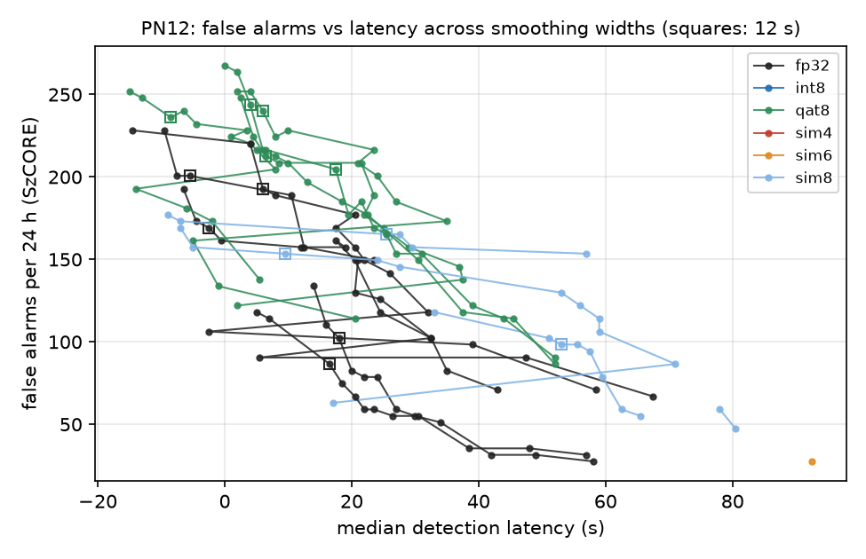

## PN13

Folds per seed: {0: 1, 1: 1, 2: 1, 3: 1, 4: 1}

- Early stopping fired in 5/5 jobs; ONNX FP32 export max |logit diff| 3.04e-06
- Seed 0: FP32 test specificity pooled over all held-out hours 0.7223 (OUTSIDE 0.995 +/- 0.005)
- Seed 1: FP32 test specificity pooled over all held-out hours 0.7511 (OUTSIDE 0.995 +/- 0.005)
- Seed 2: FP32 test specificity pooled over all held-out hours 0.9967 (within 0.995 +/- 0.005)
- Seed 3: FP32 test specificity pooled over all held-out hours 0.9930 (within 0.995 +/- 0.005)
- Seed 4: FP32 test specificity pooled over all held-out hours 0.9939 (within 0.995 +/- 0.005)
- Diagnostic: single folds outside the band 2/5 [(10, 0, 0.7223), (10, 1, 0.7511)]

### FP32 against EpiDeNet's reporting (4 s windows, pooled over folds)

| seed | FP/h raw | FP/h 3-window vote | window sens (vote) | spec (vote) | seizures detected |
|---|---|---|---|---|---|
| 0 | 123.83 | 123.49 | 0.758 | 0.7232 | 3/3 |
| 1 | 111.02 | 110.44 | 0.758 | 0.7524 | 3/3 |
| 2 | 1.50 | 0.69 | 0.485 | 0.9984 | 2/3 |
| 3 | 3.23 | 1.96 | 0.273 | 0.9956 | 2/3 |
| 4 | 2.54 | 2.42 | 0.455 | 0.9946 | 2/3 |

EpiDeNet (all CHB-MIT, LOOCV, 5 seeds): 4.29 raw, 2.24 with vote, 165/181 seizures.

### Two meanings of "FP/h" for the same FP32 model (pooled over folds)

| seed | window FP/h (3-window vote, 4 s grid) | SzCORE false alarms/h (12 s smoothing) | ratio |
|---|---|---|---|
| 0 | 123.49 | 3.81 | 32.4 |
| 1 | 110.44 | 3.58 | 30.9 |
| 2 | 0.69 | 0.23 | 3.0 |
| 3 | 1.96 | 0.81 | 2.4 |
| 4 | 2.42 | 0.58 | 4.2 |

Window FP/h is (1 - specificity) x windows per hour, so it depends on window length and hop, and one long artifact counts many times; SzCORE merges detections within 90 s into one alarm.

### Operating point (default smoothing, own threshold) and excess latency

| seed | model | FA/24h at 12 s | median latency at 12 s | detected | excess latency at FP32's FA (s) | smoothing there (s) | ΔFA/24h at FP32's latency |
|---|---|---|---|---|---|---|---|
| 0 | fp32 | 91.4 | 19.0 | 3/3 | 0.0 | 12.0 | 0.0 |
| 0 | int8 | 0.0 | inf | 0/3 | inf | n/a | n/a |
| 0 | sim8 | 110.8 | 16.0 | 2/3 | 4.5 | 27.0 | 5.5 |
| 0 | sim6 | 91.4 | inf | 1/3 | inf | n/a | n/a |
| 0 | sim4 | 30.5 | inf | 1/3 | inf | n/a | n/a |
| 0 | qat8 | 88.6 | 22.0 | 3/3 | -1.0 | 4.0 | 0.0 |
| 1 | fp32 | 85.9 | 18.0 | 3/3 | 0.0 | 12.0 | 0.0 |
| 1 | int8 | 8.3 | inf | 0/3 | inf | n/a | n/a |
| 1 | sim8 | 88.6 | inf | 1/3 | inf | n/a | n/a |
| 1 | sim6 | 91.4 | inf | 1/3 | inf | n/a | n/a |
| 1 | sim4 | 55.4 | inf | 1/3 | inf | n/a | n/a |
| 1 | qat8 | 66.5 | 33.0 | 3/3 | 11.0 | 4.0 | n/a |
| 2 | fp32 | 5.5 | 26.0 | 2/3 | 0.0 | 12.0 | 0.0 |
| 2 | int8 | 0.0 | inf | 0/3 | inf | n/a | n/a |
| 2 | sim8 | 13.8 | inf | 0/3 | inf | n/a | n/a |
| 2 | sim6 | 63.7 | inf | 1/3 | inf | n/a | n/a |
| 2 | sim4 | 27.7 | inf | 1/3 | inf | n/a | n/a |
| 2 | qat8 | 5.5 | 57.0 | 2/3 | 29.0 | 8.0 | n/a |
| 3 | fp32 | 19.4 | 28.0 | 2/3 | 0.0 | 12.0 | 0.0 |
| 3 | int8 | 13.8 | inf | 0/3 | inf | n/a | n/a |
| 3 | sim8 | 11.1 | inf | 0/3 | inf | n/a | n/a |
| 3 | sim6 | 24.9 | inf | 0/3 | inf | n/a | n/a |
| 3 | sim4 | 69.2 | inf | 1/3 | inf | n/a | n/a |
| 3 | qat8 | 19.4 | inf | 0/3 | inf | n/a | n/a |
| 4 | fp32 | 13.8 | 26.0 | 2/3 | 0.0 | 12.0 | 0.0 |
| 4 | int8 | 30.5 | 109.0 | 2/3 | inf | n/a | n/a |
| 4 | sim8 | 36.0 | 109.0 | 2/3 | inf | n/a | n/a |
| 4 | sim6 | 33.2 | 109.0 | 2/3 | inf | n/a | n/a |
| 4 | sim4 | 8.3 | inf | 1/3 | inf | n/a | n/a |
| 4 | qat8 | 11.1 | inf | 1/3 | inf | n/a | n/a |

FP32 seed-to-seed excess latency (the null), all ordered seed pairs: ['-4.0', '3.0', '5.0', '3.0', '3.0', '4.0', '6.0', '4.0', 'inf', 'inf', 'inf', '10.5', 'inf', 'inf', '-6.0', '-5.0', 'inf', 'inf', '-4.0', '4.0']
95% band: (-5.7, 9.149999999999997)

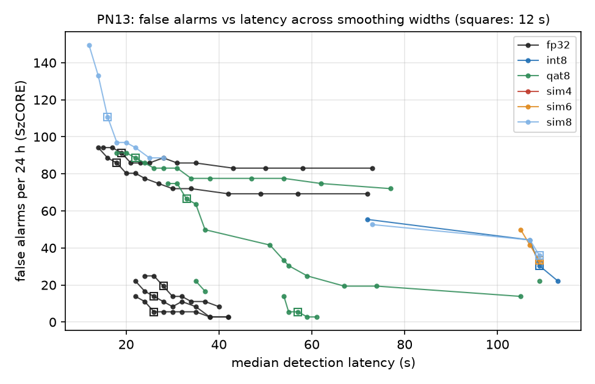

## PN14

Folds per seed: {0: 1, 1: 1, 2: 1, 3: 1, 4: 1}

- Early stopping fired in 5/5 jobs; ONNX FP32 export max |logit diff| 1.91e-06
- Seed 0: FP32 test specificity pooled over all held-out hours 0.9981 (within 0.995 +/- 0.005)
- Seed 1: FP32 test specificity pooled over all held-out hours 0.9962 (within 0.995 +/- 0.005)
- Seed 2: FP32 test specificity pooled over all held-out hours 0.9935 (within 0.995 +/- 0.005)
- Seed 3: FP32 test specificity pooled over all held-out hours 0.9901 (within 0.995 +/- 0.005)
- Seed 4: FP32 test specificity pooled over all held-out hours 0.9893 (OUTSIDE 0.995 +/- 0.005)
- Diagnostic: single folds outside the band 1/5 [(11, 4, 0.9893)]

### FP32 against EpiDeNet's reporting (4 s windows, pooled over folds)

| seed | FP/h raw | FP/h 3-window vote | window sens (vote) | spec (vote) | seizures detected |
|---|---|---|---|---|---|
| 0 | 0.98 | 0.44 | 0.150 | 0.9990 | 1/4 |
| 1 | 1.76 | 0.64 | 0.300 | 0.9986 | 1/4 |
| 2 | 2.83 | 1.66 | 0.300 | 0.9963 | 2/4 |
| 3 | 4.45 | 1.66 | 0.300 | 0.9963 | 1/4 |
| 4 | 4.74 | 1.81 | 0.300 | 0.9960 | 1/4 |

EpiDeNet (all CHB-MIT, LOOCV, 5 seeds): 4.29 raw, 2.24 with vote, 165/181 seizures.

### Two meanings of "FP/h" for the same FP32 model (pooled over folds)

| seed | window FP/h (3-window vote, 4 s grid) | SzCORE false alarms/h (12 s smoothing) | ratio |
|---|---|---|---|
| 0 | 0.44 | 0.15 | 3.0 |
| 1 | 0.64 | 0.39 | 1.6 |
| 2 | 1.66 | 0.59 | 2.8 |
| 3 | 1.66 | 1.08 | 1.5 |
| 4 | 1.81 | 1.17 | 1.5 |

Window FP/h is (1 - specificity) x windows per hour, so it depends on window length and hop, and one long artifact counts many times; SzCORE merges detections within 90 s into one alarm.

### Operating point (default smoothing, own threshold) and excess latency

| seed | model | FA/24h at 12 s | median latency at 12 s | detected | excess latency at FP32's FA (s) | smoothing there (s) | ΔFA/24h at FP32's latency |
|---|---|---|---|---|---|---|---|
| 0 | fp32 | 3.5 | inf | 1/4 | 0.0 | 12.0 | 0.0 |
| 0 | int8 | 51.6 | inf | 1/4 | n/a | n/a | n/a |
| 0 | sim8 | 3.5 | inf | 1/4 | n/a | n/a | n/a |
| 0 | sim6 | 3.5 | inf | 1/4 | n/a | n/a | n/a |
| 0 | sim4 | 4.7 | inf | 1/4 | n/a | n/a | n/a |
| 0 | qat8 | 46.9 | inf | 2/4 | n/a | n/a | n/a |
| 1 | fp32 | 9.4 | 38.5 | 3/4 | 0.0 | 12.0 | 0.0 |
| 1 | int8 | 0.0 | inf | 1/4 | inf | n/a | n/a |
| 1 | sim8 | 1.2 | inf | 1/4 | inf | n/a | n/a |
| 1 | sim6 | 3.5 | inf | 1/4 | inf | n/a | n/a |
| 1 | sim4 | 1.2 | inf | 1/4 | inf | n/a | n/a |
| 1 | qat8 | 5.9 | inf | 1/4 | inf | n/a | n/a |
| 2 | fp32 | 14.1 | 39.0 | 3/4 | 0.0 | 12.0 | 0.0 |
| 2 | int8 | 2.3 | inf | 2/4 | inf | n/a | n/a |
| 2 | sim8 | 3.5 | inf | 2/4 | inf | n/a | n/a |
| 2 | sim6 | 24.6 | inf | 2/4 | inf | n/a | n/a |
| 2 | sim4 | 2.3 | inf | 1/4 | inf | n/a | n/a |
| 2 | qat8 | 56.3 | inf | 2/4 | inf | n/a | n/a |
| 3 | fp32 | 25.8 | inf | 2/4 | 0.0 | 12.0 | 0.0 |
| 3 | int8 | 0.0 | inf | 1/4 | n/a | n/a | n/a |
| 3 | sim8 | 1.2 | inf | 1/4 | n/a | n/a | n/a |
| 3 | sim6 | 3.5 | inf | 2/4 | n/a | n/a | n/a |
| 3 | sim4 | 0.0 | inf | 1/4 | n/a | n/a | n/a |
| 3 | qat8 | 77.4 | inf | 2/4 | n/a | n/a | n/a |
| 4 | fp32 | 28.1 | 37.5 | 3/4 | 0.0 | 12.0 | 0.0 |
| 4 | int8 | 23.5 | inf | 2/4 | inf | n/a | n/a |
| 4 | sim8 | 27.0 | inf | 2/4 | inf | n/a | n/a |
| 4 | sim6 | 14.1 | inf | 1/4 | inf | n/a | n/a |
| 4 | sim4 | 4.7 | inf | 1/4 | inf | n/a | n/a |
| 4 | qat8 | 69.2 | 26.5 | 3/4 | inf | n/a | n/a |

FP32 seed-to-seed excess latency (the null), all ordered seed pairs: ['n/a', 'n/a', 'n/a', 'n/a', 'inf', 'inf', 'inf', 'inf', 'inf', '-2.5', 'inf', 'inf', 'n/a', 'n/a', 'n/a', 'n/a', 'inf', '-3.0', '-6.5', 'inf']
95% band: (-6.325000000000004, -2.525)

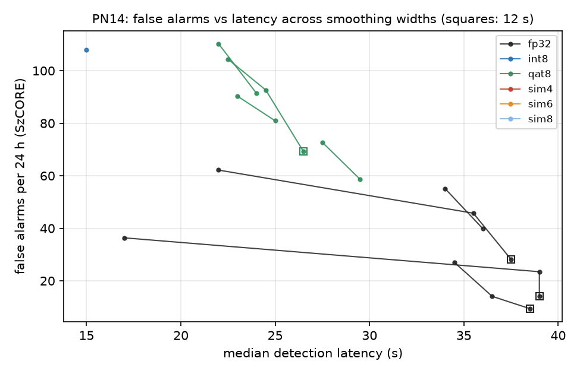

## PN16

Folds per seed: {0: 1, 1: 1, 2: 1, 3: 1, 4: 1}

- Early stopping fired in 5/5 jobs; ONNX FP32 export max |logit diff| 3.81e-06
- Seed 0: FP32 test specificity pooled over all held-out hours 0.9954 (within 0.995 +/- 0.005)
- Seed 1: FP32 test specificity pooled over all held-out hours 0.9879 (OUTSIDE 0.995 +/- 0.005)
- Seed 2: FP32 test specificity pooled over all held-out hours 0.9988 (within 0.995 +/- 0.005)
- Seed 3: FP32 test specificity pooled over all held-out hours 0.9921 (within 0.995 +/- 0.005)
- Seed 4: FP32 test specificity pooled over all held-out hours 0.9992 (within 0.995 +/- 0.005)
- Diagnostic: single folds outside the band 1/5 [(12, 1, 0.9879)]

### FP32 against EpiDeNet's reporting (4 s windows, pooled over folds)

| seed | FP/h raw | FP/h 3-window vote | window sens (vote) | spec (vote) | seizures detected |
|---|---|---|---|---|---|
| 0 | 2.25 | 0.61 | 0.357 | 0.9986 | 2/2 |
| 1 | 5.53 | 2.87 | 0.536 | 0.9935 | 2/2 |
| 2 | 0.61 | 0.41 | 0.393 | 0.9991 | 2/2 |
| 3 | 3.89 | 1.84 | 0.321 | 0.9958 | 2/2 |
| 4 | 0.41 | 0.00 | 0.286 | 1.0000 | 2/2 |

EpiDeNet (all CHB-MIT, LOOCV, 5 seeds): 4.29 raw, 2.24 with vote, 165/181 seizures.

### Two meanings of "FP/h" for the same FP32 model (pooled over folds)

| seed | window FP/h (3-window vote, 4 s grid) | SzCORE false alarms/h (12 s smoothing) | ratio |
|---|---|---|---|
| 0 | 0.61 | 0.61 | 1.0 |
| 1 | 2.87 | 1.84 | 1.6 |
| 2 | 0.41 | 0.20 | 2.0 |
| 3 | 1.84 | 0.82 | 2.2 |
| 4 | 0.00 | 0.41 | 0.0 |

Window FP/h is (1 - specificity) x windows per hour, so it depends on window length and hop, and one long artifact counts many times; SzCORE merges detections within 90 s into one alarm.

### Operating point (default smoothing, own threshold) and excess latency

| seed | model | FA/24h at 12 s | median latency at 12 s | detected | excess latency at FP32's FA (s) | smoothing there (s) | ΔFA/24h at FP32's latency |
|---|---|---|---|---|---|---|---|
| 0 | fp32 | 14.8 | 49.5 | 2/2 | 0.0 | 12.0 | 0.0 |
| 0 | int8 | 0.0 | inf | 0/2 | inf | n/a | n/a |
| 0 | sim8 | 14.8 | 87.0 | 2/2 | 37.5 | 12.0 | n/a |
| 0 | sim6 | 196.7 | 43.0 | 2/2 | inf | n/a | 78.7 |
| 0 | sim4 | 73.8 | inf | 0/2 | inf | n/a | n/a |
| 0 | qat8 | 4.9 | 50.5 | 2/2 | -3.0 | 4.0 | -7.4 |
| 1 | fp32 | 44.3 | 47.5 | 2/2 | 0.0 | 12.0 | 0.0 |
| 1 | int8 | 34.4 | 55.0 | 2/2 | 5.2 | 7.3 | n/a |
| 1 | sim8 | 29.5 | 55.0 | 2/2 | 6.0 | 9.0 | n/a |
| 1 | sim6 | 137.7 | 61.0 | 2/2 | 21.5 | 28.0 | n/a |
| 1 | sim4 | 39.3 | inf | 0/2 | inf | n/a | n/a |
| 1 | qat8 | 44.3 | 46.5 | 2/2 | -1.0 | 12.0 | -4.9 |
| 2 | fp32 | 4.9 | 49.0 | 2/2 | 0.0 | 12.0 | 0.0 |
| 2 | int8 | 54.1 | 53.0 | 2/2 | 15.0 | 30.0 | 98.4 |
| 2 | sim8 | 59.0 | 52.5 | 2/2 | 14.5 | 30.0 | 97.1 |
| 2 | sim6 | 221.3 | 47.0 | 2/2 | inf | n/a | 167.2 |
| 2 | sim4 | 54.1 | inf | 0/2 | inf | n/a | n/a |
| 2 | qat8 | 9.8 | 47.5 | 2/2 | 0.5 | 16.0 | 1.2 |
| 3 | fp32 | 19.7 | 53.5 | 2/2 | 0.0 | 12.0 | 0.0 |
| 3 | int8 | 0.0 | 75.0 | 2/2 | 17.5 | 4.0 | n/a |
| 3 | sim8 | 0.0 | 74.5 | 2/2 | 17.0 | 4.0 | n/a |
| 3 | sim6 | 167.2 | 64.5 | 2/2 | inf | n/a | n/a |
| 3 | sim4 | 59.0 | inf | 0/2 | inf | n/a | n/a |
| 3 | qat8 | 29.5 | 52.0 | 2/2 | 0.5 | 16.0 | 2.5 |
| 4 | fp32 | 9.8 | 50.5 | 2/2 | 0.0 | 12.0 | 0.0 |
| 4 | int8 | 4.9 | inf | 0/2 | inf | n/a | n/a |
| 4 | sim8 | 4.9 | inf | 0/2 | inf | n/a | n/a |
| 4 | sim6 | 98.4 | 57.5 | 2/2 | 57.5 | 90.0 | n/a |
| 4 | sim4 | 49.2 | inf | 1/2 | inf | n/a | n/a |
| 4 | qat8 | 9.8 | 50.5 | 2/2 | 0.0 | 12.0 | 0.0 |

FP32 seed-to-seed excess latency (the null), all ordered seed pairs: ['7.0', '-4.5', '15.0', '-3.0', '-2.0', '-2.5', '2.0', '-1.0', '4.5', '11.0', '21.0', '2.5', '-6.0', '0.0', '-8.5', '-7.0', '1.0', '7.8', '-5.5', '14.0']
95% band: (-7.7875, 18.14999999999999)

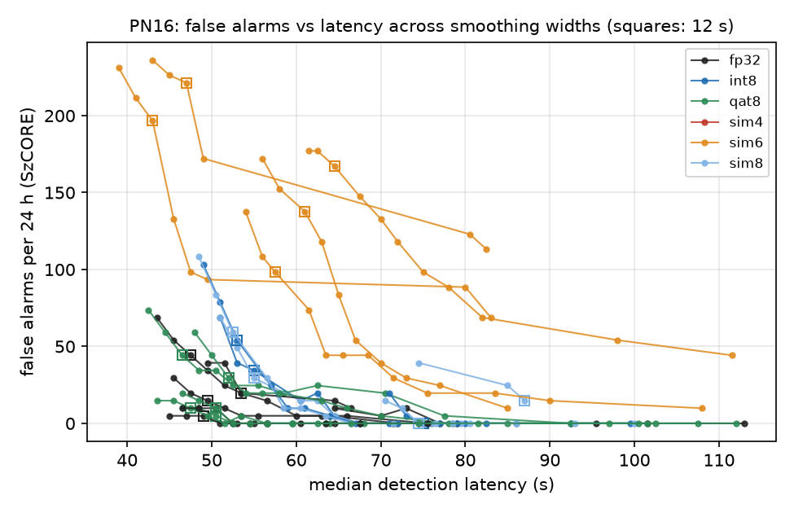

## PN17

Folds per seed: {0: 1, 1: 1, 2: 1, 3: 1, 4: 1}

- Early stopping fired in 5/5 jobs; ONNX FP32 export max |logit diff| 4.77e-06
- Seed 0: FP32 test specificity pooled over all held-out hours 0.9928 (within 0.995 +/- 0.005)
- Seed 1: FP32 test specificity pooled over all held-out hours 0.9979 (within 0.995 +/- 0.005)
- Seed 2: FP32 test specificity pooled over all held-out hours 0.9950 (within 0.995 +/- 0.005)
- Seed 3: FP32 test specificity pooled over all held-out hours 0.9970 (within 0.995 +/- 0.005)
- Seed 4: FP32 test specificity pooled over all held-out hours 0.9946 (within 0.995 +/- 0.005)
- Diagnostic: single folds outside the band 0/5

### FP32 against EpiDeNet's reporting (4 s windows, pooled over folds)

| seed | FP/h raw | FP/h 3-window vote | window sens (vote) | spec (vote) | seizures detected |
|---|---|---|---|---|---|
| 0 | 4.10 | 1.95 | 0.700 | 0.9956 | 2/2 |
| 1 | 1.17 | 0.78 | 0.650 | 0.9982 | 2/2 |
| 2 | 3.12 | 2.54 | 0.750 | 0.9943 | 2/2 |
| 3 | 1.37 | 0.98 | 0.550 | 0.9978 | 2/2 |
| 4 | 2.34 | 2.15 | 0.650 | 0.9952 | 2/2 |

EpiDeNet (all CHB-MIT, LOOCV, 5 seeds): 4.29 raw, 2.24 with vote, 165/181 seizures.

### Two meanings of "FP/h" for the same FP32 model (pooled over folds)

| seed | window FP/h (3-window vote, 4 s grid) | SzCORE false alarms/h (12 s smoothing) | ratio |
|---|---|---|---|
| 0 | 1.95 | 0.39 | 5.0 |
| 1 | 0.78 | 0.20 | 4.0 |
| 2 | 2.54 | 0.20 | 13.0 |
| 3 | 0.98 | 0.20 | 5.0 |
| 4 | 2.15 | 0.59 | 3.7 |

Window FP/h is (1 - specificity) x windows per hour, so it depends on window length and hop, and one long artifact counts many times; SzCORE merges detections within 90 s into one alarm.

### Operating point (default smoothing, own threshold) and excess latency

| seed | model | FA/24h at 12 s | median latency at 12 s | detected | excess latency at FP32's FA (s) | smoothing there (s) | ΔFA/24h at FP32's latency |
|---|---|---|---|---|---|---|---|
| 0 | fp32 | 9.4 | 22.0 | 2/2 | 0.0 | 12.0 | 0.0 |
| 0 | int8 | 0.0 | inf | 0/2 | inf | n/a | n/a |
| 0 | sim8 | 0.0 | 41.5 | 2/2 | 17.5 | 8.0 | n/a |
| 0 | sim6 | 14.0 | inf | 1/2 | inf | n/a | n/a |
| 0 | sim4 | 0.0 | inf | 1/2 | inf | n/a | n/a |
| 0 | qat8 | 0.0 | 25.5 | 2/2 | 1.5 | 8.0 | 3.5 |
| 1 | fp32 | 4.7 | 23.0 | 2/2 | 0.0 | 12.0 | 0.0 |
| 1 | int8 | 0.0 | inf | 0/2 | inf | n/a | n/a |
| 1 | sim8 | 9.4 | 43.0 | 2/2 | inf | n/a | n/a |
| 1 | sim6 | 14.0 | inf | 1/2 | inf | n/a | n/a |
| 1 | sim4 | 0.0 | inf | 1/2 | inf | n/a | n/a |
| 1 | qat8 | 0.0 | 26.0 | 2/2 | 0.0 | 6.0 | 0.0 |
| 2 | fp32 | 4.7 | 22.5 | 2/2 | 0.0 | 12.0 | 0.0 |
| 2 | int8 | 0.0 | 53.0 | 2/2 | 13.0 | 4.0 | n/a |
| 2 | sim8 | 0.0 | 53.0 | 2/2 | 12.5 | 4.0 | n/a |
| 2 | sim6 | 9.4 | inf | 1/2 | inf | n/a | n/a |
| 2 | sim4 | 0.0 | inf | 1/2 | inf | n/a | n/a |
| 2 | qat8 | 0.0 | 26.5 | 2/2 | 0.5 | 4.0 | n/a |
| 3 | fp32 | 4.7 | 23.5 | 2/2 | 0.0 | 12.0 | 0.0 |
| 3 | int8 | 0.0 | inf | 0/2 | inf | n/a | n/a |
| 3 | sim8 | 9.4 | 26.5 | 2/2 | 20.0 | 16.0 | 11.7 |
| 3 | sim6 | 0.0 | inf | 1/2 | inf | n/a | n/a |
| 3 | sim4 | 0.0 | inf | 1/2 | inf | n/a | n/a |
| 3 | qat8 | 4.7 | 24.0 | 2/2 | -1.5 | 8.0 | 0.0 |
| 4 | fp32 | 14.0 | 22.0 | 2/2 | 0.0 | 12.0 | 0.0 |
| 4 | int8 | 14.0 | 43.5 | 2/2 | 21.5 | 12.0 | n/a |
| 4 | sim8 | 9.4 | 41.0 | 2/2 | 8.5 | 6.0 | 4.7 |
| 4 | sim6 | 9.4 | inf | 1/2 | inf | n/a | n/a |
| 4 | sim4 | 0.0 | inf | 1/2 | inf | n/a | n/a |
| 4 | qat8 | 0.0 | 25.0 | 2/2 | -1.0 | 4.0 | -14.0 |

FP32 seed-to-seed excess latency (the null), all ordered seed pairs: ['-3.0', '-2.0', '-2.5', '4.0', '5.0', '-2.5', '-1.5', '8.0', '5.5', '-3.5', '-1.0', '8.5', '4.5', '-4.5', '-3.0', '7.5', '-0.5', '-3.0', '-2.5', '-2.5']
95% band: (-4.025, 8.2625)

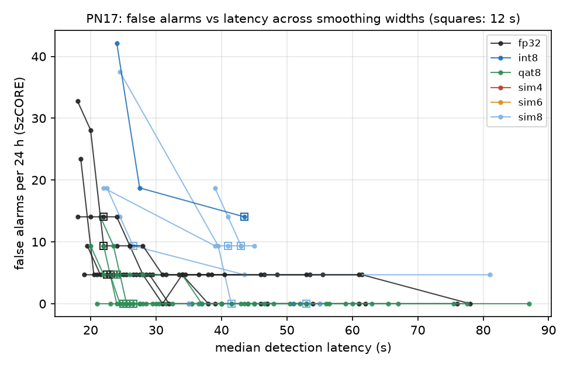

## Pooled across patients (pre-registered: median over seeds per patient, then over patients)

- FP32 seed-pair null: n = 280 ordered pairs, 95% band (-25.79, 44.0)
- int8: pooled excess latency inf s over 14 patient(s) [outside the null band, at/above the 2 s floor]; patient-seed values 70, censored 28, undefined 26
- sim8: pooled excess latency 17.50 s over 14 patient(s) [inside the null band, at/above the 2 s floor]; patient-seed values 70, censored 18, undefined 26
- sim6: pooled excess latency inf s over 14 patient(s) [outside the null band, at/above the 2 s floor]; patient-seed values 70, censored 32, undefined 26
- sim4: pooled excess latency inf s over 14 patient(s) [outside the null band, at/above the 2 s floor]; patient-seed values 70, censored 34, undefined 26
- qat8: pooled excess latency 3.00 s over 14 patient(s) [inside the null band, at/above the 2 s floor]; patient-seed values 70, censored 11, undefined 26

**Stage 0 kill rule** (stop if INT8, sim6 and sim4 are each inside the band or below 2 s): CONTINUE
